# Odysseus

NASA Space Apps 2026, Port Louis. Challenge: **Planet X and SPHEREx**.

A public web tool: enter coordinates or a name, watch real SPHEREx frames of that patch play as a series, click any object to see its spectrum, then explore it as a 3D body you can rotate and listen to.

Read the [technical paper on how the engine works](https://drive.google.com/file/d/17-vdnUqvNrglVh3bVlsuxJ6PKWRMTTpe/view?usp=drive_link).

## See it

Recorded from the app running on real cached SPHEREx data (20 Nov 2026). The clips have no sound.

### Discovery: find what no catalogue explains

<table>
  <tr>
    <td>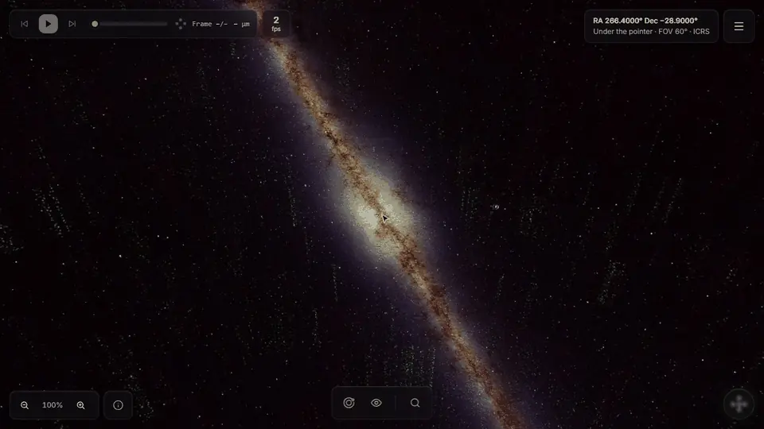</td>
  </tr>
  <tr>
    <td><b>Start a scan.</b> Click the eye, pick a patch of sky, and it is scanned square by square. Green circles are known objects, amber ones unexplained. <i>This clip uses test data, not a real scan.</i></td>
  </tr>
  <tr>
    <td>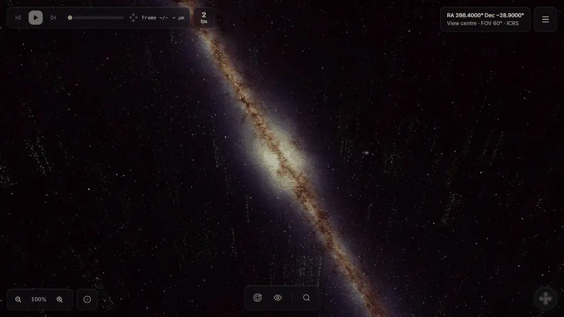</td>
  </tr>
  <tr>
    <td><b>Replay a real scan.</b> Our 14 Nov scan of 4 squares, replayed in seconds. Open a square and pick an unexplained track to see its spectrum.</td>
  </tr>
  <tr>
    <td></td>
  </tr>
  <tr>
    <td><b>One square, one unknown.</b> Square 1 with all its plot points. T23 is unexplained; its graph compares each measurement with the Sun's colour.</td>
  </tr>
</table>

### Barnard's Star: from the sky to 3D

<table>
  <tr>
    <td colspan="2">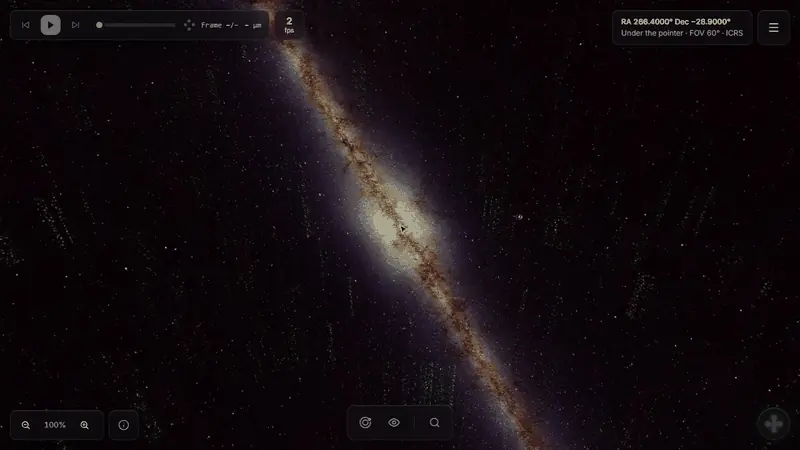</td>
  </tr>
  <tr>
    <td colspan="2"><b>Search, play, build.</b> Find Barnard's Star, play its SPHEREx frames, build it in 3D, explore the surface, then switch from true colour to ultraviolet.</td>
  </tr>
  <tr>
    <td colspan="2">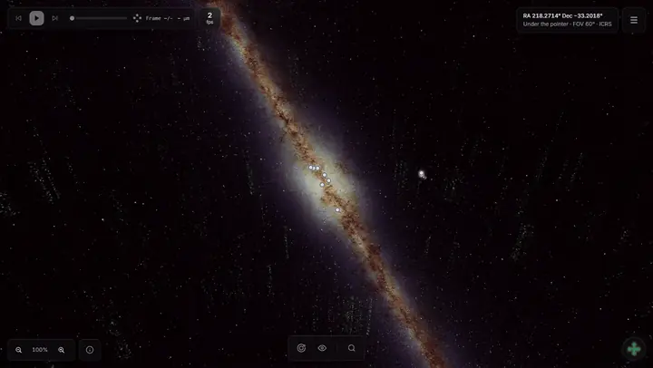</td>
  </tr>
  <tr>
    <td colspan="2"><b>Search the sky.</b> Type a name and the sky flies there. The flipbook plays the real SPHEREx frames of that patch.</td>
  </tr>
  <tr>
    <td width="57%">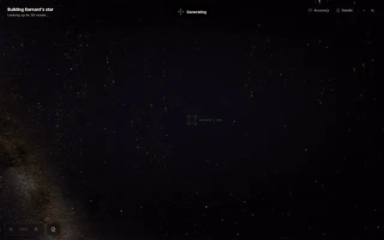</td>
    <td width="43%">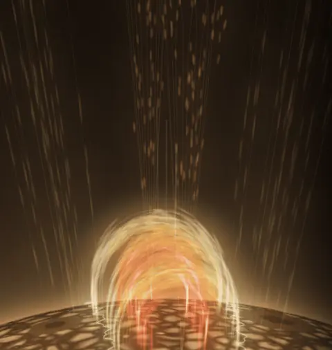</td>
  </tr>
  <tr>
    <td><b>Build it.</b> Mould, surface, spots, colour.</td>
    <td><b>Explore a star.</b> A flare at the edge of Barnard's Star.</td>
  </tr>
</table>

### More of the app

<table>
  <tr>
    <td colspan="2">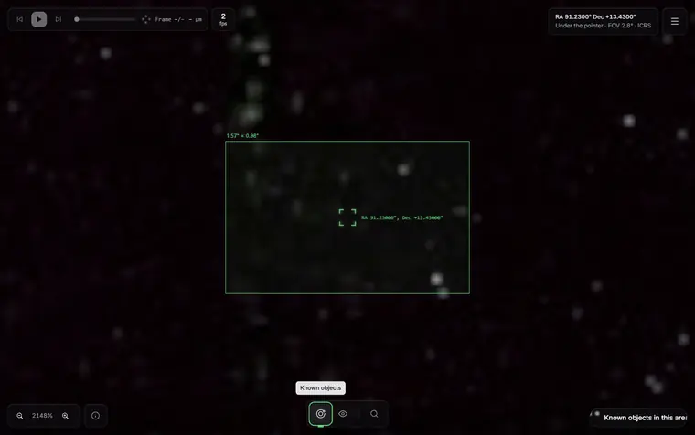</td>
  </tr>
  <tr>
    <td colspan="2"><b>Track a moving asteroid.</b> 433 Eros across SPHEREx frames, its spectrum built hop by hop. <i>The app tags this view as demo data.</i></td>
  </tr>
  <tr>
    <td width="36%">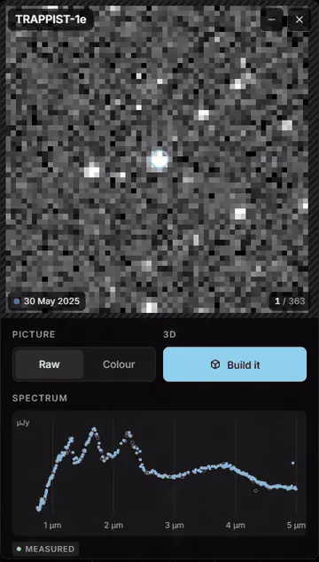</td>
    <td width="64%">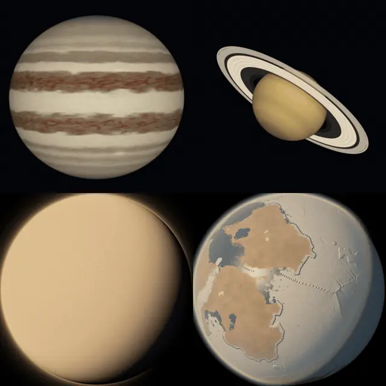</td>
  </tr>
  <tr>
    <td><b>Flipbook and spectrum.</b> Each frame is a different wavelength; the spectrum is measured from them.</td>
    <td><b>Turn it in your hand.</b> Jupiter, Saturn, K2-18 b and Kepler-186 f.</td>
  </tr>
  <tr>
    <td width="50%">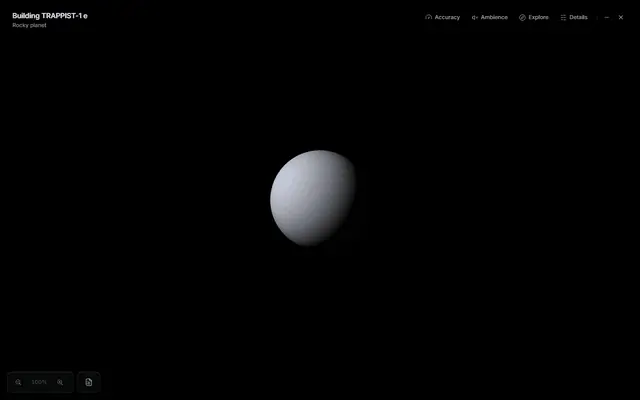</td>
    <td width="50%">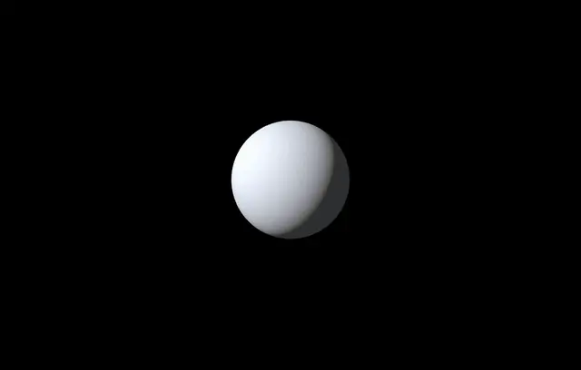</td>
  </tr>
  <tr>
    <td><b>Build a planet.</b> TRAPPIST-1 e from molten globe to continents.</td>
    <td><b>A real shape.</b> 433 Eros built from its shape model.</td>
  </tr>
</table>

### Fly over it

<table>
  <tr>
    <td width="33%">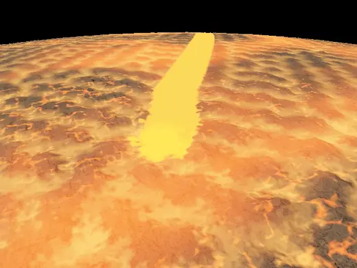</td>
    <td width="33%">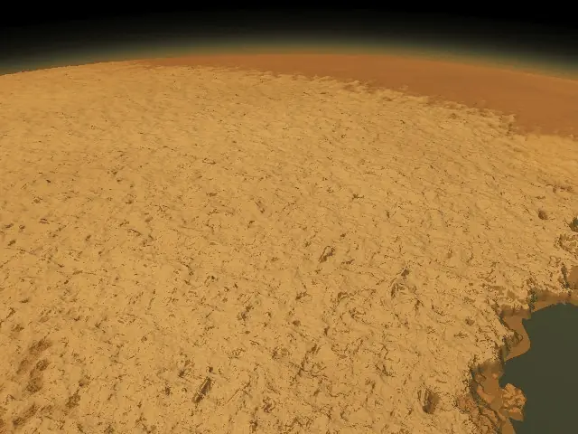</td>
    <td width="33%">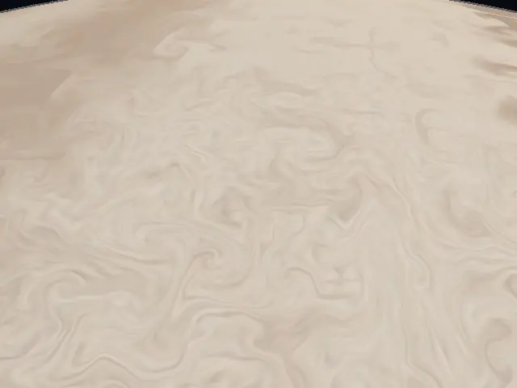</td>
  </tr>
  <tr>
    <td><b>A rocky world.</b> 55 Cancri e, cracked crust and rivers of lava.</td>
    <td><b>A water world.</b> TRAPPIST-1 f, out over its sea.</td>
    <td><b>A gas giant.</b> Jupiter's cloud tops, zone and belt.</td>
  </tr>
</table>

Planet and star surfaces are artist's impressions, and the app labels them so. Spectra, frames and tracks are measured from SPHEREx data unless the caption says otherwise.

## Repo map

| Path | What |
|---|---|
| [docs/](docs/) | Specs, decision log and UML diagrams. Start with [docs/README.md](docs/README.md). |
| [mockup/spherex-ui.html](mockup/spherex-ui.html) | Single-file UI mock-up. Open it in a browser. |
| [backend/](backend/README.md) | Python 3.12 FastAPI: name resolver, SPHEREx frames and cutouts, read-through cache (see its README). |
| [frontend/](frontend/) | Web app, 3D viewer and sound. |
| [shared/](shared/) | JSON schemas for the ObjectCard and RenderParams. |

## Install and run (step by step)

You need a computer with internet, a desktop browser (Chrome or Edge recommended) and about 2 GB of free disk space. Nothing here needs coding knowledge: you copy each command into a terminal and press Enter.

**What is a terminal?** Windows: press the Windows key, type `PowerShell`, press Enter. Mac: press Cmd+Space, type `Terminal`, press Enter.

### Step 1. Install the three tools (one time only)

| Tool | Get it from | Check it worked |
|---|---|---|
| **Git** | https://git-scm.com/downloads | `git --version` |
| **Node.js 24 or later** (pick "LTS" or "Current") | https://nodejs.org | `node --version` shows `v24` or higher |
| **uv** (installs Python for you) | Windows: `winget install astral-sh.uv`. Mac/Linux: `curl -LsSf https://astral.sh/uv/install.sh \| sh` | `uv --version` |

After installing, **close the terminal and open a new one** so it finds the new tools. You do not need to install Python yourself; uv does it.

### Step 2. Download the project (one time only)

```bash
git clone https://github.com/0ffrian/SphereX.git
cd SphereX
```

### Step 3. Install the project's parts (one time only)

```bash
npm run setup
npm run backend:setup
```

Each takes a few minutes. Warnings in yellow are normal. Red `error` lines are not; see Troubleshooting.

### Step 4. Start the app

The app has two halves, so you open **two terminals**, both inside the `SphereX` folder.

**Terminal 1: the data server**

```bash
npm run backend:dev
```

Wait until it says `Application startup complete`. Leave this window open.

**Terminal 2: the website**

```bash
npm run dev
```

Leave this window open too.

### Step 5. Open it

Go to **http://localhost:5173** in your browser. Type an object name (for example `Barnard's Star`) or coordinates, and press Enter. The first time you look up an object it can take a minute, because the real SPHEREx images are downloaded from NASA. They are saved, so the second time is fast.

To stop the app, click each terminal and press `Ctrl+C`.

### Next time

Skip steps 1 to 3. Just do steps 4 and 5. To get newer code, run `git pull`, then `npm run setup` and `npm run backend:setup` again.

### Just want to look around, with no data server?

Run `npm --prefix frontend run dev:fixtures` (one terminal, no Step 4 Terminal 1). It shows made-up sample data, so use it only to see the interface.

### Troubleshooting

| Problem | Fix |
|---|---|
| `command not found` / `not recognized` | Close the terminal, open a new one, and try again. If it persists, reinstall that tool from Step 1. |
| `node --version` is lower than 24 | Install the newer Node.js from https://nodejs.org. |
| Page is blank or says it cannot reach the server | Terminal 1 (`backend:dev`) must be running. Check it for red errors, then reload the page. |
| "Address already in use" | Another copy is running. Close the old terminals, or restart the computer. |
| 3D view is black or very slow | Use the latest Chrome or Edge, and turn on hardware acceleration in the browser settings. |
| Object takes ages to load | The NASA archive can be slow. Wait, or try again later. |

### Other commands (for developers)

```bash
npm run check              # frontend: typecheck + lint + unit tests + build
npm run backend:check      # backend: ruff + mypy + pytest (offline, recorded fixtures)
npm run backend:prefetch   # fill the cache for the test targets while the internet is good
npm run dev:phone          # HTTPS (self-signed) for phones on the same Wi-Fi, so WebGPU is available
```

`SX_OFFLINE=1` makes the backend never touch the network (the demo runs this way); set it before `npm run backend:dev`. The cache lives outside the repo; details in [backend/README.md](backend/README.md). Other root scripts (`build`, `preview`, `test`, `test:e2e`, `lint`, `typecheck`, `format`) forward to `frontend/`.

## Status

Under active development for NASA Space Apps 2026.
