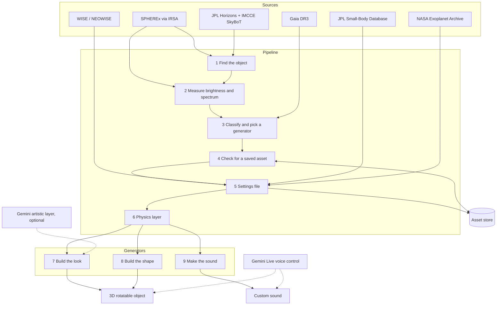

# Architecture Spec: Shift & Spectrum

NASA Space Apps 2026, Port Louis (14 to 15 Nov 2026). Challenge: **Planet X and SPHEREx**.
Status of this document: draft v1, written 4 Nov 2026. It records the direction agreed with Atish and the findings from the tests run so far.

Every claim below carries one of three labels:

| Label | Meaning |
|---|---|
| **Tested** | We called the service or ran the code and it worked. |
| **Documented** | Only an official page says so. We have not run it. |
| **To build / Not confirmed** | A plan, or something we could not check. |

---

## 1. What we are building

A public web tool. A user enters RA/Dec or a name and sees real SPHEREx images of that patch as a short video-like series (the base requirement). On top of that, every moving or interesting object also tells you what it is made of: its spectrum, its class, and a 3D model and sound generated from that data.

### 1.1 Priority tiers

The base tool must exist before any extra. If time runs short, cut from the bottom.

| Tier | Feature | Why |
|---|---|---|
| **P0** | Flipbook: coordinates or name in, SPHEREx frames out, played as a series. Must work on Barnard's Star, Epsilon Indi B, WISE 0855, RW Aurigae, R Draconis. | Required by the challenge. |
| **P0** | Spectrum on the fly for a clicked object (flux per frame against wavelength, with error bars and flags). | The twist, and an optional challenge item. |
| **P1** | Gaia and WISE overlays, URL coordinates, contamination flags, field of view, add and subtract images. | Optional items in the challenge. |
| **P1** | Classify the object, then Sky Sculptor (3D body from a settings file). | Headline wow. |
| **P2** | Physics layer, all body types, sliders. | Depth. |
| **P2** | Sound (data sweep, imagined drive), Gemini Live voice control. | Access and wow. |
| **P3** | Gemini artistic layer, fluid solver for gas giant storms, AI image-to-3D. | Stretch only. |

---

## 2. System overview



The same diagram, with arrows, is in the **Architecture** tab of the artifact: https://claude.ai/artifact/1iGLXbLSDez8ZMsbuGsSdv

### 2.1 Design principles

1. **Code first.** Every body is built by code from a small settings file. Generative AI is optional and never required.
2. **Settings, not generated code.** Data produces a settings file. A fixed set of tested generators turns it into a body. No model writes code at runtime.
3. **Honest labels.** Every number is tagged Measured, Estimated or Default. Every picture is labelled an artist's impression.
4. **Repeatable.** The same settings file and seed always give the same body.
5. **Never blank.** The code version loads first. Optional layers swap in only if they succeed.
6. **Runs on a modest laptop.** Target hardware is an Intel Iris Xe (Zenbook 14X). Heavy jobs run offline.

---

## 3. Data sources

Only the attributes listed are fetched. All checks below were run on 4 Nov 2026 unless noted.

### 3.1 SPHEREx (IRSA)

| Item | Detail |
|---|---|
| Status | **Tested** (slow and sometimes fails) |
| Product | Level-2 FITS, about 72 MB per frame, 2040 x 2040 px, 6.15 arcsec per pixel, about 114 s exposure |
| Extensions used | `IMAGE` (MJy/sr), `FLAGS`, `VARIANCE`, `WCS-WAVE` |
| Skipped | `PSF` (101 x 101 x 121, about 5 MB), `ZODI` unless background subtraction needs it |
| Detectors | 6, covering 0.75 to 5.0 micron. One frame covers a range of wavelengths across its field. |
| Revisit | Bands for one spot are captured within about 0.8 days. |
| Search | Simple Image Access: `https://irsa.ipac.caltech.edu/SIA?COLLECTION=spherex_qr2&POS=circle+RA+DEC+RADIUS&MAXREC=N` |
| Cutouts | Work through the same service. Use small cutouts, never whole frames. |
| Storage path | `s3://nasa-irsa-spherex/qr2/level2/<week>/<obs>/<detector>/` |
| Data releases | QR2 (DOI 10.26131/IRSA652), QR3 (DOI 10.26131/IRSA662, began Sept 2026) |
| Known problems | A time filter or a large cone timed out with 504 errors. A tiny cone worked. **Cache every result ahead of time.** |
| Not checked | Whether frames exist for 3I/ATLAS on its exact dates. |

### 3.2 Gaia DR3

| Item | Detail |
|---|---|
| Status | **Tested**, 24 s per query |
| Table | `gaiadr3.sso_reflectance_spectrum` through the TAP service |
| Columns | wavelength, reflectance, reflectance error, flag |
| Coverage | Visible light, 60,518 asteroids |
| Use | Visible colour and class of known asteroids. SPHEREx starts at 0.75 micron, so it cannot give visible colour. |

### 3.3 WISE / NEOWISE

| Item | Detail |
|---|---|
| Status | **Not confirmed** (IRSA TAP timed out twice) |
| Use | Diameter and albedo. Take these through the JPL Small-Body Database for now. |

### 3.4 JPL Horizons

| Item | Detail |
|---|---|
| Status | **Tested**, 3I/ATLAS returned in 1.4 s |
| Designation | 3I/ATLAS is `C/2025 N1` |
| Use | Position over time for any moving object. |

### 3.5 IMCCE SkyBoT

| Item | Detail |
|---|---|
| Status | **Tested** |
| Endpoint | `ssp.imcce.fr/webservices/skybot/api/conesearch.php` |
| Gotcha | The epoch `-ep` must be a Julian day or `now`. A normal date returned an empty 204 answer. |
| Use | All known objects in a field, with magnitude and motion. |

### 3.6 JPL Small-Body Database

| Item | Detail |
|---|---|
| Status | **Tested** |
| Endpoint | `sbdb.api?sstr=<name>&phys-par=1` |
| Attributes | `diameter`, `albedo`, `rot_per`, `spec_B`, `spec_T`, `GM` |
| Note | Each value names its source. For Eros the size came from NEAR, not NEOWISE. |

### 3.7 DAMIT

| Item | Detail |
|---|---|
| Status | **Tested** |
| File | `damit.cuni.cz/.../AsteroidModel/<id>/shape.obj` |
| Example | One model: 89 KB, 1,022 vertices, 2,040 faces |
| Limit | Shapes are convex, so they miss dips and hollows. Look up the model number from the browse page. |

### 3.8 NASA Exoplanet Archive

| Item | Detail |
|---|---|
| Status | **Not confirmed** (never called) |
| Planned columns | planet radius, planet mass, equilibrium temperature, orbit distance, star temperature, star radius |
| Use | Settings for rocky, water and gas planets. |
| Action | Test the table service before relying on it. |

### 3.9 Not used for the base path

| Item | Status | Role |
|---|---|---|
| Gemini image models | **Documented** (lists `gemini-nano-banana-2.1` and four others, up to 14 reference images, no mesh output) | Optional artistic layer. Confirm the model name before coding. |
| Gemini Live API | **Documented** (WebSocket, 16 kHz audio in, 24 kHz out, function calling, short-lived tokens for browsers, no session limit stated) | Voice control. |
| Sound-effect services | **Not confirmed** | Optional. Procedural sound is the default. |
| TRELLIS, Hunyuan3D, TripoSR | **Not confirmed** | Stretch goal. |

---

## 4. Pipeline

Each stage has one job, takes defined inputs and returns defined outputs. Stages 1 to 6 produce a settings file. Stages 7 to 9 turn it into outputs.

### 4.1 Stage 1: Find the object

- **Input:** a name or RA/Dec.
- **Process:**
  1. Resolve names (SIMBAD or SBDB, to be decided) to RA/Dec.
  2. For moving objects, get position at each frame time from Horizons, and neighbours from SkyBoT.
  3. Convert sky position to pixel position in each frame using the frame's WCS.
- **Output:** list of `(frame_id, x, y, time)`.
- **Status:** To build.

### 4.2 Stage 2: Measure brightness and spectrum

- **Input:** pixel positions and frame cutouts.
- **Process:**
  1. Sum flux in a small aperture, subtract local background.
  2. Drop pixels with bad flags.
  3. Use the variance layer for error bars.
  4. Look up each frame's wavelength at the object's pixel from the wavelength map.
- **Output:** a spectrum `[(wavelength_um, flux, error)]` and a light curve `[(time, flux)]`.
- **Status:** To build.

### 4.3 Stage 3: Classify and pick a generator

- **Input:** spectrum, Gaia colours (if known), catalogue match.
- **Process:** match against reference types: asteroid classes, brown dwarf types, comet gas features (water 2.7 micron, CO2 4.25, CO 4.67). Decide the body kind.
- **Output:** `kind` and `generator` (see 6), plus a class label with a confidence.
- **Status:** To build.

### 4.4 Stage 4: Check for a saved asset

```text
asset = store.get(object_id)
if asset exists            -> status = "saved"      -> load it
else if kind is known      -> status = "generated"  -> build settings from catalogues + spectrum
else                       -> status = "sketch"     -> build settings from SPHEREx only
save the new file to the store
```

This is the lookup flow shown in the Surface Lab "Lookup" card.

### 4.5 Stage 5: Settings file

The settings file is the only thing the generators read. See section 5 for the schema.

### 4.6 Stage 6: Physics layer

Pure functions that turn settings into derived values (section 7). Derived values are recomputed on every slider change and never stored as truth.

### 4.7 Stages 7 to 9: Generators

| Stage | Output | Detail |
|---|---|---|
| 7 Build the look | colour, relief, clouds, storms | Shader generators (section 6). Optional Gemini layer on top. |
| 8 Build the shape | geometry | DAMIT mesh for known asteroids. Otherwise a generated shape. |
| 9 Make the sound | audio | Data sweep (spectrum to pitch) and imagined drive. |

---

## 5. Asset (settings file) schema

### 5.1 Fields

| Field | Type | Meaning |
|---|---|---|
| `schema` | int | Schema version. Start at 1. |
| `id` | string | Stable id, for example `sbdb:101955` or `exo:trappist-1e`. |
| `name` | string | Display name. |
| `kind` | enum | `asteroid`, `comet`, `rocky`, `water`, `gas`, `dwarf`, `nebula`, `nova`. |
| `generator` | string | Generator name and version, for example `terra-planet@1`. |
| `status` | enum | `saved`, `generated`, `sketch`. |
| `seed` | int | Makes the look repeatable. |
| `settings` | map | One entry per setting (below). |
| `overrides` | map | Edits made by the user with the sliders. Kept separate so Reset can restore the data values. |
| `artistic` | object or null | Optional Gemini layer record. |
| `created` | ISO date | When the file was made. |

Each entry in `settings`:

| Field | Meaning |
|---|---|
| `value` | The number. |
| `unit` | Unit string. |
| `source` | `measured`, `estimated` or `default`. |
| `ref` | Where it came from, for example `sbdb.diameter` or `rule:elongation-from-lightcurve`. |
| `err` | Optional uncertainty. |

### 5.2 Example

```json
{
  "schema": 1,
  "id": "exo:example-gas-giant",
  "name": "Jupiter-like",
  "kind": "gas",
  "generator": "banded-giant@1",
  "status": "generated",
  "seed": 7,
  "settings": {
    "temp":   { "value": 130,  "unit": "K",  "source": "measured",  "ref": "exo.pl_eqt" },
    "radius": { "value": 1.0,  "unit": "RJ", "source": "measured",  "ref": "exo.pl_radj" },
    "spin":   { "value": 10.0, "unit": "h",  "source": "estimated", "ref": "rule:default-giant-spin" },
    "bands":  { "value": 12,   "unit": "",   "source": "default",   "ref": "artist" },
    "storms": { "value": 2,    "unit": "",   "source": "default",   "ref": "artist" }
  },
  "overrides": {},
  "artistic": null,
  "created": "2026-11-04"
}
```

### 5.3 Source badges

| Badge | Rule |
|---|---|
| **Measured** | Read straight from a dataset. Carries `ref`. |
| **Estimated** | Worked out from data by a stated rule. May be off. Carries the rule name. |
| **Default** | An artist's choice, because the data cannot show it (for example relief, crater density, storm count). |

SPHEREx gives only spectrum, brightness, position and time. Most settings will therefore be Estimated or Default for a new object. This is expected and is shown in the interface.

### 5.4 Asset store

| Layer | Where | Purpose |
|---|---|---|
| Pre-baked | JSON files in the repo, `assets/<kind>/<id>.json` | Demo objects. Always available offline. |
| Generated | Browser IndexedDB | Files created during a session. |
| Optional backend | Small service | Shared saves. Not needed for the demo. |

---

## 6. Generators

All generators run in the browser with Three.js. Built and tested in the Surface Lab tab of the artifact. See `shots` there for what each looks like.

| Kind | Generator | Technique | Main settings |
|---|---|---|---|
| asteroid | `rock-body` | Sphere pushed by 3D noise and big craters, stretched to an ellipsoid. Rock tile of layered noise and power-law craters, fitted by triplanar mapping. Lommel-Seeliger reflectance. | albedo, redness, elongation, spin, lumpiness, crater count, relief |
| rocky, water | `terra-planet` | Fractal terrain on the sphere with a sea level, polar ice, lava cracks, cloud shell, atmosphere glow. | temperature, radius, ocean coverage, atmosphere, cloud cover, relief, continent size, land colour |
| gas | `banded-giant` | Latitude bands warped by noise, counter-flowing jets, seeded storms, haze, optional rings. | temperature, radius, flattening, bands, turbulence, storms, haze, rings |
| dwarf | `banded-dwarf` | Same shader, self-lit with limb darkening, colour from temperature. | temperature, flattening, self-glow, bands, turbulence, storms, haze |
| nebula | `gas-cloud` | Point cloud sampled from filamentary 3D noise. Additive glow layer plus dark dust layer plus stars. | size, hydrogen, oxygen, dust, filaments, clumpiness, stars, brightness |
| nova | `shell-remnant` | Point shell with filaments, hot inner gas, core glow, expansion by age. | age, hydrogen, oxygen, hot gas, lopsidedness, shell thickness, filaments, core glow |

### 6.1 Why triplanar mapping

A flat image wrapped on a stretched shape pinches at the poles and smears along the long axis. Triplanar mapping reads the texture from three axes using the 3D position, so grain keeps the same size everywhere. The Surface Lab test grid shows both modes side by side.

### 6.2 Optional Gemini artistic layer

| Step | Behaviour |
|---|---|
| Trigger | User switches on "Ask Gemini for an artistic version". |
| Request | Server-side call (the API key must never be in the browser). Ask for a seamless, top-down close-up of the surface, with no horizon and no lighting. |
| Timeout | If no answer in a set time, keep the code version and show "Failed, using code". |
| On success | Use the image as a colour tile, fitted by triplanar mapping. Relief stays procedural, or comes from a depth model run offline. |
| Label | Always "AI-made". |

Gemini only produces images. It cannot produce a mesh or a relief map.

### 6.3 Offline jobs (not on the demo laptop)

| Job | Where | Note |
|---|---|---|
| Depth Anything V2 Small (Apache-2.0) to turn an AI tile into a height map | Any laptop, or Colab | Small model. |
| Marigold (albedo, roughness, metallic from one image) | A GPU with about 8 GB, or a free Colab T4 | Trained on indoor scenes, so quality on rock is unknown. Optional experiment. |
| Image-to-3D (TRELLIS, TripoSR) | Colab | Stretch goal. Results saved as GLB files. |

---

## 7. Physics layer

This is **reduced, physically inspired physics**, not simulation. Each rule is a short formula or table, shown next to its slider so reviewers can check it. Rules marked "built" already exist in the Surface Lab.

### 7.1 Planets

| Quantity | Rule | Status |
|---|---|---|
| Equilibrium temperature | `Teq = T_star * sqrt(R_star / (2a)) * (1 - A)^(1/4)` | To build |
| Bulk density | `rho = 5.51 * M / R^3` g/cm3 with M, R in Earth units | To build |
| Surface gravity | `g = G M / R^2` | To build |
| Escape speed | `v_esc = sqrt(2 G M / R)` | To build |
| Atmosphere kept | Keep if `v_esc` is well above the gas thermal speed `sqrt(2 k T / m)` (rule of thumb: about 6 times) | To build |
| Ice, ocean, steam | Cold below about 330 K gets polar ice, growing as temperature falls. Oceans are removed above about 450 K. Lava glow starts near 700 K. | Built (as simple thresholds) |
| Ocean share to sea level | Sea level from the inverse normal curve of the terrain height distribution | Built |

### 7.2 Gas giants (storms that respond)

| Quantity | Rule | Status |
|---|---|---|
| Spin to band count | Rhines scale `L = pi * sqrt(U / beta)`, `beta = 2 Omega / R`. Number of bands about `sqrt(2 Omega R / U)`. For Jupiter (`Omega = 1.76e-4 /s`, `R = 7e7 m`, `U = 50 m/s`) this gives about 22. Order of magnitude only. | To build |
| Flattening | `f = 0.7 * q`, `q = Omega^2 R^3 / (G M)`. Rule of thumb calibrated on Jupiter and Saturn. | To build (slider exists, not linked) |
| Colour family | Chosen by temperature: pale cyan (about 60 K), blue (100), cream (130), gold (200), cobalt (600), dark (1,100), glowing (1,800). | Built |
| Storm placement | Place storms where wind shear between neighbouring jets is anticyclonic, so spots sit between counter-flowing jets. | To build |
| Storm drift | A storm moves at the zonal wind speed of its latitude. | Built in a basic form (bands shear) |
| Storm size | About the Rossby deformation radius `L_d = N H / f`. Larger storms live longer. | To build |
| Storm count | Rises with internal heat and temperature. | To build |

**Stretch: real fluid solver.** A 2D barotropic vorticity solver on a latitude-longitude grid, with the equation `d(zeta)/dt + J(psi, zeta + f) = nu * del2(zeta) + forcing`. Storms then form, merge, shear and die on their own. Needs a GPU pass. A 256 x 128 grid should be possible on an Iris Xe, but this is **untested**. Build it only after the rules layer works.

### 7.3 Brown dwarfs

| Quantity | Rule | Status |
|---|---|---|
| Spectral type | From temperature, roughly L above about 1,400 K, T from about 1,400 K to 500 K, Y below about 500 K. Approximate. | To build |
| Radius | About 1 Jupiter radius, almost independent of mass (degeneracy pressure) | To build |
| Absorption features | Water near 1.4, 1.9 and 2.7 micron, methane near 1.6, 2.2 and 3.3 micron. These fall inside SPHEREx's range. | Used in Brown Dwarf Match |
| Colour | Orange-brown when hotter, darker and more purple when cooler. Cold ones glow mostly in infrared, so visible colour is a guess. | Built |

### 7.4 Asteroids

| Quantity | Rule | Status |
|---|---|---|
| Elongation from brightness swing | `delta_m = 2.5 * log10(a / b)` (side-on, a lower limit) | Used as the estimate for elongation |
| Spin limit | Rubble piles cannot spin faster than `P = sqrt(3 pi / (G rho))`. For `rho = 2000 kg/m3` this is about 2.3 hours. | To build |
| Crater density | More craters on older surfaces. Sizes follow a power law. | Built (crater count slider) |
| Reflectance | Lommel-Seeliger law for dark airless rock | Built |

### 7.5 Supernova remnants

| Quantity | Rule | Status |
|---|---|---|
| Radius | Sedov-Taylor: `R = 1.15 * (E t^2 / rho)^(1/5)`. Typical form: `R ~ 12.4 pc * (E51 / n)^(1/5) * (t / 10^4 yr)^(2/5)`. | Built (age to the power 0.4 only) |
| Phases | Free expansion, Sedov, then radiative. Look and colour differ. | To build |
| Colour | Hydrogen red, oxygen teal, hot gas blue. | Built, estimated |

---

## 8. Sound and voice

| Part | Detail | Status |
|---|---|---|
| Data sweep | Spectrum to pitch with a triangle oscillator. Bell chimes at gas wavelengths. Stereo sweep. Web Audio in the browser. | Built in the Listen tab. Syntax checked, never heard by the author. |
| Imagined drive | Procedural noise, gravel and thuds shaped by gravity, roughness and surface type from the settings file. Always labelled "Imagined". | Built, unheard |
| AI sound clips | Optional. Services advertise 0.5 to 22 second clips. | Not confirmed |
| Voice control | Gemini Live over WebSocket. Gemini calls the same controls the sliders use, and describes the screen. Use ephemeral tokens in the browser. Keep a recorded backup for the demo. | Documented |

---

## 9. Frontend and platform

| Area | Choice | Note |
|---|---|---|
| UI | React, TypeScript, Tailwind, animate-ui components | animate-ui is the agreed UI library. |
| 3D | Three.js (r128 used in the mock-up), optionally through react-three-fiber | Keep generators as plain modules so they work with or without React. |
| State | One store holding the current asset, overrides and the edited sliders | Small library such as Zustand. |
| Data access | A thin backend proxy for IRSA, Gaia, Horizons, SBDB and the Exoplanet Archive | Browser access (CORS) was **not tested**. A proxy also gives caching and keeps API keys off the client. Python with Astropy fits the challenge's Astropy hint. |
| Caching | Pre-fetch and store results for all five test targets and the demo objects | IRSA times out, so a live demo must not depend on it. |
| Hash routing | Share a link with coordinates or an asset id in the URL | Optional challenge item. |
| Fallbacks | Procedural look, procedural sound, recorded voice demo | Every optional service has one. |

### 9.1 Performance budget (Intel Iris Xe)

| Item | Budget |
|---|---|
| Frame rate | At least 30 fps while turning a body |
| Canvas | Cap pixel ratio at 1.5 |
| Mesh | At most about 50,000 triangles |
| Points | At most about 60,000 |
| Textures | At most 2048 px, one tile per body |
| Shader | Few texture reads per pixel, 5 or 6 noise octaves |
| Measured so far | Not measured on the real laptop. Tested only in headless Chromium with software rendering. |

---

## 10. Honesty policy (user-facing)

- Show Measured, Estimated and Default next to every setting.
- Label every rendering an artist's impression. Label imagined sounds "Imagined" and AI images "AI-made".
- New objects are labelled "Sketch from SPHEREx only".
- Real spacecraft photos are used only to compare against our output, never as textures.
- State limits in plain words, for example: SPHEREx cannot resolve an asteroid, so shape detail is not in the data.

### 10.1 Blind test (optional demo)

Pick an object with real spacecraft images (for example Bennu). Give the pipeline only the data a normal object would have. Show our result, then the real photo, with a scorecard:

| Compare | Expectation |
|---|---|
| Size, rough elongation | Should match |
| Colour class and brightness | Should match for known asteroids |
| Craters, ridges, boulders | Will not match |
| Concave or unusual shapes | Will not match |

---

## 11. Testing

| Layer | Method |
|---|---|
| Physics functions | Unit tests with known values (Jupiter band count, Sedov radius, spin limit) |
| Schema | Validate every asset file with a JSON schema |
| Generators | Same asset and seed must give the same image. Keep reference screenshots and compare |
| UI | Playwright with headless Chromium. Already used for the mock-up, checks console errors and clicks |
| Data adapters | Recorded responses so tests do not hit IRSA |
| Hardware | Run the real app on the Zenbook and record frame rate |

---

## 12. Plan to 14 Nov

About 10 days. Dates are targets, not promises.

| Dates | Work |
|---|---|
| 5 to 6 Nov | Data adapters and cache. Find the object, measure flux, build the flipbook for the five test targets (P0). |
| 7 to 8 Nov | Spectrum on the fly. Classify. Asset lookup and settings file. |
| 9 to 10 Nov | Port generators from the mock-up into the app. Physics layer v1 (planets and gas giants first). |
| 11 Nov | Optional overlays (Gaia, WISE, contamination flags). Sound and voice. |
| 12 Nov | Gemini artistic layer behind a server proxy, if time. Pre-bake demo assets. |
| 13 Nov | Test on the Zenbook. Fix performance. Record backup demo. |
| 14 to 15 Nov | Event. |

---

## 13. Risks and open questions

| Risk or question | Why it matters | Plan |
|---|---|---|
| SPHEREx search is slow and fails | The base tool depends on it | Cache all test targets. Ship pre-fetched cutouts. |
| Frames on 3I/ATLAS dates unchecked | The headline comet may have no data | Check early. Keep a known asteroid as fallback. |
| NEOWISE access unconfirmed | Diameter and albedo | Use JPL values. |
| Exoplanet Archive untested | Planet settings | Test first. |
| CORS to science services unknown | Browser may be blocked | Use a backend proxy. |
| Gemini model name may change | Code would break | Read it from config. Confirm before coding. |
| Gemini key exposure | Key theft | Server-side call only. |
| Gemini Live session limit unknown | Voice may drop | Keep a recording. |
| Sound output never heard by the author | May not play | Test on a real machine early. |
| Time | 10 days | Follow the priority tiers. Cut supernova and gas cloud first. |
| Iris Xe speed | Demo may stutter | Measure early. Lower point and triangle counts if needed. |
| Overclaiming | Scientists may reject unsupported claims | Keep badges and labels. Show formulas. |

---

## 14. Glossary

| Term | Meaning |
|---|---|
| RA / Dec | Sky coordinates, like longitude and latitude on the sky. |
| FITS | The standard astronomy file format. |
| WCS | World Coordinate System, maps pixels to sky positions. |
| Flux | How much light arrives. |
| SIA / TAP | Standard web services for image search and table queries. |
| DAMIT | Database of asteroid shape models built from brightness changes. |
| Triplanar mapping | Texture lookup from three axes, so it does not stretch. |
| Rhines scale | Size at which a flow turns into zonal jets on a spinning planet. |
| Sedov-Taylor | A blast wave law for the early life of a supernova remnant. |
| Asset | The small settings file that fully describes one body. |
