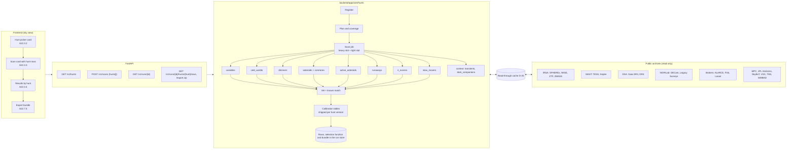
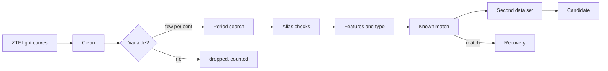

# Discovery hunts: a research tool for one patch of sky

> **Part of:** Architecture spec ([index](README.md)) · **Sections:** A22 to A22.16 (proposed numbers; see "Status" below) · **Builds on:** Area search and Discovery ([A16](moving-objects/area-search.md), [A17](moving-objects/area-backend.md), [A17.6 to A17.13](moving-objects/area-contract.md), [A18](moving-objects/area-ui.md)), scans and runs ([Q-470](../decisions/moving-objects.md), Q-471, Q-472, Q-473, Q-483), the gap analysis ([Q-478](../decisions/moving-objects.md)), the scan honesty rules ([Q-479](../decisions/moving-objects.md)) · **Rules it follows:** provenance tags and badges ([A5.2](data-contract.md#a52-provenance-tags-and-badges), D-02, D-21), the cache ([D-25](../decisions/data-sources.md)), the generated contract ([D-18](../decisions/contract.md)), the design language ([design-language.md](../design-language.md), D-38) · **Mock-up:** [`mockup/discovery-hunts.html`](../../mockup/discovery-hunts.html)

**Status: proposal, revised 20 Nov 2026, not built.** First written on 17 Nov 2026. Revised on 18, 19 and 20 Nov 2026 after Atish's reviews on PR #182 (the 20 Nov revision is Atish's third review, applied as corrections) (three comments: findings per hunt, credit routes checked one by one, sizes, calibration, twelve citations to correct). Moon took twelve decisions on the first review (R-1 to R-12) answered the rest on the re-review (R-13 to R-28, and the PD rows), and improved them from the literature (R-29 to R-49, with R-50 a process note; all in [A22.15](#a2215-decisions)) and changed the tool's purpose: **it is a scientific tool meant for research**, not an outreach tool. Three things are still needed before any code:

1. **Moon approves the revised mock-up** (UI needs an approved mock-up before it is built).
2. **The decisions in [A22.15](#a2215-decisions) get their `D-` and `Q-` rows** in `docs/decisions/`. This PR holds two files only (this spec and the mock-up), so the decision index, the section map in [README.md](README.md), the routing table in `docs/README.md` and the UML are **not** updated here. Run `/sx-spec-sync` after approval. Until then "A22" is a proposed number and nothing else in the docs links here.
3. **Every item marked [verify]** is checked against the real service or paper ([A22.14](#a2214-open-items-and-items-to-verify)), and the outside contacts of R-12 are made.

Labels follow the architecture spec: **Tested** (we ran it), **Documented** (a primary source says so), **To build**, **Proposed** (a choice waiting for a decision), **Decided (R-n)** (Moon, 18 Nov 2026), **[verify]** (seen only in a search result, a preprint or a secondary source, or not checked at all). *(estimate)* marks a reviewer's own arithmetic.

The mock-up is visual input, never a spec (D-01). Every number on its result cards is an example, not a measurement.

---

## A22 Discovery hunts

Today Discovery does one thing: in a patch of sky it looks for dots that move between SPHEREx visits and checks them against known asteroids. This spec turns Discovery into a set of **hunts**: self-contained, versioned searches and measurements that share one core. The user picks a patch as today, then chooses which hunts to run. Each hunt uses the survey that was built to see its kind of object, runs on the user's own computer, and returns **a table**: every candidate and every recovered known object, with its measurements, its provenance, the checks it passed, the completeness and purity of the hunt version that produced it, and the selection function of the search. The cards in the sky view are for exploring that table; the table is the product.

In one sentence: pick a patch of sky, choose the searches and measurements to run, and get back a reproducible, citable table with the evidence behind every row and an honest measure of what the search could and could not have found.

The journey keeps the shape it has now:

1. **Discovery** in the dock, then **pick a patch** (as built, Q-472).
2. **Choose what to run** (new card).
3. **Scanning** (the scan card as built, with one progress row per hunt).
4. **Results by hunt** (the results card as built, with a tab per hunt) and the **export**.

### A22.1 Why and who

| Item | Detail | Label |
|---|---|---|
| Purpose | **A scientific tool meant for research.** Its output must be usable in a paper or a research note without redoing the work: standard formats, provenance per value, measured completeness and purity, a documented selection function, and enough recorded detail to reproduce the run. | Decided (Moon, 18 Nov 2026) |
| Users | Researchers, including students and amateurs doing research: anyone who will cite the result. The tool assumes the user reads a methods section, not that they need to be persuaded. | Decided (Moon, 18 Nov 2026); supersedes the outreach framing of 16 Nov |
| What it does not try to be | A competitor to the survey pipelines (Rubin, ZTF, the TESS pipelines, the alert brokers) at their own job. Where a pipeline already searches the same data with better tools, the hunt is either cut or turned into context (H6, H7, H10). | Decided (R-7, R-8) |
| Where it adds something | (1) **Characterisation with SPHEREx**: a 0.75 to 5 µm spectrum of known or already-detected objects, which no other public survey offers. (2) **Searches in the gaps** the pipelines leave: the coldest brown dwarfs, single transits, faint and long-period variables, tails in archive images, slow movers in long stares. (3) **One reproducible pipeline over several archives**, with a measured selection function, for samples a researcher wants to define themselves. | Proposed |
| SPHEREx's role | **Characterisation, not discovery** (R-1). The SPHEREx team writes that *"SPHEREx is not designed to discover objects"* and that the project *"only actively track[s] and report[s] spectrophotometry [of] solar system objects with cataloged orbits"* ([Lisse, Bauer & Kim 2024](https://arxiv.org/abs/2402.08705)). Discovery comes from surveys built for it (TESS, ZTF, WISE, Gaia, DECam). SPHEREx contributes to H4 (spectra and precovery of known rocks), H2 (typing L to mid-T dwarfs) and H9 (spectra of excess candidates); it plays no part in the other hunts. | Decided (R-1) |
| The honest starting point | The first real moving-rocks run recovered **0 of 38** known asteroids in its area, and Q-478 (b) records a real asteroid (8925 Boattini) missed by the pair test. The run is not yet recorded in `docs/` (Atish's review, item 10): it needs a run id and a `Q-` entry. Issue #143 was closed on 14 Nov 2026, but its fixes are not in `backend/app/core/area/join.py`, which still checks only the part of the velocity perpendicular to `w`; HN-5 needs a new or reopened issue. No hunt may show candidates before it passes its gate ([A22.10](#a2210-calibration-and-proof)). | Tested (14 Nov 2026); record missing |
| Niches kept from 16 Nov | (1) SPHEREx spectra of known asteroids (composition). (2) Precovery of named objects in archived frames. (3) Cold-world candidates typed with SPHEREx (L to mid-T only, see H2). | Decided (Moon, 16 Nov 2026), kept |

**What this is not.** It does not announce discoveries. It does not submit anything on the user's behalf. It does not replace Track, Build or the single-area cards; those stay as built.

### A22.2 Scope

**The hunts after the review** (R-2, R-7, R-8). The `id` is the proposed `HuntId` in the contract ([A22.7](#a227-contract)); the short key is the one the mock-up's markup uses. Numbers H1 to H10 are kept from the first draft so the review's references still work.

| # | Hunt (title on the card) | `id` | Mock-up key | Kind | Main data | Release |
|---|---|---|---|---|---|---|
| H1 | Variable and eclipsing stars | `variables` | `var` | Search | ZTF DR24 light curves (HATS), Gaia DR3 | 1 |
| H2 | Cold nearby worlds | `cold_worlds` | `cold` | Search, then characterisation | CatWISE2020, unWISE and unTimely; SPHEREx typing (L to mid-T) | 1 |
| H4 | Known rocks: spectra and precovery | `asteroids` | `rocks` | Characterisation (blind search gated, see H4) | SPHEREx spectral images, Horizons | 1 |
| H8 | Runaway stars | `runaways` | `run` | Search | Gaia DR3 (DR4 later) | 1 |
| H9 | Infrared excess: SPHEREx spectra of candidates | `ir_excess` | `irx` | Characterisation | WISE, 2MASS, Gaia, SPHEREx | 1 |
| H3 | Single transits and strange dimmers | `dimmers` | `dim` | Search | TESS light curves (capped sample) | 2 |
| H5 | Active asteroids | `active_asteroids` | `active` | Search (graded by the user) | DECam and ZTF archive images | 2 |
| H11 | Slow movers in TESS stares (new) | `slow_movers` | `slow` | Search; usually an upper limit | TESS full-frame images, shift-and-stack | 2 |
| H4b | Faint asteroids in the DECam archive (new stage of H4) | `asteroids` (stage) | `rocks` | Search | NOIRLab Source Catalog, DECam archive | 2 |
| H7 | Alerts in this patch | `transients` | `change` | **Context layer** (no candidates) | ZTF and Rubin alerts via brokers; TNS | 1 |
| H10 | Gaia DR4 dark companions | `dark_companions` | `bh` | **Context layer**: cross-match with DPAC's table, plus our refit as a check | Gaia DR4 `bh_two_body_orbit`, `nss_two_body_orbit` | after 2 Dec 2026 |
| ~~H6~~ | ~~Gravitational lenses~~ | | | **Removed** (R-7) | | |

**Why each change** (from Atish's review, checked against the sources cited there):

- **H6 removed.** Euclid DR1 (12 Nov 2026) shipped **15,072** high-confidence lens candidates ([ESA](https://www.esa.int/media/about-us/directorates/science/euclid/euclid-reveals-the-largest-ever-catalogue-of-strong-cosmic-lenses), [Space Warps](https://blog.spacewarps.org/2026/11/12/space-warps-esa-euclid-15000-strong-lenses-found-in-data-release-1/)); Legacy Surveys has about 3,900 more ([arXiv:2508.20087](https://arxiv.org/abs/2508.20087)). Space Warps does not take outside candidates. A later cross-match layer may flag published lenses in a patch; it is not in this spec.
- **H7 becomes context.** The surveys report transients within hours; TNS asks that Galactic nova candidates **not** be submitted there ([TNS](https://www.wis-tns.org/content/tns-getting-started)) but to the [CBAT TOCP](http://www.cbat.eps.harvard.edu/unconf/tocp_help.html); and a report built from another survey's alerts names that survey's data as the discovery source. H7 shows what the alerts and TNS hold in the patch, as context for the other hunts.
- **H9 becomes characterisation.** A WISE excess alone is more likely false than real (at most 7.9% are good disk candidates, [Silverberg et al. 2018](https://arxiv.org/abs/1809.09663)) and Disk Detective 2.0 reports no discoveries yet. What is new is SPHEREx's 0.75 to 5 µm spectrum of excess candidates, with the 3.3 µm feature as a test for background galaxies. That is a measurement, not a search.
- **H10 becomes a cross-match.** Gaia DR4 (2 Dec 2026) ships DPAC's own `bh_two_body_orbit` table. Our refit from epoch astrometry checks it; it does not compete with it.
- **H11 added.** TESS stares at each sector for about 27 days, so stacking along trial paths reaches slow, faint, distant movers. TESS stacking traced 3I/ATLAS 55 days before its discovery ([arXiv:2508.02499](https://arxiv.org/abs/2508.02499)). This is the challenge's "Planet X" done properly; the usual result is an upper limit.
- **H4 re-scoped.** "Known rocks" first: predict, measure, gate, spectra, precovery. Blind tracks are "possible" until the lead criteria of R-3 can be met ([A22.9.4](#a2294-h4-known-rocks-spectra-and-precovery)). H4b adds the DECam archive in release 2.
- **IASC dropped** (R-2). Atish proposed Pan-STARRS image sets through the International Astronomical Search Collaboration. It is a student programme with image sets handed to registered teams, not open research data.
- **Rubin images not used.** Alerts are public worldwide, but images and data releases are proprietary for two years to anyone without data rights ([RTN-011](https://rtn-011.lsst.io/RTN-011.pdf)) **[verify Mauritius's status]**.

**Left out on purpose:** Hubble and JWST archive searches for asteroid trails (small fields make finds rare per patch, and Asteroid Hunters on Zooniverse already covers Hubble); galaxy distances for cosmology (needs whole-sky statistics); direct imaging of planets; our own difference imaging for transients; ice along sightlines (a later view, not a hunt); microlensing and primordial black holes (surveys catch the events, and no single event proves a primordial black hole); interstellar visitors as a search (precovery of named ones is in H4).

**Releases.**

| Release | Content |
|---|---|
| 0 | Approval of the revised mock-up; the decision rows of A22.15; the outside contacts of R-12. |
| 1 | The shared core with export bundles, then H4 known rocks with its gate, H8, H2, H1 (with its sample definition), H9 characterisation; H7 as context. ([A22.12](#a2212-plan-tickets-and-owners)) |
| 2 | H3 with a capped sample, H5 graded by the user, H11 TESS slow movers, H4b DECam archive linking, blind H4 candidates once the linker and error model pass. |
| After 2 Dec 2026 | H10 cross-match on Gaia DR4. |
| Later | Watch saved objects; sharing finished squares between PCs. |

### A22.3 Journey and UI

The mock-up shows every screen: [`mockup/discovery-hunts.html`](../../mockup/discovery-hunts.html) (open the file in a browser; it is one self-contained page, [A22.16](#a2216-the-mock-up-file)). It was built from screenshots of the real app (the sky, the grid, the dock and the scan card are real) with the new cards drawn on top in the app's own CSS. Structure and wording come from the mock-up; the look follows `docs/design-language.md` (D-38). Where the mock-up and this section differ, this section wins.

**What stays exactly as built:** the dock and the Discovery button; picking a patch with the screen-shaped rectangle (Q-472 (1)); the grid and square numbering (Q-470, Q-472 (2)); square states and colours; the scanning rings (Q-483 (1)); pause, resume and stop (Q-470 (7)); the Runs list and replay (Q-473, Q-483 (2)); the ← back rule (Q-483 (3)); Measured only (D-21); the status-dot message style (no tinted alert boxes); minimise to the island.

#### A22.3.1 Step 1: pick a patch (as built)

No change. The label reads, for example, "12.0° × 7.2° · 35 squares". **Proposed:** it drops the time estimate once hunts exist, since the time depends on the hunts chosen next (PD-6).

#### A22.3.2 Step 2: choose what to run (new card)

Replaces the single-purpose offer card of state 3 for a Discovery scan. Known objects keeps its own offer card.

- **Card:** the standard glass panel, tall variant. Header "Discovery", subtitle "Scan · 12.0° × 7.2°", minimise and close as on every card.
- **Question:** "What should we run on these 35 squares?"
- **Groups by readiness** (R-8), each with a small heading. The group a hunt sits in comes from the register (`level`, [A22.10.1](#a22101-levels-a-hunt-version-can-be-at)), never from the frontend:
  1. **"Validated"**: hunt versions that passed their gate and ship completeness and purity tables. They return candidates.
  2. **"Characterisation"**: measurements of objects found elsewhere (H4 known rocks, H9, H2's typing stage).
  3. **"Experimental"**: hunts that run and return recoveries of known objects only, until their gate passes. Their row says so: "Returns known objects only until it is validated."
  4. **"Context"**: layers that show what other surveys already hold in the patch (H7, H10). No candidates, no export of their own beyond the table they show.
- **One row per hunt,** a checkbox row with four parts:
  1. title (bold) and, right-aligned, the time estimate ("about 2 h") or a short state ("not here", "after 2 Dec");
  2. one line saying what it measures, in plain words;
  3. one muted line naming the data releases and the hunt version ("ZTF DR24, Gaia DR3 · v1.0");
  4. where coverage is partial or the sample is limited, that third line becomes a status-dot line with the reason ("High latitude only: in the plane the sample is limited to r < 18") or ("ZTF covers 71% of the patch; the southern part is outside its reach", from the hunt's coverage MOC).
- **Disabled rows** are greyed, cannot be ticked, and always say why ("Opens with Gaia DR4, 2 December 2026"). The reason comes from the plan reply (`hunts[].reason`), never from the frontend.
- **Facts under the list:** Squares ("35 (7 × 5) of up to 2°"), Time ("about 26 h: 23 h of image work, then the rest"; see the rule below), Download ("about 40 GB"), Data (the distinct releases of the ticked hunts).
- **Buttons:** primary "Run 6 hunts" (the count of ticked hunts; "Run 1 hunt"; disabled with "Choose a hunt" when none is ticked) and "Select again".
- **Default ticks:** the Validated and Characterisation groups. Experimental and Context rows start unticked.
- **Time rule (R-9).** The estimate is the heavy lane's **total** (its hunts run one after another), plus the light lane's work that does not overlap it, plus a contention factor for shared archives (IRSA serves H1, H2, H4 and H9). It is computed by the backend from per-unit costs measured on a reference PC ([A22.11](#a2211-running-on-a-home-gaming-pc)). It is **never** the largest single hunt. Ticking updates Time, Download and the button from the plan already fetched, with no new request.
- **Size before start (R-6).** Each catalogue and light-curve hunt answers its expected row count and download size from a **count query** to the archive (for example `SELECT COUNT(*)` with the hunt's cuts) made when the plan is asked for. This is the one network call the plan adds to Q-470 (8), and it is cached. **Offline (R-17, amends Q-470 (8)):** under `SX_OFFLINE=1` the plan uses a cached count when one exists; otherwise the row reads "Size not known offline" and the hunt can run only if its inputs are already cached. **Budget (R-26):** above a per-hunt download budget (default 50 GB, a setting), the row requires a stated limit (for example a magnitude limit) before Run is enabled; the plan never lets a run start that would not fit. When a hunt's sample must be limited, the limit is a **stated selection criterion** (a magnitude limit, a contamination limit), shown on the row and written into the selection function of the result. There is never a silent row cap.
- **Keyboard and screen readers:** each row is one labelled checkbox; the group headings are real headings; a disabled row's reason is part of its accessible description; the estimate is read after the title.

#### A22.3.3 Step 3: scanning (the scan card, extended)

- **Header:** "Discovery", subtitle "Scanning · 6 hunts".
- **Mini grid, the "Square n of N · step" line and the time left:** as built. The square states on the sky and in the mini grid are those of the pixel hunts (H4 first). Catalogue and light-curve hunts do not walk squares (R-10); their rows show their own progress. When no pixel hunt is ticked, the mini grid is not shown.
- **New: one progress row per ticked hunt,** in the existing step-list style: a state mark (spinner, tick, or a muted dot), the hunt's name, a count in the hunt's own unit, and a thin bar while running. Examples: "Variable stars · 18,000 of 52,000" (stars), "Known rocks · square 5 of 35", "Cold nearby worlds · 2 candidates · done".
- **A finished hunt's row is a button** that opens its results while the others still run. Catalogue hunts finish in minutes; image hunts take hours.
- **Messages:** one status-dot line per skipped square (as built) and one per hunt with a coverage gap, stated for the whole patch from its MOC ("Variables: 71% of the patch covered. The south is outside ZTF's reach."). A hunt that failed says so in its row and in one line, with the reason; the scan goes on (as a failed square does today, Q-471 (3)).
- **Pause and Stop:** as built; they act on the whole run. Stopping keeps every finished hunt's and square's results.
- **Minimised:** the island pill reads "Discovery · 3 of 6 hunts done" (**Proposed**; today "Discovery · Square 7 of 15").
- **Closing the card does not stop the scan** (as built).

#### A22.3.4 Step 4: results by hunt

- **Header:** "Discovery", subtitle "Scan · 12.0° × 7.2° · 6 hunts".
- **Hunt switch:** a segmented control inside the card, one segment per ticked hunt with its count of candidates ("Variables 24", "Cold 2", "Known rocks 12", "Runaway 4 recovered", "IR excess 3"; a hunt that returns recoveries or measurements only shows that word instead). It wraps on a narrow card. The Known rocks segment shows today's combined results (state 11) with the additions of H4.
- **Source line:** the releases and the hunt version ("Done · ZTF DR24 and TESS · variables v1.0 · 52,000 stars") and the coverage from the hunt's MOC ("71% of the patch: ZTF does not reach the south").
- **Selection line (new):** the sample the hunt searched, in one line ("Stars with r 13 to 19.5, at least 40 epochs, |b| > 20°"). It opens the full selection function.
- **Three totals** in the existing tiles: candidates, recovered known objects, and a third count that depends on the hunt (unsure, ruled out, too faint to see, blends rejected). Under Measured only (R-11) the totals that depend on a catalogue match are hidden and the tiles show detections only.
- **Provenance line:** which parts of a row are Measured and which Estimated.
- **The selected row**, expanded: a heading ("Candidate V7"), an evidence list (label and value pairs, [A22.8](#a228-results-provenance-and-honesty-rules)), every check with its result, at most one status-dot caution, then the actions.
- **Actions:** "Export" (always; the bundle of [A22.7.5](#a2275-export-formats-and-the-reproducibility-bundle)); "Prepare a submission" only where the route is verified and takes outside data (R-4: VSX, Backyard Worlds, an RNAAS draft; the MPC once a code exists); the hunt's own second action ("Build it", "See the images", "Track it").
- **Footer lines, always present:** the completeness of the hunt version at this row's expected signal-to-noise ("Completeness at this S/N: 0.86 (0.81 to 0.90)"); the purity or false-candidate rate where measured; the hunt version and calibration id. No "Your credit" line (R-4).
- **Left panel:** the row's main evidence chart ([A22.3.5](#a2235-charts-and-sky-markers)).
- **On the sky:** each candidate is a ring with a short label; recoveries are drawn muted and only when "Show known" is on.
- **Empty and partial states:** "No candidates. 310 known variables recovered (completeness for this sample: see the table)." is a normal result. A hunt with no coverage shows its reason, not zero.

#### A22.3.5 Charts and sky markers

| Hunt | Left-panel chart | Series and tags | Sky marker |
|---|---|---|---|
| H1 Variables | Brightness folded on the period, two cycles | TESS points and ZTF points (`measured`); fitted curve (`derived`) | Ring + "V7 · 0.41 d" |
| H2 Cold worlds | SPHEREx spectrum, 0.75 to 5 µm, with the best template | SPHEREx points with error bars (`measured`); template (`model_dependent`) | Ring + motion arrow (the measured motion, exaggerated, labelled with the rate) |
| H3 Dimmers | Light curve around the dip; for a periodic signal, folded | TESS points (`measured`), binned averages (`derived`), transit model (`model_dependent`) | Ring + "P1 · 4.21 d" |
| H4 Known rocks | As built (track, dots in wavelength colour), plus the corrected reflectance spectrum | As A16.5; spectrum points (`measured`), corrections and class (`model_dependent`) | As built (Q-472 (4)) |
| H5 Active asteroids | Brightness from the centre outward: the asteroid against stars of the same brightness | Both profiles (`measured`) | Ring + "A1 · tail in 2023" |
| H7 Alerts (context) | Brightness over time from the broker, with limits as open markers | The survey's detections (`measured`, named survey) | Small muted diamond + TNS name or broker id |
| H8 Runaways | Histogram of speeds across the sky for the patch's stars, the row marked (log count) | Speeds (`derived`) | Ring + arrow along the measured motion |
| H9 Infrared excess | Brightness by wavelength, log-log: Gaia, 2MASS, WISE and the SPHEREx spectrum; the photosphere; the dust model | Points (`measured`); photosphere and dust (`model_dependent`) | Ring + "X1 · 9× at 22 µm" |
| H11 Slow movers | The stack at the best rate, and the limit reached per rate bin | Stack (`measured`); limits (`model_dependent`: injection) | Ring + "M1", or none for a limit |
| H10 Dark companions (context) | The orbit on the sky (DPAC's and our refit) and the partner's mass with its range | Orbits and mass (`model_dependent`) | Muted ring + "B1" |

Chart rules: the dataviz rules of the design language; legend in words with the badge colour; brighter is up; under Measured only (D-21), Estimated series and markers are hidden and the legend says so; every chart has a text alternative listing its key values (R9).

#### A22.3.6 Wording rules (extends A16.5)

- **Candidate, recovery, measurement.** A row that matches nothing known and passed every check is a **candidate**. A row that matches a known object is a **recovery**. A characterisation hunt returns **measurements** of named objects.
- **Never "discovered", "new", "confirmed" or "found a ..."** for a candidate. Counts read "24 candidates".
- **Types are suggestions.** "Type: contact eclipsing pair (suggested, p = 0.81)".
- **Not checked is not clean.** "Not checked against VSX", never "not in VSX".
- **Coverage and selection are stated** per hunt and per square. A square without the input is "not covered", never "nothing found".
- **No exotic explanations.** Infrared excess is "warm dust or a blend"; a heavy dark partner is "a dark-companion candidate in Gaia DR4" with DPAC's own classification beside ours.
- **Numbers carry their interval and their source.** A rate without its bin, interval and calibration id is not shown.

#### A22.3.7 Export, submission, build

- **"Export" is the default action** on every row and every hunt (R-4). It downloads the reproducibility bundle ([A22.7.5](#a2275-export-formats-and-the-reproducibility-bundle)).
- **"Prepare a submission"** appears only where the route is verified and takes outside data: VSX (H1, one star at a time, moderated), Backyard Worlds (H2, its public form), an RNAAS draft (H3, H8, H9, H11: a methods paragraph and a table filled from the bundle, for the user to edit), and the MPC for H4 precovery astrometry **once SPHEREx has an observatory code and the user has a program code**. It never submits: it prepares the files, shows the route's checklist, and opens the route's page. The app keeps no account details.
- **Removed routes** (Atish's review, section 5): ExoFOP (since 19 Aug 2026 it takes only candidates already published in a peer-reviewed journal, and needs approval), Planet Hunters TESS, Active Asteroids and Space Warps (they classify their own data), Disk Detective (quiet since about 2020), TNS for Galactic novae (they go to CBAT).
- **"Build it"** (H2, H3) hands the object to Build with what was measured, as for a known object today (Q-469). Layers without data are not drawn.
- **"Track it"** (H4) is unchanged.

#### A22.3.8 States the mock-up does not draw (to mock up before building)

Per the project rule that any UI needs an approved mock-up: the H4 "Pairs: 1 night only (n)" section with an ambiguous pair (R-14; the mock-up draws one unexplained pair); a gate out of date (R-34); the export dialog and the bundle's contents; "Prepare a submission" for each verified route; the selection-function panel; a failed hunt's row and results state; a hunt with zero candidates; an Experimental hunt's recoveries-only results; the Context layers H7 and H10 on the sky; the hunt switch at phone width; the Runs list row for a run with hunts; replay of a run with hunts (**Proposed:** the H4 events as today, plus each other hunt's rows at their `rows_ready` event time).

### A22.4 Architecture

Everything runs on the user's own computer inside the existing FastAPI backend; the browser only displays. The one new idea is the **hunt**: a self-contained search with a common interface, so the scan job, the run record, the API and the cards do not know what a hunt looks for.



#### A22.4.1 The hunt interface (Proposed)

```python
# backend/app/core/hunts/base.py  (proposed; names to settle in HN-1)
class Hunt(Protocol):
    id: HuntId                 # "variables", "cold_worlds", ...
    version: str               # bumps when the method or thresholds change; keys the cache and the calibration table
    kind: Literal["search", "characterisation", "context"]
    level: Literal["off", "experimental", "validated", "characterisation", "context"]   # per version, A22.10.1
    weight: Literal["light", "heavy"]   # light = catalogues and light curves; heavy = pixels or GPU

    def availability(self, settings) -> Availability:
        """Is the hunt usable at all? e.g. disabled until a data release exists. No network."""

    def coverage(self, region: Region, squares: list[Square]) -> HuntCoverage:
        """Pixel hunts: which squares have the input. Catalogue hunts: a MOC of the patch (R-10).
        From shipped footprints and one cached count query with the hunt's cuts (R-6);
        never a pixel download. Every uncovered region carries a reason code."""

    def sample(self, region: Region, options: dict) -> Selection:
        """The selection function: cuts, limits, flags, expected row count (R-6)."""

    def estimate(self, coverage: HuntCoverage) -> Estimate:
        """Seconds and bytes, from measured per-unit costs (A22.11)."""

    def run(self, unit: WorkUnit, ctx: HuntContext, progress: Progress) -> UnitResult:
        """One unit of work: a square for pixel hunts, a chunk of stars for catalogue hunts.
        Pure function of its inputs and ctx.seed. Raises nothing for missing data: returns `missing` codes."""

    def merge(self, results: list[UnitResult]) -> list[Row]:
        """Join per-unit results into rows, merging duplicates across overlapping units.
        Row ids are assigned here, after the merge, and never change (A22.7.2)."""

    def bundle(self, rows: list[Row], run: RunRecord) -> Bundle:
        """The hunt's additions to the reproducibility bundle (A22.7.5)."""
```

Rules for every hunt:

- **Deterministic on the CPU path.** Same inputs, same hunt version, same seed: the same rows, byte for byte in the stored reply. Any random step (bootstrap, Monte Carlo trace-back, injection) takes its seed from the run record. The GPU path is tested for agreement (A22.4.2, PD-16).
- **Refuse rather than invent.** A missing input produces a `missing` code and "not covered", never a guess. A value a hunt cannot compute is absent and listed, never zero.
- **Provenance on every value** ([A22.8](#a228-results-provenance-and-honesty-rules)).
- **No language model anywhere in a hunt or its bundle.** Every number and every sentence of `method.md` comes from code and templates.
- **Network only through adapters** in `backend/app/adapters/`, each behind the read-through cache (D-25), each with a timeout, retries with back-off and a mirror where one exists. Under `SX_OFFLINE=1` nothing reaches the network and uncached inputs are `missing`.
- **Resumable.** A unit's result is stored when it finishes; a restart resumes at the next unit (as squares do today).

#### A22.4.2 Jobs and scheduling (Decided R-9, extends Q-470 (6) and (7))

- A scan stays **one run** with one record and **one job on the live-area worker**, as Q-470 (6). The job owns two lanes: a **heavy lane** (one unit at a time: pixels and anything on the GPU) and a **light lane** (catalogue queries and CPU light-curve work, a pool of 2 workers by default). Both lanes belong to the scan job, not to the server.
- **One pause rule for both lanes (R-9).** Pause stops both lanes at their next unit boundary; the units already running finish and are stored; then the scan **leaves the worker** and resumes at the back of the queue (Q-470 (7)). **Pause is refused only while every lane that still has work is on its last unit** (R-18, amends Q-470 (7)), since only then could it never take effect; a lane that has finished does not count. Stop is immediate for queued units and at the next `Progress.check` for running ones.
- **Single live areas** wait behind the whole scan job, as today; the light lane does not let them jump ahead.
- **Shared archives.** Each adapter has its own concurrency limit (IRSA, MAST, Gaia, NOIRLab, brokers), shared by both lanes, so the light lane cannot starve H4's IRSA downloads (Atish, item 3). The time estimate includes this contention.
- Hunts are ordered so that quick results arrive first: light lane H8, H9 (catalogue stage), H2 (catalogue stage), H1, H3; heavy lane H4, then H5, H11, the pixel stages of H2 and H9.
- H4 keeps walking squares in index order exactly as today (Q-470 (4)).
- A hunt that fails does not fail the run. A run is `failed` only when every unit of every hunt failed (extends Q-481).
- **GPU.** One GPU job at a time, with a memory cap. **Determinism is guaranteed on the CPU path only** (Atish, item 9): stored results name the path that produced them (`compute_path: cpu | gpu`), with the device, driver, CUDA and library versions, the tolerance used and the largest deviation the CPU check found (R-41). A headline number is always recomputed on the CPU. The GPU path is tested against the CPU path for agreement of the measured values within a stated tolerance; rows at a threshold may differ, and the test reports them rather than failing on them.

#### A22.4.3 Code layout (Proposed)

| Part | Path | Owner (Proposed, to confirm under D-17) |
|---|---|---|
| Hunt base, register, plan, lanes | `backend/app/core/hunts/` (`base.py`, `register.py`, `plan.py`, `lanes.py`, `rows.py`, `calibration.py`, `bundle.py`) | Kevin |
| One package per hunt | `backend/app/core/hunts/<id>/` (`coverage.py`, `detect.py`, `vet.py`, `export.py`, `config.py`) | per ticket (A22.12) |
| Asteroid hunt | a thin wrapper over `backend/app/core/area/` as built; the predict-first stage is new (`core/area/predict.py`) | Kevin |
| New adapters | `backend/app/adapters/` (`ztf.py` with HATS, `mast.py`, `brokers.py`, `noirlab.py`, `vsx.py`, `tns.py`, `mpc.py`); `gaia.py` gains DataLink; `wise.py`, `tap.py`, `irsa_*.py`, `skybot.py`, `horizons.py`, `simbad.py` exist | Kevin, Atish |
| Calibration tables and footprints | `backend/assets/hunts/<id>/calibration-<version>.json`, `backend/assets/hunts/footprints/` | Moon |
| Export bundle | `backend/app/core/hunts/bundle.py` (VOTable, ECSV, MOC, method templates, citations) | Moon |
| Injection harness | `backend/scripts/hunt_calibrate.py` | Kevin |
| API | `backend/app/api/hunts.py`; `runs.py` extended | Kevin |
| Schemas and fixtures | `shared/schemas/hunt-*.schema.json`, `run.schema.json` and `scan-plan.schema.json` extended; `shared/fixtures/hunts/` | Moon |
| Cards, charts, markers, store | `frontend/src/app/area/hunts/` (`HuntPicker.tsx`, `HuntRows.tsx`, `HuntResults.tsx`, `RowCard.tsx`, `ExportDialog.tsx`, `charts/`), `frontend/src/app/sky/HuntMarkers.tsx`, `huntsStore.ts`, `huntsApi.ts` | Moon |

### A22.5 Shared core

Every hunt follows the same seven steps. The hunt sheets in A22.9 fill in steps 4 and 5; the rest is common code.


| # | Step | What it does | Rule |
|---|---|---|---|
| 1 | **Coverage and sample** | For each hunt: which part of the patch holds its input, and how many rows its cuts select. **Pixel hunts** (H4, H5, H11, image stages of H2 and H9) report coverage per square. **Catalogue and light-curve hunts** (H1, H2 catalogue stage, H3, H8, H9 catalogue stage) report coverage for the **whole patch as a MOC** (the IVOA Multi-Order Coverage format) and do not walk squares (R-10). | A region without the input is `not_covered` with a reason code and is excluded from the MOC. It is never counted as searched. |
| 2 | **Catalogues first** | Star lists and known-object lists for the patch through TAP or cone queries, **with the hunt's cuts in the query** (R-6). | Never "download everything, then cut": without cuts CatWISE and Gaia return about 4 million rows for an 86 deg² patch *(estimate, Atish)*. |
| 3 | **Pixels only where needed** | Cutouts, light curves or tiles for the survivors of step 2. Bulk paths where the archive recommends them (ZTF: HATS Parquet for more than about 1,000 light curves). | Raw files deleted when their unit finishes unless the user keeps them. |
| 4 | **Detect or measure** | The hunt's own method. | Thresholds in the hunt's `config.py`, written into `method`, changed only with a version bump. **Every search that tries many hypotheses sets its threshold from a control, not from a nominal sigma** (Atish, section 8). |
| 5 | **Vet** | Physics checks against the usual impostors, then a match against every relevant known list. | Each check is recorded on the row as pass, fail or not run, with its values. A failed check moves the row to "ruled out" with the reason. A failed catalogue call makes the row `unchecked`. |
| 6 | **Calibrate** | Look up completeness and purity for the row's own **expected signal-to-noise** in the table of this hunt version (R-5), or from the patch's own injection run when the user ran one. | No table, or outside it: the rate is absent, and the card says so. |
| 7 | **Table and bundle** | Store the rows with provenance, serve them, build the export bundle. | Nothing leaves the PC unless the user exports it. |

**Cross-matching (shared helper, `core/hunts/match.py`, Proposed).** Positions are moved to the catalogue's epoch with the measured motion; the match radius is the larger of a per-catalogue floor and 3σ of the combined position error; every match stores the catalogue, the identifier, the separation, the catalogue version and `fetched_at`. "Not in X" is written only when the query to X succeeded.

**The selection function (new, required for every hunt).** Stored with the result and exported: the MOC of the area searched, the input releases, every cut with its value, the magnitude and signal-to-noise limits, the quality flags required, and the completeness table that applies. A researcher must be able to say "this sample is complete to X within Y" from the export alone.

**Coverage footprints shipped with the app.** Small static tables, versioned and dated, each with its source: TESS sector pointings, the ZTF northern limit, Gaia and WISE all-sky, Rubin alert coverage **[verify: still changing during early operations]**. A footprint older than a stated age shows "coverage table from <date>".

### A22.6 Data sources

Sources this spec adds to [A3](data-sources.md) (to move there when the spec is accepted). "Status" is what the research of 17 Nov 2026 could confirm.

| Mission or survey | Product we use | Archive and access | Used by | Status |
|---|---|---|---|---|
| **SPHEREx** | Level 2 spectral images: multi-extension FITS, about 70 MB each, one per detector (6 per pointing); layers IMAGE, FLAGS, VARIANCE, ZODI, PSF, WCS-WAVE. Pixel 6.15″. Wavelengths for science from the Spectral WCS product (CWAVE, CBAND), not the WCS-WAVE lookup table, which is "for visualization". | IRSA SIA and cutout service (as built); AWS open-data copy `nasa-irsa-spherex` | H4; forced photometry for H2, H9 | Documented ([data products](https://caltech-ipac.github.io/spherex-archive-documentation/spherex-data-products)). The app already runs on `spherex_dr1` (Q-463). QR2 frames pulled before April 2026 carry a PSF-header error and must be re-pulled **[verify]**. Depth: 5σ about AB 19.5 to 19.9 (0.75 to 3.8 µm) and 17.8 to 18.8 (3.8 to 5 µm) for 4 observations per channel ([Bock et al.](https://arxiv.org/abs/2511.02985)); Rustamkulov et al. 2026 quote similar depths per exposure, so which applies is **[verify]**; **the single-frame per-channel limit is not published and must be measured from the VARIANCE layer**. |
| **ZTF** | DR24 light curves (g, r, i): one per field, filter and CCD quadrant (5.32 billion), tens to over 1,000 epochs each. | AWS HATS Parquet copy (since 26 May 2026) for patches; IRSA API (cones at most 10′) for single stars | H1; history for H7 | Documented ([API](https://irsa.ipac.caltech.edu/docs/program_interface/ztf_lightcurve_api.html), [AWS](https://registry.opendata.aws/ztf/)). Patch sizes **[verify by a real query]**. |
| **ZTF, Rubin** | Public alerts: difference-image detections with a real/bogus score and image stamps. | Brokers: ALeRCE, Fink, Lasair, ANTARES (cone queries) | H7 | Rubin's public alert stream has been live since 24 Feb 2026 ([Rubin](https://rubinobservatory.org/for-scientists/data-products/alerts-and-brokers)). Broker API details, rate limits and terms for a public tool **[verify]**. |
| **ATLAS** | Forced photometry at a position. | ATLAS forced-photometry server | H7 (history) | **[verify]** access terms |
| **TESS** | Light curves: SPOC 2-minute and 20-second, TESS-SPOC and QLP (from full-frame images), TGLC (crowded fields). Pixel cutouts (TESScut) for candidates. TESS Input Catalog v8.2. Pixel 21″. | MAST (astroquery, lightkurve); AWS open-data copy | H3; confirmation for H1 | Product names Documented at MAST; per-patch size **[verify by a real query]** |
| **Kepler / K2** | Long light curves where the patch overlaps. | MAST | H3 | Documented |
| **WISE / NEOWISE** | CatWISE2020 (1.89 billion sources; W1 and W2; motions from 2010 to 2018). AllWISE (W1 to W4, 3.4, 4.6, 12 and 22 µm; W4 beam about 12″). unTimely catalogue and time-resolved unWISE coadds (about 16 epochs per band, to 2020). | IRSA TAP (table names **[verify]**: `catwise_2020`, `allwise_p3as_psd`); unWISE cutout service (unwise.me) | H2, H9; masks for H4 | Documented ([Marocco et al. 2021](https://arxiv.org/abs/2012.13084), [Meisner et al. 2023](https://arxiv.org/abs/2209.14327)) |
| **2MASS** | Point Source Catalog (J, H, Ks; 1998 to 2001). | IRSA TAP (`fp_psc` **[verify]**) | H2 (long baseline), H9 | Documented |
| **Gaia DR3** | `gaia_source` (positions, motions, parallaxes, RUWE, radial velocity for brighter stars), variability tables (10.5 million variables), `nss_two_body_orbit`, Bailer-Jones distances (`external.gaiaedr3_distance`). | ESA Gaia archive, TAP/ADQL (adapter exists) | H8, H10 (testing); masks, neighbours and matches for all | Documented |
| **Gaia DR4** | 66 months of data. `epoch_astrometry` (about 130 billion rows, 62 TB in all), `nss_two_body_orbit` (about 5.9 million rows), radial-velocity tables. | ESA Gaia archive: orbit tables by TAP (`nss_two_body_orbit` about 2.7 GB in all); epoch astrometry by **DataLink** per source; DPAC's `bh_two_body_orbit` | H10 | Due **2 Dec 2026, about 12:00 CET** ([ESA](https://www.cosmos.esa.int/web/gaia/data-release-4)) |
| **Legacy Surveys DR10** | Catalogues. | NOIRLab Astro Data Lab | visible-light check for H2 | **[verify]** |
| **DECam archive** | Calibrated archive images containing known asteroids. | NOIRLab Astro Data Archive | H5 | Used by the Active Asteroids project ([Chandler et al. 2024](https://arxiv.org/abs/2403.09768)); product names and cutout access **[verify]** |
| **Pan-STARRS, VHS, UKIDSS** | Visible and near-infrared catalogues. | MAST, ESO, WSA | H2 (reject ordinary stars), H7 (hosts) | Not researched in detail **[verify]** |
| **IRAS 100 µm (IRIS or SFD dust maps)** | Galactic dust emission behind each H9 candidate. | IRSA (IRIS), or the SFD map through `dustmaps` | H9 (dust screen, R-46) | Decided (R-46); product and licence **[verify]** |
| **Minor Planet Center** | Orbit file (MPCORB), ADES submission. | MPC downloads and submission service | H4, H5, H11 | Since Aug 2025 archive submitters must be verified and get a program code per observatory code ([newsletters Jul](https://www.minorplanetcenter.net/media/newsletters/MPC_Newsletter_Jul2025.pdf) and [Oct 2025](https://minorplanetcenter.net/media/newsletters/MPC_Newsletter_Oct2025.pdf); [program-codes policy](https://www.minorplanetcenter.net/mpcops/documentation/program-codes-policy/)). SPHEREx is not on the [SARC archive list](https://docs.minorplanetcenter.net/mpc-ops-docs/data-and-services/sarc/) and has no observatory code: ask (R-12) |
| **JPL Horizons, SkyBoT** | Positions of known objects seen from SPHEREx (`500@-163182`, Q-138) or from the ground; Sun and velocity position angles. | As built | H4, H5 | Tested (as built) |
| **AAVSO VSX, ASAS-SN, Chen et al. 2020** | Known variable stars. The Chen et al. ZTF catalogue (781,602 periodic variables) is downloadable and can be shipped as a local cross-match table. | VSX query service; VizieR; Zenodo | H1, H7 | Documented ([Chen et al. 2020](https://arxiv.org/abs/2005.08662)); VSX API terms **[verify]** |
| **Transient Name Server** | Public object list. | TNS | H7 | API key and terms for a public tool **[verify]** |
| **TOI list, ExoFOP, NASA Exoplanet Archive** | Known planets and candidates. | Public tables (adapter exists for the archive) | H3 | Documented |
| **UltracoolSheet, the 20-pc census, SIMBAD** | Known brown dwarfs and nearby stars. | Public tables; SIMBAD (adapter exists) | H2 | Documented |
| **Model grids and code** | Gagné et al. 2026 templates (6,003 L0 to Y1 objects; accepted to ApJ) and the SPIFF code; Sonora and ATMO 2020 as cross-checks; stellar model atmospheres for H9. | Public downloads, 1 to 3 GB once | H2, H9 | [arXiv:2604.22012](https://arxiv.org/abs/2604.22012); licences **[verify]** (R-12) |

Rules for every new adapter (as the existing ones): read-through cache keyed on the full request; the raw reply is cached before it is parsed; a reply that is not what the service documents is an error, not "no results" (Q-478 (13)); a generic client name in the User-Agent, no personal details; polite rate limits per archive.

### A22.7 Contract

All of this section is **Proposed** (R-11 decides the Measured-only rule in it). It extends the scan and run routes as built (A17.8, Q-470, Q-471) without changing what a client that sends no `hunts` gets. Schemas live in `shared/schemas/`; the backend and frontend types are generated from them (D-18). The unit of output is a **row**: a candidate, a recovery or a measurement.

#### A22.7.1 Endpoints

| Endpoint | Purpose | Reply |
|---|---|---|
| `GET /v1/hunts` | The hunt register. | `hunt-register.schema.json`: `[{id, title, summary, kind: search \| characterisation \| context, level: validated \| characterisation \| experimental \| context, weight, version, releases[], routes[{id, url, verified_at}], availability{state: available \| disabled, reason?}, calibration{id, measured_at} \| null}]` |
| `POST /v1/scans` (extended) | Gains `hunts: HuntId[]` and `options{hunt_id: {...}}` (for example a magnitude limit). **Absent `hunts` means `["asteroids"]`,** today's behaviour. `kind` must be `discovery` when `hunts` is sent. | With `start=false`: the plan gains `hunts[{id, version, state: ready \| partial \| not_covered \| disabled, coverage: {moc_url} \| {squares_covered, squares_total, not_covered[{square, code}]}, sample{expected_rows, selection[]}, reason?, estimate_s, download_bytes, sources[]}]` and a run-level `estimate_s` computed by the rule of A22.3.2. With `start=true`: 202 and the run. |
| `GET /v1/runs`, `GET /v1/runs/{run_id}` (extended) | The run record gains `hunts[]`, `seed`, `software` and new event types. | A22.7.2 |
| `GET /v1/runs/{run_id}/hunts/{hunt_id}/rows` | The rows of one hunt, merged across units, with stable ids. Served for hunts that are done. | `hunt-rows.schema.json`: `{hunt, version, state, source_line, selection, coverage, totals, rows[RowSummary], method, missing, provenance, computed_at, cached_at}` |
| `GET /v1/runs/{run_id}/hunts/{hunt_id}/rows/{row_id}` | One row in full: evidence, checks, matches, rates, chart series. | `hunt-row.schema.json` (A22.7.3) |
| `GET /v1/runs/{run_id}/hunts/{hunt_id}/rows/{row_id}/images/{name}.png` | Cutouts and stamps of a row. | PNG, stretched as `/cutouts/{frame_id}.png` is |
| `GET /v1/runs/{run_id}/hunts/{hunt_id}/export.zip` | The reproducibility bundle for the hunt (A22.7.5). | The file |
| `GET /v1/runs/{run_id}/hunts/{hunt_id}/rows/{row_id}/submission.zip` | The package for a verified route (R-4), only where one exists. | The file; 404 `route_not_available` otherwise |
| `POST /v1/runs/{run_id}/hunts/{hunt_id}/inject` | Run the hunt's injection test on this run's own data (R-5). Queued as a job. | 202; the result is a calibration table tied to the run |
| `GET /v1/hunts/{hunt_id}/calibration` | The shipped calibration table of the running hunt version. | `hunt-calibration.schema.json` (A22.10.4) |

`/v1/runs/{run_id}/results` (the asteroid results) is unchanged. H4's rows route answers the same merged rows in the row shape.

**Errors:** 422 `hunt:unknown`; 422 `hunt:disabled` (names the reason); 422 `hunt:none`; 404 `hunt_not_in_run`; 404 `row_not_found`; 409 `hunt_not_done`; 404 `route_not_available`; existing scan errors unchanged.

#### A22.7.2 The run record with hunts

`run.schema.json` gains (all optional, so older records still validate; an older record reads as a run of H4 alone):

```json
{
  "hunts": [
    {
      "id": "variables",
      "version": "1.0.0",
      "level": "validated",
      "state": "running",
      "progress": { "done": 18000, "total": 52000, "unit": "stars" },
      "totals": { "candidates": null, "recovered": null, "ruled_out": null, "unsure": null, "unchecked": null },
      "coverage": { "moc": "runs/<run_id>/variables.moc.fits", "not_covered": [] },
      "selection": [ { "key": "r_mag", "op": "between", "value": [13, 19.5] } ],
      "missing": [],
      "calibration_id": "variables-1.0.0-2026-12-01",
      "compute_path": "cpu",
      "started_at": "2026-11-17T08:00:12Z",
      "finished_at": null,
      "error": null
    }
  ],
  "seed": 1234567,
  "software": { "app": "<git sha>", "python": "3.12.x", "packages": "<lockfile hash>" }
}
```

- **Hunt states:** `queued`, `running`, `paused`, `done`, `failed`, `stopped`, `not_covered`. The level (`validated`, `characterisation`, `experimental`, `context`) is the hunt version's and is copied into the record so a later reader knows what the run could return.
- **`totals`** are read from the stored rows after the merge, never computed in the API (as Q-471 (5)); null until the hunt is done.
- **Events** (`{t, type, hunt, ...}`): `hunt_started`, `hunt_unit_done` (`{hunt, unit, n_rows}`), `hunt_done`, `hunt_failed`, `hunt_not_covered`, and **`rows_ready`** (`{hunt, rows: [{row_id, status, ra, dec}]}`), written **once, after the hunt's merge** (Atish, item 5): row ids are assigned only after duplicates from overlapping units are joined, so an id never changes and replay never shows a row that was later merged away. The existing `square_*` and `found` events are unchanged and belong to H4.
- **Restart rule:** as Q-471 (6).
- **`RunTotals`** gains `hunts_done`, `hunts_failed` and `candidates` (over hunts other than H4).
- **`software`** records what produced the run, for the bundle.

#### A22.7.3 The row

One shape for every hunt. Hunt-specific numbers go in `evidence` and `series`.

```json
{
  "row_id": "V7",
  "hunt": "variables",
  "hunt_version": "1.0.0",
  "status": "candidate",
  "title": "Eclipsing pair",
  "facts": "0.4127 days · 18% deep",
  "ra": 83.8221, "dec": -5.3911, "epoch": "2016.0",
  "squares": [18],
  "ids": { "gaia_dr3": "…", "tic": "…", "ztf": ["…", "…"] },
  "evidence": [
    { "key": "period_d", "label": "Period", "value": 0.4127, "unit": "d", "uncertainty": 0.0001,
      "tag": "measured", "note": "same in TESS and ZTF" },
    { "key": "type", "label": "Type", "value": "contact eclipsing pair (W UMa)",
      "tag": "derived", "method": "random forest on light-curve features", "probability": 0.81 }
  ],
  "checks": [
    { "id": "alias", "label": "Not a 1-day alias", "result": "pass", "tag": "derived" },
    { "id": "second_dataset", "label": "Same period in a second data set", "result": "pass", "tag": "measured" }
  ],
  "matches": [
    { "catalogue": "VSX", "version": "2026-11-15", "result": "none", "radius_arcsec": 5.0, "fetched_at": "…" }
  ],
  "caution": { "code": "crowded_field", "title": "Crowded field", "line": "A star 40″ away could cause the dip." },
  "expected_snr": 23.4,
  "rates": {
    "completeness": { "value": 0.90, "band": [0.86, 0.93], "from": "fitted curve at expected S/N 23.4", "calibration_id": "…", "scope": "average over the reference fields" },
    "false_candidates": { "range": [0.0019, 0.0026], "per": "star", "controls": ["magnitudes shuffled at fixed times", "constant stars"], "tuned_on_controls": false, "calibration_id": "…" }
  },
  "routes": [ { "id": "vsx", "verified_at": "2026-11-18" } ],
  "series": [ { "name": "tess", "tag": "measured", "x": "phase", "y": "rel_flux", "points": [[0.01, 0.82]] } ],
  "images": [],
  "missing": [],
  "provenance": { "…": "per value, as A5.2" }
}
```

- **`status`:** `candidate` (passed every check that ran and matched nothing known), `recovery` (matches a known object), `measurement` (characterisation of a named object), `unsure` (needs the user's eye), `ruled_out` (a check failed; kept with the reason), `unchecked` (a known-object query failed), `possible` (H4 tracks below the lead criteria of R-3; a two-visit pair that passed the known-object check is shown as "unexplained pair · possible", see A22.9.4).
- **`row_id`:** a letter per hunt and a number in order of right ascension, **assigned after the merge**: V, W, P and D (periodic and single dips), T (H4 tracks, as today), K (H4 known rocks), A, M (H11 slow movers), R, X, B (H10).
- **`rates`** is null when the hunt version has no table, the row falls outside it, or the hunt is `experimental`. `scope` says whether the rate comes from the shipped reference fields or from this patch's own injection run.
- **`routes`** lists only verified routes (R-4); empty for most rows.

#### A22.7.4 `missing` and refusal codes (new namespaces)

| Code | Meaning | Words on the card (proposed) |
|---|---|---|
| `hunt:<id>:not_covered:<where>` with a reason suffix (`:no_sector`, `:south_of_ztf`, `:outside_footprint`, `:no_visit_pair`) | The region lacks the hunt's input. | Pixel hunts: "Square 29 not covered. No visit pair." Catalogue hunts: "29% of the patch not covered: south of ZTF's reach." |
| `hunt:<id>:needs_release:<release>` | The hunt waits for a data release. | "Opens with Gaia DR4." |
| `hunt:<id>:archive:<service>` | A service failed after retries; the unit was not searched and is excluded from the MOC. | "TESS archive not reachable. 4 squares not searched." |
| `hunt:<id>:known_check:<catalogue>` | A known-object query failed; rows are `unchecked`. | "Not checked against VSX." |
| `hunt:<id>:calibration:none` / `:outside` | No table for this version, or the row falls outside it. | "Completeness not measured for this hunt yet." / "... for this kind of row." |
| `hunt:<id>:sample_limited:<criterion>` | The sample was limited by a stated criterion (R-6). | "Limited to r < 18 in this patch: the plane holds too many stars." |
| `hunt:<id>:gate_not_passed` | The hunt version, or this run's own gate, did not pass; the hunt returns recoveries only. | "This hunt returns known objects only until it is validated." |

There is no `truncated` code: a query that would hit a row limit is split or the sample is limited by a stated criterion before it runs (R-6). Codes are never shown raw (Q-477, Q-478 (6)).

#### A22.7.5 Export formats and the reproducibility bundle

**Every hunt exports the same bundle** (R-4), `export.zip`. **The bundle is always complete, whatever the Measured-only setting** (R-19, amends Q-479 (7) for hunt bundles): a research export must hold every value, and each column carries its provenance tag so a reader can filter it. The export dialog says so: "The export holds Measured and Estimated values, each tagged."

| File | Contents |
|---|---|
| `rows.vot` and `rows.ecsv` | Every row (candidates, recoveries, measurements, ruled out with reasons), one column per evidence key, with units, UCDs **[verify the UCD list]**, the provenance tag of each column, and the catalogue matches |
| `selection.json` and `coverage.moc.fits` | The selection function ([A22.5](#a225-shared-core)): every cut, limit and flag, and the area searched as a MOC |
| `calibration.json` | The completeness and purity table used (shipped or this patch's own), with its id |
| `method.md` | A methods paragraph filled from the run: releases, hunt version, thresholds, controls, software versions. Written by code from templates, never by a language model |
| `provenance.json` | The run record: run id, `seed`, `software`, every external query with its URL, parameters and `fetched_at`, cache keys |
| `cite.md` | The papers and data releases to cite for this hunt, and the tool's own DOI for the release used |
| `series/` and `images/` | Light curves, spectra and cutouts per row (CSV and FITS; PNG previews) |

**Bundle format, improved (R-39).** The bundle root is an **RO-Crate** (`ro-crate-metadata.json`, listing every file; Soiland-Reyes et al. 2022, Data Science 5(2):97–138, doi:10.3233/DS-210053), with an optional **W3C PROV / IVOA Provenance** export of the run: each external query an activity, each file an entity ([IVOA ProvenanceDM v1.0, Recommendation of 11 April 2020](https://www.ivoa.net/documents/ProvenanceDM/)). The provenance tag of a column goes in the FIELD's `DESCRIPTION`, or in a `GROUP` holding a `FIELDref` to the column and a `PARAM name="provenance"` (VOTable 1.4 and 1.5 allow a FIELD only `DESCRIPTION`, `VALUES` and `LINK` children and no custom attributes; `INFO` is not allowed inside a FIELD), and in the ECSV column `meta`, never in the UCD. Checked against the VOTable 1.4 and 1.5 schemas (20 Nov); the IVOA validator run stays with HN-4b. Per-row light curves, spectra and cutouts are linked from a **DataLink** table. Each cut is stored as its exact ADQL, with the TAP URL and the release. Whether a published selection function (for example GaiaUnlimited) was applied is stated.

**Hunt-specific additions:** H4 adds `ades.xml` (ADES 2022 **[verify version]**; spacecraft position per record; precovery of named objects only until the MPC questions of R-12 are answered); H1 adds a VSX field sheet per star; H2 adds the Backyard Worlds form fields and the unWISE flip-book frames; H3, H8, H9, H11 add an RNAAS draft (`note.tex` from the AAS template **[verify licence]**, for the user to edit).

**Citation policy (R-40).** Each tool release gets a Zenodo version DOI under one concept DOI, a `CITATION.cff` in the repository and, once a refereed paper uses the tool, an ASCL entry (ASCL lists codes used in or described by refereed papers **[verify]**) (Software Citation Principles, Smith et al. 2016, PeerJ CS 2:e86, doi:10.7717/peerj-cs.86). All of this needs the project licence decided first (HN-0). The provenance JSON records the lockfile hash, and the container image digest if the tool ever ships as a container. The bundle's citation file also cites astropy, astroquery and each archive. The bundle cites it, the hunt's method papers and every data release used, with the archives' acknowledgement texts.

#### A22.7.6 Fixtures

`shared/fixtures/hunts/`: one synthetic run with every hunt (states: done, done with a coverage gap, failed, disabled, not covered, experimental), and for each hunt at least one candidate, one recovery, one measurement where the hunt makes them, one ruled-out, one unsure where the hunt has that status, and one unchecked, plus a sample bundle. All synthetic, with the dev-only Fixture badge, served with `X-SX-Fixture: synthetic` (Q-32). The frontend builds the cards against these before any hunt exists (D-29).

### A22.8 Results, provenance and honesty rules

#### A22.8.1 Tags per kind of value

| Value | Tag | Badge | Notes |
|---|---|---|---|
| A survey's own photometry, astrometry, timestamps (ZTF, TESS, WISE, Gaia, 2MASS points; SPHEREx pixel values) | `measured` | Measured | The survey measured it; we name the survey and the release. |
| SPHEREx forced photometry at a given position | `measured` | Measured | Aperture or PSF method in `method`; the position it was forced at carries its own tag. |
| A period from a periodogram; an amplitude; a transit depth and duration from the data alone; a motion from positions; a radial profile | `measured` when it is a direct statistic of measured points with its uncertainty; `derived` when a choice of method changes it materially | Measured or Estimated | Decision needed on the boundary (PD-5). The mock-up shows period and motion as Measured. |
| A fitted model curve; a planet size from the depth and the star's catalogue radius; a temperature from a template fit; a distance from type and brightness; a speed from motion and parallax; a dust temperature; an unseen partner's mass; a lens ring radius | `model_dependent` | Estimated | The assumption is written in the tooltip ("star radius from the TESS Input Catalog"; "single blackbody"). |
| A classifier's type and probability; a real/bogus score; a lens score | `derived` | Estimated | The method and its training set in `method`. Shown as a suggestion. |
| A match or a non-match against a catalogue | `derived` | Estimated | Carries the catalogue version and `fetched_at`. **H4 keeps A16.5's `model_dependent` tag** for its known-object match (R-20), since the match uses orbit positions. |
| Positions of known objects from an orbit | `model_dependent` | Estimated | As A16.5. |
| Completeness and purity | `model_dependent` | Estimated | "Measured on planted test objects and controls in real data"; the expected signal-to-noise bin, interval and scope are always stated. |
| The user's own grade (H5, H9) | not a provenance tag | none | Stored as `user_grade` with the time; never mixed with computed values. |

Nothing in a hunt is `artistic`. Under Measured only (D-21, R-11) Estimated values, model curves, type suggestions, rates and match-derived statuses are hidden, and the row's title falls back to a neutral one ("Row V7").

#### A22.8.2 Rules

- **A candidate needs a completed known-object check.** Otherwise it is `unchecked`.
- **A candidate needs the hunt's confirmation rule** (the same period in a second data set; detections on two nights and an orbit fit; seen in both halves of the frames).
- **Recoveries are first-class.** Every hunt counts and lists what it re-found.
- **Rates are functions of expected signal-to-noise, with intervals** (R-5). The card shows the value for the row's own expected signal-to-noise, its interval and its calibration id; the export carries the whole table. This amends A16.5 and Q-203 (1) ("no single figure goes into a card") for the row's own bin only (PD-3, decided 19 Nov 2026); the rule stays true for an overall catch rate.
- **Purity is measured, not implied by the gate** ([A22.10](#a2210-calibration-and-proof)).
- **Measured only (R-11, D-21).** Statuses and totals that come from catalogue matches (`candidate` against `recovery`, "already known", "ruled out" by a match) are hidden, as Q-479 (1) hides known names. Rows show their measured values only; the tiles show the number of detections only.
- **Planted means planted** (A16.5). Injected objects exist only in calibration runs, never in a run's rows.
- **The user decides what leaves the PC.** No telemetry of rows, positions or runs.
- **Dates on everything that can go stale:** matches, footprints, calibration tables, broker classes, route checks.

### A22.9 Hunt sheets

One sheet per hunt, each with the same parts: **what it is**, **data in**, **what we study**, **processing**, **vetting**, **output**, **accuracy**, **calibration and gate**, **route**, **at home**, **open items**. The mock-up's section 5 has a diagram of the signal for each hunt. Revised on 18 Nov 2026 with the corrections of Atish's review (citations, sizes, routes, cuts).

How to read them:

- **Most accurate** is the best published method. **At home** is what we run on a gaming PC and what that costs in accuracy.
- **Starting values** are first settings, all **Proposed**. They are tuned on the injection tests and controls ([A22.10](#a2210-calibration-and-proof)) and fixed per hunt version. None is a measured result.
- **Published accuracy** is from the cited paper, not from our code. Ours is measured before a hunt returns candidates.
- Catalogue column names and table names are as remembered from the archives' documentation and are all **[verify]** against the live schema in the ticket that builds the adapter (the rule against inventing fields).

#### A22.9.1 H1 Variable and eclipsing stars

**What it is.** Stars that pulse, or pairs that eclipse each other, repeat a brightness pattern. The hunt finds the period hidden in a few hundred unevenly spaced measurements and checks that the star is not catalogued yet.

**Data in.**

| Source | Product | Access | What we take |
|---|---|---|---|
| ZTF | DR24 light curves, g, r and i: one per field, filter and CCD quadrant, so about 3 to 4 per star | The HATS Parquet copy on AWS (IRSA recommends it above about 1,000 light curves; its API limits cones to 10′) | time, magnitude, error, quality flag, filter, field and quadrant |
| TESS | SPOC, QLP or TGLC light curves, where the star has one | MAST | a second, independent data set to confirm a period |
| Gaia DR3 | `gaia_source`, variability tables | TAP | parallax and colour (to place the star on the colour-brightness diagram); neighbours within a TESS pixel; known variables |
| Known lists | AAVSO VSX; Chen et al. 2020 (781,602 ZTF periodic variables, shipped locally); Gaia DR3 variables; ASAS-SN | query or local table | recoveries |

**Sample (R-6).** High Galactic latitude (|b| > 20°) by default. Nearer the plane, a stated magnitude limit chosen from a Gaia count query so the job fits its budget. For an 86 deg² patch: 4 to 13 GB and 4 to 9 × 10⁴ stars at high latitude; 75 to 250 GB and 10⁶ to 10⁷ stars in the plane without a limit *(estimates, Atish)*. The selection is written into the export.

**What we study.** The period, the amplitude and the shape of the folded curve. For eclipsing pairs: the ratio of the two eclipse depths, and whether the true period is twice the periodogram's strongest peak (an ellipsoidal or contact pair shows two near-equal minima per orbit). Colour and absolute brightness place the star among the known classes.

**Processing.**



| # | Step | Method | Starting values |
|---|---|---|---|
| 1 | Clean | Keep points with a clean quality flag; drop nights with fewer than 2 points when pairing; sigma-clip single outliers only when isolated (a real eclipse is several points) | at least 40 good epochs in g or r; r between 13 and 19.5 mag |
| 1b | Join | Join one star's light curves across fields and quadrants (all within 1″ of one Gaia source); fit and remove the zero-point offset between them per filter | offsets fitted on at least 20 common nights; else searched separately |
| 2 | Is it variable? | Reduced χ² about the weighted mean and the Stetson J index, each compared with the median for stars of the same brightness in the same field | above the median by 5 robust standard deviations in either index |
| 3 | Period search | Multiband Lomb-Scargle (g and r together) for smooth variation; Box Least Squares for sharp eclipses | periods 0.04 to 500 days or a third of the time span; oversampling 5; threshold set from the controls (A22.10.3) for a stated false-candidate rate per star, corrected for the number of stars searched (a bootstrap 10⁻³ over 10⁵ stars would give about 100 false peaks) |
| 4 | Alias checks | Reject peaks at 1 day, its fractions, the sidereal day (0.9973 d), the lunar month and one year, and peaks that match the window function; test half and double the period by comparing odd and even minima | within 1% of an alias: flagged, not a lead |
| 5 | Type | Features (period, amplitude, Fourier ratios R21 and φ21, skewness, g − r, Gaia colour and absolute magnitude) into a random forest trained on VSX-labelled ZTF stars; coarse classes only (eclipsing, RR Lyrae, δ Scuti, Cepheid, long-period, rotating, irregular) | probability below 0.6: status `unsure` ("needs your eye") |
| 6 | Known match | VSX, Chen 2020, Gaia variables, ASAS-SN | radius 5″ (VSX), 2″ (Chen), 1″ (Gaia), 10″ (ASAS-SN, 8″ pixels) |
| 7 | Confirm | The same period in a second data set: TESS if the star is bright and alone in its 21″ pixel, else the other ZTF band on its own | periods agree within their combined uncertainty; else `unsure` |

**Vetting, the usual impostors.** Daily and yearly aliases; a neighbour's variability blended in (Gaia neighbours within the ZTF and TESS apertures); bad photometry near bright stars and chip edges (flags); a known variable under another name (wide VSX radius).

**Output.**

| Field | Tag |
|---|---|
| Position, identifiers (Gaia, ZTF, TIC) | `measured` (survey) |
| Epochs used per band, time span | `measured` |
| Period and its uncertainty, epoch of minimum or maximum | `measured` (PD-5) |
| Amplitude per band, eclipse depths | `measured` |
| Mean magnitude, colour | `measured` |
| Suggested type and probability | `derived` |
| Alias flag, second-data-set check | `derived` |
| Matches (catalogue, version, date) | `derived` |
| Series: folded points per data set (`measured`), fitted curve (`derived`) | as stated |

**Accuracy.** Published: the ALeRCE light-curve classifier reaches 0.96 precision and 0.99 recall at its top level (periodic, stochastic, transient) but 0.57 precision and 0.76 recall for the fine classes ([Sánchez-Sáez et al. 2021](https://arxiv.org/abs/2008.03311)). This is why the type is a suggestion and the classes are coarse. Chen et al. found 781,602 periodic variables in ZTF DR2, about 80% of them new at the time ([Chen et al. 2020](https://arxiv.org/abs/2005.08662)); most are now in VSX or Gaia.

**Calibration and gate.** Inject sinusoids and eclipse templates into real, non-variable ZTF light curves (real sampling and noise) over expected signal-to-noise and period. A recovery is a period within 1% (a harmonic is reported separately). Purity: magnitudes shuffled at fixed times, real constant stars, and held-out years. **Gate (reference fields, once per version):** an integration test that recovers VSX stars above the calibrated limit. It is not evidence of purity: about 85% of VSX's ZTF-era entries came from Chen's own search, so the gate favours easy stars.

**Route (verified).** AAVSO VSX: a free account; moderators review each star; there is no bulk channel ([VSX guidance](https://www.aavso.org/new-vsx-manual-data-submissions); the page returned 403 to the reviewer, so its exact wording is **[verify]**). "Prepare a submission" works one star at a time.

**Where candidates are realistic.** About 665,000 of Chen's 781,602 ZTF variables are already in VSX ([AAVSO](https://www.aavso.org/vsx-surpassed-2000000-object-milestone)). What remains: faint stars (r 19 to 20.5), low amplitudes, long periods, Gaia DR3 variables missing from VSX, stars that vary in ZTF or Gaia but are missing from VSX, a better type for stars listed only as "variable", and corrected periods. Chen's "suspected variables" table was apparently not imported into VSX **[verify]** (an AAVSO forum guide), which makes it a place to look.

**Improved (R-45).** Baluev's analytic false-alarm probability ([arXiv:0711.0330](https://arxiv.org/abs/0711.0330)) is a first screen only; the shuffle control over the **same frequency grid** decides (R-32). Baluev's value is an upper limit valid for alias-free periodograms and over-estimates the false-alarm probability by design, more so with a structured window (VanderPlas 2018, ApJS 236, 16). Each row records the grid and the false-alarm method.

**At home.** Sizes as in "Sample", measured by the plan's count query before the run. The variability cut leaves a few thousand; their periodograms take minutes on CPU and are a natural GPU batch.

**Open.** VSX query terms for a tool; whether the Chen 2020 table may be redistributed with the app (licence); TESS blending rule; the fine-class list.

#### A22.9.2 H2 Cold nearby worlds

**What it is.** The coldest brown dwarfs near the Sun are almost invisible in visible light. They show themselves by moving across the sky year after year and by being bright at 4.6 µm and faint at 3.4 µm. The census within 20 parsecs is complete except for exactly these: types T8 and later, below about 600 K ([Kirkpatrick et al. 2021](https://arxiv.org/abs/2011.11616)).

**Data in.**

| Source | Product | Access | What we take |
|---|---|---|---|
| WISE, NEOWISE | CatWISE2020 (1.89 billion sources, W1 and W2, motions from 2010 to 2018) | IRSA TAP | position, motion and its error, motion-corrected magnitudes, artefact flags |
| WISE, NEOWISE | unTimely catalogue and time-resolved unWISE images (about 16 epochs per band, 2010 to 2020) | IRSA; unWISE cutout service | per-epoch detections and small images, for candidates only |
| 2MASS, VHS, UKIDSS | Near-infrared catalogues (J, H, K) | IRSA, ESO, WSA | a position 10 to 20 years earlier; J − W2 colour |
| Pan-STARRS, Legacy Surveys | Visible-light catalogues | MAST, NOIRLab | a real cold dwarf is absent or very faint here |
| Gaia DR3 | `gaia_source` | TAP | reject ordinary moving stars; find a co-moving primary star |
| SPHEREx | Spectral images, 0.75 to 5 µm | as built | forced photometry at the object's position in each frame |
| Known lists | UltracoolSheet, the 20-pc census, Backyard Worlds lists, SIMBAD | tables | recoveries |
| Models and code | Gagné et al. 2026 templates and SPIFF; Sonora, ATMO 2020 as cross-checks | downloads | typing |

**What we study.** (1) Motion over a decade of images, against stars that stay put. (2) Colour: W1 − W2 is red for T dwarfs and very red for Y dwarfs; often W1 is not detected at all, so limits are used. (3) Reduced proper motion, H = W2 + 5 log₁₀ μ + 5 (μ in arcseconds a year), which separates nearby faint dwarfs from distant bright stars without a distance. (4) For L to mid-T candidates bright enough, the SPHEREx spectrum and its water, methane, CO₂ and CO bands, which set the type.

**Processing.**

| # | Step | Method | Starting values |
|---|---|---|---|
| 1 | Catalogue movers | CatWISE sources with a significant motion and a red colour, using the motion-corrected magnitudes (ignoring motion biases the photometry of fast movers by 20% or more) | total motion above 5σ; two tiers: **T** (W1 − W2 above 0.8 mag, which also selects known L and T dwarfs) and **Y** (W1 − W2 ≳ 2.4 or W1 undetected, plus reduced proper motion); W2 signal-to-noise above 10; clean artefact flags; **all cuts in the archive's query** (R-6) |
| 2 | Faint movers | Difference the first and last unWISE epochs around W2-only sources: a mover leaves a bright and dark pair. A small convolutional network ranks 64 × 64 pixel pairs; the user checks each survivor in the flip-book the app already has | top-ranked pairs only; network trained on injected movers |
| 3 | Reject impostors | Catalogue artefact flags; bright-star haloes and diffraction spikes; sources seen in one epoch only; a Gaia match with ordinary colours; a visible-light detection too bright for the colour | Gaia match within 3″ at the WISE epoch |
| 4 | Long baseline | Match 2MASS, VHS or UKIDSS positions for up to 25 years of motion; refit the motion | consistent within 3σ, else `unsure` |
| 5 | Companion test | A Gaia star within a few arcminutes with the same motion and a consistent distance makes the candidate a wide companion (a benchmark: the star gives age and metals) | motion within 3σ |
| 6 | Spectrum | Forced photometry in every SPHEREx frame, at the position moved to that frame's date. Channels are binned when single channels are too faint | only when the predicted flux is above the frame's limit; else limits |
| 7 | Type | SPIFF and the templates of Gagné et al. 2026, reused rather than rebuilt; model grids only as a cross-check | L0 to about T6 only, to a median of 1.5 subtypes; later types are not typed from SPHEREx |
| 8 | Distance | Parallax when one exists; otherwise from type and brightness | marked Estimated |

**A limit to state plainly.** SPHEREx types L0 to about T6 dwarfs; Gagné et al. had to take their T6 to Y1 templates from JWST because SPHEREx's signal was too low, and SPHEREx does not detect the methane band in Y dwarfs ([Rustamkulov et al. 2026](https://arxiv.org/abs/2607.00543)); for WISE 0855 (W2 ≈ 13.9 Vega) only flux beyond 3.9 µm was detected reliably. W2 (AB) = W2 (Vega) + 3.339, so new Y candidates at W2 14 to 16.5 (Vega) are AB 17.3 to 19.8, at or below SPHEREx's 3.8 to 5 µm limit. **The Y tier is a motion and colour search only;** its rows say "not typed: below SPHEREx's reach".

**Vetting, the usual impostors.** Blends of two stars whose centre shifts between epochs; latent images and haloes; distant red galaxies (no motion on the long baseline); reddened background stars; known objects under another name.

**Output.**

| Field | Tag |
|---|---|
| Position at a stated epoch | `measured` |
| Motion and its error (catalogue, or our refit over the long baseline) | `measured` (catalogue) or `derived` (refit) |
| W1, W2 (or the W1 limit), W1 − W2, J − W2 | `measured` |
| Reduced proper motion | `derived` |
| Gaia match; companion star | `derived` |
| SPHEREx fluxes per channel or bin, with the frames used | `measured` |
| Best template, χ², type range, temperature | `model_dependent` |
| Distance | `measured` (parallax) or `model_dependent` (from type) |
| `missing` list (for example "no near-infrared detection", "spectrum below the limit") | n/a |

**Accuracy.** Published: CatWISE2020 motions agree with Gaia to about 20 mas a year at W1 ≈ 15 and 100 mas a year at W1 ≈ 17; the catalogue is 90% complete at W1 = 17.7 and W2 = 17.5 ([Marocco et al. 2021](https://arxiv.org/abs/2012.13084)). Motion plus a Spitzer colour gave 17 Y-like objects among 170 CatWISE candidates, 6 of the 170 spurious ([Meisner et al. 2020](https://ui.adsabs.harvard.edu/abs/2020ApJ...889...74M)). SPHEREx typing is accurate to a median of **1.5 subtypes** for L0 to about T6 ([Gagné et al. 2026](https://arxiv.org/abs/2604.22012), accepted to ApJ).

**Calibration and gate.** Inject synthetic movers into unWISE epoch images over expected signal-to-noise and motion; synthetic rows for the catalogue stage. Purity as a range from two controls: shuffled epochs, and stationary CatWISE sources with the same colours and magnitudes (R-31, R-51). **Gate (reference fields, once per version):** recover the UltracoolSheet objects above the calibrated limits.

**Route (verified).** Backyard Worlds' public forms; volunteers who leave an email join the co-author group. **Overlap (R-12):** Gagné et al. 2026 already ran SPHEREx over all Backyard Worlds brown-dwarf candidates. Contact that team before building the typing stage, so H2 adds to their work rather than repeating it; the search tiers (especially Y) are where H2 adds most.

**Improved (R-44).** Beside the colour cut, each CatWISE row gets the **XGBoost "moving-object" score** of Kota et al. 2022 ([arXiv:2112.11314](https://arxiv.org/abs/2112.11314)), since colour alone is contaminated (a binary classifier for significant motion, trained on a human-vetted earlier search). A Y-tier row needs a confirmed motion, and is called a Y dwarf only with JWST follow-up or archival Spitzer photometry (Spitzer ended in January 2020) (Meisner et al. 2020, ApJ 899, 123).

**At home.** CatWISE averages about 46,000 sources per square degree (about 4 million rows for 86 deg² without cuts); with the cuts in the query, a few MB; images are fetched for tens of survivors; the network is small enough for a CPU.

**Open.** unWISE epoch range and cutout access; the template library's licence; the SPHEREx depth for a moving point source; table and column names.

#### A22.9.3 H3 Single transits and strange dimmers (release 2)

**What it is.** A planet crossing its star dims it by a small, regular amount. The TESS pipelines find most repeating dips. People still win on what is left: a single dip from a long-period planet, and odd shapes such as exocomets, disintegrating planets and dipper stars.

**Data in.**

| Source | Product | Access | What we take |
|---|---|---|---|
| TESS | Light curves: SPOC 2-minute and 20-second, TESS-SPOC and QLP from full-frame images, TGLC for crowded fields | MAST or the AWS copy | time, flux, error, quality flags, per sector |
| TESS | Pixel cutouts (TESScut) | MAST | candidates only, to see where the dip comes from |
| TESS Input Catalog v8.2 | Star radius, mass, temperature, contamination ratio | MAST | planet size; dilution |
| Gaia DR3 | Neighbours | TAP | stars bright enough to fake the dip |
| Kepler, K2 | Light curves where they overlap | MAST | longer baselines |
| Known lists | TOIs, CTOIs, TCEs, TESS and Gaia eclipsing-binary catalogues, NASA Exoplanet Archive | tables | recoveries |

**What we study.** Depth (the planet's area relative to the star's: depth ≈ (R_p / R_*)²), duration and shape (flat-bottomed U for a planet, V for grazing or stellar eclipses), period, whether odd and even dips are equal, whether there is a second dip half a period later, and whether the centre of light moves during the dip.

**Processing.**

| # | Step | Method | Starting values |
|---|---|---|---|
| 1 | Choose stars | Stars bright enough for a small planet's dip to show and not swamped by neighbours | dwarfs with TESS magnitude below 11 to 12, contamination ratio below 0.1, at most about 5,000 stars by a stated magnitude limit (15 to 20 GB) *(estimate, Atish)*; written into the selection function |
| 2 | Pick the light curve | Prefer SPOC, then TESS-SPOC, then TGLC in crowded fields, then QLP; one product per star and sector, named in the reply | n/a |
| 3 | Detrend | Tukey biweight sliding filter (wotan), the most robust in its benchmark ([Hippke et al. 2019](https://arxiv.org/abs/1906.00966)) | window 3 × the longest transit duration searched |
| 4 | Periodic search | Box Least Squares on the GPU for every star; Transit Least Squares only where the box signal is strong | periods 0.5 days to half the time covered; box SDE ≥ 6 to pass on; TLS SDE ≥ 9 and at least 2 dips |
| 5 | Single dips | A separate matched-filter search for lone dips in the detrended curve, each fitted with a transit model whose duration must suit the star's density | depth signal-to-noise ≥ 10; not at a sector edge or a momentum dump |
| 6 | Odd shapes | Flag asymmetric dips (slow recovery: exocomet), depths that change from dip to dip (disintegrating planet), and irregular, non-periodic dips (dipper) | shown as `unsure` for the user's eye |
| 7 | Fit | Depth, duration, period; planet radius from the star's catalogue radius, corrected for diluting light; equilibrium temperature from the star and the orbit | n/a |

**Vetting, the false positives to rule out.**

| Check | Rule | Starting value |
|---|---|---|
| Odd and even depths | Different depths mean an eclipsing binary at twice the period | difference below 3σ |
| Secondary eclipse | A dip at phase 0.5 means two stars (or a very hot planet) | below 3σ |
| Shape and size | V shape; a "planet" larger than about twice Jupiter is a star | flagged |
| Centroid | The light centre moves during the dip, in the TESScut difference image | offset below 3σ and below one pixel |
| Neighbours | A Gaia star within about 3 TESS pixels bright enough to cause the dip | listed with its distance; caution line on the card |
| Systematics | Momentum dumps, scattered light, the same dip at the same time on many stars of the sector | masked or rejected |
| False-positive probability | TRICERATOPS | reported; its published validation thresholds **[verify]** are not used to call anything "validated" |
| Known | TOIs, CTOIs, the TCE lists, the TESS eclipsing-binary catalogue (Prša et al. 2022), Gaia DR3 eclipsing binaries, the Exoplanet Archive. 18 Planet Hunters TESS candidates were pipeline signals never promoted to TOIs (Eisner et al. 2021) | a match is a recovery |

**Output.** TIC id, sectors and product (`measured`); mid-time, depth in ppm, duration in hours, period or "single" (`measured`, PD-5); signal strength (SDE, signal-to-noise), odd-even difference, secondary-eclipse depth, centroid offset (`derived`); planet radius and equilibrium temperature (`model_dependent`: "star radius and temperature from the TESS Input Catalog"; "albedo 0"); vetting flags; series: raw, detrended and binned flux (`measured`, `derived`), transit model (`model_dependent`).

**Accuracy.** Published: Transit Least Squares recovers 93% of injected Earth-sized planets against 76% for Box Least Squares at a 1% false-alarm rate, **on synthetic light curves with white noise**, in about 10 seconds per long light curve on a laptop ([Hippke & Heller 2019](https://arxiv.org/abs/1901.02015)). Real TESS noise does worse, which is why the hunt measures its own completeness.

**Calibration and gate.** Inject model transits into real light curves **before** detrending, over expected signal-to-noise and period (1 to 30 days and single events). Purity from inverted light curves (as Kepler DR25) and shuffled sectors. **Gate (reference fields, once per version):** recover TOIs with disposition PC, KP or CP above the calibrated limit.

**Route.** An RNAAS note first (free, editor-reviewed, about 72 h); ExoFOP only after that: since 19 Aug 2026 it takes candidates already published in a peer-reviewed journal, with approval ([ExoFOP-TESS](https://exofop.ipac.caltech.edu/tess/)).

**Where candidates are realistic.** Planet Hunters TESS reported 90 strong candidates not found by other teams in TESS's first two years, 73 of them single transits ([Eisner et al.](https://repository.lsu.edu/physics_astronomy_pubs/383)); TOI-813 b began as a single dip. The single-transit niche is open.

**At home.** Without the sample limit an 86 deg² patch is about 50 GB at high latitude and about 600 GB in the plane *(estimates)*; with it, 15 to 20 GB. Stars × trial periods is one GPU kernel; TLS runs on the top few per cent across CPU cores.

**Open.** Per-patch download size (a real MAST call); a GPU box-search library and its pin; the single-dip threshold; vetting tool pins and accuracy.

#### A22.9.4 H4 Known rocks: spectra and precovery

**What it is.** Today's Discovery ([A17](moving-objects/area-backend.md)) re-scoped to what SPHEREx is built for (R-1): measure known asteroids and comets along their predicted paths, give each a 0.75 to 5 µm spectrum, and find named objects in earlier frames (precovery). The blind search stays, but its tracks are `possible` until they meet the lead criteria of R-3. H4b (release 2) adds faint asteroids in the DECam archive.

**The audit comes first (HN-5).** The first real run recovered **0 of 38** known asteroids. The first draft blamed the narrow wavelength of each frame; Atish's review corrects that: an AB magnitude is already a flux density, so the channel width is part of the per-channel limit. The likely causes are:

1. The published depth ([Bock et al., Fig. 19](https://arxiv.org/abs/2511.02985)) is for **4 observations per channel**, so a single frame is about 0.75 mag shallower *(inference, Atish)*: roughly AB 18.8 to 19.2 at 0.75 to 3.8 µm and 17 to 18 at 3.8 to 5 µm.
2. Reflected sunlight is fainter in AB beyond about 2.5 µm.
3. SPHEREx looks about 90° from the Sun, so phase angles are large and rocks are fainter than at opposition.
4. The pair test and error model of Q-478 (a) and (b): 8925 Boattini (V 17.4, about 1.5 mag above the single-frame limit, in all 8 frames) failed at a residual of 0.193 against a tolerance of 0.189.

Rocks at V 19 to 22 will mostly be invisible in single frames. Stages A1 to A3 and C measure which cause applies.

**Data in.**

| Source | Product | Access | What we take |
|---|---|---|---|
| SPHEREx | Level 2 spectral images (IMAGE, FLAGS, VARIANCE, PSF; 6.15″ pixels); the Spectral WCS product for wavelengths | IRSA SIA and cutouts (as built); AWS copy | pixels, noise, flags, the frame's star shape, time, wavelength per pixel |
| MPC, JPL Horizons, SkyBoT | Orbits; positions seen from SPHEREx (`500@-163182`, Q-138); predicted V, distances, phase angle, position uncertainty | as built | where and how bright each known rock should be in each frame |
| Gaia DR3, CatWISE2020 | Star lists | as built (A19.6) | masks; the astrometric error model |
| NEOWISE | Diameters and albedos | IRSA | heat correction |
| Light-curve databases (LCDB, SOLO) | Rotation periods and amplitudes | public tables | rotation correction of spectra |
| Gaia DR3 | Asteroid reflectance spectra ([arXiv:2206.12174](https://arxiv.org/abs/2206.12174)) | Gaia archive | a check on our spectra where they overlap |
| NOIRLab Source Catalog, DECam archive (H4b) | Detections and images | NOIRLab | faint asteroids, release 2 |

**What we study.** A rock moves in a straight line over hours while stars stay put. SPHEREx sees each patch **hundreds of times over about two weeks in each epoch** (Lisse et al. 2024; Bock et al.), so detections on several days are the normal case, not a rare one. Each detection lands at a different wavelength: together they are a spectrum.

**Processing.**

| # | Stage | Method | Starting values |
|---|---|---|---|
| A1 | **Predict** | Every known rock crossing the square: position and expected flux in each frame at that frame's wavelength. Flux model: predicted V, scaled by the Sun's spectrum (`backend/assets/solar/sun.json`), flat reflectance, phase angle from Horizons (`model_dependent`); heat emission not added, so a lower bound beyond about 3 µm | n/a |
| A2 | **Frame limit** | The single-frame 5σ point-source limit at that spot, from the VARIANCE layer and the frame's PSF | n/a |
| A3 | **Sort** | Each (rock, frame): "should be seen", "marginal", "too faint here". Rocks too faint in every frame are listed and do not count as misses | predicted above 5σ: should be seen |
| A4 | **Forced photometry** | Measure at the predicted spot with the frame's PSF, in every frame, including non-detections | reported with signal-to-noise |
| B | **Blind search (as built, fixed)** | Dots, glitches, stars, fixed dots, join, known check (A17.1 to A17.5), with Q-478 (a) closed: the pair test uses the full velocity; a glitch needs the other visit's agreement; the known-match radius is capped. **Needs a new or reopened issue** (#143 is closed but not built) | per that issue |
| B2 | **Error model** | Calibrate the centroid error against Horizons positions of recovered rocks, as a function of signal-to-noise and position within the pixel (6.15″ pixels are undersampled). Q-478's residuals of 0.8 to 2.7″ fit Lisse's "about 3″" | replaces the assumed `sigma_c` |
| C | **Loss table (the audit)** | For each "should be seen" rock not returned: where it was lost (no dot, masked as a star, called a glitch, a dot but no link, a link but no match) | reported per run in `method` |
| D | **Multi-day linking** | Link tracklets across days within an epoch (the HelioLinC approach: hypothesise distance and radial speed, move detections to Sun-centred positions, cluster), then fit an orbit (the fitter per R-37, after the licence decision) | see the lead criteria below |
| E | **Stack for fainter rocks** | Catalogue-based shift-and-stack of sub-threshold dots along trial motions, **each frame weighted by the rock's expected flux at that frame's wavelength** (KBMOD assumes constant flux); the detection threshold set from the shuffled-time control, which accounts for the 10⁴ to 10⁶ trial motions (a 5σ peak among them is not 5σ overall) | dots down to 3σ; present in both halves of the frames |
| F | **Precovery** | For a named object: run its orbit and uncertainty back to every archived frame; search inside the uncertainty area; stack along the path when faint. This is how 3I/ATLAS was traced back in ZTF ([arXiv:2509.08792](https://arxiv.org/abs/2509.08792)) and TESS ([arXiv:2508.02499](https://arxiv.org/abs/2508.02499)), and the SPHEREx team observed it itself ([arXiv:2512.07318](https://arxiv.org/abs/2512.07318)) | 5σ, or a stack at the control's threshold seen in both halves |
| G | **Spectra of known rocks** | Join A4's measurements: divide by the Sun's spectrum; scale to a common distance; **correct for rotation** (each channel is taken at a different time; the team's own Ophelia example swung 1.5 mag, [arXiv:2602.08037](https://arxiv.org/abs/2602.08037)) from LCDB or SOLO light curves, or the method of Ivezić et al. 2022 (Icarus 371, 114696); **correct phase reddening**; remove heat emission (NEATM) from about 3 µm for dark or near rocks; check against Gaia DR3 reflectance spectra where they overlap; compare with the Bus-DeMeo classes and measure the 3 µm band | at least 20 channels above 5σ; a rock without a rotation period is flagged and its class is a suggestion |

**Lead criteria for a blind track (R-3; amends Q-146 (3), A16.5's "unexplained track" label and "a lead for follow-up" wording, and A18 as built; see R-14).** A track is a `candidate` only with: detections on **at least 2 nights** (the MPC's rule for a designation); **at least 3 tracklets**; an **orbit fit** whose residuals pass a χ² test against the calibrated error model of B2; and a **false-link rate** measured from the shuffled-time control and shown with it. Anything less is `possible`. Two-visit pairs are always `possible`.

**What the results card shows for a pair (R-14).** Today a two-visit pair checked against known objects reads "unexplained track" (Q-146 (3)), and Q-483 (4) hides single-visit possibles until asked. After R-3: a two-visit pair that passed the known-object check reads **"unexplained pair · possible"** and is listed in its own **visible** section, "Pairs: 1 night only (n)", under the candidates; it is not hidden. Q-483 (4)'s "Show possible (n)" keeps hiding single-visit dots only. A pair with a known match still reads "found blind = (designation)". An **ambiguous pair** (A17.4 in area-backend.md: the two tracklets are not each other's best match, or the best residual is more than `ambiguity_ratio` times the next; Q-146 (3) names it as a kind of possible) is listed in the same visible section as "ambiguous pair · possible" (R-52). **What changes as built:** A18 (area-ui.md: the labels, the text alternative and the results list) and `DiscoveryCard.tsx` hide *every* `possible` behind "Show possible (n)" (`showPossible`); each possible needs an explicit kind (`single_visit`, `pair`, `ambiguous_pair`) so the filter hides `single_visit` only, and the text alternative counts pairs separately. A18 gets an amendment note at the sync.

**Release (R-24).** Multi-day linking with the orbit fit (stage D) and stacking (stage E) move to **release 2**, pending V2 (the revisit pattern) and the licence decision of R-37. Release 1 H4 is known rocks (A to C, F, G) plus pairs.

**First error model (R-23).** The 0 of 38 run recovered nothing to calibrate from, so B2 starts from A4: centroids measured at the predicted spots of known rocks detected above S/N 10, cross-checked against Track's Eros fixtures. It is refined as recoveries accumulate.

**Error model, improved (R-36).** The first layer is SPHEREx's **own WCS fit to Gaia stars** (each frame's residuals; the pipeline fits translation and rotation per image against isolated Gaia stars, [arXiv:2511.15823](https://arxiv.org/abs/2511.15823)); asteroid centroids above S/N 10 are the second layer, and Eros fixtures a sanity check. Centroids are **PSF fits, not moments**: moment centroids on undersampled pixels are biased by where the source falls in the pixel, which an effective-PSF fit largely removes (Anderson & King 2000, [astro-ph/0006325](https://arxiv.org/abs/astro-ph/0006325); [arXiv:2512.16764](https://arxiv.org/abs/2512.16764)). σ = S/N term ⊕ pixel-phase term ⊕ WCS floor, with the sub-pixel phase recorded. Frames with astrometric RMS above 1″ are flagged (the cut of [arXiv:2603.23620](https://arxiv.org/abs/2603.23620)). Before the model is trusted, the audit checks time conventions, sub-exposure timing and the WCS as causes of the 0 of 38, not only the centroid floor.

**Lead criteria, improved (R-35).** An **orbit-residual RMS cut**, checked against the error model, joins the χ² test. The MPC's uncertainty parameter U is reported as context only, never as a pass test ([MPC](https://docs.minorplanetcenter.net/mpc-ops-docs/orbits/uncertainty-parameter/)). A **Rubin reference mode** applies Rubin's rule (tracklets of 2+ detections spanning 5 to 90 minutes, on at least 3 distinct nights within 14 days; [Rubin](https://prompt-products.lsst.io/processing/moving/ss_linking.html)). Our 2-night rule is looser and stated as such; it rests on our measured false-link rate.

**Software route (R-37, refines R-24; re-decided by Atish, 20 Nov 2026).** Licences checked on the upstream repositories and their dependency lists on 19 and 20 Nov 2026: heliolinx is BSD-3 ([heliolinx/heliolinx](https://github.com/heliolinx/heliolinx)); THOR is BSD-3 but requires `adam-assist` (GPL-3); adam_core is MIT, but fitting and propagating orbits needs a propagator plugin, `adam-assist` (GPL-3) or pyoorb (OpenOrb, GPL-3); layup is MIT but depends on ASSIST and REBOUND (both GPL-3) and on sorcha (some files GPL-3 only); Find_Orb is GPL-2; OpenOrb, REBOUND, ASSIST and jorbit are GPL-3. **No permissive orbit-fit route was found;** only linking with heliolinx alone stays permissive. Whether GPL dependencies are acceptable depends on the project's own licence, and **the repository has no LICENSE file yet**. So: linking with heliolinx; under D-41 (BSD-3-Clause; GPL only as an optional plugin the user installs) the orbit fitter is a GPL plugin until a permissive one exists, chosen once V35 checks the candidates.

**Stacking null, improved (R-38).** Stage E's threshold comes from shuffled times **plus reverse-motion stacks** (as DEEP does, [arXiv:2309.09478](https://arxiv.org/abs/2309.09478); randomised shifts in [arXiv:2307.13773](https://arxiv.org/abs/2307.13773)), run through the same trial grid; the false-alarm rate is reported per trial grid, not per stack. A finer velocity grid raises false positives (KBMOD on the New Horizons Subaru survey, [arXiv:2407.21142](https://arxiv.org/abs/2407.21142)). Frame weights come from the rock's predicted reflectance, never fitted to the data; results are shown with and without weighting, since no published precedent for wavelength weighting was found.

**Output.** As A17.7 and A17.8, plus per known rock: predicted and measured flux per frame, the sort, the loss table, the error model used, the spectrum points (`measured`) with reflectance, rotation, phase and heat corrections and the class (`model_dependent`); per candidate: the orbit fit, its residuals and χ², the false-link rate.

**Accuracy.** Stacking N frames gains 2.5 log₁₀ √N magnitudes for a correctly guessed motion. Catalogue-based stacking is 10 to 1,000 times faster than image stacking for about 0.25 mag less depth ([arXiv:2509.26279](https://arxiv.org/abs/2509.26279), preprint). KBMOD searched 10¹⁰ trajectories in under a minute on one GPU ([Whidden et al. 2019](https://arxiv.org/abs/1901.02492)). About 100,000 asteroids are expected with useful SPHEREx flux, about 10,000 of high quality (Bock et al.).

**Calibration and gate.** Planted movers with the frame's PSF over expected signal-to-noise (predicted flux / frame limit) and rate; the shuffled-time control (A17.6). **Gate (every run):** the blind search returns the known rocks that A3 sorted as "should be seen"; the card states the count ("recovered 11 of 12 known rocks bright enough to see"). Below the threshold (Proposed: 8 in 10) the run's H4 returns recoveries and measurements only, with `hunt:asteroids:gate_not_passed`.

**Routes.** The MPC in ADES, **for precovery of named objects only**, after the questions of R-12 are answered: SPHEREx is not on the MPC's archive list and has no observatory code; since Aug 2025 archive submitters must be verified and get a program code per observatory code ([MPC newsletters Jul](https://www.minorplanetcenter.net/media/newsletters/MPC_Newsletter_Jul2025.pdf) and [Oct 2025](https://minorplanetcenter.net/media/newsletters/MPC_Newsletter_Oct2025.pdf); [program-codes policy](https://www.minorplanetcenter.net/mpcops/documentation/program-codes-policy/)); ADES records from a spacecraft need its position. Spectra go in the bundle for a paper or an RNAAS note.

**H4b, DECam archive (release 2).** Deep (r ≈ 23 to 24) public images full of unlinked faint asteroids. Work from the NOIRLab Source Catalog to avoid downloading pixels, link across nights and fit orbits, as THOR did on that catalogue ([Moeyens et al. 2021](https://arxiv.org/abs/2105.01056)). Same lead criteria. Needs an archive program code at the MPC. The proprietary period (about 12 to 18 months) is **[verify]**.

**At home.** Cutouts in 512-pixel tiles as 32-bit floats; GPU for sky subtraction, stacking and batched forced photometry. The download per square is to be measured: the observed 36 minutes a square at 50 Mbit/s would be about 13 GB a square if bandwidth were the limit *(estimate, Atish)*, against the first draft's 5 to 15 GB for the whole patch.

**Open.** The audit; SPHEREx time-stamp keywords; the revisit pattern per epoch; the linker and orbit-fit libraries; the MPC process.

#### A22.9.5 H5 Active asteroids (release 2)

**What it is.** A few asteroids grow a faint tail or haze, from ice turning to gas, a collision or spinning apart. Fewer than about 60 are known among more than a million asteroids **[verify]**. Activity is often brief and sits in archive images nobody re-examined.

**Data in.**

| Source | Product | Access | What we take |
|---|---|---|---|
| DECam | Calibrated archive images | NOIRLab Astro Data Archive | small cutouts at predicted positions (the source the Active Asteroids project uses) |
| ZTF | Archive images | IRSA | more nights, less depth |
| SPHEREx | Spectral images | as built | an infrared look at any candidate |
| MPC, JPL Horizons | Orbits; position at each image time; the direction away from the Sun and the direction behind the orbit, as seen on the sky; predicted brightness and rate of motion | as built | where to cut, and which way a real tail should point |
| Known lists | Published active asteroids and comets | tables | recoveries |

**What we study.** A point of light should look like the stars beside it. Dust makes the asteroid's brightness profile wider than a star's of the same brightness, and a real tail points away from the Sun or trails along the orbit.

**Processing.**

| # | Step | Method | Starting values |
|---|---|---|---|
| 1 | Predict | Every known asteroid in the patch at every archive image time; skip images where it is predicted too faint, on a chip gap or near a bright star | predicted brightness at least 1.5 mag above the image limit |
| 2 | Cut out | A small cutout centred on the prediction, with the image's noise map | about 2′ on a side |
| 3 | Find it | Centroid near the prediction; check it against the predicted motion during the exposure (a fast mover is trailed) | trailing above one seeing width: use a trailed comparison or skip |
| 4 | Compare profiles | Azimuthally averaged profile of the asteroid against the median profile of at least 5 unsaturated stars of similar brightness on the same chip (the SAFARI method) | excess in the wings (1.5 to 4 seeing widths) above 5σ. A pre-filter only: in the original search it flagged 1 object in 11,703; the user's grade is the detector |
| 5 | Tail direction | Position angle of any extension from the residual image's shape; compare with the two predicted angles | within 30° of either, or between them |
| 6 | Repeat | Activity must show in at least 2 images, ideally on different nights | else `unsure` |
| 7 | You decide | The cutouts are shown beside the comparison stars; nothing is exported without the user's yes | `user_grade` stored |

**Vetting, the usual impostors.** A background galaxy or star under the asteroid (check the same sky position in an image from another date); cosmic rays; ghosts and scattered light; trailing from the asteroid's own motion; bad seeing on one side of the chip.

**Output.** Designation; image ids and times (`measured`); profile of the asteroid and of the comparison stars, profile excess and its significance (`measured`); tail angle (`measured`); the two predicted angles (`model_dependent`: orbit); the user's grade; cutout images.

**Accuracy and rate.** The Active Asteroids project: about 8,300 volunteers classified about 430,000 cutouts and found 15 objects with new activity, of which **only 4 are active asteroids** (7 Jupiter-family comets, 4 active quasi-Hildas) ([Chandler et al. 2024](https://arxiv.org/abs/2403.09768)). The method came from a search of 11,703 asteroids in 35,640 archive images ([Chandler et al. 2018](https://arxiv.org/abs/1807.00831)). Finds are rare: one patch will usually give none, and the card says so.

**Calibration and gate.** Inject synthetic comae and tails onto real asteroid cutouts over expected signal-to-noise and tail strength. Purity as a range from two controls: field stars moved to "asteroid" positions, and known inactive asteroids of similar brightness (R-31, R-51). **Gate (fixture, once per version):** recover the known active objects that have archive images, as a fixture test (a patch rarely holds one).

**Route.** Active Asteroids documents no intake for outside candidates. Export the bundle for an RNAAS note; astrometry to the MPC under the user's own program code; a new cometary object to CBAT **[verify]**.

**At home.** Cutouts of a few hundred KB each; profile work on the CPU.

**Open.** NOIRLab cutout access and limits; the exact Horizons quantities for the two angles; cutout size.

#### A22.9.6 H6 Gravitational lenses: removed

Removed by R-7. Euclid DR1 (12 Nov 2026) shipped 15,072 high-confidence candidates; Legacy Surveys has about 3,900 more; Space Warps does not take outside candidates; and in Euclid Q1 the best single network reached 7.3% purity at 50% completeness, while eight networks **plus Space Warps volunteers** reached 52% ([Holloway et al. 2025](https://arxiv.org/abs/2503.15328)). A home tool cannot add to that. A later cross-match layer may show published lenses in a patch; it is not specified here.

#### A22.9.7 H7 Alerts in this patch (context layer)

**What it is.** A layer that shows what the transient surveys and TNS already hold in the patch, so a researcher sees whether a variable, a mover or a dimmer from another hunt coincides with a reported event. It returns **no candidates** and offers no report (R-8).

**Why not a search.** The surveys report within hours. TNS asks that Galactic nova candidates not be submitted to it; they go to the [CBAT TOCP](http://www.cbat.eps.harvard.edu/unconf/tocp_help.html), and variable stars to AAVSO ([TNS](https://www.wis-tns.org/content/tns-getting-started)). A report built from another survey's alerts names that survey's data as the discovery source.

**Data in.** ALeRCE (public, no published limit) and Lasair (10 calls an hour anonymous, 100 with a user token; cones of at most 1,000″) ([Lasair API](https://lasair.readthedocs.io/en/main/core_functions/rest-api.html), [ALeRCE API](https://alerce.readthedocs.io/en/latest/apis.html)); Rubin alerts through the same brokers (public since 24 Feb 2026); the TNS object list. Use the brokers' query endpoints for a region rather than many cones: cones alone would take about 4 h for an 86 deg² patch through Lasair *(estimate, Atish)*. ZTF-3 ends on 31 Dec 2026 **[verify]**.

**Output.** One row per alert object in the patch: position, first and last detection, brightness range, broker class and score, TNS name and type if any, and which other hunt's rows lie within 3″. Tagged as the brokers' values (`derived`, with the broker and its classifier version).

**At home.** Megabytes; minutes with a token.

#### A22.9.8 H8 Runaway stars

**What it is.** Some young, massive stars are thrown out of their birth cluster by a companion's supernova or a close encounter and move far faster than their neighbours. Gaia measures the motion; running the path backwards shows where the star came from.

**Data in.** Gaia DR3 `gaia_source` for the patch by TAP (positions, motions, parallaxes, colours, quality flags, radial velocity where it exists); Bailer-Jones distances; a catalogue of open clusters with motions and distances; published lists of runaway and hypervelocity stars.

**What we study.** Speed across the sky (4.74 × motion in mas a year ÷ parallax in mas, in km/s) compared with what Galactic rotation predicts at that place; then the path backwards through a model of the Galaxy.

**Two classes, kept apart.** Old stars of the Galaxy's halo move fast without having been ejected from anything. So: **runaway candidates** are young, massive stars (upper main sequence on the colour-brightness diagram) with a peculiar speed above the classical limit; **fast stars** of any age are listed separately with the caution that most are ordinary halo stars.

**Processing.**

| # | Step | Method | Starting values |
|---|---|---|---|
| 1 | Quality | Good astrometry only | RUWE below 1.4; parallax better than 10% (this removes most OB stars beyond about 1 kpc, stated in the selection function); no excess astrometric noise; cuts in the query (R-6) |
| 2 | Correct | Gaia's parallax zero-point correction (Lindegren et al. 2021), valid for G 6 to 21 within its colour range; it leaves residuals for bright blue stars (G < 11 to 13), exactly the OB targets, which get a flag and a widened error; Bayesian distances rather than 1/parallax | n/a |
| 3 | Speed | Peculiar speed across the sky after removing Galactic rotation and the Sun's motion, with errors by Monte Carlo | 1,000 draws |
| 4 | Select | Young, massive stars above the classical runaway limit; any star far outside the local spread | 25 km/s in 2D (no radial velocity) or 30 km/s in 3D, stored with the hunt version; above 5 robust standard deviations of the patch for fast stars |
| 5 | Trace back | Integrate each draw backwards through a standard Galaxy model (galpy) | up to 50 million years |
| 6 | Origin | Closest approach to each cluster of Hunt & Reffert 2023 (about 7,200; moved back along its own orbit), to the Galactic plane, the Galactic centre and the Large Magellanic Cloud | a cluster is a candidate origin when the star passes within its radius in a stated share of draws |
| 7 | No radial velocity? | Trace back over a grid of assumed speeds along the line of sight and report the range for which an origin holds: a prediction a spectrum can test | −500 to +500 km/s |

**Vetting.** Bad astrometry from an unseen companion (RUWE); crowded fields; spurious radial velocities; a "young" star that is a reddened old one (extinction).

**Output.** Gaia id, parallax and its quality (`measured`); distance with range (`model_dependent`: prior); speed across the sky and peculiar speed (`derived`); radial velocity, or "not measured" (`measured` or absent); probability of being unbound (`model_dependent`); best origin, closest approach, flight time, and the radial-velocity range that supports it (`model_dependent`).

**Reality check.** Among about 34 million Gaia DR3 stars with full 3D speeds, no star fast enough to leave the Galaxy was found ([Marchetti et al. 2022](https://arxiv.org/abs/2206.06962)). A 2025 search of stars without radial velocities found 149 candidates, about a third possibly from outside the Galaxy ([Carballo-Bello et al. 2025](https://arxiv.org/abs/2507.00150)). Most candidates will be ordinary runaways: still worth a research note.

**Calibration and gate.** **Experimental** (recoveries only) until both its controls are measured (R-16, R-31): the same search on stars whose motions are drawn from the local distribution, and on stars whose parallax and motion are redrawn within their errors (R-51), give the false-candidate range; completeness comes from synthetic runaways added to the catalogue over expected signal-to-noise (A22.10.2). **Gate (fixture, once per version):** recover known runaways from the published lists.

**Route (verified).** An RNAAS note: free, editor-reviewed, online in about 72 h. Candidates without a radial velocity need a spectrum. A Nov 2026 Zenodo dataset tracing all 33 million Gaia DR3 stars with radial velocities back to young clusters (not peer-reviewed) is used for "already known", with care **[verify]**.

**Improved (R-43).** Select on **significance plus speed** (peculiar speed / its uncertainty, and the km/s threshold), using the residual from Galactic rotation in 2D, as Carretero-Castrillo, Ribó & Paredes 2023 do ([arXiv:2311.01827](https://arxiv.org/abs/2311.01827)). Every 2D-only row carries "needs spectroscopy" ([arXiv:2209.14319](https://arxiv.org/abs/2209.14319)). The selection function warns that the parallax cut removes distant OB stars; no published study measures that bias yet, so it is an open item.

**At home.** Catalogue only: under 0.2 GB a patch, minutes on the CPU.

**Open.** The cluster catalogue to ship; the runaway-speed convention; extinction handling.

#### A22.9.9 H9 Infrared excess: SPHEREx spectra of candidates (characterisation)

**What it is.** A star with warm dust is brighter at long wavelengths than the star alone. A WISE excess alone is more likely false than real, so this hunt does not search for excesses to report. It **selects excess candidates with Disk Detective's published cuts, then measures them with SPHEREx**: the star's own 0.75 to 5 µm spectrum (a better photosphere), any hot dust below 5 µm, and the 3.3 µm feature that marks a background galaxy. That measurement is new; the search is not (R-8).

**Data in.**

| Source | Product | Access | What we take |
|---|---|---|---|
| WISE | AllWISE W1 to W4 with quality flags (`w4snr`, `w4rchi2`, `w4nm`, `na`, `nb`, `cc_flags`); unWISE images | IRSA TAP; cutout service | the selection and the images |
| 2MASS, Gaia DR3 | J, H, Ks; G, BP, RP; parallax, RUWE, neighbours | IRSA, TAP | the star |
| SPHEREx | Spectral images | forced photometry | the 0.75 to 5 µm spectrum |
| Known lists | Published debris-disk and young-star catalogues; Disk Detective's candidate lists | tables | marks a measured star as already published (`recovery`) |
| Models | Stellar model atmospheres **[verify grid and licence]** | download once | the photosphere |

**Selection (Disk Detective's real cuts, [Kuchner et al. 2016](https://arxiv.org/abs/1607.05713)).** `w4snr` ≥ 10; W4 < W1 − 0.25 with the W1 − W4 excess significant at **5σ**; `w4rchi2` < 1.3; `w4nm` > 5; `na` = 0; `nb` = 1; exactly one 2MASS match within 3″; `cc_flags` clean in W1 and W4. RUWE below 1.4. All in the archive's query (R-6).

**What we study.** Brightness by wavelength: the photosphere fitted to Gaia, 2MASS and SPHEREx below about 3 µm; the WISE excess at 12 and 22 µm; whether SPHEREx shows hot dust from 3 to 5 µm; whether the 3.3 µm feature of a galaxy is present. The 22 µm beam is about 12″ wide, so anything inside it can fake an excess.

**Processing.**

| # | Step | Method | Starting values |
|---|---|---|---|
| 1 | Select | The cuts above | as listed |
| 2 | Photosphere | Fit temperature and scale to Gaia, 2MASS and the SPHEREx channels below 3 µm | n/a |
| 3 | Excess | χ at 12 and 22 µm against the photosphere | 5σ (the selection's own rule) |
| 4 | Rule out | Photocentre shift between W1 and W4 images; a Gaia neighbour inside the beam; extended shape; nebulosity; **Eddington bias** for faint W4; the 3.3 µm galaxy feature in SPHEREx | any failure: `ruled_out` with the reason |
| 5 | Measure | SPHEREx excess from 3 to 5 µm with its significance; a single blackbody for the dust (temperature and fractional luminosity) | `model_dependent` |
| 6 | Inspect | Band images for the user's grade | `user_grade` stored |

**Output.** Per star: Gaia id, distance, photosphere fit, WISE magnitudes and flags, χ per band, SPHEREx spectrum and its excess, galaxy-feature test, dust temperature and fraction, rule-out reasons, the user's grade. Status `measurement` for every star that passed the selection (`recovery` when it is already in a published list); `ruled_out` with the reason otherwise.

**Accuracy.** At most 7.9 ± 0.2% of WISE-selected excesses are good disk candidates; earlier searches without image checks had false-positive rates above 70% ([Silverberg et al. 2018](https://arxiv.org/abs/1809.09663)). At high latitude, about zero per patch *(Atish)*: the hunt is most useful in star-forming regions and on targeted samples.

**Calibration.** Synthetic excess added to clean stars' photometry gives the selection's completeness per expected signal-to-noise; the galaxy test is checked on known background galaxies behind stars.

**Route.** An RNAAS note (Disk Detective 2.0 reports no discoveries yet; its FAQ).

**Improved (R-46).** A **Galactic-dust screen** on the IRAS 100 µm background joins the rule-outs (Kuchner et al. 2016 list interstellar matter among the false-positive kinds; their wording on dust emission **[verify]** in the full text). The card states published figures, not a measured rate: Silverberg et al. rejected 7% of 261 targets on follow-up imaging and estimate that at most 7.9% ± 0.2% of AllWISE excesses are good disk candidates, while other surveys show false-positive rates above 70% ([Silverberg et al. 2018](https://arxiv.org/abs/1809.09663)); their estimate of 4 to 8% of published high-quality candidates affected by background objects is from the body text **[verify]**. The SPHEREx 3.3 µm galaxy test is labelled **our own method**: no published SPHEREx debris-disk work was found; SPHEREx ice and PAH maps exist ([arXiv:2603.12390](https://arxiv.org/abs/2603.12390), [arXiv:2603.22135](https://arxiv.org/abs/2603.22135)).

**At home.** Catalogues plus SPHEREx forced photometry for tens of stars; minutes.

**Open.** The model grid; SPHEREx sensitivity to hot dust at these brightnesses.

#### A22.9.10 H10 Gaia DR4 dark companions (context layer, after 2 Dec 2026)

**What it is.** A star orbiting an unseen, heavy partner wobbles on the sky. Gaia found three black holes this way; Gaia BH3 is about 33 times the Sun's mass on an 11.6-year orbit ([Panuzzo et al. 2024](https://www.aanda.org/2024-highlights/2972)). Gaia DR4 (due 2 Dec 2026) ships DPAC's own `bh_two_body_orbit` table, so H10 does not search: it **cross-matches the patch with DPAC's table and with `nss_two_body_orbit`, and refits the few high-mass systems from epoch astrometry as an independent check** (R-8).

**State.** Disabled until DR4 is out and its access is checked (`hunt:dark_companions:needs_release:gaia_dr4`). Built and tested on DR3's orbit table meanwhile.

**Data in.** Gaia DR4: `bh_two_body_orbit`; `nss_two_body_orbit` (5,901,111 rows, about 2.7 GB in all, through TAP); `epoch_astrometry` (62 TB in all) **through DataLink, not TAP** (DR3 capped DataLink requests at 5,000 sources) ([ESA](https://www.cosmos.esa.int/web/gaia/data-release-4)); radial-velocity tables. Gaia DR3's `nss_two_body_orbit` for building.

**What we study.** After removing steady motion and parallax, an orbit remains. With the orbit's size a₀ in astronomical units and the period P in years, a₀³ / P² = M₂³ / (M₁ + M₂)² (solar masses). With the star's mass M₁ from its colour and brightness, this gives the unseen partner's mass M₂.

**Processing.**

| # | Step | Method |
|---|---|---|
| 1 | Read | DPAC's `bh_two_body_orbit` and the two-body solutions in the patch |
| 2 | Masses | M₁ from stellar models with a range; M₂ from the mass function |
| 3 | Dark? | Whether a normal star of mass M₂ would show in the light and colour |
| 4 | Refit | For systems with M₂ above about 3 Suns only: refit from epoch positions (Thiele-Innes) and compare with DPAC's solution |
| 5 | Known | Gaia BH1 to BH3, published candidates, and published spurious solutions |

**Output.** One row per system: Gaia id, DPAC's classification, period, eccentricity, orbit size, M₁, M₂ with range, RUWE, radial-velocity check, our refit and its agreement with DPAC. Status `recovery` (in DPAC's table or the literature) or `measurement`.

**Reality check.** Spectroscopy showed DR3's high-mass candidates other than BH1 to be spurious solutions ([El-Badry et al. 2023, BH1](https://arxiv.org/abs/2209.06833); [BH2](https://arxiv.org/abs/2302.07880)); published cuts also removed real systems: Andrews et al. 2022 excluded BH1. Müller-Horn et al. 2026 find 389 giant-star candidates from RUWE and radial-velocity scatter ([arXiv:2510.05982](https://arxiv.org/abs/2510.05982)).

**Improved (R-47).** Our refit goes through the **Shahaf triage**: the astrometric mass-ratio function (AMRF, from the semi-major axis, the parallax and the primary's mass) against the largest value a single or close-binary main-sequence companion could give, which sorts systems into classes I to III ([Shahaf et al. 2023](https://arxiv.org/abs/2209.00828), MNRAS 518, 2991). The DR4 cross-match is labelled "pending release" until 2 Dec 2026. No row uses black-hole wording without a radial-velocity check.

**Gate (fixture, once per version).** From DR3's table, return BH1 and BH2 and reject the published spurious solutions.

**Route.** None of its own: a table for follow-up planning.

#### A22.9.11 H11 Slow movers in TESS stares (release 2, new)

**What it is.** TESS stares at each sector for about 27 days. Shifting its full-frame images along trial paths and adding them reaches slow, faint, distant movers far below a single image's limit: the challenge's "Planet X" question asked properly. The usual result is an **upper limit** ("nothing brighter than X moving at rates in this range in this sector"), which is a publishable result.

**Data in.** TESS full-frame images (MAST; AWS copy; 21″ pixels; 200-second frames since the second extended mission ([arXiv:2508.02499](https://arxiv.org/abs/2508.02499))), TESS Input Catalog and Gaia DR3 for masking, MPC orbits and Horizons for known movers.

**Precedent (R-48, corrected).** Payne, Holman & Pál 2019 ([arXiv:1911.03676](https://arxiv.org/abs/1911.03676)): stacking about 1,300 frames of a sector reaches about I = 22.0 ± 0.5 at 50% detection, the reference for our depth estimate. Rice & Laughlin 2020 ([arXiv:2010.13791](https://arxiv.org/abs/2010.13791)): a shift-stacking pipeline tested on known objects, then a blind search of Sectors 18 and 19 for bodies at 70 to 800 au. Two separate 3I/ATLAS precovery papers: Martinez-Palomera et al. ([arXiv:2508.02499](https://arxiv.org/abs/2508.02499), published, doi:10.3847/2041-8213/ae1f91; about 900 stacked frames for a 3σ detection, from the full text) and Feinstein, Noonan & Seligman ([arXiv:2507.21967](https://arxiv.org/abs/2507.21967), accepted by AAS Journals; journal reference **[verify]**).

**Processing.**

| # | Step | Method | Starting values |
|---|---|---|---|
| 1 | Clean | Remove the static sky (median of the sector, or difference imaging), scattered light and bright-star residuals; mask Gaia stars | per camera and CCD |
| 2 | Stack | Shift-and-stack on the GPU over a grid of rates and directions suited to distant bodies (KBMOD method) | rates from about 0.1 to 10″ an hour **[verify the range for 30 to 1,000 au]** |
| 3 | Threshold | From the control (stacks along paths in directions no solar-system body can take, and shuffled frame times), corrected for the number of trial paths | stated false-candidate rate per sector |
| 4 | Known | Predict every known mover in the stack; a match is a recovery | n/a |
| 5 | Confirm | Seen in both halves of the sector; consistent with a bound orbit | n/a |
| 6 | Limit | Where nothing passes: the depth reached per rate bin, from injected movers | the main output |

**Output.** Candidates (rare) with their stacks and rates; recoveries; and the **limit table**: depth reached per rate and direction bin, with the area searched as a MOC.

**Calibration and gate.** Planted movers in the real images over expected signal-to-noise and rate. **Gate (reference fields, here TESS sectors, once per version):** recover known distant objects (trans-Neptunian objects and Centaurs) in test sectors.

**Route.** An RNAAS note for a limit; the MPC for a candidate only after follow-up from another telescope, through the user's own program code.

**At home.** One sector-camera-CCD is large (about 1,300 full-frame images); work from cutouts of the patch (TESScut) and stack on the GPU. Size and time to measure (V5).

**Open.** The rate grid; the scattered-light model; download size per patch.

### A22.10 Calibration and proof

A hunt that cannot say how complete and how pure it is does not return candidates. This is the prerequisite for the whole tool, and it is what makes the output usable in research.

#### A22.10.1 Levels a hunt version can be at

| Level | What the user sees | Requirement |
|---|---|---|
| **Off** | Not in the picker, or disabled with a reason. | n/a |
| **Experimental** | The hunt runs and returns recoveries of known objects only, with the recovery count. | The code is merged and its known-object match works. |
| **Validated** | Candidates, recoveries, completeness and purity. | (1) A calibration table for this exact version ships. (2) The gate passed on the reference fields. (3) Purity measured by a control. Held-out years are used where possible (H1, H3, perhaps H2) and are not required (R-25). (4) The run's own gate passes where the hunt has one (H4). |
| **Characterisation** | Measurements of named objects. | The measurement's own check (H4 spectra against Gaia DR3; H9's galaxy test against known galaxies; H2's typing against known dwarfs). |
| **Context** | Rows from other surveys' tables. | The adapter works and the table's version is recorded. |

The level is a property of the hunt version in the register, never a setting. A run whose own gate fails drops that hunt to Experimental for that run and says why.

**Gates are labelled by when they run** (Atish, item 7; R-15): **"reference fields, once per version"** (H1, H2, H3, H11), **"fixture, once per version"** for hunts whose real targets are too rare for reference fields (H5, H8, H10), or **"every run"** (H4). A gate is an **integration test**: it shows the search works, not that its candidates are real (Atish, item 8).

#### A22.10.2 Completeness by injection, against expected signal-to-noise (R-5)

Synthetic objects are added to **real** data, the unchanged hunt is run, and the share recovered is the completeness. Rules:

- **The axis is expected signal-to-noise,** as Kepler fits its detection rate against MES: brightness bins from a few fields do not carry over to a patch with different sampling.

| Hunt | Expected signal-to-noise | Second axis | A recovery is |
|---|---|---|---|
| H1 | amplitude / σ × √(number of epochs) | period | period within 1% |
| H2 | W2 signal-to-noise per epoch × √(epochs) | motion per year | position within 1 pixel, motion within 3σ |
| H3 | depth / σ × √(number of transits) | period, and single events | epoch within half a duration, period within 1% |
| H4 | predicted flux / frame limit | rate of motion | as A17.6 |
| H5 | tail flux / sky noise in the wing annulus | tail strength | flagged and graded in at least 2 images |
| H9 | excess / combined error at 22 µm | excess ratio | selected and not ruled out |
| H11 | predicted flux / stack noise | rate and direction | position within 1 pixel, rate within the grid step |
| H8 | peculiar speed / its uncertainty | distance | flagged above threshold with a trace-back |

- **Inject at the earliest stage the hunt reads:** pixels (H4, H5, H11, image stage of H2), raw light curves before detrending (H1, H3), catalogue rows (catalogue stages of H2 and H9).
- **The hunt is not told where.**
- **Intervals.** An interval on every rate (the rule of R-29 below), published with the number of injections behind it. 200 per bin is the project's precision target, not a validity floor (R-29).
- **Reference fields.** At least five per hunt (Proposed: different Galactic latitudes, crowding and cadence; the Eros area is one), with the epochs or sectors they cover stored. A row outside their range gets `calibration:outside`.
- **Version 1 is capped (R-22).** 3 to 4 expected-S/N bins and one second-axis bin per hunt where the physics allows, on the shipped reference fields only, about 1,000 injections per field per hunt; the cost of each table (machine hours, downloads) is recorded in it. Finer grids come with later versions.
- **On the user's own patch (R-5, release 2 per R-22).** `POST .../inject` runs the same injection on the run's own data and writes a calibration table tied to the run. The plan shows its time and download before it starts. Every planted object carries A16.5's **Injected** badge wherever it is drawn (R-21) and never enters the run's rows. The bundle then carries the patch's own completeness, which is what a paper needs.

- **A fitted curve, not bins (R-29).** Completeness is fitted as a monotone curve in log expected S/N (a logistic, or the gamma CDF Kepler used in MES (Burke & Catanzarite 2017, KSCI-19111-002; Christiansen et al. 2020, [arXiv:2010.04796](https://arxiv.org/abs/2010.04796); the functional form **[verify]**)) by binomial maximum likelihood, with a bootstrap band. The 3 to 4 bins of R-22 stay as a goodness-of-fit check, drawn as points. Injections are concentrated where the curve rises, not spread evenly. Point intervals: Wilson or the equal-tailed Jeffreys interval for n ≤ 40, with Jeffreys's boundary modification at k = 0 and k = n (L(0) = 0, U(n) = 1, the other limit kept at α/2; check §4.1 before implementing); Wilson, Jeffreys or Agresti-Coull above 40. Clopper-Pearson only where guaranteed minimum coverage is required, since it is otherwise "wastefully conservative" ([Brown, Cai & DasGupta 2001](https://doi.org/10.1214/ss/1009213286), §4; corrected in Atish's third review). The project's 200 per bin is a precision choice, not a validity floor. A 3-parameter curve needing about 150 to 300 injections in the transition is an estimate to confirm by a small simulation in HN-4.
- **Stale gates show (R-34).** A gate re-runs whenever an upstream input changes (data release, detrending, thresholds, control seeds), not only per version; a hash of those inputs is part of its label, so a stale gate is visible on the card. While its gate is stale a Validated hunt shows as **Experimental, "gate out of date"** until the gate re-runs (R-53). Kepler re-ran injection on its final pipeline version for DR25.

#### A22.10.3 Purity

Measured separately from the gate (R-5, Atish, section 8):

- **Controls with no signal:** H1 magnitudes shuffled **at fixed times** (keeps the window function and its aliases) **and** real constant stars (keeps correlated noise, which shuffling removes); H3 inverted light curves (as Kepler DR25); H4 and H11 shuffled frame times and impossible directions; H2 shuffled epochs **and** stationary CatWISE sources with the same colours and magnitudes; H5 field stars at asteroid positions **and** known inactive asteroids of similar brightness; H8 stars with motions drawn from the local distribution **and** the same search with each star's parallax and motion redrawn within its errors (second controls: R-51). A hunt with only one control reports a single figure labelled "one control" and cannot be Validated (R-31).
- **Trials corrected:** every threshold accounts for the number of hypotheses tried (H1 over 10⁵ stars, H3 SDE, H4 stage E, H11).
- **Held-out years** where possible: run the hunt on data before a cut-off date; of its candidates, how many later entered VSX, Gaia or the TOI list. This measures what the controls cannot.

- **A range, not a number (R-31).** Purity is reported as the range between at least two controls. Kepler DR25 found that inversion and scrambling bias false alarms in opposite directions, so "the truth likely lies somewhere in between" ([Thompson et al. 2018](https://arxiv.org/abs/1710.06758)). Shuffles keep blocks (seasons, sectors) so correlated noise survives. Injection goes in before detrending and the gate. The card says that the purity of a list is not the false-alarm probability of one row.
- **Look-elsewhere by construction (R-32).** A hunt's threshold is set from the distribution of the **maximum** statistic of control runs over the **same search grid** as the real run (the same trial periods, positions or motions), which accounts for the number of trials directly. If the controls cannot reach the tail, the threshold is reported as a bound. Across many hunts or patches in a session, a Benjamini-Hochberg false-discovery-rate line is shown beside the per-hunt figure (Gross & Vitells 2010, EPJC 70, 525; Benjamini & Hochberg 1995, JRSS-B 57, 289; BH assumes independent or positively dependent tests, so Benjamini-Yekutieli is used where hunts over one patch are correlated).
- **Tuned or separate (R-33).** A purity figure measured on the same controls that set the threshold is labelled **"tuned on controls"**. Only controls kept separate (other seeds, sky or years) count towards Validated.

#### A22.10.4 The calibration table

`hunt-calibration.schema.json` (Proposed):

```json
{
  "calibration_id": "variables-1.0.0-2026-12-01",
  "hunt": "variables", "hunt_version": "1.0.0",
  "scope": "reference_fields",
  "measured_at": "2026-12-01T00:00:00Z",
  "fields": [ { "name": "b+60", "moc": "…", "epochs": ["2018-03-17", "2025-12-31"] } ],
  "axes": [ { "key": "expected_snr", "edges": [5, 10, 20, 50, 100] },
            { "key": "period_d", "edges": [0.05, 100] } ],
  "covariates": [ { "key": "period_d", "range": [0.05, 100] }, { "key": "n_epochs", "range": [40, 1200] } ],
  "curve": { "form": "logistic in log10(expected_snr)", "params": { "x50": 1.02, "width": 0.11, "plateau": 0.94 },
             "band": "bootstrap 16 to 84%", "n_bootstrap": 1000 },
  "completeness": [ { "bin": [2, 0], "n_injected": 240, "n_recovered": 216, "rate": 0.9, "ci": [0.86, 0.93], "interval": "wilson" } ],
  "purity": { "controls": [ { "name": "shuffled at fixed times", "n_searched": 50000, "n_false": 96, "tuned_on": false },
                            { "name": "constant stars", "n_searched": 20000, "n_false": 51, "tuned_on": false } ],
              "false_rate_range": [0.0019, 0.0026],
              "held_out": { "cutoff": "2023-01-01", "n_candidates": 140, "n_later_catalogued": 97 } },
  "threshold": { "statistic": "max over the search grid of the control runs", "value": 21.4, "bound": false },
  "gate": { "kind": "reference_fields", "catalogue": "VSX", "n_expected": 310, "n_recovered": 287, "passed": true,
            "inputs_hash": "sha256:…" },
  "cost": { "machine_hours": 14.5, "download_gb": 38 },
  "method": { "seed": 1, "templates": "…" },
  "provenance": { "tag": "model_dependent", "assumption": "synthetic signals added to real data in these fields" }
}
```

#### A22.10.5 Wording of rates

- On the card: "Completeness at this S/N: 0.90 (0.86 to 0.93), average over the reference fields" and "False candidates: about 2 to 3 per 1,000 stars (range of 2 controls: magnitudes shuffled at fixed times; constant stars)", with the calibration id in the tooltip and whether it is the reference fields' or this patch's.
- No table, or outside it: "Completeness not measured for this kind of row." Never a default number.

- **Continuous, bounded, never extrapolated (R-30, refines PD-3).** The card reads completeness from the fitted curve at the row's own expected S/N (no bin-edge jumps) and adds "average over the reference fields". When the row lies outside the injected range of any covariate the table records (period, number of transits, magnitude, crowding), no value is shown and the reason goes in `missing`. Completeness depends on more than S/N (Christiansen et al. 2020); the covariates and their validity range are published with the table, as Gaia's selection functions publish theirs ([Rix et al. 2021](https://arxiv.org/abs/2106.07653); [Cantat-Gaudin et al. 2023](https://arxiv.org/abs/2208.09335)).

### A22.11 Running on a home gaming PC

#### A22.11.1 Target machines (Proposed)

| | Minimum | Recommended |
|---|---|---|
| CPU | 6 cores | 8 cores or more |
| Memory | 16 GB | 32 GB |
| GPU | none (CPU path, slower) | NVIDIA RTX with 8 to 12 GB; AMD through ROCm where supported **[verify]** |
| Disk | 250 GB free SSD | 1 TB NVMe |
| Internet | 50 Mbit/s | 100 Mbit/s or more |

#### A22.11.2 Budget for an 86 deg² patch (12.0° × 7.2°)

Sizes from Atish's review *(estimates, his arithmetic)*; each needs one real query (V4, V5) before the picker shows a figure, and the picker's figures always come from the plan's count queries (R-6).

| Hunt | High latitude | Milky Way's plane | How it stays within budget |
|---|---|---|---|
| H1 ZTF | 4 to 13 GB through HATS (4 to 9 × 10⁴ stars) | 75 to 250 GB (10⁶ to 10⁷ stars) | HATS as the bulk path; in the plane a stated magnitude limit |
| H2 CatWISE | small with cuts in the query | larger | cuts in the query (about 4 million rows without them) |
| H3 TESS | about 50 GB unlimited | about 600 GB unlimited | dwarfs T < 11 to 12, contamination < 0.1, one product, at most about 5,000 stars: 15 to 20 GB |
| H4 SPHEREx | to measure (36 min a square observed) | same | cutouts, ranged reads |
| H5 DECam, ZTF cutouts | small | small | cutouts only |
| H7 brokers | MB; about 4 h of calls without query endpoints | same | query endpoints and a token |
| H8 Gaia | small with cuts | larger | cuts in the query |
| H9 WISE, SPHEREx | small | small | cuts in the query |
| H10 Gaia DR4 | orbit tables by TAP; epoch data by DataLink for a few sources | same | refit only above 3 Suns |
| H11 TESS FFI cutouts | to measure | to measure | patch cutouts only |

Wall-clock time is set mostly by archive download speed and by sharing archives between hunts ([A22.4.2](#a2242-jobs-and-scheduling-decided-r-9-extends-q-470-6-and-7)).

#### A22.11.3 How it stays light

1. **Catalogues before pixels.** Megabyte queries cut most of the work before any image is fetched.
2. **Cutouts and ranged reads.** Read only the needed part of each file from the AWS open-data copies (SPHEREx, TESS, ZTF), with IRSA and MAST as fallback.
3. **Stream, don't hoard.** Work in tiles of 32-bit floats; delete raw files when a unit finishes unless the user keeps them; a disk budget (a setting) evicts the oldest cached raw data first and never evicts results.
4. **GPU where it pays:** shift-and-stack, FFT sky subtraction, batched box search, model-grid fits, network inference. Through one array library with a CPU twin (CuPy with NumPy, or PyTorch on CPU; the choice is HN-1's). **The CPU path is the reference; the GPU path is checked against it within stated tolerances** (PD-16), and stored results name the path used.
5. **Calibrated once, shipped** (A22.10).

#### A22.11.4 Living with a gaming machine

| Concern | Rule |
|---|---|
| Resource manager | One GPU job at a time with a memory cap (default 70% of the card); the light lane's worker count and the per-archive download workers are settings with polite defaults. |
| Retries and mirrors | Back off and retry, then switch mirror, then mark the unit `hunt:<id>:archive:<service>` and go on. (The 502 errors of 14 Nov 2026 failed 7 squares; Q-482's second pass is the model.) |
| Checkpoints | Per unit and per hunt, so a reboot resumes rather than restarts (as squares do, Q-471 (6)). |
| Gaming mode | Low process priority; pauses when another program takes the GPU (read through the vendor's monitoring interface) or a laptop goes on battery; can be scheduled overnight. Phase "Later". |
| Share the work | Export and import finished squares so a class or a club can split a large patch across several PCs and merge the results. Phase "Later". |
| Offline | Under `SX_OFFLINE=1` a hunt runs only on cached inputs and lists the rest as `missing` (D-25). |

**Archive handling (R-42).** Output and upload limits are read from each service's live TAP capabilities (VOSI exposes only those); rate and concurrency limits come from each archive's documentation and are stored with a date **[verify]**, not hard-coded in code; anything large uses asynchronous TAP; concurrent requests are capped per archive; HTTP 429 and 503 back off. Offline, a cached count older than a set age is marked stale, and its fetch time goes into provenance. Current IRSA, MAST and Gaia limits are **[verify]** (the Gaia synchronous cap of 2,000 rows is from an old FAQ).

#### A22.11.5 Dependencies (to pin in each ticket; none is added by this spec)

Per the pinned-versions rule, every library below gets an exact version in `backend/pyproject.toml` in the ticket that first needs it, after checking its licence and that it supports Python 3.12. Listed so reviewers know what is coming: `astroquery` (archives), `lightkurve` or direct MAST calls (TESS), `wotan` and `transitleastsquares` (H3), `batman-package` (transit models), `scikit-learn` (H1 classifier), `galpy` and `gaiadr3-zeropoint` (H8), `sbpy` (H4, H5), `heliolinx` (H4 linking) and an orbit fitter chosen per R-37 after the licence decision (H4), `xgboost` (H2, R-44), `dustmaps` (H9, R-46), `pyvo` (asynchronous TAP, DataLink), an RO-Crate writer such as `rocrate` (release 2, R-39), `mocpy` (coverage), the IVOA VOTable writer in `astropy`, SPIFF (H2), `photutils` (forced photometry, profiles), a GPU array library (`cupy` or `torch`), `pyarrow` (Parquet). Each is **[verify]**: name, licence, maintained, version.

**Library facts, batch A: archives and data (checked 25 Nov 2026, #193).** Read from each library's PyPI JSON record (`https://pypi.org/pypi/<name>/json`) and its source repository on 25 Nov 2026. "Maintained" means a stable release in the last 12 months (since 25 Nov 2025). "Wheels" means a wheel for CPython 3.12 on Windows (`win_amd64`) and Linux (`manylinux` x86-64) is on PyPI for that version. This records facts only; it adds nothing to `backend/pyproject.toml` and chooses nothing (each hunt ticket does both).

| Library (PyPI name) | Licence (SPDX) | Copyleft? | Newest stable, released | Wheels 3.12 Win / Linux | Maintained? (last release) | Source |
|---|---|---|---|---|---|---|
| `astroquery` | [BSD-3-Clause](https://github.com/astropy/astroquery/blob/main/LICENSE.rst) | No | 0.4.11, 20 Sep 2025 | Yes / Yes (one pure-Python wheel) | **No by the 12-month rule** (14 months; the repository is active, last push 24 Nov 2026) | [astropy/astroquery](https://github.com/astropy/astroquery) |
| `pyvo` | [BSD-3-Clause](https://pypi.org/project/pyvo/) | No | 1.10.0, 4 Nov 2026 | Yes / Yes (pure Python) | Yes (4 Nov 2026) | [astropy/pyvo](https://github.com/astropy/pyvo) |
| `mocpy` | [BSD-3-Clause](https://github.com/cds-astro/mocpy/blob/master/LICENSE) | No | 0.21.0, 27 Oct 2026 | Yes / Yes (`cp310-abi3`) | Yes (27 Oct 2026) | [cds-astro/mocpy](https://github.com/cds-astro/mocpy) |
| `pyarrow` | [Apache-2.0](https://pypi.org/project/pyarrow/) | No | 26.0.1, 3 Nov 2026 | Yes / Yes (`cp312`) | Yes (3 Nov 2026) | [apache/arrow](https://github.com/apache/arrow) |
| `photutils` | [BSD-3-Clause](https://pypi.org/project/photutils/) | No | 3.1.1, 16 Oct 2026 | Yes / Yes (`cp312-abi3`) | Yes (16 Oct 2026) | [astropy/photutils](https://github.com/astropy/photutils) |
| `lightkurve` | [MIT](https://github.com/lightkurve/lightkurve/blob/main/LICENSE) | No | 2.6.0, 16 Apr 2026 | Yes / Yes (one pure-Python wheel) | Yes (16 Apr 2026) | [lightkurve/lightkurve](https://github.com/lightkurve/lightkurve) |
| `dustmaps` | [GPL-2.0-only **OR** BSD-2-Clause](https://github.com/gregreen/dustmaps) (dual: `LICENSE.GPL-2.0` and `LICENSE.BSD-2-Clause`) | **Dual: usable under the BSD-2 option. Its dependency `healpy` is GPL-2.0-only** | 1.0.14, 4 Mar 2025 | Yes / Yes (one pure-Python wheel) | **No** (20 months; the repository was pushed 22 Oct 2026) | [gregreen/dustmaps](https://github.com/gregreen/dustmaps) |

**Constraints and flags for the hunt tickets (batch A).**

- **Copyleft, D-41.** Nothing in this batch is GPL itself, but **`dustmaps` requires `healpy` (GPL-2.0-only, [COPYING](https://github.com/healpy/healpy/blob/main/COPYING))** on a plain install, so a default install of `dustmaps` pulls GPL code in. Under D-41 that makes the H9 dust correction an optional plugin, or it needs a route that avoids `healpy`; the H9 ticket decides. The BSD-2 option of `dustmaps` itself does not remove the `healpy` dependency.
- **Weak copyleft.** `tqdm` (MPL-2.0 AND MIT, file-level copyleft) is pulled in by `lightkurve` and `dustmaps`; it is not GPL and is only a flag.
- **Not maintained by the 12-month rule: `astroquery` and `dustmaps`.** Both repositories are active, but their last stable releases are older than 12 months. The ticket that pins either re-checks the release date first.
- **Dependency chain.** `astroquery` requires `pyvo>=1.5`, so the two are pinned together. `lightkurve` requires `astroquery`, `scikit-learn`, `pandas<3`, `bokeh`, `s3fs` and `matplotlib`, a heavy install; its `fbpca` dependency is declared only as "BSD License" on PyPI, with no SPDX id.
- **Python 3.12 floor.** `photutils` 3.x requires Python >=3.12 and `numpy>=2`, and `pyarrow` 26 requires >=3.11. Both fit a 3.12 backend; the pinned `numpy` must satisfy `photutils`.
- **Install.** All seven are on PyPI; none needs installing from source.

**Library facts, batch B: science methods (checked 25 Nov 2026, #194).** Read from each library's PyPI JSON record (`https://pypi.org/pypi/<name>/json`) and its source repository on 25 Nov 2026. "Maintained" means a stable release in the last 12 months (since 25 Nov 2025). "Wheels" means a wheel for CPython 3.12 on Windows (`win_amd64`) and Linux (`manylinux` x86-64) is on PyPI for that version. This records facts only; it adds nothing to `backend/pyproject.toml` and chooses nothing (each hunt ticket does both).

| Library (PyPI name) | Licence (SPDX) | Copyleft? | Newest stable, released | Wheels 3.12 Win / Linux | Maintained? (last release) | Source |
|---|---|---|---|---|---|---|
| `wotan` | [MIT](https://github.com/hippke/wotan/blob/master/LICENSE) | No | 2.1.1, 18 Nov 2026 | Yes / Yes (one pure-Python wheel) | Yes (18 Nov 2026) | [hippke/wotan](https://github.com/hippke/wotan) |
| `transitleastsquares` | [MIT](https://github.com/hippke/tls/blob/master/LICENSE) | No | 2.3.0, 12 Nov 2026 | Yes / Yes (one pure-Python wheel) | Yes (12 Nov 2026) | [hippke/tls](https://github.com/hippke/tls) |
| `batman-package` | [**GPL-3.0**](https://github.com/lkreidberg/batman/blob/master/LICENSE.txt) | **Yes (GPL-3.0)** | 2.5.3, 5 May 2025 | Yes / Yes (`cp312`, `win_amd64` and `manylinux_2_17_x86_64`; no sdist on PyPI) | **No** by the 12-month rule (18 months) | [lkreidberg/batman](https://github.com/lkreidberg/batman) |
| `scikit-learn` | [BSD-3-Clause](https://pypi.org/project/scikit-learn/) | No | 1.9.1, 10 Sep 2026 | Yes / Yes (`cp312`) | Yes (10 Sep 2026) | [scikit-learn/scikit-learn](https://github.com/scikit-learn/scikit-learn) |
| `galpy` | [BSD-3-Clause](https://github.com/jobovy/galpy/blob/main/LICENSE) | No | 1.12.1, 2 Nov 2026 | Yes / Yes (`cp312`, Linux x86-64 only) | Yes (2 Nov 2026) | [jobovy/galpy](https://github.com/jobovy/galpy) |
| `gaiadr3-zeropoint` | [**LGPL-3.0-or-later**](https://gitlab.com/icc-ub/public/gaiadr3_zeropoint/-/blob/master/LICENSE) | **Yes (weak copyleft, LGPL)** | 0.1.0, 10 Jan 2025 | Yes / Yes (one pure-Python wheel) | **No** (22 months) | [gitlab.com/icc-ub/public/gaiadr3_zeropoint](https://gitlab.com/icc-ub/public/gaiadr3_zeropoint) |
| `sbpy` | [BSD-3-Clause](https://github.com/NASA-Planetary-Science/sbpy/blob/main/LICENSE.rst) | No | 0.6.0, 2 Dec 2025 | **No wheel on PyPI** (source distribution only; pure Python, no compiled extension, so it installs on both without a compiler) | Yes (2 Dec 2025, just inside the 12 months: **it falls outside them after 2 Dec 2026** unless a newer release appears; the repository was pushed 14 May 2026) | [NASA-Planetary-Science/sbpy](https://github.com/NASA-Planetary-Science/sbpy) |
| `xgboost` | [Apache-2.0](https://pypi.org/project/xgboost/) | No | 3.4.1, 15 Aug 2026 | Yes / Yes (`py3-none-win_amd64` and `py3-none-manylinux_2_28_x86_64`) | Yes (15 Aug 2026) | [dmlc/xgboost](https://github.com/dmlc/xgboost) |

**Constraints and flags for the hunt tickets (batch B).**

- **Copyleft, D-41.** `batman-package` is **GPL-3.0**: under D-41 it may only be an optional plugin the user installs, never in the default install. The transit-model step that needs it (H3) must either be a plugin or use a permissive model; the H3 ticket decides. `gaiadr3-zeropoint` is **LGPL-3.0-or-later**, a weak copyleft licence: it is not GPL, but D-41 does not mention LGPL (it allows GPL only as an optional plugin), so whether LGPL in the default install is acceptable is open: the H8 ticket ([#228](https://github.com/0ffrian/SphereX/issues/228)) asks Atish and records the answer as a `Q-` entry.
- **Not maintained by the 12-month rule: `batman-package` and `gaiadr3-zeropoint`.** Their last releases are 18 and 22 months old. The H8 ticket re-checks both before pinning.
- **Dependency licences.** No dependency of `wotan`, `transitleastsquares`, `scikit-learn`, `galpy`, `sbpy` or `xgboost` is GPL or LGPL. `tqdm` (MPL-2.0 AND MIT, file-level copyleft) is pulled in by `transitleastsquares`. On Linux, `xgboost` 3.4.1 requires `nvidia-nccl-cu13`, whose licence PyPI does not declare (an NVIDIA binary, not an open licence); check it before pinning `xgboost` on a Linux server.
- **Heavy dependency.** `wotan` and `transitleastsquares` both require `numba` (BSD-2-Clause), which pins a range of `numpy` versions; the H3 ticket pins `numba` and `numpy` together.
- **Python 3.12.** `scikit-learn` 1.9 requires Python >=3.11 and `xgboost` 3.4 requires >=3.12. Both fit a 3.12 backend.
- **Install.** All eight are on PyPI and none needs a compiler. Only `sbpy` builds from source: it has only a source distribution, which `pip` builds locally.

### A22.12 Plan, tickets and owners

Owners follow D-17 and are to be confirmed. Each search hunt ticket ships its calibration and purity tables in the same ticket, and the hunt becomes **Validated** when its gate passes (R-27). **Release 1 minimum (R-27):** HN-0, HN-1, HN-2, HN-3, HN-4b, HN-5 and HN-6 (the core, the bundle, the H4 audit and H8); the other tickets follow in the order of the table. **Said plainly:** the calibration harness (HN-4) is not in this minimum, so the release 1 **minimum** ships **no Validated search hunt** (H1 and H2 become Validated only once HN-4, HN-8 and HN-9 land, still within release 1 per R-8); H4 known rocks is Characterisation and H8 stays Experimental. R-31 to R-33 (two controls, separate controls, the maximum-statistic threshold) raise the calibration cost above R-22's estimate; HN-4 re-estimates it before it starts. R-34's automatic gate re-runs need an owner and a runner, to be named in HN-4.

| Ticket | Content | Depends on | Owner (Proposed) |
|---|---|---|---|
| **HN-0** | Approve the revised mock-up; register the decisions of A22.15; `/sx-spec-sync` (section map, routing table, UML: a component diagram and a sequence for a run with hunts); record the 0 of 38 run (run id and a `Q-` entry); open a new issue for #143's unbuilt fixes; the outside contacts of R-12; the project's licence is D-41 (BSD-3-Clause for code, CC-BY-4.0 for docs, GPL only as an optional plugin; branch `chore/license`, Kevin and Moon to confirm); close V37 before registering R-29 to R-49 | n/a | Moon |
| **HN-1** | Core backend: hunt interface, register with levels, `GET /v1/hunts`, plan with count queries and MOC coverage, the two lanes with one pause rule, run record with `hunts`, `seed` and `software`, rows store and routes with ids after the merge, `missing` codes | HN-0 | Kevin |
| **HN-2** | Schemas and fixtures: `hunt-*.schema.json`, extended `run` and `scan-plan`, the synthetic run, a sample bundle | HN-0 | Moon |
| **HN-3** | Frontend against fixtures: picker by readiness, hunt rows on the scan card, results by hunt, row card, charts, sky markers, Measured only (R-11); the mock-ups of A22.3.8 first | HN-2 | Moon |
| **HN-4** | Calibration and purity harness: injection by expected signal-to-noise, controls, held-out years, reference fields, per-patch injection route, the table format | HN-1 | Kevin |
| **HN-4b** | Export bundle, release 1: VOTable and ECSV writers with UCDs and provenance tags, selection function, MOC, ADQL per cut, method text from templates, `provenance.json`, `cite.md`; a Zenodo DOI per release. **Release 2 (R-54):** the RO-Crate root, the PROV export, DataLink and the ASCL entry (R-39, R-40) | HN-1 | Moon |
| **HN-5** | H4 audit: stages A1 to A4 and the loss table; the error model (B2); the new #143 issue; the every-run gate. **Before any search hunt can be Validated** | HN-1 | Kevin |
| **HN-6** | H8 runaways (Experimental until its control exists) | HN-1, HN-4b | Atish |
| **HN-7** | SPHEREx forced photometry as a shared helper; H9 characterisation | HN-1 | Moon |
| **HN-8** | H2 cold worlds: catalogue stage with two tiers, images, then typing with SPIFF and Gagné's templates (after contacting that team) | HN-7 | Moon |
| **HN-9** | H1 variables: HATS adapter, light-curve joining, periodograms, controls, classifier | HN-1, HN-4 | Kevin |
| **HN-10** | H7 context layer (broker adapters with a token) | HN-1 | Atish |
| **HN-11** | H4 spectra (stage G with rotation and phase corrections), precovery (F), ADES export once the MPC answers (V13) | HN-5 | Kevin |
| **HN-12** | Release 2: H4 multi-day linking and orbit fit (stage D), stacking (E), the lead criteria of R-3; then H4b on the NOIRLab Source Catalog (release 2) | HN-5 | Kevin |
| **HN-13** | H3 single transits (release 2) | HN-1, HN-4 | Atish |
| **HN-14** | H5 active asteroids (release 2) | HN-1 | Atish |
| **HN-15** | H11 TESS slow movers (release 2) | HN-4, GPU stacking from HN-12 | Moon |
| **HN-16** | "Prepare a submission" for the verified routes (VSX, Backyard Worlds, RNAAS drafts; MPC after R-12) | HN-4b; V13 to V15, V30 | Moon |
| **HN-17** | H10 cross-match on Gaia DR4 | HN-1; DR4 | Kevin |
| Later | Watch saved objects; sharing squares between PCs; replay with hunts | | |

**Order.** HN-5 comes before any search hunt is Validated: a tool whose first hunt misses every known asteroid has no standing to offer more. The export bundle (HN-4b) comes before the first hunt ships, because without it nothing is usable in research.

### A22.13 Tests

| Level | What |
|---|---|
| Unit, per hunt | Every numbered step of its sheet on synthetic inputs with known answers: a planted period is found; an alias is rejected; ZTF light curves of one star are joined with the right offset; a V-shaped dip is flagged; a blended excess is ruled out; the mass function gives the right M₂ for a worked example; an orbit fit recovers a known orbit. |
| Determinism | Same inputs, version and seed on the **CPU path**: byte-identical stored rows. The GPU path: measured values agree within a stated tolerance; rows at a threshold that differ are reported, not failed. Stored results name the path. |
| Contract | Every reply validates against its schema when stored and when served. The fixture run validates. Older run records (no `hunts`) still validate and read as H4 only. Row ids never change after `rows_ready`. |
| Bundle | The bundle of every hunt: VOTable validates (IVOA validator **[verify tool and pin]**); the MOC reads back to the searched area; `method.md` names every release and version in the run; re-running from `provenance.json` with the cache gives the same rows. |
| Refusal | Each `missing` code is produced by its cause and reaches the card as words. Offline mode makes no network call. No query runs without its cuts. |
| Calibration | Per hunt, the gate on recorded reference data; the controls run; the per-patch injection route writes a table tied to the run. |
| Honesty | No reply or card string contains "discovered", "new" or "confirmed" for a candidate; a failed known check gives `unchecked`; rates are absent, not defaulted, without a table; Measured only hides every Estimated value and every match-derived status and total (R-11). |
| Frontend | The cards against fixtures: picker groups come from the register; ticking updates time and download from the plan; disabled rows read their reason; a finished hunt opens while others run; keyboard and screen-reader paths; phone width; reduced motion. |
| Design review | Side-by-side screenshots against the approved mock-up before a card is called done. |
| End to end, real data | One small patch per hunt against the live archives, by hand; results and bundles recorded in the PR, alongside the required CI check. |

### A22.14 Open items and items to verify

The first draft's research (17 Nov 2026) was at the level of search results and abstracts. Atish's review (18 Nov 2026) checked many items against primary papers and the archives' own pages; those are marked **resolved** and folded into the sheets. `/sx-verify` is the tool for the rest.

**Data and services**

| # | Item | State |
|---|---|---|
| V1 | SPHEREx single-frame, per-channel limit for a moving point source; time-stamp keywords; astrometric accuracy | Open: measure from VARIANCE layers and the 38 rocks (HN-5). Atish infers about 0.75 mag shallower than the 4-observation depth. |
| V2 | SPHEREx revisit pattern per epoch | Partly resolved: hundreds of observations over about two weeks per epoch (Lisse et al. 2024; Bock et al.). Per-patch pattern to measure. |
| V3 | SPHEREx release facts | Resolved (checked 24 Nov 2026); see [A3.1](data-sources.md#a31-spherex-irsa) |
| V4 | ZTF sizes and limits | Partly resolved: DR24 on 22 Jan 2026, HATS copy on 26 May 2026; API cones at most 10′, HATS above about 1,000 light curves. Patch sizes to measure. |
| V5 | TESS per-patch sizes; FFI cadence for H11 | Open: real MAST calls |
| V6 | IRSA table and column names for CatWISE2020, AllWISE, 2MASS | Open (Disk Detective's flag names are now cited) |
| V7 | unWISE epoch coverage and cutout access | Open |
| V8 | Gaia DR4 access | Partly resolved: orbit tables by TAP (2.7 GB); epoch astrometry by DataLink; `bh_two_body_orbit` ships. Release-day check open. |
| V9 | Euclid DR1 | Resolved and moot (H6 removed) |
| V10 | Broker APIs | Partly resolved: Lasair token and limits, ALeRCE public. Region query endpoints open. |
| V11 | NOIRLab: DECam cutouts and the Source Catalog; proprietary period | Open (release 2) |
| V12 | Horizons quantities for tail angles and position uncertainty | Open |
| V27 | Rubin data rights for users in Mauritius | Open (images not used either way) |
| V28 | ZTF-3 end date (31 Dec 2026) and what follows | Open |

**Routes**

| # | Item | State |
|---|---|---|
| V13 | MPC: SPHEREx observatory code, archive program code, ADES spacecraft fields | Open: ask the MPC (R-12) |
| V14 | Citizen-science intake | Resolved: Backyard Worlds yes; Planet Hunters TESS, Active Asteroids, Space Warps no; Disk Detective quiet |
| V15 | VSX | Resolved: account, moderated one by one, no bulk channel |
| V16 | TNS | Resolved: Galactic novae to CBAT; H7 is context only |
| V29 | ExoFOP | Resolved: published candidates only since 19 Aug 2026 |
| V30 | RNAAS terms and the AAS template licence | Partly resolved: free, editor-reviewed, about 72 h; template licence open |

**Methods and figures**

| # | Item | State |
|---|---|---|
| V17 | Vetting tools (TRICERATOPS and others) and a GPU box-search library | Open |
| V18 | SPHEREx brown-dwarf typing | Resolved: 1.5 subtypes, L0 to about T6 (Gagné et al. 2026); no methane in Y dwarfs (Rustamkulov et al. 2026). SPIFF licence open. |
| V19 | Stacking figures | Resolved (both verified by Atish) |
| V20 | Lens figures | Resolved and moot |
| V21 | Active asteroids | Resolved: 15 objects, 4 active asteroids. The count of known active asteroids still open. |
| V22 | Disk Detective cuts | Resolved (now in H9) |
| V23 | Runaway thresholds, cluster catalogue, the 2025 search | Resolved: 25 km/s 2D or 30 to 40 km/s 3D; Hunt & Reffert 2023; Carballo-Bello et al. 2025 |
| V24 | Gaia BH citations | Resolved: El-Badry et al. 2023; Andrews et al. 2022 |
| V25 | ParSNIP figures | Resolved: 89% in five classes (Boone 2021); 82% is Aleo et al. 2023 (H7 no longer quotes either) |
| V26 | Redistribution licences: Chen 2020, footprints, model grids, SPIFF and templates, network weights | Open (R-12) |
| V31 | The rate grid for H11 and the TESS shift-and-stack precedents | Partly resolved: precedents corrected (R-48); the rate grid is open |
| V32 | The orbit-fit library for H4 and the VOTable validator | Open: R-37 found no permissive orbit-fit route (the choice waits for the licence decision, V35); the FIELD rule is checked against the VOTable schemas, the validator run is open |
| V33 | THOR, ZTF, Pan-STARRS and NEOWISE linking criteria, read in full | Open: blocks HN-12 |
| V34 | SPHEREx end-to-end astrometric accuracy: IRSA Explanatory Supplement section 4.2.2 and arXiv:2511.15823 in full | Open: blocks HN-5's error model |
| V35 | The licences of the chosen orbit tools and their dependencies (checked 19 Nov: see R-37); the project licence is D-41 | Open: blocks any pin in HN-12 |
| V36 | A simulation confirming 150 to 300 injections for a 3-parameter completeness curve | Open: blocks HN-4's table format |
| V37 | The sources marked [verify] in R-29 to R-49 | Partly resolved (Atish's third review, 20 Nov 2026): RO-Crate (Data Science 5(2):97–138), the Software Citation Principles (PeerJ CS 2:e86), Gross & Vitells (EPJC 70, 525), Benjamini & Hochberg (JRSS-B 57, 289), VanderPlas 2018 (ApJS 236, 16), ASSIST's licence (GPL-3), the IVOA ProvenanceDM v1.0 Recommendation (11 Apr 2020) and TESS's 200 s frames are confirmed. Still open: the gamma-CDF form in KSCI-19111-002 §3, Kuchner et al. 2016 on dust (full text), archive limits (R-42), ASCL eligibility (R-40). Blocks registering R-29 to R-49 (HN-0) |

**Which [verify] item blocks which ticket** (none blocks approval of this proposal):

| Item | Blocks |
|---|---|
| V13 (MPC) | HN-11's ADES export and the MPC route in HN-16 |
| V26 and the R-12 licences (Chen 2020, SPIFF, templates, network weights, the AAS template, orbit fitters) | any ticket that ships them |
| V1 (single-frame depth) | HN-5's gate threshold |
| V6 (IRSA tables and columns) | every adapter ticket |
| V2 (revisit pattern) | HN-12 |
| V31 (H11 rate grid) | scheduling HN-15 |
| V33 (linking criteria) | HN-12 |
| V34 (SPHEREx astrometry) | HN-5's error model |
| V35 (project and tool licences) | R-37, HN-12, and R-40's citation files |
| V36 (injection-count simulation) | HN-4's table format |
| V37 (R-29 to R-49 sources) | registering those rows (HN-0) |

**Design questions still open:** the reference fields per hunt; replay with hunts; what "Build it" may draw for a cold world or a transit candidate without inventing anything; whether the picker remembers the last selection.

### A22.15 Decisions

This PR may not touch `docs/decisions/`, so nothing here has an id yet. On approval each row becomes a `D-` or `Q-` entry (next free at the time of writing: **D-42** and **Q-485**; PR #183 reserves Q-484 and the project licence takes D-41) in `docs/decisions/moving-objects.md` and the index. R-1 to R-12 were **decided by Moon on 18 Nov 2026**, taking the recommendations made on Atish's twelve questions. R-13 to R-28 and the PD rows were **decided by Moon on 19 Nov 2026** on Atish's re-review (changes requested at 76eca86). R-29 to R-49 were **decided by Moon on 19 Nov 2026** from a literature review (arXiv, ADS, IVOA and archive documentation; abstracts and repository pages, not full texts, so sources not opened are marked [verify] and listed as V37). They are registered only once V37 is closed (HN-0). Atish's third review (20 Nov 2026) corrected the citations of R-29, R-39, R-44, R-46, R-47 and R-48, re-decided R-37, corrected the wording of R-3, R-14, R-16, R-18, R-24, R-39, R-40, R-42 and PD-3, and took R-51 to R-54. Atish confirmed the corrections and took these decisions as a code owner on 20 Nov 2026 (Q-484; Moon may still reopen any of them on the PR). The project licence stays a whole-team `D-` decision (HN-0).

| Ref | Decision | Status |
|---|---|---|
| R-0 | **Purpose:** a scientific tool meant for research. Outputs are tables usable in a paper: standard formats, provenance, completeness and purity, selection function, reproducibility. Supersedes PD-1 (the first draft's direction: an outreach tool for the public, students and amateurs) and PD-2 (the ten hunts grouped by an ordinary user's odds of a credited find). | Decided (Moon, 18 Nov 2026) |
| R-1 | **SPHEREx is the characterisation layer,** not the discovery data. | Decided |
| R-2 | **Datasets.** Release 1: SPHEREx DR1, CatWISE2020 and unWISE/unTimely, Gaia DR3 (DR4 after 2 Dec), ZTF DR24 light curves. Release 2: TESS full-frame-image shift-and-stack (H11), DECam archive and NOIRLab Source Catalog with multi-night linking (H4b). IASC dropped. | Decided |
| R-3 | **H4 candidates** need detections on at least 2 nights, at least 3 tracklets, an orbit fit passing a χ² test against a calibrated astrometric error model, and a measured false-link rate. Anything less is `possible`. Amends Q-146 (3)'s "unexplained track (a lead)" and A16.5's "unexplained track" / "a lead for follow-up" wording; the card change is R-14. | Decided; wording corrected and confirmed by Atish (code owner), 20 Nov 2026 |
| R-4 | **Export first.** Every hunt exports the reproducibility bundle (VOTable or ECSV with provenance, selection function and MOC, calibration, method text, citation file; ADES for H4). "Prepare a submission" only for verified routes that take outside data (VSX, Backyard Worlds, RNAAS drafts; the MPC once a code exists). Zooniverse routes dropped. No "Your credit" wording. A Zenodo DOI per tool release. | Decided |
| R-5 | **Calibration** against expected signal-to-noise; completeness and purity as functions with intervals; purity from controls (and held-out data) separately from the gate; per-patch injection offered to the user. | Decided |
| R-6 | **No silent caps.** A count query before the run; any limit is a stated selection criterion written into the output. Cuts always in the archive's query. | Decided |
| R-7 | **H6 lenses removed.** | Decided (settles PD-9, which asked whether lenses stay in "Good chance" or move to "Possible") |
| R-8 | **No learning mode.** H7 becomes a context layer; H9 becomes SPHEREx characterisation of excess candidates; H10 becomes a cross-match with Gaia DR4's own black-hole table plus our refit. Release 1: H1, H2, H4, H8, H9, and H7 as context; release 2: H3, H5, H11, H4b. Picker grouped by readiness (Validated, Characterisation, Experimental, Context). | Decided (settles PD-7, which asked which hunts the picker ticks by default: now Validated and Characterisation) |
| R-9 | **Time estimate** = the heavy lane's total plus bandwidth contention, from measured per-unit costs. **One pause rule:** both lanes stop at their next unit boundary and the scan leaves the worker (Q-470 (7)). | Decided |
| R-10 | **Coverage.** Squares for pixel hunts only; catalogue and light-curve hunts report coverage for the whole patch as a MOC, part of the selection function. | Decided (settles PD-8, which marked a square done when every ticked hunt had finished it) |
| R-11 | **Measured only** hides statuses and totals that come from catalogue matches, as Q-479 (1); only measured detections and their counts show. | Decided |
| R-12 | **Ask first:** the MPC (SPHEREx observatory code, archive program code, ADES spacecraft fields) before HN-11's ADES export and HN-16; the Gagné et al. team before H2's typing stage; and the licence of every table, model grid, code and network shipped. | Decided |
| R-13 | **Mock-up section 5 cut** to a pointer to this spec; the data-path and per-hunt signal diagrams stay as a visual appendix. | Decided (19 Nov) |
| R-14 | **Pairs on the results card** (amends Q-146 (3), A16.5 track wording and A18 as built, area-ui.md; Q-483 (4) itself already speaks of single-visit possibles): "unexplained pair · possible", listed in a visible section "Pairs: 1 night only (n)"; not hidden. | Decided (19 Nov) |
| R-15 | **Gate labels:** "reference fields, once per version", "fixture, once per version" (H5, H8, H10), "every run" (H4). | Decided (19 Nov) |
| R-16 | **H8's route to Validated:** expected S/N = peculiar speed / its uncertainty; controls = motions drawn from the local distribution, plus parallax and motion redrawn within their errors (the second per R-51). | Decided (19 Nov); wording corrected and confirmed by Atish (code owner), 20 Nov 2026 |
| R-17 | **Offline plan** (amends Q-470 (8)): cached counts only; otherwise "Size not known offline", and only hunts with cached inputs run. | Decided (19 Nov) |
| R-18 | **Pause with two lanes** (amends Q-470 (7)): refused only while every lane that still has work is on its last unit (a finished lane does not count). | Decided (19 Nov); wording corrected and confirmed by Atish (code owner), 20 Nov 2026 |
| R-19 | **Bundle and Measured only** (amends Q-479 (7) for hunt bundles): the bundle is always complete, every column tagged; the export dialog says so. | Decided (19 Nov) |
| R-20 | **H4 known-object match** keeps A16.5's `model_dependent` tag. | Decided (19 Nov) |
| R-21 | **Injected badge** (A16.5) on every planted object, including per-patch injection. | Decided (19 Nov) |
| R-22 | **Calibration cost cap for version 1:** 3 to 4 S/N bins, shipped reference fields only, about 1,000 injections per field per hunt, cost recorded in the table; per-patch injection in release 2 with its estimate in the plan. | Decided (19 Nov) |
| R-23 | **First H4 error model:** A4 centroids of known rocks above S/N 10, cross-checked against Track's Eros fixtures. | Decided (19 Nov) |
| R-24 | **Multi-day linking, the orbit fit and stacking (stages D and E) move to release 2** (V2 and fitter licences first). Release 1 H4: known rocks plus pairs. | Decided (19 Nov); wording corrected and confirmed by Atish (code owner), 20 Nov 2026 |
| R-25 | **Held-out years** where possible, not required for Validated. | Decided (19 Nov) |
| R-26 | **Download budget enforced before the run:** above 50 GB per hunt (a setting) the row needs a stated limit before Run is enabled. | Decided (19 Nov) |
| R-27 | **Release 1 minimum:** HN-0, 1, 2, 3, 4b, 5, 6. A hunt's calibration ships in its own ticket; no separate "Validated" tickets. | Decided (19 Nov) |
| R-28 | **Hubble and JWST archives** left out on purpose (small fields; Asteroid Hunters covers Hubble). | Decided (19 Nov) |
| R-29 | **Completeness as a fitted curve** (refines R-22): monotone curve in log expected S/N by binomial likelihood with a bootstrap band; bins as a fit check; injections concentrated in the rise; Wilson or Jeffreys (with L(0) = 0 and U(n) = 1, the other limit kept at α/2) for n ≤ 40, Agresti-Coull also above 40; Clopper-Pearson only where guaranteed coverage is required (corrected 20 Nov from Brown, Cai & DasGupta §4). | Decided (19 Nov), from the literature; pending V37 |
| R-30 | **Card value from the curve** (refines PD-3), "average over the reference fields", and none outside the injected range of any covariate. | Decided (19 Nov) |
| R-31 | **Purity as a range** between at least two controls (refines R-5); block shuffles; injection before detrending; purity is not a row's FAP. | Decided (19 Nov) |
| R-32 | **Threshold from the control's maximum statistic over the same grid**; a bound when the tail is not reached; a session false-discovery-rate line. | Decided (19 Nov) |
| R-33 | **"Tuned on controls"** label; only separate controls count for Validated (refines R-25). | Decided (19 Nov) |
| R-34 | **Gate re-runs on any upstream change**, with an input hash in its label (refines R-15). | Decided (19 Nov) |
| R-35 | **Orbit-residual RMS cut**, MPC U as context only, and a Rubin reference mode (refines R-3). | Decided (19 Nov) |
| R-36 | **Error model from SPHEREx's Gaia WCS residuals first**, PSF-fit centroids, pixel phase, 1″ frame flag; audit time stamps and WCS first (refines R-23). | Decided (19 Nov) |
| R-37 | **Software route:** linking with heliolinx (BSD-3); every orbit fitter found (THOR, adam_core's propagators, layup, Find_Orb, OpenOrb) brings GPL code, so under D-41 the fitter is an optional plugin the user installs, chosen once V35 checks the candidates (refines R-24). | Decided (Atish, code owner, 20 Nov 2026): replaces Moon's first wording ("no GPL code linked"), which the named tools cannot meet; follows D-41 |
| R-38 | **Stacking null** from shuffled times plus reverse-motion stacks on the same grid; weights from a reflectance model, shown with and without. | Decided (19 Nov) |
| R-39 | **RO-Crate bundle root**, optional PROV / IVOA Provenance export, tags in each FIELD's DESCRIPTION or a GROUP with a provenance PARAM, DataLink for per-row products (RO-Crate, PROV, DataLink: release 2, R-54), ADQL stored per cut (refines R-4). | Decided (19 Nov) |
| R-40 | **CITATION.cff, concept and version DOIs**, an ASCL entry once a refereed paper uses the tool, lockfile hash (container digest only if a container ships); needs the project licence first. | Decided (19 Nov); wording corrected and confirmed by Atish (code owner), 20 Nov 2026 |
| R-41 | **GPU record:** device, driver, CUDA, libraries, tolerance, largest deviation; headline numbers recomputed on the CPU (refines PD-16). | Decided (19 Nov) |
| R-42 | **Archive handling:** output limits from live TAP capabilities, rate limits from dated archive documentation, async TAP, per-archive concurrency, back-off, stale-count marking offline (refines R-6, R-17, R-26). | Decided (19 Nov); wording corrected and confirmed by Atish (code owner), 20 Nov 2026 |
| R-43 | **H8:** significance plus speed from the rotation residual; "needs spectroscopy" on 2D rows; parallax-cut bias warned (refines R-16). | Decided (19 Nov) |
| R-44 | **H2:** add the XGBoost moving-object score (weights and training set under V26); Y only with JWST follow-up or archival Spitzer photometry. | Decided (19 Nov) |
| R-45 | **H1:** Baluev FAP as a screen, shuffle control on the same grid decides; grid and method recorded. | Decided (19 Nov) |
| R-46 | **H9:** IRAS 100 µm dust screen (added to A22.6); Silverberg's published figures (7% of 261 rejected; at most 7.9% of AllWISE excesses good) shown, not a measured rate; the SPHEREx galaxy test labelled as our own method. | Decided (19 Nov) |
| R-47 | **H10:** Shahaf triage on our refit; "pending release" until DR4; RV check before black-hole wording. | Decided (19 Nov) |
| R-48 | **H11 precedents corrected:** Payne, Holman & Pál 2019; Rice & Laughlin 2020; two separate 3I/ATLAS papers (one published, one accepted). | Decided (19 Nov) |
| R-49 | **PD-5 note:** measured statistics inherit the hunt's cuts. | Decided (19 Nov) |
| R-50 | *Process note, not a decision; not registered as a `Q-` row:* the open questions from the research (V33 to V37) are resolved by reading the named sources and running the HN-4 simulation, each blocking its ticket (A22.14). | Note |
| R-51 | **Second controls for R-31:** H2 stationary CatWISE sources with the same colours and magnitudes; H5 known inactive asteroids of similar brightness; H8 the same search with parallax and motion redrawn within their errors. A hunt with one control cannot be Validated. | Decided (Atish, code owner, 20 Nov 2026) |
| R-52 | **Ambiguous pairs** (A17.4) are listed in the visible "Pairs: 1 night only (n)" section as "ambiguous pair · possible"; each possible carries a kind (`single_visit`, `pair`, `ambiguous_pair`) and "Show possible (n)" hides `single_visit` only (amends A18 as built). | Decided (Atish, code owner, 20 Nov 2026) |
| R-53 | **Stale gate:** while its gate is stale (R-34) a Validated hunt shows as Experimental, "gate out of date", until the gate re-runs. | Decided (Atish, code owner, 20 Nov 2026) |
| R-54 | **Bundle release split** (refines R-39, R-40): release 1 ships VOTable and ECSV with provenance tags, selection function, MOC, ADQL per cut, methods text, `provenance.json` and `cite.md`; the RO-Crate root, PROV export, DataLink and the ASCL entry come in release 2. | Decided (Atish, code owner, 20 Nov 2026) |
| PD-3 | Rates on the row card: the value at the row's own expected signal-to-noise, with its interval. Amends A16.5 (area-search.md, "no single figure goes into a card"), Q-203 (1) and A16's "completeness only as the grid for the squares tested" **for that per-row value only**, and Q-203 (5) and A16.5's "for the square tested" because the value is an average over the reference fields, labelled as such (R-30); the ban stays for any overall catch rate, on a card, an announcement or the export headline. A18.11 to be amended to match at the sync. | Decided (Moon, 19 Nov 2026); wording corrected and confirmed by Atish (code owner), 20 Nov 2026 |
| PD-5 | **Tag boundary.** A period, depth, motion or profile computed directly from measured points with its uncertainty is `measured`; anything needing a model or a catalogue parameter is `model_dependent`; classifier outputs are `derived`. Measured statistics still inherit the hunt's cuts (R-49). | Decided (Moon, 19 Nov 2026) |
| PD-6 | The selection label drops its time estimate once hunts exist. | Decided (Moon, 19 Nov 2026) |
| PD-11 | **Contract** of A22.7: `hunts` and `options` on `POST /v1/scans` defaulting to `["asteroids"]`; rows, ids after the merge, `rows_ready`; `seed` and `software`; the bundle and inject routes. Extends Q-470 and Q-471. | Decided (Moon, 19 Nov 2026) |
| PD-12 | **Two lanes** owned by the scan job, with per-archive limits shared by both. Extends Q-470 (6). | Decided (Moon, 19 Nov 2026); Kevin to confirm feasibility in HN-1 |
| PD-13 | **Wording** of A22.3.6. Extends A16.5. | Decided (Moon, 19 Nov 2026) |
| PD-14 | **H4 first:** the audit and the every-run gate before any search hunt is Validated. | Decided (Moon, 19 Nov 2026) |
| PD-15 | Owners of the tickets in A22.12. | Decided (Moon, 19 Nov 2026), under D-17; `app/sky/HuntMarkers.tsx` under Moon confirmed, as it is outside `app/sky/area/` (Q-406 (7)) |
| PD-16 | **Determinism** on the CPU path only; the GPU path is tested for agreement within a tolerance; stored results name the path. Amends the determinism rule for GPU work. | Decided (Moon, 19 Nov 2026) |

### A22.16 The mock-up file

[`mockup/discovery-hunts.html`](../../mockup/discovery-hunts.html) is the page Moon reviewed, revised on 18, 19 and 20 Nov 2026 for the research framing (groups by readiness, export instead of credit, H6 removed, H7 and H10 as context, release-2 panes removed), saved as one self-contained HTML document (about 1.1 MB).

**To open it:** open the file in any browser, or from the repo root run `python3 -m http.server 8080` and visit `http://localhost:8080/mockup/discovery-hunts.html`. It needs no build and no backend. The only outside request is the Inter font from Google Fonts; without a connection it falls back to the system font.

**What is in it.**

| Section | Content | Real or new |
|---|---|---|
| 1 Pick a patch | The selection rectangle on the sky | A screenshot of the real app |
| 2 Choose what to run | The picker card by readiness (A22.3.2). **Interactive:** tick and untick hunts; the time, data line and button update. | Sky and grid real; the card new |
| 3 Scanning | The scan card with one row per hunt (A22.3.3) | Sky and square states real; the card new |
| 4 Results by hunt | One tab per hunt, each with sky markers, the row card and the left-hand chart (A22.3.4, A22.3.5). **Interactive:** the tabs and the in-card switch. The Known rocks tab shows a real run. | Sky real; markers, cards and charts new |
| 5 How the hunts work | A pointer to this spec, then a visual appendix: the data-path diagram and one signal diagram per hunt (R-13). | Diagrams only; the spec owns the content |

**How it was made.** Four screenshots of the running app (the frontend as on `main` in mid-November 2026, with `?scan=mock` for the scanning state) are embedded as images; the new cards use the app's own classes and tokens (`.sx-panel`, `.sx-live*`, `.sx-scan-*`, `.sx-seg`, the D-38 dark tokens and glass variables) copied into the page, so they read as the real cards would. Each stage is 1440 × 860 and scales to the column.

**What not to take from it.** Every number on a result card is an example. The page's section 5 is a pointer to this spec plus signal diagrams (R-13). Where the page and this spec differ, the spec wins; where both are silent, ask (the UI rule: no UI without an approved mock-up).

---

## Sources

**Decision research, 19 Nov 2026 (R-29 to R-50).** [Brown, Cai & DasGupta 2001](https://doi.org/10.1214/ss/1009213286) · [Burke & Catanzarite 2017](https://exoplanetarchive.ipac.caltech.edu/docs/KSCI-19111-002.pdf) · [Christiansen et al. 2020](https://arxiv.org/abs/2010.04796) · [Thompson et al. 2018](https://arxiv.org/abs/1710.06758) · [Rix et al. 2021](https://arxiv.org/abs/2106.07653) · [Cantat-Gaudin et al. 2023](https://arxiv.org/abs/2208.09335) · [Everall & Boubert](https://arxiv.org/abs/2111.04127) · [Denneau et al. 2013](https://arxiv.org/abs/1302.7281) · [Sorcha](https://arxiv.org/abs/2506.02804) · [Rubin linking](https://prompt-products.lsst.io/processing/moving/ss_linking.html) · [MPC U parameter](https://docs.minorplanetcenter.net/mpc-ops-docs/orbits/uncertainty-parameter/) · [Anderson & King 2000](https://arxiv.org/abs/astro-ph/0006325) · [arXiv:2512.16764](https://arxiv.org/abs/2512.16764) · [arXiv:2603.23620](https://arxiv.org/abs/2603.23620) · [DEEP](https://arxiv.org/abs/2309.09478) · [arXiv:2307.13773](https://arxiv.org/abs/2307.13773) · [KBMOD Subaru](https://arxiv.org/abs/2407.21142) · [IVOA ProvenanceDM v1.0](https://www.ivoa.net/documents/ProvenanceDM/) · [Carretero-Castrillo et al. 2023](https://arxiv.org/abs/2311.01827) · [arXiv:2209.14319](https://arxiv.org/abs/2209.14319) · [Kota et al. 2022](https://arxiv.org/abs/2112.11314) · [Baluev 2008](https://arxiv.org/abs/0711.0330) · [Shahaf et al. 2023](https://arxiv.org/abs/2209.00828) · [Payne, Holman & Pál 2019](https://arxiv.org/abs/1911.03676) · [Rice & Laughlin 2020](https://arxiv.org/abs/2010.13791) · [arXiv:2507.21967](https://arxiv.org/abs/2507.21967) · SPHEREx ice and PAH maps [arXiv:2603.12390](https://arxiv.org/abs/2603.12390), [arXiv:2603.22135](https://arxiv.org/abs/2603.22135)

Grouped by hunt. "P" marks a preprint or a secondary source; treat its figures as **[verify]**.

**SPHEREx and shared.** [SPHEREx data products](https://caltech-ipac.github.io/spherex-archive-documentation/spherex-data-products) · [IRSA SPHEREx release overview](https://irsa.ipac.caltech.edu/data/SPHEREx/docs/overview_qr.html) · [Bock et al., The SPHEREx Satellite Mission, arXiv:2511.02985](https://arxiv.org/abs/2511.02985) (P) · [Akeson et al. 2025, arXiv:2511.15823](https://arxiv.org/abs/2511.15823) (pipeline) · [Lisse, Bauer and Kim 2024, arXiv:2402.08705](https://arxiv.org/abs/2402.08705) (solar system objects) · [SPHEREx on AWS](https://registry.opendata.aws/spherex-qr/)

**H1.** [Chen et al. 2020, ApJS 249, 18](https://arxiv.org/abs/2005.08662) · [Sánchez-Sáez et al. 2021, AJ 161, 141](https://arxiv.org/abs/2008.03311) · [Eyer et al. 2023, A&A 674, A13](https://arxiv.org/abs/2206.06416) · [ZTF light-curve API](https://irsa.ipac.caltech.edu/docs/program_interface/ztf_lightcurve_api.html) · [ZTF on AWS](https://registry.opendata.aws/ztf/) · [VSX submission guidance](https://www.aavso.org/new-vsx-manual-data-submissions)

**Review.** Atish's review of the first draft: PR #182, three comments of 18 Nov 2026.

**H2.** [Marocco et al. 2021, ApJS 253, 8 (CatWISE2020)](https://arxiv.org/abs/2012.13084) · [Meisner et al. 2023, AJ 165, 36 (unTimely)](https://arxiv.org/abs/2209.14327) · [Kirkpatrick et al. 2021, ApJS 253, 7 (20-pc census)](https://arxiv.org/abs/2011.11616) · [Kirkpatrick et al. 2024, arXiv:2312.03639](https://arxiv.org/abs/2312.03639) · [Meisner et al. 2020, ApJ 889, 74](https://ui.adsabs.harvard.edu/abs/2020ApJ...889...74M) · [Kuchner et al. 2017 (Backyard Worlds)](https://arxiv.org/abs/1705.02919) · [Gagné et al. 2026, arXiv:2604.22012](https://arxiv.org/abs/2604.22012) (accepted to ApJ) · [Rustamkulov et al. 2026, arXiv:2607.00543](https://arxiv.org/abs/2607.00543)

**H3.** [Hippke & Heller 2019 (TLS)](https://arxiv.org/abs/1901.02015) · [Hippke et al. 2019 (wotan)](https://arxiv.org/abs/1906.00966) · [Eisner et al., Planet Hunters TESS II](https://repository.lsu.edu/physics_astronomy_pubs/383) · [TOI-813 b, arXiv:1909.09094](https://arxiv.org/abs/1909.09094) · [ExoFOP-TESS](https://exofop.ipac.caltech.edu/tess/) · [RNAAS](https://journals.aas.org/article-charges-and-copyright/)

**H4.** [Whidden et al. 2019 (KBMOD)](https://arxiv.org/abs/1901.02492) · [Catalogue-based shift-and-stack, arXiv:2509.26279](https://arxiv.org/abs/2509.26279) (P) · [Holman et al. 2018 (HelioLinC)](https://arxiv.org/abs/1805.02638) · [MPC SARC](https://docs.minorplanetcenter.net/mpc-ops-docs/data-and-services/sarc/) · [MPC newsletter Jul 2025](https://www.minorplanetcenter.net/media/newsletters/MPC_Newsletter_Jul2025.pdf) · [Oct 2025](https://minorplanetcenter.net/media/newsletters/MPC_Newsletter_Oct2025.pdf) · [program codes](https://www.minorplanetcenter.net/mpcops/documentation/program-codes-policy/) · [THOR, Moeyens et al. 2021](https://arxiv.org/abs/2105.01056) · [Gaia DR3 asteroid spectra](https://arxiv.org/abs/2206.12174) · [Ophelia, arXiv:2602.08037](https://arxiv.org/abs/2602.08037) · 3I precovery: [ZTF](https://arxiv.org/abs/2509.08792), [TESS](https://arxiv.org/abs/2508.02499), [SPHEREx](https://arxiv.org/abs/2512.07318)

**H5.** [Chandler et al. 2024 (Active Asteroids)](https://arxiv.org/abs/2403.09768) · [Chandler et al. 2018 (SAFARI)](https://arxiv.org/abs/1807.00831)

**H6 (removed).** [Holloway et al. 2025, arXiv:2503.15328](https://arxiv.org/abs/2503.15328) · [ESA: Euclid lens catalogue](https://www.esa.int/media/about-us/directorates/science/euclid/euclid-reveals-the-largest-ever-catalogue-of-strong-cosmic-lenses) · [Space Warps DR1](https://blog.spacewarps.org/2026/11/12/space-warps-esa-euclid-15000-strong-lenses-found-in-data-release-1/) · [Legacy Surveys DR10 lenses](https://arxiv.org/abs/2508.20087)

**H7.** [Rubin alerts and brokers](https://rubinobservatory.org/for-scientists/data-products/alerts-and-brokers) · [Rubin RTN-011](https://rtn-011.lsst.io/RTN-011.pdf) · [TNS getting started](https://www.wis-tns.org/content/tns-getting-started) · [CBAT TOCP](http://www.cbat.eps.harvard.edu/unconf/tocp_help.html) · [Lasair API](https://lasair.readthedocs.io/en/main/core_functions/rest-api.html) · [ALeRCE API](https://alerce.readthedocs.io/en/latest/apis.html)

**H8.** [Marchetti et al. 2022, arXiv:2206.06962](https://arxiv.org/abs/2206.06962) · [Brown et al. 2018, arXiv:1805.04184](https://arxiv.org/abs/1805.04184) · [Carballo-Bello et al. 2025, arXiv:2507.00150](https://arxiv.org/abs/2507.00150)

**H11.** [Lisse, Bauer & Kim 2024](https://arxiv.org/abs/2402.08705) · [TESS precovery of 3I, arXiv:2508.02499](https://arxiv.org/abs/2508.02499) · [Payne, Holman & Pál 2019](https://arxiv.org/abs/1911.03676) · [Rice & Laughlin 2020](https://arxiv.org/abs/2010.13791)

**H9.** [Silverberg et al. 2018, ApJ 868, 43](https://arxiv.org/abs/1809.09663) · [Kuchner et al. 2016, ApJ 830, 84 (Disk Detective)](https://arxiv.org/abs/1607.05713) · [Cotten & Song 2016](https://arxiv.org/abs/1606.01134) · [Patel et al., arXiv:1510.01327](https://arxiv.org/abs/1510.01327) · [The faintest WISE debris disks, arXiv:1612.04818](https://arxiv.org/abs/1612.04818)

**H10.** [ESA Gaia DR4](https://www.cosmos.esa.int/web/gaia/data-release-4) · [Panuzzo et al. 2024 (Gaia BH3)](https://www.aanda.org/2024-highlights/2972) · [El-Badry et al. 2023 (BH1), arXiv:2209.06833](https://arxiv.org/abs/2209.06833) · [El-Badry et al. 2023 (BH2), arXiv:2302.07880](https://arxiv.org/abs/2302.07880) · [Müller-Horn et al. 2026, arXiv:2510.05982](https://arxiv.org/abs/2510.05982)
