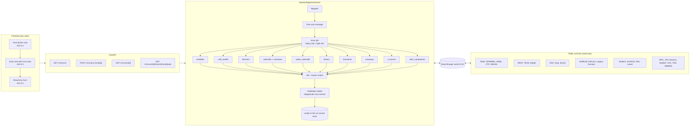
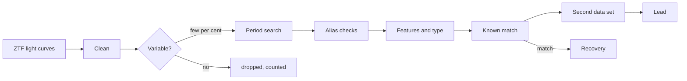

# Discovery hunts: one patch, ten searches

> **Part of:** Architecture spec ([index](README.md)) · **Sections:** A22 to A22.16 (proposed numbers; see "Status" below) · **Builds on:** Area search and Discovery ([A16](moving-objects/area-search.md), [A17](moving-objects/area-backend.md), [A17.6 to A17.13](moving-objects/area-contract.md), [A18](moving-objects/area-ui.md)), scans and runs ([Q-470](../decisions/moving-objects.md), Q-471, Q-472, Q-473, Q-483), the gap analysis ([Q-478](../decisions/moving-objects.md)) · **Rules it follows:** provenance tags and badges ([A5.2](data-contract.md#a52-provenance-tags-and-badges), D-02, D-21), the cache ([D-25](../decisions/data-sources.md)), the generated contract ([D-18](../decisions/contract.md)), the design language ([design-language.md](../design-language.md), D-38) · **Mock-up:** [`mockup/discovery-hunts.html`](../../mockup/discovery-hunts.html)

**Status: proposal, not built, not yet decided (17 Nov 2026).** Written after Space Apps, from the direction Moon set on 16 and 17 Nov 2026. Three things are still needed before any code:

1. **Moon approves the mock-up** (UI needs an approved mock-up before it is built).
2. **The decisions in [A22.15](#a2215-decisions-to-register) get their `D-` and `Q-` rows** in `docs/decisions/`. This PR holds two files only (this spec and the mock-up), so the decision index, the section map in [README.md](README.md), the routing table in `docs/README.md` and the UML are **not** updated here. Run `/sx-spec-sync` after approval. Until then "A22" is a proposed number and nothing else in the docs links here.
3. **Every item marked [verify]** is checked against the real service or paper ([A22.14](#a2214-open-items-and-items-to-verify)).

Labels follow the architecture spec: **Tested** (we ran it), **Documented** (a primary source says so), **To build**, **Proposed** (a choice waiting for a decision), **[verify]** (seen only in a search result, a preprint or a secondary source, or not checked at all).

The mock-up is visual input, never a spec (D-01). Every number on its result cards is an example, not a measurement.

---

## A22 Discovery hunts

Today Discovery does one thing: in a patch of sky it looks for dots that move between SPHEREx visits and checks them against known asteroids. This spec turns Discovery into a set of **hunts**. The user picks a patch as today, then chooses what to look for. Each hunt uses the survey that can actually see its kind of object, runs on the user's own computer, and reports **leads** with the evidence, the detection rate and the name of the project that can credit a find.

In one sentence for the public: pick a patch of sky, tick what you want to hunt for, and the app searches the public archives of several space and ground surveys for you, shows what it found and why, and helps you send a promising lead to the people who can confirm it.

The journey keeps the shape it has now:

1. **Discovery** in the dock, then **pick a patch** (as built, Q-472).
2. **Choose what to hunt** (new card).
3. **Scanning** (the scan card as built, with one progress row per hunt).
4. **Results by hunt** (the results card as built, with a tab per hunt and a lead card per hunt type).

### A22.1 Why and who

| Item | Detail | Label |
|---|---|---|
| Audience | **The public, students and amateur astronomers.** Not professional survey teams. | Decided (Moon, 16 Nov 2026) |
| Why not compete with the professionals | Rubin, ZTF, the TESS pipelines and the alert brokers search the whole sky every night with methods and hardware a home tool cannot match. A hackathon tool that claims discoveries against them would be dishonest. | Decided (Moon) |
| What the tool is instead | An accessible, honest explorer of several public surveys at once. It teaches how each kind of object is found, re-finds known objects in front of the user (a "recovery"), and passes the rare real lead to an established citizen-science or reporting route under the user's own name. | Proposed |
| Where ordinary users do have a chance | The leftovers the pipelines drop or nobody re-examined: stars missing from the variable-star index, the coldest brown dwarfs, single transits, tails on asteroids in old archive images, lens candidates that need a human grade. The hunts are grouped by these odds ([A22.2](#a222-scope)). | Documented per hunt ([A22.9](#a229-hunt-sheets)) |
| What SPHEREx adds | A 0.75 to 5 µm spectrum (102 channels) of everything it sees. Three hunts use it as their distinctive check: cold worlds (methane, water, CO), infrared excess (the star's own spectrum, a galaxy test) and asteroids (what known rocks are made of). | Documented (instrument, [A3.1](data-sources.md#a31-spherex-irsa)) |
| The honest starting point | The first real moving-rocks run recovered **0 of 38** known asteroids in its area, and Q-478 (b) records a real asteroid (8925 Boattini) missed by the pair test. No hunt may show leads before it proves it can recover known objects ([A22.10](#a2210-calibration-and-proof)). | Tested (14 Nov 2026) |
| Science niches Moon wants kept | (1) SPHEREx spectra of known asteroids (composition). (2) Precovery of known interstellar objects and comets in archived frames. (3) Cold-world candidates checked with SPHEREx methane and CO bands: the strongest science case. (4) Vetted leads fed into citizen-science projects. | Decided (Moon, 16 Nov 2026) |

**What this is not.** It does not announce discoveries. It does not submit anything on the user's behalf. It does not rank users. It does not replace Track, Build or the single-area cards; those stay as built.

### A22.2 Scope

**In scope: ten hunts.** Chosen by Moon on 17 Nov 2026 from a longer list, grouped by an ordinary user's odds of a credited find. The `id` is the proposed `HuntId` in the contract ([A22.7](#a227-contract)); the short key is the one the mock-up's markup uses.

| # | Hunt (title on the card) | `id` | Mock-up key | Group | Main data | Credit route | State at launch |
|---|---|---|---|---|---|---|---|
| H1 | Variable and eclipsing stars | `variables` | `var` | Good chance | ZTF and TESS light curves | AAVSO VSX | Available |
| H2 | Cold nearby worlds | `cold_worlds` | `cold` | Good chance | WISE (CatWISE2020, unWISE), SPHEREx spectra | Backyard Worlds | Available |
| H3 | Strange dimmers and planets | `dimmers` | `dim` | Good chance | TESS light curves | Planet Hunters TESS, ExoFOP | Available |
| H4 | Asteroids (with precovery and rock spectra) | `asteroids` | `rocks` | Good chance | SPHEREx spectral images | Minor Planet Center | Available (this is today's Discovery, made reliable) |
| H5 | Active asteroids | `active_asteroids` | `active` | Good chance | DECam and ZTF archive images | Active Asteroids (Zooniverse), then MPC | Available |
| H6 | Gravitational lenses | `lenses` | `lens` | Good chance (see note) | Euclid, Legacy Surveys, HSC, DES images | Space Warps (Zooniverse) | Available only where the patch has lens-quality images; off in the Milky Way's plane |
| H7 | Novae and supernovae | `transients` | `change` | Possible, against strong competition | ZTF and Rubin alerts through brokers | Transient Name Server | Available |
| H8 | Runaway stars | `runaways` | `run` | Possible | Gaia DR3 | A research note (no central registry) | Available |
| H9 | Infrared excess | `ir_excess` | `irx` | Possible | WISE, 2MASS, Gaia, SPHEREx spectra | Disk Detective | Available |
| H10 | Sleeping black holes | `dark_companions` | `bh` | Possible | Gaia DR4 orbits and epoch astrometry | Follow-up observers, a paper | **Disabled until Gaia DR4 is out** (due 2 Dec 2026) and its access is checked |

**Note on H6 (for Moon to decide, [A22.15](#a2215-decisions-to-register) PD-9).** The research of 17 Nov 2026 found that Euclid's DR1-Foundation release (Nov 2026, about 1,900 square degrees) shipped with a large lens catalogue already made **[verify]**. That lowers the odds of a new lens in Euclid sky. The hunt may belong in "Possible", or may keep its place for the grading and for sky outside Euclid. Not moved here.

**Kept for learning only** (shown as explanations or as views of other hunts' results, never as a hunt that promises leads):

| Topic | Why not a hunt | Where it lives |
|---|---|---|
| Interstellar visitors | Surveys catch them first, in real time. Finding a known one in older SPHEREx frames is the useful part. | Precovery inside H4 ([A22.9.4](#a2294-h4-asteroids-precovery-and-rock-spectra)) |
| Planet X and slow, faint movers | Stacking gives upper limits far more often than finds. | A limit report inside H4, deep fields only (phase 2) |
| Ice along sightlines | SPHEREx's own speciality; a map, not a discovery. | Out of this spec (a later view) |
| Microlensing and primordial black holes | Surveys catch the events automatically, and no single event proves a primordial black hole. | Explanation only |

**Left out on purpose:** galaxy distances for cosmology (needs whole-sky statistics, not a patch); direct imaging of planets (not possible with these data); our own difference imaging for transients (the surveys do it better and faster; H7 reads their alerts).

**Phases.**

| Phase | Content |
|---|---|
| 0 | Approval of the mock-up and the decisions in A22.15. |
| 1 | The shared core against fixtures: hunt register, plan with coverage, run record with hunts, lead schema, the three cards. No hunt code yet. ([A22.12](#a2212-plan-tickets-and-owners), ticket HN-1 to HN-3) |
| 2 | H4 made reliable and gated (the 0 of 38). The calibration harness. |
| 3 | The catalogue hunts, cheapest first: H8, H9, H7. Then the light-curve hunts H1 and H3, then H2. |
| 4 | The image hunts H5 and H6. H10 after Gaia DR4. |
| Later | "Watch it" (daily recheck of saved leads), sharing finished squares between PCs, the slow-mover limit report. |

### A22.3 Journey and UI

The mock-up shows every screen: [`mockup/discovery-hunts.html`](../../mockup/discovery-hunts.html) (open the file in a browser; it is one self-contained page, [A22.16](#a2216-the-mock-up-file)). It was built from screenshots of the real app (the sky, the grid, the dock and the scan card are real) with the new cards drawn on top in the app's own CSS. Structure and wording come from the mock-up; the look follows `docs/design-language.md` (D-38). Where the mock-up and this section differ, this section wins.

**What stays exactly as built:** the dock and the Discovery button; picking a patch with the screen-shaped rectangle (Q-472 (1)); the grid and square numbering (Q-470, Q-472 (2)); square states and colours; the scanning rings (Q-483 (1)); pause, resume and stop (Q-470 (7)); the Runs list and replay (Q-473, Q-483 (2)); the ← back rule (Q-483 (3)); Measured only (D-21); the status-dot message style (no tinted alert boxes); minimise to the island.

#### A22.3.1 Step 1: pick a patch (as built)

No change. The label still reads, for example, "12.0° × 7.2° · 35 squares · about 23 h". With hunts, the time in the label is the asteroid hunt's estimate until the user changes the selection of hunts; the picker card then shows the real total. **Proposed:** the label drops the time once hunts exist and keeps "12.0° × 7.2° · 35 squares" (PD-6).

#### A22.3.2 Step 2: choose what to hunt (new card)

Replaces the single-purpose offer card of state 3 for a Discovery scan. Known objects keeps its own offer card.

- **Card:** the standard glass panel, tall variant. Header "Discovery", subtitle "Scan · 12.0° × 7.2°", minimise and close as on every card.
- **Question:** "What should we look for in these 35 squares?"
- **Two groups, each with a small heading:** "Good chance of a find" and "Possible, against strong competition".
- **One row per hunt,** a checkbox row with four parts:
  1. title (bold) and, right-aligned, the time estimate ("about 2 h") or a short state ("not here", "not yet");
  2. one line saying what it looks for, in plain words;
  3. one muted line naming the data and the credit route ("TESS and ZTF light curves · credit in the AAVSO index");
  4. where coverage is partial or missing, that third line becomes a status-dot line in the warning tone, with the reason ("ZTF alerts reach 28 of 35 squares; the bottom row is too far south").
- **Disabled rows** are greyed (62% opacity in the mock-up), cannot be ticked, and always say why: "Euclid avoids the Milky Way's plane, so this patch has no lens images"; "Opens when Gaia DR4 is out (due 2 December 2026)". The reason comes from the plan reply (`hunts[].reason`, [A22.7](#a227-contract)), never from the frontend.
- **Facts under the list** (the existing `dl` style): Squares ("35 (7 × 5) of up to 2°"), Time ("about 23 h, hunts run side by side"), Data (the distinct sources of the ticked hunts, for example "SPHEREx, TESS, ZTF, WISE, Gaia").
- **Buttons:** primary "Start 8 hunts" (the count of ticked hunts; "Start 1 hunt"; disabled with "Choose a hunt" when none is ticked) and "Select again".
- **Behaviour:** all available hunts are ticked by default (PD-7 asks whether the default should be the "Good chance" group only). Ticking or unticking updates Time, Data and the button at once, with no request. Time is the **largest** of the ticked hunts' estimates, because hunts run side by side ([A22.4](#a224-architecture)); it is never their sum.
- **Where the numbers come from:** `POST /v1/scans` with `start=false` and all hunts answers the plan once, with each hunt's `estimate_s`, coverage and sources. No network call to an archive is made for the plan that today's plan does not already make (Q-470 (8)); coverage that needs a query is answered from footprint tables shipped with the app ([A22.5](#a225-shared-core)).
- **Keyboard and screen readers:** each row is one labelled checkbox; the group headings are real headings; a disabled row's reason is part of its accessible description; the estimate is read after the title.

#### A22.3.3 Step 3: scanning (the scan card, extended)

- **Header:** "Discovery", subtitle "Scanning · 8 hunts".
- **Mini grid, the "Square n of N · step" line and the time left:** as built. The square states on the sky and in the mini grid are those of the asteroid hunt (the only hunt that walks squares one by one in the sky view). When the asteroid hunt is not ticked, the mini grid shows squares as done when every ticked hunt has finished them (PD-8).
- **New: one progress row per ticked hunt,** in the existing step-list style: a state mark (spinner, tick, or a muted dot), the hunt's name, a count in the hunt's own unit, and a thin bar while running. Examples: "Variable stars · 18,000 of 52,000" (stars), "Asteroids · square 5 of 35", "Active asteroids · 12 of 40 known", "Cold nearby worlds · 2 leads · done".
- **A finished hunt's row is a button** that opens its results while the others still run. Catalogue hunts finish in minutes; image hunts take hours.
- **Messages:** one status-dot line per skipped square (as built) and one per hunt with a coverage gap ("Novae: squares 29 to 35 not covered. Too far south for ZTF."). A hunt that failed says so in its row and in one line, with the reason; the scan goes on (as a failed square does today, Q-471 (3)).
- **Pause and Stop:** as built; they act on the whole run. Stopping keeps every finished hunt's and square's results.
- **Minimised:** the island pill reads "Discovery · 3 of 8 hunts done" (**Proposed**; today "Discovery · Square 7 of 15").
- **Closing the card does not stop the scan** (as built).

#### A22.3.4 Step 4: results by hunt

- **Header:** "Discovery", subtitle "Scan · 12.0° × 7.2° · 8 hunts".
- **Hunt switch:** a segmented control inside the card, one segment per ticked hunt with its lead count ("Variables 24", "Cold 2", "Dimmers 2", "Asteroids 83", "Active 1", "Novae 1", "Runaway 1", "IR excess 3"). It wraps to several rows on a narrow card. The Asteroids segment shows today's combined results (state 11) unchanged.
- **Source line:** "Done · TESS (3 sectors) and ZTF light curves · 52,000 stars" and the coverage ("All 35 squares; ZTF adds 28 of them").
- **Three totals** in the existing tiles: leads, already known (recoveries), and a third count that depends on the hunt (unsure, ruled out, too faint, blends rejected).
- **Provenance line:** which parts of a lead are Measured and which Estimated ("Measured: light curve, period · Estimated: type").
- **The selected lead**, expanded: a heading ("Lead V7", "Candidate P1"), an evidence list (label and value pairs, [A22.8](#a228-leads-provenance-and-honesty-rules)), at most one status-dot caution ("Crowded field. A star 40″ away could cause the dip."), then the rows.
- **Lead rows:** id, a plain title ("Eclipsing pair"), one line of key facts ("0.4127 days · 18% deep"), the square, and the actions. The first action is the credit route ("Send to AAVSO VSX", "Send to Backyard Worlds", "Send to Planet Hunters TESS", "Send to Active Asteroids", "Report to TNS", "Send to Disk Detective", "Export for follow-up"). The second depends on the hunt: "Watch it", "Build it", "See the images", "Track it".
- **Footer lines, always present:** the detection rate for this kind of lead ("Detection rate: finds 9 in 10 test stars with 5% swings"), the false-lead rate where measured ("False leads: about 1 per 500 stars"), and "Your credit: ..." naming what the user gets and from whom.
- **Left panel (new):** when a lead is selected, a chart panel opens at the left edge of the sky (the same glass panel, `left` variant) with the lead's main evidence chart and its legend. One chart type per hunt ([A22.3.5](#a2235-charts-and-sky-markers)). It closes with the lead.
- **On the sky:** each lead is a ring with a short label (id and one fact), in the hunt's marker style. Recoveries are drawn muted and only when "Show known" is on (as predicted objects are hidden by default today). Selecting a ring selects the row and the reverse.
- **Empty and partial states:** "No leads in this patch. 310 known variables recovered." is a normal, good result and reads as one. A hunt with no coverage shows its reason, not zero. A hunt still running shows its progress row in place of results.

#### A22.3.5 Charts and sky markers

| Hunt | Left-panel chart | Series and tags | Sky marker |
|---|---|---|---|
| H1 Variables | Brightness folded on the period, two cycles | TESS points and ZTF points (`measured`); fitted curve (`derived`) | Ring + "V7 · 0.41 d" |
| H2 Cold worlds | SPHEREx spectrum, 0.75 to 5 µm, with the best template | SPHEREx points with error bars (`measured`); template (`model_dependent`) | Ring + motion arrow (the measured motion, exaggerated, labelled with the rate) |
| H3 Dimmers | Light curve around the dip; for a periodic signal, folded | TESS points (`measured`), binned averages (`derived`), transit model (`model_dependent`) | Ring + "P1 · 4.21 d" |
| H4 Asteroids | As built: track, dots in wavelength colour, the spectrum check | As A16.5 | As built (Q-472 (4)) |
| H5 Active asteroids | Brightness from the centre outward: the asteroid against stars of the same brightness | Both profiles (`measured`) | Ring + "A1 · tail in 2023" |
| H6 Lenses | The cutout in two colour stretches, with the model ring | Image (`measured`); ring (`model_dependent`) | Ring + "L1 · grade B" |
| H7 Transients | Brightness over time in each band, with limits shown as open markers | Detections (`measured`); non-detections as limits (`measured`) | Ring + "C1 · up 3.2 mag" |
| H8 Runaways | Histogram of speeds across the sky for the patch's stars, the lead marked (log count) | Speeds (`derived`) | Ring + arrow along the measured motion |
| H9 Infrared excess | Brightness by wavelength, log-log: the points, the star model, the dust model | Points (`measured`); star model (`model_dependent`); dust blackbody (`model_dependent`) | Ring + "X1 · 9× at 22 µm" |
| H10 Dark companions | The fitted orbit on the sky and the mass of the unseen partner with its range | Orbit (`model_dependent`, Gaia's fit); mass (`model_dependent`) | Ring + "B1" |

Chart rules: the dataviz rules of the design language; legend in words with the badge colour; brighter is up; under Measured only (D-21), Estimated series and markers are hidden and the legend says so; every chart has a text alternative listing its key values (R9).

#### A22.3.6 Wording rules (extends A16.5)

- **Lead, candidate, recovery.** A result that matches nothing known is a **lead** ("Lead V7"). For transits the field's own word **candidate** is allowed ("Planet candidate"). A result that matches a known object is a **recovery** and is counted under "already known" or "already catalogued".
- **Never "discovered", "new", "confirmed" or "found a ..."** for a lead. Counts read "24 leads", not "24 new variables". The mock-up file in this PR follows this rule.
- **Types are suggestions.** "Type: contact eclipsing pair (suggested)". A classifier's output is Estimated and says so.
- **Not checked is not clean.** A lead whose catalogue check failed is "not checked against VSX", never "not in VSX" (as `unchecked` in A16.5).
- **Coverage gaps are stated,** per hunt and per square, with the reason. A square without the input a hunt needs is "not covered", never "nothing found".
- **Competition is stated** on the hunts in the second group: "Professionals are fast here. Surveys report most flares within hours; check TNS before sending."
- **No exotic explanations.** Infrared excess is "warm dust or a blend", never anything stranger. A heavy dark partner is a "black hole candidate" only on the card's caution line and never before a spectrum confirms it.
- **Credit is concrete.** "Your credit: your name on the VSX entry", "co-author on Backyard Worlds papers" **[verify each route's actual practice before it ships]**.

#### A22.3.7 Send, export, watch, build

- **"Send to ..." never sends.** It opens a sheet with (1) what will be handed over (the export file and the images), (2) the short checklist that project asks for, (3) a button that downloads the package and (4) a link that opens the project's submission page. The user submits under their own account. The app keeps no account details. (**Proposed**, PD-4. How each project accepts candidates found outside its own site is **[verify]**.)
- **"Export for follow-up"** (H8, H10) downloads an ECSV table with the provenance header of A19.9.
- **"Watch it"** (H1, H7) saves the lead locally and rechecks it daily. Phase "Later"; the button is not drawn until it exists.
- **"Build it"** (H2, H3) hands the object to Build with what was measured, as "Build it" does for a known object today (Q-469). Layers without data are not drawn (refuse rather than invent).
- **"Track it"** (H4) is unchanged.

#### A22.3.8 States the mock-up does not draw (to mock up before building)

Per the project rule that any UI needs an approved mock-up: the Send sheet; a failed hunt's row and results state; the results state of a hunt with zero leads; the hunt switch at phone width; a recoveries-only hunt ([A22.10](#a2210-calibration-and-proof)); the Runs list row for a run with hunts; replay of a run with hunts (**Proposed:** replay shows the asteroid hunt's events as today plus each other hunt's leads at their `lead` event time).

### A22.4 Architecture

Everything runs on the user's own computer inside the existing FastAPI backend; the browser only displays. The one new idea is the **hunt**: a self-contained search with a common interface, so the scan job, the run record, the API and the cards do not know what a hunt looks for.



#### A22.4.1 The hunt interface (Proposed)

```python
# backend/app/core/hunts/base.py  (proposed; names to settle in HN-1)
class Hunt(Protocol):
    id: HuntId                 # "variables", "cold_worlds", ...
    version: str               # bumps when the method or thresholds change; keys the cache and the calibration table
    group: Literal["good_chance", "possible"]
    weight: Literal["light", "heavy"]   # light = catalogues and light curves; heavy = pixels or GPU

    def availability(self, settings) -> Availability:
        """Is the hunt usable at all? e.g. disabled until a data release exists. No network."""

    def coverage(self, region: Region, squares: list[Square]) -> HuntCoverage:
        """Which squares have the input this hunt needs. From shipped footprint tables and
        cached catalogue answers only; never a pixel download. Each uncovered square carries a reason code."""

    def estimate(self, coverage: HuntCoverage) -> Estimate:
        """Seconds and bytes, from measured per-unit costs (A22.11)."""

    def run(self, unit: WorkUnit, ctx: HuntContext, progress: Progress) -> UnitResult:
        """One unit of work: a square for pixel hunts, a chunk of stars for catalogue hunts.
        Pure function of its inputs and ctx.seed. Raises nothing for missing data: returns `missing` codes."""

    def merge(self, results: list[UnitResult]) -> list[Lead]:
        """Join per-unit results into leads, merging duplicates across overlapping squares."""

    def export(self, lead: Lead, fmt: str) -> ExportFile:
        """The file for the hunt's credit route."""
```

Rules for every hunt:

- **Deterministic.** Same inputs, same hunt version, same seed: the same leads, byte for byte in the stored reply (the determinism rule). Any random step (bootstrap, Monte Carlo trace-back, network initialisation) takes its seed from the run record.
- **Refuse rather than invent.** A missing input produces a `missing` code and "not covered", never a guess. A value a hunt cannot compute is absent and listed, never zero.
- **Provenance on every value** ([A22.8](#a228-leads-provenance-and-honesty-rules)).
- **No language model anywhere in a hunt.** Every number comes from code.
- **Network only through adapters** in `backend/app/adapters/`, each behind the read-through cache (D-25), each with a timeout, retries with back-off and a mirror where one exists. Under `SX_OFFLINE=1` nothing reaches the network and uncached inputs are `missing`.
- **Resumable.** A unit's result is stored when it finishes; a restart resumes at the next unit (as squares do today).

#### A22.4.2 Jobs and scheduling (Proposed, extends Q-470 (6))

- A scan stays **one run** with one record. Its job now has two lanes: a **heavy lane** (one unit at a time: pixel work and anything on the GPU; this is today's single worker) and a **light lane** (catalogue queries and CPU light-curve work, a small pool, default 2 workers).
- Hunts are ordered inside each lane so that quick results arrive first: light hunts in the order H8, H9, H7, H2 (catalogue stage), H1, H3; heavy hunts in the order H4, H5, H6, then the pixel stages of H2.
- The asteroid hunt keeps walking squares in index order exactly as today (Q-470 (4)), so the sky view and the mini grid do not change.
- Pause takes effect after the current unit in each lane. Stop is immediate for queued units and at the next `Progress.check` for running ones. `MAX_WAITING` and the 429 `queue_full` rule are unchanged and count runs, not hunts.
- A hunt that fails does not fail the run. A run is `failed` only when every square of every hunt failed (extends Q-481).
- **GPU:** one GPU job at a time, with a memory cap; the CPU path gives the same results within a stated tolerance and is tested against it ([A22.11](#a2211-running-on-a-home-gaming-pc)).

#### A22.4.3 Code layout (Proposed)

| Part | Path | Owner (Proposed, to confirm under D-17) |
|---|---|---|
| Hunt base, register, plan, lanes | `backend/app/core/hunts/` (`base.py`, `register.py`, `plan.py`, `lanes.py`, `leads.py`, `calibration.py`) | Kevin |
| One package per hunt | `backend/app/core/hunts/<id>/` (`coverage.py`, `detect.py`, `vet.py`, `export.py`, `config.py`) | per ticket (A22.12) |
| Asteroid hunt | a thin wrapper over `backend/app/core/area/` as built; the predict-first stage is new (`core/area/predict.py`) | Kevin |
| New adapters | `backend/app/adapters/` (`ztf.py`, `mast.py`, `brokers.py`, `noirlab.py`, `euclid.py`, `vsx.py`, `tns.py`, `mpc.py`); `gaia.py`, `wise.py`, `tap.py`, `irsa_*.py`, `skybot.py`, `horizons.py`, `simbad.py` exist | Kevin, Atish |
| Calibration tables and footprints | `backend/assets/hunts/<id>/calibration-<version>.json`, `backend/assets/hunts/footprints/` | Moon |
| Injection harness | `backend/scripts/hunt_calibrate.py` | Kevin |
| API | `backend/app/api/hunts.py`; `runs.py` extended | Kevin |
| Schemas and fixtures | `shared/schemas/hunt-*.schema.json`, `run.schema.json` and `scan-plan.schema.json` extended; `shared/fixtures/hunts/` | Moon |
| Cards, charts, markers, store | `frontend/src/app/area/hunts/` (`HuntPicker.tsx`, `HuntRows.tsx`, `HuntResults.tsx`, `LeadCard.tsx`, `SendSheet.tsx`, `charts/`), `frontend/src/app/sky/HuntMarkers.tsx`, `huntsStore.ts`, `huntsApi.ts` | Moon |

### A22.5 Shared core

Every hunt follows the same seven steps. The hunt sheets in A22.9 fill in steps 4 and 5; the rest is common code.


| # | Step | What it does | Rule |
|---|---|---|---|
| 1 | **Check coverage** | For each hunt and each square: does the archive hold the input this hunt needs? Answered from footprint tables shipped with the app (TESS sectors per sky position, the ZTF declination limit, Euclid and Legacy Surveys footprints, SPHEREx visit pairs as today) and from cached catalogue answers. | A square without the input is `not_covered` with a reason code. It is never treated as empty and never counted as searched. |
| 2 | **Catalogues first** | Fetch the star lists and the known-object lists for the patch through TAP or cone queries: megabytes, not gigabytes. They drive target selection, masking, matching and vetting. | Most hunts cut the patch from 10⁴ to 10⁶ sources down to tens or thousands before any pixel or light curve is fetched. |
| 3 | **Pixels only where needed** | Download cutouts, light curves or image tiles only for the survivors of step 2. Prefer ranged reads from the public cloud copies (SPHEREx and TESS on AWS) with the archive (IRSA, MAST) as fallback. | Never a whole full-frame image when a cutout exists. Raw files are deleted when their unit finishes unless the user keeps them. |
| 4 | **Detect** | The hunt's own method. | Thresholds live in the hunt's `config.py`, are written into the reply's `method`, and change only with a hunt version bump. |
| 5 | **Vet** | Physics checks that rule out the usual impostors, then a match against every relevant list of known objects. | Each check is recorded on the lead as pass, fail or not run, with its values. A failed check never deletes a result silently: it moves it to "ruled out" with the reason. A failed catalogue call makes the lead `unchecked`. |
| 6 | **Calibrate** | Look up the detection rate and false-lead rate for the lead's own bin (brightness and the hunt's second parameter) in the table shipped for this hunt version. The tables are measured once per version by injecting synthetic objects into real data ([A22.10](#a2210-calibration-and-proof)). | No table for this version, or the lead falls outside the table: the rate is absent and the card says "detection rate not measured for this kind of lead". |
| 7 | **Report** | Store the leads with provenance, serve them, export them in the credit route's format. | Leads, not discoveries. Nothing leaves the PC unless the user downloads or sends it. |

**Cross-matching (shared helper, `core/hunts/match.py`, Proposed).** One function for every hunt: positions are moved to the catalogue's epoch with the measured motion when one exists; the match radius is the larger of a per-catalogue floor and 3σ of the combined position error; every match stores the catalogue, the identifier, the separation, the catalogue version and `fetched_at`. "Not in X" is written only when the query to X succeeded.

**Coverage footprints shipped with the app (Proposed).** Small static tables, versioned and dated, each with its source: TESS sector pointing table (or `tess-point` computed locally **[verify licence and pin]**), the ZTF northern limit, Euclid release footprints as MOC files, Legacy Surveys DR10 footprint, Rubin alert coverage **[verify: it is still changing during early operations]**. A footprint older than a stated age shows "coverage table from <date>" on the picker.

### A22.6 Data sources

Sources this spec adds to [A3](data-sources.md) (to move there when the spec is accepted). "Status" is what the research of 17 Nov 2026 could confirm.

| Mission or survey | Product we use | Archive and access | Used by | Status |
|---|---|---|---|---|
| **SPHEREx** | Level 2 spectral images: multi-extension FITS, about 70 MB each, one per detector (6 per pointing); layers IMAGE, FLAGS, VARIANCE, ZODI, PSF, WCS-WAVE. Pixel 6.15″. Wavelengths for science from the Spectral WCS product (CWAVE, CBAND), not the WCS-WAVE lookup table, which is "for visualization". | IRSA SIA and cutout service (as built); AWS open-data copy `nasa-irsa-spherex` | H4; forced photometry for H2, H9 | Documented ([data products](https://caltech-ipac.github.io/spherex-archive-documentation/spherex-data-products)). The app already runs on `spherex_dr1` (Q-463). QR2 frames pulled before April 2026 carry a PSF-header error and must be re-pulled **[verify]**. Depth: 5σ about AB 19.5 to 19.9 (0.75 to 3.8 µm) and 17.8 to 18.8 (3.8 to 5 µm) after the full survey ([Bock et al.](https://arxiv.org/abs/2511.02985)); **the single-frame per-channel limit is not published and must be measured from the VARIANCE layer**. |
| **ZTF** | Data-release light curves (g, r, i): tens to over 1,000 epochs per source. | IRSA light-curve API (cone or ID; VOTable); AWS copy as HATS Parquet | H1; history for H7 | Documented ([API](https://irsa.ipac.caltech.edu/docs/program_interface/ztf_lightcurve_api.html)). Latest listed release DR24 (22 Jan 2026) **[verify]**. Size and rate limits **[verify by a real query]**. |
| **ZTF, Rubin** | Public alerts: difference-image detections with a real/bogus score and image stamps. | Brokers: ALeRCE, Fink, Lasair, ANTARES (cone queries) | H7 | Rubin's public alert stream has been live since 24 Feb 2026 ([Rubin](https://rubinobservatory.org/for-scientists/data-products/alerts-and-brokers)). Broker API details, rate limits and terms for a public tool **[verify]**. |
| **ATLAS** | Forced photometry at a position. | ATLAS forced-photometry server | H7 (history) | **[verify]** access terms |
| **TESS** | Light curves: SPOC 2-minute and 20-second, TESS-SPOC and QLP (from full-frame images), TGLC (crowded fields). Pixel cutouts (TESScut) for candidates. TESS Input Catalog v8.2. Pixel 21″. | MAST (astroquery, lightkurve); AWS open-data copy | H3; confirmation for H1 | Product names Documented at MAST; per-patch size **[verify by a real query]** |
| **Kepler / K2** | Long light curves where the patch overlaps. | MAST | H3 | Documented |
| **WISE / NEOWISE** | CatWISE2020 (1.89 billion sources; W1 and W2; motions from 2010 to 2018). AllWISE (W1 to W4, 3.4, 4.6, 12 and 22 µm; W4 beam about 12″). unTimely catalogue and time-resolved unWISE coadds (about 16 epochs per band, to 2020). | IRSA TAP (table names **[verify]**: `catwise_2020`, `allwise_p3as_psd`); unWISE cutout service (unwise.me) | H2, H9; masks for H4 | Documented ([Marocco et al. 2021](https://arxiv.org/abs/2012.13084), [Meisner et al. 2023](https://arxiv.org/abs/2209.14327)) |
| **2MASS** | Point Source Catalog (J, H, Ks; 1998 to 2001). | IRSA TAP (`fp_psc` **[verify]**) | H2 (long baseline), H9 | Documented |
| **Gaia DR3** | `gaia_source` (positions, motions, parallaxes, RUWE, radial velocity for brighter stars), variability tables (10.5 million variables), `nss_two_body_orbit`, Bailer-Jones distances (`external.gaiaedr3_distance`). | ESA Gaia archive, TAP/ADQL (adapter exists) | H8, H10 (testing); masks, neighbours and matches for all | Documented |
| **Gaia DR4** | 66 months of data. `epoch_astrometry` (about 130 billion rows, 62 TB in all), `nss_two_body_orbit` (about 5.9 million rows), radial-velocity tables. | ESA Gaia archive; patch queries only | H10 | Due **2 Dec 2026, about 12:00 CET** ([ESA](https://www.cosmos.esa.int/web/gaia/data-release-4)). Whether epoch astrometry can be queried per source through TAP **[verify after release]**. |
| **Euclid** | Q1 (63 square degrees, Mar 2025). DR1-Foundation (Nov 2026, about 1,900 square degrees; the full DR1 in mid-2027). VIS images and near-infrared colours. | ESA Euclid archive; IRSA mirror **[verify]** | H6 | Staging Documented ([ESA DR1 timeline](https://www.cosmos.esa.int/web/euclid/dr1-timeline)); exact date, product names and cutout access **[verify]** |
| **Legacy Surveys DR10, HSC, DES** | Image cutouts and catalogues for sky outside Euclid. | NOIRLab Astro Data Lab; survey cutout services | H6; visible-light check for H2 | Not researched in detail **[verify]** |
| **DECam archive** | Calibrated archive images containing known asteroids. | NOIRLab Astro Data Archive | H5 | Used by the Active Asteroids project ([Chandler et al. 2024](https://arxiv.org/abs/2403.09768)); product names and cutout access **[verify]** |
| **Pan-STARRS, VHS, UKIDSS** | Visible and near-infrared catalogues. | MAST, ESO, WSA | H2 (reject ordinary stars), H7 (hosts) | Not researched in detail **[verify]** |
| **Minor Planet Center** | Orbit file (MPCORB), ADES submission. | MPC downloads and submission service | H4, H5 | Since Aug 2025, measurements from archive images need a program code and a check by the MPC's archive team (SARC) first ([MPC](https://docs.minorplanetcenter.net/mpc-ops-docs/data-and-services/sarc/)) **[verify the process and the observatory code for space-based archive images]** |
| **JPL Horizons, SkyBoT** | Positions of known objects seen from SPHEREx (`500@-163182`, Q-138) or from the ground; Sun and velocity position angles. | As built | H4, H5 | Tested (as built) |
| **AAVSO VSX, ASAS-SN, Chen et al. 2020** | Known variable stars. The Chen et al. ZTF catalogue (781,602 periodic variables) is downloadable and can be shipped as a local cross-match table. | VSX query service; VizieR; Zenodo | H1, H7 | Documented ([Chen et al. 2020](https://arxiv.org/abs/2005.08662)); VSX API terms **[verify]** |
| **Transient Name Server** | Public object list. | TNS | H7 | API key and terms for a public tool **[verify]** |
| **TOI list, ExoFOP, NASA Exoplanet Archive** | Known planets and candidates. | Public tables (adapter exists for the archive) | H3 | Documented |
| **UltracoolSheet, the 20-pc census, SIMBAD** | Known brown dwarfs and nearby stars. | Public tables; SIMBAD (adapter exists) | H2 | Documented |
| **Model grids** | Sonora (Bobcat, Elf Owl) and ATMO 2020 model spectra; the 2026 SPHEREx ultracool-dwarf template library (preprint); stellar model atmospheres for H9. | Public downloads, 1 to 3 GB once | H2, H9 | Template library is a preprint ([arXiv:2604.22012](https://arxiv.org/abs/2604.22012)) **[verify]** |

Rules for every new adapter (as the existing ones): read-through cache keyed on the full request; the raw reply is cached before it is parsed; a reply that is not what the service documents is an error, not "no results" (Q-478 (13)); a generic client name in the User-Agent, no personal details; polite rate limits per archive.

### A22.7 Contract

All of this section is **Proposed**. It extends the scan and run routes as built (A17.8, Q-470, Q-471) without changing what a client that sends no `hunts` gets. Schemas live in `shared/schemas/`, and the backend and frontend types are generated from them (D-18).

#### A22.7.1 Endpoints

| Endpoint | Purpose | Reply |
|---|---|---|
| `GET /v1/hunts` | The hunt register. | `hunt-register.schema.json`: `[{id, title, summary, group, weight, version, sources[], credit{route, url, format}, availability{state: available \| disabled, reason?}, calibration{id, measured_at} \| null}]` |
| `POST /v1/scans` (extended) | Gains `hunts: HuntId[]`. **Absent means `["asteroids"]`,** which is today's behaviour. `kind` must be `discovery` when `hunts` is sent. | With `start=false`: the plan (`scan-plan.schema.json`) gains `hunts[{id, version, state: ready \| partial \| not_covered \| disabled, squares_covered, squares_total, not_covered[{square, code}], reason?, estimate_s, download_bytes, units{total, name}, sources[]}]`. With `start=true`: 202 and the run. |
| `GET /v1/runs`, `GET /v1/runs/{run_id}` (extended) | The run record gains `hunts[]` and new event types. | See A22.7.2 |
| `GET /v1/runs/{run_id}/hunts/{hunt_id}/leads` | The leads of one hunt, merged across squares. Served while the run is still going, for hunts that are done. | `hunt-leads.schema.json`: `{hunt, version, state, source_line, coverage, totals, leads[LeadSummary], method, missing, provenance, computed_at, cached_at}` |
| `GET /v1/runs/{run_id}/hunts/{hunt_id}/leads/{lead_id}` | One lead in full, with its evidence, checks, matches and chart series. | `hunt-lead.schema.json` (A22.7.3) |
| `GET /v1/runs/{run_id}/hunts/{hunt_id}/leads/{lead_id}/images/{name}.png` | Cutouts and stamps that belong to a lead (H5, H6, H2 flip-book frames, H9 band images). | PNG, stretched as `/cutouts/{frame_id}.png` is |
| `GET /v1/runs/{run_id}/hunts/{hunt_id}/leads/{lead_id}/export.{ext}` | The file for the credit route (A22.7.5). | The file |
| `GET /v1/hunts/{hunt_id}/calibration` | The detection-rate table of the running hunt version. | `hunt-calibration.schema.json` (A22.10) |

`/v1/runs/{run_id}/results` (the asteroid results) is unchanged. The asteroid hunt's leads route answers the same merged rows in the lead shape, so the results card has one code path for the hunt switch and keeps today's path for the Asteroids segment.

**Errors:** 422 `hunt:unknown` (an id not in the register); 422 `hunt:disabled` (a disabled hunt was asked for; the reply names the reason); 422 `hunt:none` (an empty list); 404 `hunt_not_in_run`; 404 `lead_not_found`; 409 `hunt_not_done` (leads asked for a hunt that is queued or running); existing scan errors unchanged.

#### A22.7.2 The run record with hunts

`run.schema.json` gains (all optional, so older records still validate; an older record reads as a run of the asteroid hunt alone):

```json
{
  "hunts": [
    {
      "id": "variables",
      "version": "1.0.0",
      "state": "running",
      "progress": { "done": 18000, "total": 52000, "unit": "stars" },
      "totals": { "leads": 0, "recovered": 0, "ruled_out": 0, "unsure": 0, "unchecked": 0 },
      "coverage": { "squares_covered": 35, "squares_total": 35, "not_covered": [] },
      "missing": [],
      "calibration_id": "variables-1.0.0-2026-12-01",
      "started_at": "2026-11-17T08:00:12Z",
      "finished_at": null,
      "error": null
    }
  ],
  "seed": 1234567
}
```

- **Hunt states:** `queued`, `running`, `paused`, `done`, `failed`, `stopped`, `not_covered` (no square had the input), `recoveries_only` is **not** a state: it is a property of the hunt version (A22.10) and is carried in the register and on the leads reply.
- **`totals`** are read from the stored leads, never computed in the API (as Q-471 (5)). `unchecked` is null on records written before a hunt counted it (as Q-480).
- **New events** in the timeline (`{t, type, hunt, ...}`): `hunt_started`, `hunt_done`, `hunt_failed`, `hunt_not_covered`, and `lead` (`{hunt, lead_id, status, ra, dec, square}`), one per lead or recovery, written when its unit finishes. The existing `square_*` and `found` events are unchanged and belong to the asteroid hunt. `t` never decreases (as Q-471 (4)).
- **Restart rule:** as Q-471 (6). A hunt left `queued`, `running` or `paused` loads as `stopped`; its finished units stay.
- **`RunTotals`** (the run level) gains `hunts_done`, `hunts_failed` and `leads` (the sum over hunts other than asteroids); the existing asteroid totals keep their meaning.

#### A22.7.3 The lead

One shape for every hunt. Hunt-specific numbers go in `evidence` and `series`, so the card and the export need no per-hunt schema.

```json
{
  "lead_id": "V7",
  "hunt": "variables",
  "hunt_version": "1.0.0",
  "status": "lead",
  "title": "Eclipsing pair",
  "facts": "0.4127 days · 18% deep",
  "ra": 83.8221, "dec": -5.3911, "epoch": "2016.0",
  "squares": [18],
  "ids": { "gaia_dr3": "…", "tic": "…", "ztf": "…" },
  "evidence": [
    { "key": "period_d", "label": "Period", "value": 0.4127, "unit": "d", "uncertainty": 0.0001,
      "tag": "measured", "note": "same in TESS and ZTF" },
    { "key": "type", "label": "Type", "value": "contact eclipsing pair (W UMa)",
      "tag": "derived", "method": "random forest on light-curve features", "probability": 0.81 }
  ],
  "checks": [
    { "id": "alias", "label": "Not a 1-day alias", "result": "pass", "tag": "derived" },
    { "id": "second_dataset", "label": "Same period in a second data set", "result": "pass", "tag": "measured" }
  ],
  "matches": [
    { "catalogue": "VSX", "version": "2026-11-15", "result": "none", "radius_arcsec": 5.0, "fetched_at": "…" },
    { "catalogue": "Gaia DR3 vari", "result": "none", "radius_arcsec": 2.0, "fetched_at": "…" }
  ],
  "caution": { "code": "crowded_field", "title": "Crowded field", "line": "A star 40″ away could cause the dip." },
  "rates": {
    "detection": { "value": 0.9, "n": 200, "bin": "amplitude 5%, r 15 to 16", "calibration_id": "…" },
    "false_leads": { "value": 0.002, "per": "star", "calibration_id": "…" }
  },
  "credit": { "route": "AAVSO VSX", "url": "https://www.aavso.org/vsx/", "format": "vsx", "line": "your name on the VSX entry" },
  "series": [ { "name": "tess", "tag": "measured", "x": "phase", "y": "rel_flux", "points": [[0.01, 0.82], …] } ],
  "images": [],
  "missing": [],
  "provenance": { "…": "per value, as A5.2" }
}
```

- **`status`:** `lead` (passed every check that ran and matched nothing known), `recovery` (matches a known object), `unsure` (the hunt could not decide; needs the user's eye), `ruled_out` (a check failed; kept with the reason), `unchecked` (a known-object query failed).
- **`lead_id`:** a letter per hunt and a number in order of position (stable for a run): V (variables), W (cold worlds), P (periodic transit) and D (single dip), T (asteroid tracks, as today), A (active asteroids), L (lenses), C (transients), R (runaways), X (infrared excess), B (dark companions).
- **`rates`** is null when the hunt version has no calibration table or the lead falls outside it.
- **`tag`** is one of the five provenance tags; the card maps it to a badge (D-02). A value that mixes a measurement and a model is tagged by its weakest part.

#### A22.7.4 `missing` and refusal codes (new namespaces)

| Code | Meaning | Words on the card (proposed) |
|---|---|---|
| `hunt:<id>:not_covered:<square>` with a reason suffix (`:no_sector`, `:south_of_ztf`, `:outside_footprint`, `:no_visit_pair`, `:galactic_plane`) | The square lacks the hunt's input. | "Square 29 not covered. Too far south for ZTF." |
| `hunt:<id>:needs_release:<release>` | The hunt waits for a data release. | "Opens when Gaia DR4 is out." |
| `hunt:<id>:archive:<service>` | A service failed after retries; the unit was not searched. | "TESS archive not reachable. 4 squares not searched." |
| `hunt:<id>:known_check:<catalogue>` | A known-object query failed; leads are `unchecked`. | "Not checked against VSX." |
| `hunt:<id>:calibration:none` | No detection-rate table for this version. | "Detection rate not measured for this hunt yet." |
| `hunt:<id>:calibration:outside` | The lead falls outside the table's bins. | "Detection rate not measured for this kind of lead." |
| `hunt:<id>:truncated:<n>` | A query hit a row limit; the unit is partial. | "Too many stars in square 12; the faintest were not searched." |
| `hunt:<id>:gate_not_passed` | The hunt version has not passed its recovery gate; it reports recoveries only. | "This hunt is still proving itself. It shows known objects it re-found, and no leads yet." |

Codes are never shown raw (Q-477, Q-478 (6)); the code stays in `data-code`.

#### A22.7.5 Export formats

| Hunt | Format | Contents |
|---|---|---|
| H1 | `vsx.zip` | A text sheet with the fields the VSX form asks for (position, identifiers, period, epoch, magnitude range, type, passband), the light-curve data as CSV, the folded curve as PNG |
| H2 | `backyard-worlds.zip` | ECSV of position, motion, photometry, spectrum fit; the unWISE flip-book frames; the SPHEREx spectrum as CSV and PNG |
| H3 | `candidate.zip` | A vetting report (PDF or HTML) with the light curve, the fit, every check; CSV of the detrended light curve; TIC id and sectors |
| H4 | `ades.xml` (and the existing ECSV) | ADES positions and magnitudes; unchanged ECSV of A17.7 |
| H5 | `active-asteroid.zip` | The cutouts (FITS and PNG), the radial profiles as CSV, the tail and Sun angles |
| H6 | `lens.zip` | Cutouts in each band, the score, the grade, the model parameters |
| H7 | `tns.json` | The fields of a TNS report, for the user to paste or upload **[verify the form]** |
| H8, H10 | `export.ecsv` | The table with a provenance header (A19.9 writer) |
| H9 | `disk-detective.zip` | The brightness-by-wavelength table and plot, the band images |

Every export carries the hunt id and version, the run id, the data releases used, and the sentence "A lead for follow-up, not a discovery".

#### A22.7.6 Fixtures

`shared/fixtures/hunts/`: one synthetic run with all ten hunts (states: done, done with a coverage gap, failed, disabled, not covered), and for each hunt at least one lead, one recovery, one ruled-out, one unsure where the hunt has that status, and one unchecked. All synthetic, all with the dev-only Fixture badge, served with `X-SX-Fixture: synthetic` (Q-32). The frontend builds the three cards against these before any hunt exists (D-29). The mock answers only with `?scan=mock`, as today.

### A22.8 Leads, provenance and honesty rules

#### A22.8.1 Tags per kind of value

| Value | Tag | Badge | Notes |
|---|---|---|---|
| A survey's own photometry, astrometry, timestamps (ZTF, TESS, WISE, Gaia, 2MASS points; SPHEREx pixel values) | `measured` | Measured | The survey measured it; we name the survey and the release. |
| SPHEREx forced photometry at a given position | `measured` | Measured | Aperture or PSF method in `method`; the position it was forced at carries its own tag. |
| A period from a periodogram; an amplitude; a transit depth and duration from the data alone; a motion from positions; a radial profile | `measured` when it is a direct statistic of measured points with its uncertainty; `derived` when a choice of method changes it materially | Measured or Estimated | Decision needed on the boundary (PD-5). The mock-up shows period and motion as Measured. |
| A fitted model curve; a planet size from the depth and the star's catalogue radius; a temperature from a template fit; a distance from type and brightness; a speed from motion and parallax; a dust temperature; an unseen partner's mass; a lens ring radius | `model_dependent` | Estimated | The assumption is written in the tooltip ("star radius from the TESS Input Catalog"; "single blackbody"). |
| A classifier's type and probability; a real/bogus score; a lens score | `derived` | Estimated | The method and its training set in `method`. Shown as a suggestion. |
| A match or a non-match against a catalogue | `derived` | Estimated | Carries the catalogue version and `fetched_at`. |
| Positions of known objects from an orbit | `model_dependent` | Estimated | As A16.5. |
| Detection rate and false-lead rate | `model_dependent` | Estimated | "Measured on planted test objects in real data"; the bin is always stated. |
| The user's own grade (H5, H6, H9) | not a provenance tag | none | Stored as `user_grade` with the time; never mixed with computed values. |

Nothing in a hunt is `artistic`. Under Measured only (D-21) Estimated values, model curves, type suggestions and rates are hidden, and the lead's title falls back to a neutral one ("Lead V7").

#### A22.8.2 Rules

- **A lead needs a completed known-object check.** Otherwise it is `unchecked` (as A16.5).
- **A lead needs the hunt's confirmation rule** where the sheet defines one (the same period in a second data set; seen in both halves of the frames; two nights).
- **Recoveries are first-class.** Every hunt counts and can list what it re-found. That count is the user's evidence that the hunt works here.
- **Rates are per bin, with the bin named.** This amends A16.5's "no single figure goes into a card": the lead card shows the rate **of the lead's own bin**, worded "finds 9 in 10 test stars with 5% swings", never an overall catch rate (PD-3).
- **Odds are stated on the picker** by the two group headings, and on the cards of the second group by one caution line.
- **Planted means planted** (A16.5). Injected objects exist only in the calibration harness and its tables, never in a user's run results.
- **The user decides what leaves the PC.** No telemetry of leads, positions or runs.
- **Dates on everything that can go stale:** catalogue matches, footprints, calibration tables, broker classes.

### A22.9 Hunt sheets

One sheet per hunt, each with the same parts: **what it is**, **data in**, **what we study**, **processing**, **vetting**, **output**, **calibration and gate**, **credit**, **at home**, **open items**. The mock-up's section 5 has a diagram of the signal for each hunt, in the same order.

How to read them:

- **Most accurate** is the best published method. **At home** is what we run on a gaming PC and what that costs in accuracy.
- **Starting values** are first settings, all **Proposed**. They are tuned on the injection tests ([A22.10](#a2210-calibration-and-proof)) and fixed per hunt version. None is a measured result.
- **Published accuracy** is from the cited paper, not from our code. Ours is measured before a hunt shows leads.
- Catalogue column names and table names are as remembered from the archives' documentation and are all **[verify]** against the live schema in the ticket that builds the adapter (the rule against inventing fields).

#### A22.9.1 H1 Variable and eclipsing stars

**What it is.** Stars that pulse, or pairs that eclipse each other, repeat a brightness pattern. The hunt finds the period hidden in a few hundred unevenly spaced measurements and checks that the star is not catalogued yet.

**Data in.**

| Source | Product | Access | What we take |
|---|---|---|---|
| ZTF | Data-release light curves, g, r and i | IRSA light-curve API by cone, chunked per square; or the AWS Parquet copy for a whole patch | time, magnitude, error, quality flag, filter, per source |
| TESS | SPOC, QLP or TGLC light curves, where the star has one | MAST | a second, independent data set to confirm a period |
| Gaia DR3 | `gaia_source`, variability tables | TAP | parallax and colour (to place the star on the colour-brightness diagram); neighbours within a TESS pixel; known variables |
| Known lists | AAVSO VSX; Chen et al. 2020 (781,602 ZTF periodic variables, shipped locally); Gaia DR3 variables; ASAS-SN | query or local table | recoveries |

**What we study.** The period, the amplitude and the shape of the folded curve. For eclipsing pairs: the ratio of the two eclipse depths, and whether the true period is twice the periodogram's strongest peak (an ellipsoidal or contact pair shows two near-equal minima per orbit). Colour and absolute brightness place the star among the known classes.

**Processing.**



| # | Step | Method | Starting values |
|---|---|---|---|
| 1 | Clean | Keep points with a clean quality flag; drop nights with fewer than 2 points when pairing; sigma-clip single outliers only when isolated (a real eclipse is several points) | at least 40 good epochs in g or r; r between 13 and 19.5 mag |
| 2 | Is it variable? | Reduced χ² about the weighted mean and the Stetson J index, each compared with the median for stars of the same brightness in the same field | above the median by 5 robust standard deviations in either index |
| 3 | Period search | Multiband Lomb-Scargle (g and r together) for smooth variation; Box Least Squares for sharp eclipses | periods 0.04 to 500 days or a third of the time span; oversampling 5; false-alarm probability below 10⁻³ by bootstrap |
| 4 | Alias checks | Reject peaks at 1 day, its fractions, the sidereal day (0.9973 d), the lunar month and one year, and peaks that match the window function; test half and double the period by comparing odd and even minima | within 1% of an alias: flagged, not a lead |
| 5 | Type | Features (period, amplitude, Fourier ratios R21 and φ21, skewness, g − r, Gaia colour and absolute magnitude) into a random forest trained on VSX-labelled ZTF stars; coarse classes only (eclipsing, RR Lyrae, δ Scuti, Cepheid, long-period, rotating, irregular) | probability below 0.6: status `unsure` ("needs your eye") |
| 6 | Known match | VSX, Chen 2020, Gaia variables, ASAS-SN | radius 5″ (VSX), 2″ (Chen), 1″ (Gaia), 10″ (ASAS-SN, 8″ pixels) |
| 7 | Confirm | The same period in a second data set: TESS if the star is bright and alone in its 21″ pixel, else the other ZTF band on its own | periods agree within their combined uncertainty; else `unsure` |

**Vetting, the usual impostors.** Daily and yearly aliases; a neighbour's variability blended in (Gaia neighbours within the ZTF and TESS apertures); bad photometry near bright stars and chip edges (flags); a known variable under another name (wide VSX radius).

**Output.**

| Field | Tag |
|---|---|
| Position, identifiers (Gaia, ZTF, TIC) | `measured` (survey) |
| Epochs used per band, time span | `measured` |
| Period and its uncertainty, epoch of minimum or maximum | `measured` (PD-5) |
| Amplitude per band, eclipse depths | `measured` |
| Mean magnitude, colour | `measured` |
| Suggested type and probability | `derived` |
| Alias flag, second-data-set check | `derived` |
| Matches (catalogue, version, date) | `derived` |
| Series: folded points per data set (`measured`), fitted curve (`derived`) | as stated |

**Accuracy.** Published: the ALeRCE light-curve classifier reaches 0.96 precision and 0.99 recall at its top level (periodic, stochastic, transient) but 0.57 precision and 0.76 recall for the fine classes ([Sánchez-Sáez et al. 2021](https://arxiv.org/abs/2008.03311)). This is why the type is a suggestion and the classes are coarse. Chen et al. found 781,602 periodic variables in ZTF DR2, about 80% of them new at the time ([Chen et al. 2020](https://arxiv.org/abs/2005.08662)); most are now in VSX or Gaia.

**Calibration and gate.** Inject sinusoids and eclipse templates into real, non-variable ZTF light curves (keeping the real sampling and noise) over amplitude (1 to 50%), period (0.05 to 100 days) and brightness. A recovery is a period within 1% of the injected one (a harmonic counts as half and is reported separately). False-lead rate: the same search on the same light curves with their times shuffled. **Gate:** in the patch, recover at least 8 in 10 VSX stars that have enough epochs and an amplitude above the calibrated limit (threshold Proposed).

**Credit.** AAVSO VSX. Its moderators check that a star is correctly identified, variable and not already known, ask for supporting evidence when the data are sparse, and **do not accept bulk automated submissions** ([VSX guidance](https://www.aavso.org/new-vsx-manual-data-submissions)). So the Send sheet prepares one star at a time, and the app never offers "send all".

**Odds.** Bright, large-amplitude variables are almost all catalogued. The realistic finds: stars that vary in ZTF or Gaia but are missing from VSX, a better type for stars listed only as "variable", and corrected periods.

**At home.** A patch is 10⁴ to 10⁵ ZTF sources, tens to hundreds of MB **[verify by a real query]**. The variability cut leaves a few thousand; their periodograms take minutes on CPU and are a natural GPU batch.

**Open.** VSX query terms for a tool; whether the Chen 2020 table may be redistributed with the app (licence); TESS blending rule; the fine-class list.

#### A22.9.2 H2 Cold nearby worlds

**What it is.** The coldest brown dwarfs near the Sun are almost invisible in visible light. They show themselves by moving across the sky year after year and by being bright at 4.6 µm and faint at 3.4 µm. The census within 20 parsecs is complete except for exactly these: types T8 and later, below about 600 K ([Kirkpatrick et al. 2021](https://arxiv.org/abs/2011.11616)).

**Data in.**

| Source | Product | Access | What we take |
|---|---|---|---|
| WISE, NEOWISE | CatWISE2020 (1.89 billion sources, W1 and W2, motions from 2010 to 2018) | IRSA TAP | position, motion and its error, motion-corrected magnitudes, artefact flags |
| WISE, NEOWISE | unTimely catalogue and time-resolved unWISE images (about 16 epochs per band, 2010 to 2020) | IRSA; unWISE cutout service | per-epoch detections and small images, for candidates only |
| 2MASS, VHS, UKIDSS | Near-infrared catalogues (J, H, K) | IRSA, ESO, WSA | a position 10 to 20 years earlier; J − W2 colour |
| Pan-STARRS, Legacy Surveys | Visible-light catalogues | MAST, NOIRLab | a real cold dwarf is absent or very faint here |
| Gaia DR3 | `gaia_source` | TAP | reject ordinary moving stars; find a co-moving primary star |
| SPHEREx | Spectral images, 0.75 to 5 µm | as built | forced photometry at the object's position in each frame |
| Known lists | UltracoolSheet, the 20-pc census, Backyard Worlds lists, SIMBAD | tables | recoveries |
| Models | Sonora, ATMO 2020; the SPHEREx ultracool-dwarf template library (preprint) | downloads | typing |

**What we study.** (1) Motion over a decade of images, against stars that stay put. (2) Colour: W1 − W2 is red for T dwarfs and very red for Y dwarfs; often W1 is not detected at all, so limits are used. (3) Reduced proper motion, H = W2 + 5 log₁₀ μ + 5 (μ in arcseconds a year), which separates nearby faint dwarfs from distant bright stars without a distance. (4) For the brightest candidates, the depth of the water, methane (2.2 and 3.3 µm), CO₂ (4.3 µm) and CO (4.6 µm) bands in the SPHEREx spectrum, which set the temperature.

**Processing.**

| # | Step | Method | Starting values |
|---|---|---|---|
| 1 | Catalogue movers | CatWISE sources with a significant motion and a red colour, using the motion-corrected magnitudes (ignoring motion biases the photometry of fast movers by 20% or more) | total motion above 5σ; W1 − W2 above 0.8 mag, or W1 undetected; W2 signal-to-noise above 10; clean artefact flags |
| 2 | Faint movers | Difference the first and last unWISE epochs around W2-only sources: a mover leaves a bright and dark pair. A small convolutional network ranks 64 × 64 pixel pairs; the user checks each survivor in the flip-book the app already has | top-ranked pairs only; network trained on injected movers |
| 3 | Reject impostors | Catalogue artefact flags; bright-star haloes and diffraction spikes; sources seen in one epoch only; a Gaia match with ordinary colours; a visible-light detection too bright for the colour | Gaia match within 3″ at the WISE epoch |
| 4 | Long baseline | Match 2MASS, VHS or UKIDSS positions for up to 25 years of motion; refit the motion | consistent within 3σ, else `unsure` |
| 5 | Companion test | A Gaia star within a few arcminutes with the same motion and a consistent distance makes the lead a wide companion (a benchmark: the star gives age and metals) | motion within 3σ |
| 6 | Spectrum | Forced photometry in every SPHEREx frame, at the position moved to that frame's date. Channels are binned when single channels are too faint | only when the predicted flux is above the frame's limit; else limits |
| 7 | Type | χ² fit of the binned spectrum against the template library and the model grids (one matrix product on the GPU), plus a methane index | type quoted as a range |
| 8 | Distance | Parallax when one exists; otherwise from type and brightness | marked Estimated |

**A limit to state plainly.** SPHEREx reaches about AB 17.8 to 18.8 at 3.8 to 5 µm after the full survey ([Bock et al.](https://arxiv.org/abs/2511.02985)). A cold dwarf fainter than roughly W2 = 15 (Vega) is at or below that, so most faint leads get **limits or a binned spectrum, not 102 colours** **[verify by measurement]**. The lead card must say which.

**Vetting, the usual impostors.** Blends of two stars whose centre shifts between epochs; latent images and haloes; distant red galaxies (no motion on the long baseline); reddened background stars; known objects under another name.

**Output.**

| Field | Tag |
|---|---|
| Position at a stated epoch | `measured` |
| Motion and its error (catalogue, or our refit over the long baseline) | `measured` (catalogue) or `derived` (refit) |
| W1, W2 (or the W1 limit), W1 − W2, J − W2 | `measured` |
| Reduced proper motion | `derived` |
| Gaia match; companion star | `derived` |
| SPHEREx fluxes per channel or bin, with the frames used | `measured` |
| Best template, χ², type range, temperature | `model_dependent` |
| Distance | `measured` (parallax) or `model_dependent` (from type) |
| `missing` list (for example "no near-infrared detection", "spectrum below the limit") | n/a |

**Accuracy.** Published: CatWISE2020 motions agree with Gaia to about 20 mas a year at W1 ≈ 15 and 100 mas a year at W1 ≈ 17; the catalogue is 90% complete at W1 = 17.7 and W2 = 17.5 ([Marocco et al. 2021](https://arxiv.org/abs/2012.13084)). Motion plus a Spitzer colour gave 17 Y-like objects among 170 CatWISE candidates ([Marocco et al. 2020](https://ui.adsabs.harvard.edu/abs/2020ApJ...889...74M)). The accuracy of typing from SPHEREx spectra is not published yet **[verify in arXiv:2604.22012]**; we state no figure until it is.

**Calibration and gate.** Inject synthetic movers into unWISE epoch images over brightness and motion; inject synthetic catalogue rows for the catalogue stage. False-lead rate per square from the search on real data with the epochs shuffled. **Gate:** recover the UltracoolSheet objects in the patch that are above the calibrated brightness and motion limits.

**Credit.** Backyard Worlds: Planet 9 and its Cool Neighbors phase, whose volunteers co-author the papers **[verify how they take outside candidates]**.

**At home.** CatWISE averages about 46,000 sources per square degree, so a patch is tens of MB; images are fetched for tens of survivors; the network is small enough for a CPU.

**Open.** unWISE epoch range and cutout access; the template library's licence; the SPHEREx depth for a moving point source; table and column names.

#### A22.9.3 H3 Strange dimmers and planets

**What it is.** A planet crossing its star dims it by a small, regular amount. The TESS pipelines find most repeating dips. People still win on what is left: a single dip from a long-period planet, and odd shapes such as exocomets, disintegrating planets and dipper stars.

**Data in.**

| Source | Product | Access | What we take |
|---|---|---|---|
| TESS | Light curves: SPOC 2-minute and 20-second, TESS-SPOC and QLP from full-frame images, TGLC for crowded fields | MAST or the AWS copy | time, flux, error, quality flags, per sector |
| TESS | Pixel cutouts (TESScut) | MAST | candidates only, to see where the dip comes from |
| TESS Input Catalog v8.2 | Star radius, mass, temperature, contamination ratio | MAST | planet size; dilution |
| Gaia DR3 | Neighbours | TAP | stars bright enough to fake the dip |
| Kepler, K2 | Light curves where they overlap | MAST | longer baselines |
| Known lists | TOI list, ExoFOP, NASA Exoplanet Archive, Planet Hunters TESS candidates | tables | recoveries |

**What we study.** Depth (the planet's area relative to the star's: depth ≈ (R_p / R_*)²), duration and shape (flat-bottomed U for a planet, V for grazing or stellar eclipses), period, whether odd and even dips are equal, whether there is a second dip half a period later, and whether the centre of light moves during the dip.

**Processing.**

| # | Step | Method | Starting values |
|---|---|---|---|
| 1 | Choose stars | Stars bright enough for a small planet's dip to show and not swamped by neighbours | TESS magnitude below 13.5; contamination ratio below 0.5. The cut is shown on the card |
| 2 | Pick the light curve | Prefer SPOC, then TESS-SPOC, then TGLC in crowded fields, then QLP; one product per star and sector, named in the reply | n/a |
| 3 | Detrend | Tukey biweight sliding filter (wotan), the most robust in its benchmark; a simple box filter loses about 5 to 10% of small planets | window 3 × the longest transit duration searched |
| 4 | Periodic search | Box Least Squares on the GPU for every star; Transit Least Squares only where the box signal is strong | periods 0.5 days to half the time covered; box SDE ≥ 6 to pass on; TLS SDE ≥ 9 and at least 2 dips |
| 5 | Single dips | A separate matched-filter search for lone dips in the detrended curve, each fitted with a transit model whose duration must suit the star's density | depth signal-to-noise ≥ 10; not at a sector edge or a momentum dump |
| 6 | Odd shapes | Flag asymmetric dips (slow recovery: exocomet), depths that change from dip to dip (disintegrating planet), and irregular, non-periodic dips (dipper) | shown as `unsure` for the user's eye |
| 7 | Fit | Depth, duration, period; planet radius from the star's catalogue radius, corrected for diluting light; equilibrium temperature from the star and the orbit | n/a |

**Vetting, the false positives to rule out.**

| Check | Rule | Starting value |
|---|---|---|
| Odd and even depths | Different depths mean an eclipsing binary at twice the period | difference below 3σ |
| Secondary eclipse | A dip at phase 0.5 means two stars (or a very hot planet) | below 3σ |
| Shape and size | V shape; a "planet" larger than about twice Jupiter is a star | flagged |
| Centroid | The light centre moves during the dip, in the TESScut difference image | offset below 3σ and below one pixel |
| Neighbours | A Gaia star within about 3 TESS pixels bright enough to cause the dip | listed with its distance; caution line on the card |
| Systematics | Momentum dumps, scattered light, the same dip at the same time on many stars of the sector | masked or rejected |
| False-positive probability | TRICERATOPS | reported; its published validation thresholds **[verify]** are not used to call anything "validated" |
| Known | TOI, ExoFOP, Exoplanet Archive | a match is a recovery |

**Output.** TIC id, sectors and product (`measured`); mid-time, depth in ppm, duration in hours, period or "single" (`measured`, PD-5); signal strength (SDE, signal-to-noise), odd-even difference, secondary-eclipse depth, centroid offset (`derived`); planet radius and equilibrium temperature (`model_dependent`: "star radius and temperature from the TESS Input Catalog"; "albedo 0"); vetting flags; series: raw, detrended and binned flux (`measured`, `derived`), transit model (`model_dependent`).

**Accuracy.** Published: Transit Least Squares recovers 93% of injected small planets against 76% for Box Least Squares at a 1% false-alarm rate, in about 10 seconds per long light curve on a laptop ([Hippke & Heller 2019](https://arxiv.org/abs/1901.02015)); biweight detrending is the most robust of the tested filters ([Hippke et al. 2019](https://arxiv.org/abs/1906.00966)).

**Calibration and gate.** Inject model transits into real light curves **before** detrending, over planet radius (1 to 15 Earth radii), period (1 to 30 days and single events) and star brightness. False-lead rate from the search on inverted light curves (dips become bumps) and on shuffled sectors. **Gate:** recover the TOIs in the patch whose signal is above the calibrated limit.

**Credit.** Planet Hunters TESS and ExoFOP community candidates **[verify how outside candidates are taken]**.

**Odds.** Planet Hunters TESS reported 90 strong candidates not found by other teams in TESS's first two years, 73 of them single transits ([Eisner et al.](https://repository.lsu.edu/physics_astronomy_pubs/383)); TOI-813 b began as a single dip. The single-transit niche is open.

**At home.** Light curves, never full-frame images: gigabytes per patch, not terabytes. Stars × trial periods is one GPU kernel; TLS runs on the top few per cent across CPU cores.

**Open.** Per-patch download size (a real MAST call); a GPU box-search library and its pin; the single-dip threshold; vetting tool pins and accuracy.

#### A22.9.4 H4 Asteroids, precovery and rock spectra

**What it is.** Today's Discovery ([A17](moving-objects/area-backend.md)), made trustworthy, plus two things SPHEREx is unusually good for: earlier sightings of known objects in archived frames (precovery) and a 0.75 to 5 µm spectrum of known rocks.

**The problem to solve first.** The first real run recovered **0 of 38** known asteroids in its area. Q-478 lists related gaps: (a) issue #143 (the pair test checks only part of the velocity; glitch rejection ignores the other visit; no cap on the known-match radius), (b) 8925 Boattini (V 17.4, detected in all 8 frames) not linked because the centroid error is understated. A further likely cause, from the research: **each SPHEREx frame records a spot at one narrow wavelength**, so a rock is fainter in any one frame than its catalogue brightness suggests, and many of the 38 may be below the single-frame limit. These are hypotheses until the audit below is run.

**Data in.**

| Source | Product | Access | What we take |
|---|---|---|---|
| SPHEREx | Level 2 spectral images (IMAGE, FLAGS, VARIANCE, PSF layers; 6.15″ pixels); the Spectral WCS product for wavelengths | IRSA SIA and cutouts (as built); AWS copy | pixels, noise, flags, the frame's own star shape, time, wavelength per pixel |
| MPC, JPL Horizons, SkyBoT | Orbits; positions seen from SPHEREx (`500@-163182`); predicted V magnitude, distances and phase angle; position uncertainty | as built | where and how bright each known rock should be in each frame |
| Gaia DR3, CatWISE2020 | Star lists | as built (A19.6) | masks and astrometric check |
| NEOWISE | Diameters and albedos of known rocks | IRSA | removing heat emission from spectra |
| ZTF, DECam, Pan-STARRS | Archive images | IRSA, NOIRLab, MAST | deeper visible-light confirmation of an unexplained track (phase 2) |

**What we study.** A rock moves in a straight line over hours while stars stay put. In SPHEREx each detection lands at a different wavelength, which is a nuisance for finding it and a gift once it is found: the detections together are a spectrum.

**Processing.** Stage A is new and comes first; stages B and C are the existing pipeline with the open gaps closed; D to F are new.

| # | Stage | Method | Starting values |
|---|---|---|---|
| A1 | **Predict** | For every known rock that crosses the square: its position in each frame, and its expected flux at that frame's wavelength. Flux model: the predicted V brightness, scaled by the Sun's spectrum to the channel (`backend/assets/solar/sun.json`), with a flat reflectance (so `model_dependent`); heat emission is not added, so the prediction is a lower bound beyond about 3.5 µm | n/a |
| A2 | **Frame limit** | The 5σ point-source limit of each frame at that spot, from the VARIANCE layer and the frame's PSF | n/a |
| A3 | **Sort** | Each (rock, frame) is "should be seen" (predicted above the limit), "marginal" or "too faint here". Rocks that are too faint in every frame are listed as such and **do not count as misses** | above 5σ: should be seen |
| A4 | **Forced photometry** | Measure at the predicted spot with the frame's PSF, in every frame | reported with its signal-to-noise, including non-detections |
| B | **Blind search (as built, fixed)** | Dots, glitches, stars, fixed dots, join across visits, known-object check (A17.1 to A17.5), with Q-478 (a) and (b) closed: the pair test uses the full velocity; a glitch needs the other visit's agreement; the centroid error is calibrated against Horizons residuals; the known-match radius is capped | per issue #143 |
| C | **Loss table (the audit)** | For each "should be seen" rock that the blind search did not return: where it was lost. No dot (too faint in practice, blended, masked as a star, called a glitch); a dot but no link; a link but no match | reported per run in `method` |
| D | **Stack for unknowns** | Catalogue-based shift-and-stack: take sub-threshold dots, shift them along a grid of trial motions and look for pile-ups. Image-based stacking (the KBMOD method) on the GPU only where SPHEREx has many frames over a few days (the deep fields near the ecliptic poles) | dots down to 3σ; motions up to 1.2°/day (today's pair limit); a pile-up above 5σ, present in both halves of the frames |
| E | **Precovery** | For a named object (an interstellar visitor, a newly found comet or asteroid): run its orbit and its position uncertainty back to every archived frame, search inside the uncertainty area, stack along the path when faint | a detection above 5σ, or a stack above 5σ seen in both halves |
| F | **Spectra of known rocks** | Join the forced photometry of A4 into a spectrum: divide by the Sun's spectrum, scale every point to a common distance and phase, remove heat emission with a thermal model (NEATM) where a NEOWISE size and albedo exist, flag where they do not. Compare with the Bus-DeMeo classes (to 2.45 µm) and measure the 3 µm band of water-bearing minerals | at least 20 channels above 5σ; spin brightness changes can mimic features, so the scatter is reported and the class is a suggestion |

Multi-night linking (the HelioLinC method: guess a distance and radial speed, move detections to Sun-centred positions, cluster) is needed only when a patch has visits on 3 or more nights spread over weeks. It stays in the later phase with the rate-grid linker of A17.12.

**Vetting.** As A17.3 to A17.5, plus: a stack peak must have the frame's star shape and must not sit on a masked star; an unexplained track is checked against the MPC's list of unlinked detections (phase 2).

**Output.** As A17.7 and A17.8, plus per known rock: predicted and measured flux per frame (`model_dependent`, `measured`), the "should be seen / too faint" sort (`derived`), the loss table (`derived`), the spectrum points (`measured`) with the reflectance, thermal correction and class (`model_dependent`).

**Accuracy.** Stacking N frames gains 2.5 log₁₀ √N magnitudes for a correctly guessed motion. Catalogue-based stacking is 10 to 1,000 times faster than image stacking for about 0.25 mag less depth ([preprint, arXiv:2509.26279](https://arxiv.org/abs/2509.26279)) **[verify]**. The image method searched 10¹⁰ trajectories in under a minute on one consumer GPU ([Whidden et al. 2019](https://arxiv.org/abs/1901.02492)) **[verify the figure in the paper]**. No published accuracy for SPHEREx asteroid spectra; the team expects about 100,000 asteroids with useful flux **[verify]**.

**Calibration and gate.** The injection and control of A17.6 (planted movers with the frame's PSF over brightness and rate; shuffled visit times), now run for the shipped hunt version rather than per area. **Gate (the important one):** in every run, the blind search must return the known rocks that stage A sorted as "should be seen". The card states the count ("recovered 11 of 12 known rocks bright enough to see"). Below the gate threshold (Proposed: 8 in 10) the hunt reports recoveries only, with `hunt:asteroids:gate_not_passed`.

**Credit.** The Minor Planet Center, in ADES. Three things to settle before the button exists **[verify]**: (1) since August 2025 the MPC asks for a program code and a check by its archive team before measurements from archive images are accepted; (2) observations from a spacecraft need the spacecraft's position in each record and an observatory code for SPHEREx; (3) single-night positions are of little use for linking, so the export says how many nights it holds.

**At home.** Cutouts in 512-pixel tiles as 32-bit floats; GPU for sky subtraction, stacking and batched forced photometry; downloads dominate (about 36 minutes a square on 14 Nov 2026).

**Open.** The audit itself (which hypothesis explains the 0 of 38); SPHEREx time-stamp keywords and astrometric accuracy at 6.15″ pixels; the revisit pattern that decides where stacking works; the MPC process.

#### A22.9.5 H5 Active asteroids

**What it is.** A few asteroids grow a faint tail or haze, from ice turning to gas, a collision or spinning apart. Fewer than about 60 are known among more than a million asteroids **[verify]**. Activity is often brief and sits in archive images nobody re-examined.

**Data in.**

| Source | Product | Access | What we take |
|---|---|---|---|
| DECam | Calibrated archive images | NOIRLab Astro Data Archive | small cutouts at predicted positions (the source the Active Asteroids project uses) |
| ZTF | Archive images | IRSA | more nights, less depth |
| SPHEREx | Spectral images | as built | an infrared look at any lead |
| MPC, JPL Horizons | Orbits; position at each image time; the direction away from the Sun and the direction behind the orbit, as seen on the sky; predicted brightness and rate of motion | as built | where to cut, and which way a real tail should point |
| Known lists | Published active asteroids and comets | tables | recoveries |

**What we study.** A point of light should look like the stars beside it. Dust makes the asteroid's brightness profile wider than a star's of the same brightness, and a real tail points away from the Sun or trails along the orbit.

**Processing.**

| # | Step | Method | Starting values |
|---|---|---|---|
| 1 | Predict | Every known asteroid in the patch at every archive image time; skip images where it is predicted too faint, on a chip gap or near a bright star | predicted brightness at least 1.5 mag above the image limit |
| 2 | Cut out | A small cutout centred on the prediction, with the image's noise map | about 2′ on a side |
| 3 | Find it | Centroid near the prediction; check it against the predicted motion during the exposure (a fast mover is trailed) | trailing above one seeing width: use a trailed comparison or skip |
| 4 | Compare profiles | Azimuthally averaged profile of the asteroid against the median profile of at least 5 unsaturated stars of similar brightness on the same chip (the SAFARI method) | excess in the wings (1.5 to 4 seeing widths) above 5σ |
| 5 | Tail direction | Position angle of any extension from the residual image's shape; compare with the two predicted angles | within 30° of either, or between them |
| 6 | Repeat | Activity must show in at least 2 images, ideally on different nights | else `unsure` |
| 7 | You decide | The cutouts are shown beside the comparison stars; nothing is exported without the user's yes | `user_grade` stored |

**Vetting, the usual impostors.** A background galaxy or star under the asteroid (check the same sky position in an image from another date); cosmic rays; ghosts and scattered light; trailing from the asteroid's own motion; bad seeing on one side of the chip.

**Output.** Designation; image ids and times (`measured`); profile of the asteroid and of the comparison stars, profile excess and its significance (`measured`); tail angle (`measured`); the two predicted angles (`model_dependent`: orbit); the user's grade; cutout images.

**Accuracy and rate.** The Active Asteroids project: about 8,300 volunteers classified about 430,000 cutouts and found 15 asteroids and one Centaur with new activity ([Chandler et al. 2024](https://arxiv.org/abs/2403.09768)). The method came from a search of 11,703 asteroids in 35,640 archive images ([Chandler et al. 2018](https://arxiv.org/abs/1807.00831)). Finds are rare: one patch will usually give none, and the card says so.

**Calibration and gate.** Inject synthetic comae and tails onto real asteroid cutouts over brightness and tail strength. False-lead rate from the same test on field stars moved to "asteroid" positions. **Gate:** recover the known active objects that have archive images, as a fixture test (a patch rarely holds one).

**Credit.** Active Asteroids on Zooniverse, then the MPC **[verify how outside candidates are taken]**.

**At home.** Cutouts of a few hundred KB each; profile work on the CPU.

**Open.** NOIRLab cutout access and limits; the exact Horizons quantities for the two angles; cutout size.

#### A22.9.6 H6 Gravitational lenses

**What it is.** A massive galaxy bends the light of a galaxy far behind it into an arc or a ring. Networks sort millions of images; people are still better at the final call.

**Data in.**

| Source | Product | Access | What we take |
|---|---|---|---|
| Euclid | Q1 (63 square degrees) and DR1-Foundation (about 1,900 square degrees): sharp visible images and near-infrared colours; the galaxy catalogue | ESA archive (IRSA mirror **[verify]**) | cutouts around selected galaxies |
| Legacy Surveys DR10, HSC, DES | Images and catalogues outside Euclid | NOIRLab and survey cutout services | the same, at lower sharpness |
| Known lists | Published lens catalogues, including Euclid's | tables | recoveries |

Coverage: away from the Milky Way's plane only. In a patch without lens-quality images the hunt is disabled with the reason.

**What we study.** A red, massive galaxy with blue arcs or a ring around it, often with a fainter counter-image on the opposite side. The ring's radius (the Einstein radius, typically about an arcsecond) gives the mass inside it.

**Processing.**

| # | Step | Method | Starting values |
|---|---|---|---|
| 1 | Select | Massive red galaxies from the catalogue: lenses are almost always these | brightness and colour cut per survey |
| 2 | Cut out | A small colour cutout around each | about 20″ on a side |
| 3 | Score | A lens-finding network (convolutional or vision transformer) with published weights, on the GPU | the top 100 scores per patch go to the user, not a fixed threshold |
| 4 | Remove known | Match against the published lists | radius 2″ |
| 5 | You grade | As Space Warps: A (definite), B (probable), C (possible), not a lens. The usual impostors are shown as examples: ring galaxies, spirals, mergers, chance alignments | `user_grade` stored |
| 6 | Model | For grades A and B, a simple lens model (an elliptical mass and a smooth source, with lenstronomy) | reported only when the fit converges |

**Output.** Galaxy id and position (`measured`); the cutouts (`measured`); network score (`derived`); the user's grade; Einstein radius and model parameters (`model_dependent`); matches.

**Accuracy.** In Euclid Q1, eight networks from five teams together reached 52% purity at 50% completeness for grade A and B lenses; the best single network reached 7.3% **[verify]** ([Holloway et al. 2025](https://arxiv.org/abs/2503.15328)). Q1 gave 497 candidates in 63 square degrees, 250 of grade A ([Walmsley et al. 2025](https://arxiv.org/abs/2503.15324)). A single network at home therefore needs the user's grading; the score alone is never a lead.

**Calibration and gate.** Paint simulated lenses onto real galaxy cutouts over ring radius and arc brightness; false leads per 1,000 ordinary galaxies. **Gate:** recover known grade A lenses in a test field (fixture).

**Credit.** Space Warps and other Zooniverse lens projects **[verify how outside candidates are taken]**.

**Odds.** See the note in A22.2: Euclid's DR1-Foundation came with a lens catalogue of its own **[verify]**, so the best odds are grading and sky outside it.

**At home.** Cutouts of candidate galaxies only; network inference in batches on the GPU, slower on CPU.

**Open.** Which published network and weights may be shipped (licence); Euclid cutout access; the parent-sample cuts.

#### A22.9.7 H7 Novae and supernovae

**What it is.** A star that suddenly brightens. Surveys and their alert brokers report most of these to the Transient Name Server within minutes or hours. The hunt reads their alerts for the patch rather than repeating their image processing, and looks for what automated cuts drop.

**Data in.**

| Source | Product | Access | What we take |
|---|---|---|---|
| Rubin, ZTF | Public alerts with light curves, a real/bogus score and stamps | Brokers (ALeRCE, Fink, Lasair, ANTARES), cone query | objects in the patch with a first detection in the window |
| ZTF, ATLAS | Forced photometry | services | what was at that spot before |
| Legacy Surveys, Pan-STARRS, Gaia | Catalogues | NOIRLab, MAST, TAP | the host galaxy, or the star that brightened |
| Known lists | TNS public objects, VSX, SIMBAD; the brokers' asteroid flag | queries | recoveries |

**What we study.** The surveys subtract a reference image so only new light is left. We study how fast it rises and fades, its colour, and where it sits: on a star in our Galaxy (a nova or a dwarf nova) or in or near a distant galaxy (a supernova).

**Processing.**

| # | Step | Method | Starting values |
|---|---|---|---|
| 1 | Fetch | Broker objects inside the region | first detection in the last 30 days (a setting) |
| 2 | Filter | Real/bogus score; number of detections; not a moving object; not a known variable or active galaxy | the broker's recommended score threshold **[verify]**; at least 2 detections on 2 nights |
| 3 | Size of the change | Rise from the last limit or the quiet level | at least 1 mag |
| 4 | History | Forced photometry: an earlier detection is a precovery, which TNS values | reported |
| 5 | Where it sits | A star at the spot before the event: Galactic. A galaxy nearby: its offset in arcseconds | faint host or large offset: flagged as worth a look |
| 6 | Classify | The broker's class and score; a small local light-curve classifier (SuperNNova or ParSNIP) as a second opinion | both shown, neither called a type |
| 7 | Known | TNS, VSX, SIMBAD | radius 3″ |

**Output.** Position, first detection time, peak brightness, per-band light curve with limits (`measured`, survey); rise and decline rates (`measured`); host and offset (`derived`); broker class and score, local class and probability (`derived`); matches with dates; stamps.

**Accuracy.** SuperNNova separates Type Ia from other supernovae with about 97% accuracy on complete, simulated light curves, lower on real and partial ones ([Möller & de Boissière 2020](https://arxiv.org/abs/1901.06384)). ParSNIP reached 82% on 472 spectroscopically confirmed supernovae **[verify]**.

**Calibration.** There is no pixel injection here: the surveys do the detection. We measure our **filter**: the share of historical, confirmed transients in archived alerts that pass it, and the share of passers that were bogus or already known. The card words it accordingly ("our filter keeps 9 in 10 confirmed events this bright"). **Gate:** recover the TNS objects of the window that lie in the patch.

**Credit.** TNS. The card warns that surveys usually report first **[verify the rules for individual reporters]**.

**Odds.** A first report of a bright new event is unlikely. Earlier detections, faint or far-offset hosts and late reclassification are where a user adds something.

**At home.** Kilobytes to a few MB; minutes.

**Open.** Broker terms and rate limits for a public tool; Rubin alert coverage per patch, still changing; forced-photometry access.

#### A22.9.8 H8 Runaway stars

**What it is.** Some young, massive stars are thrown out of their birth cluster by a companion's supernova or a close encounter and move far faster than their neighbours. Gaia measures the motion; running the path backwards shows where the star came from.

**Data in.** Gaia DR3 `gaia_source` for the patch by TAP (positions, motions, parallaxes, colours, quality flags, radial velocity where it exists); Bailer-Jones distances; a catalogue of open clusters with motions and distances; published lists of runaway and hypervelocity stars.

**What we study.** Speed across the sky (4.74 × motion in mas a year ÷ parallax in mas, in km/s) compared with what Galactic rotation predicts at that place; then the path backwards through a model of the Galaxy.

**Two classes, kept apart.** Old stars of the Galaxy's halo move fast without having been ejected from anything. So: **runaway candidates** are young, massive stars (upper main sequence on the colour-brightness diagram) with a peculiar speed above the classical limit; **fast stars** of any age are listed separately with the caution that most are ordinary halo stars.

**Processing.**

| # | Step | Method | Starting values |
|---|---|---|---|
| 1 | Quality | Good astrometry only | RUWE below 1.4; parallax better than 10%; no excess astrometric noise |
| 2 | Correct | Gaia's parallax zero-point correction; Bayesian distances rather than 1/parallax | n/a |
| 3 | Speed | Peculiar speed across the sky after removing Galactic rotation and the Sun's motion, with errors by Monte Carlo | 1,000 draws |
| 4 | Select | Young, massive stars above the classical runaway limit; any star far outside the local spread | peculiar speed above 30 km/s for runaway candidates **[verify the convention]**; above 5 robust standard deviations of the patch for fast stars |
| 5 | Trace back | Integrate each draw backwards through a standard Galaxy model (galpy) | up to 50 million years |
| 6 | Origin | Closest approach to each cluster (moved back along its own orbit), to the Galactic plane, the Galactic centre and the Large Magellanic Cloud | a cluster is a candidate origin when the star passes within its radius in a stated share of draws |
| 7 | No radial velocity? | Trace back over a grid of assumed speeds along the line of sight and report the range for which an origin holds: a prediction a spectrum can test | −500 to +500 km/s |

**Vetting.** Bad astrometry from an unseen companion (RUWE); crowded fields; spurious radial velocities; a "young" star that is a reddened old one (extinction).

**Output.** Gaia id, parallax and its quality (`measured`); distance with range (`model_dependent`: prior); speed across the sky and peculiar speed (`derived`); radial velocity, or "not measured" (`measured` or absent); probability of being unbound (`model_dependent`); best origin, closest approach, flight time, and the radial-velocity range that supports it (`model_dependent`).

**Reality check.** Among about 34 million Gaia DR3 stars with full 3D speeds, no star fast enough to leave the Galaxy was found ([Marchetti et al. 2022](https://arxiv.org/abs/2206.06962)). A 2025 search of stars without radial velocities found 149 candidates, almost none tracing to the Galactic centre **[verify]**. Most leads will be ordinary runaways: still worth a research note, and a good lesson.

**Calibration and gate.** No injection table at first (`rates` is null and the card shows only the credit line, as the mock-up does). **Gate:** recover known runaways from the published lists when the patch holds them; a fixture test otherwise.

**Credit.** A research note; candidates without a radial velocity need a spectrum from a professional telescope. There is no registry.

**At home.** Catalogue only: under 0.2 GB a patch, minutes on the CPU.

**Open.** The cluster catalogue to ship; the runaway-speed convention; extinction handling.

#### A22.9.9 H9 Infrared excess

**What it is.** A star with a disk of warm dust is brighter at long wavelengths than the star alone can be. Most such excesses turn out to be something else, a background galaxy or a blended neighbour, so this hunt is mostly about ruling those out.

**Data in.**

| Source | Product | Access | What we take |
|---|---|---|---|
| WISE | AllWISE: 3.4, 4.6, 12 and 22 µm, with quality and contamination flags | IRSA TAP | the four magnitudes, their signal-to-noise, flags |
| WISE | unWISE images | cutout service | band images for the photocentre test and the user's check |
| 2MASS, Gaia DR3 | J, H, Ks; G, BP, RP; parallax, RUWE, neighbours | IRSA, TAP | the star itself |
| SPHEREx | 0.75 to 5 µm spectrum | forced photometry | pins down the star's temperature; shows any hot dust; a galaxy test (the 3.3 µm feature). It cannot see cold dust, and its 6.2″ pixels do not separate blends |
| Models | A grid of stellar model atmospheres | download once | the star's expected brightness at every wavelength |

**What we study.** Brightness by wavelength. A star model fits the visible and near-infrared points; dust shows as measured points above the model at 12 and 22 µm. The 22 µm beam is about 12″ wide, so anything inside it can fake an excess.

**Processing.**

| # | Step | Method | Starting values |
|---|---|---|---|
| 1 | Clean stars | Gaia match; good astrometry; reliable WISE detections; not saturated; nearby enough that dust between us and the star matters little | RUWE below 1.4; W4 signal-to-noise at least 10 (the Disk Detective cut **[verify]**); clean contamination and extended-source flags; distance below 500 pc |
| 2 | Star model | Fit temperature and scale to Gaia, 2MASS and SPHEREx points (and W1, W2 when they show no excess) | n/a |
| 3 | Excess | χ = (measured − model) / combined error, at 12 and 22 µm | χ above 3 in either |
| 4 | Rule out | Photocentre shift between the 3.4 and 22 µm images; a Gaia neighbour inside the 12 or 22 µm beam; extended shape; bright or patchy background (nebulosity); a galaxy spectrum in SPHEREx | any failure: `ruled_out`, with the reason counted ("21 blends rejected") |
| 5 | Dust | A single blackbody fitted to the excess: temperature and the share of the star's light it re-emits | marked Estimated; "single blackbody" in the tooltip |
| 6 | You inspect | The band images, as Disk Detective volunteers do | `user_grade` stored |

**Output.** Gaia id, distance, temperature (`measured`, `model_dependent`); magnitudes with flags (`measured`); model prediction per band (`model_dependent`); χ and the excess ratio per band (`derived`); dust temperature and fraction (`model_dependent`); blend flag with the nearest neighbour and its distance (`derived`); the user's verdict; series for the chart.

**Accuracy.** At most 7.9 ± 0.2% of WISE-selected excesses are good disk candidates, and earlier searches without image checks had false-positive rates above 70% ([Silverberg et al. 2018](https://arxiv.org/abs/1809.09663)). The card says so in its footer: "most excess turns out to be blends or galaxies".

**Calibration and gate.** Add synthetic excess to the catalogue photometry of real, clean stars over excess ratio and brightness: the detection rate. The false-lead rate cannot be measured by injection; the published ceiling is quoted instead, with its source. **Gate:** recover the published disk stars in the patch that pass step 1.

**Credit.** Disk Detective **[verify how outside candidates are taken]**. The app never suggests exotic explanations.

**At home.** Catalogues plus a few cutouts per candidate; fits on the CPU in minutes.

**Open.** The model grid and its licence; flag names; extinction for more distant stars.

#### A22.9.10 H10 Sleeping black holes

**What it is.** A star that orbits an unseen, heavy partner wobbles on the sky. Gaia found three black holes this way; the heaviest, Gaia BH3, is about 33 times the Sun's mass with an 11.6-year orbit ([Panuzzo et al. 2024](https://www.aanda.org/2024-highlights/2972)). Gaia DR4, due 2 December 2026, publishes the individual position measurements for the first time.

**State.** Disabled in the picker (`hunt:dark_companions:needs_release:gaia_dr4`) until DR4 is out, its access is checked and the gate passes. It is built and tested on DR3's orbit table meanwhile.

**Data in.** Gaia DR4: `nss_two_body_orbit` (about 5.9 million solutions), `epoch_astrometry` (62 TB in all, so queried per source, never downloaded whole), radial-velocity tables. Gaia DR3's `nss_two_body_orbit` for building. Published lists of known and refuted candidates.

**What we study.** After removing a star's steady motion and its yearly parallax ellipse, an orbit remains. Its size and period give the **astrometric mass function**: with the orbit's size a₀ in astronomical units (the angular size divided by the parallax) and the period P in years, a₀³ / P² = M₂³ / (M₁ + M₂)², in solar masses. With the star's own mass M₁ estimated from its colour and brightness, this gives the unseen partner's mass M₂. A partner above about 3 Suns that contributes no light is a black hole candidate.

**Processing.**

| # | Step | Method | Starting values |
|---|---|---|---|
| 1 | Read orbits | Gaia's own two-body solutions in the patch, with their significance and quality | Gaia's recommended quality cuts **[verify]** |
| 2 | Star's mass | From colour, brightness and distance against stellar models | with a range |
| 3 | Partner's mass | Solve the mass function for M₂ over the ranges of the inputs | lower bound (16th percentile) above 3 Suns |
| 4 | Is it dark? | A normal star of mass M₂ would outshine or redden the pair; compare with the measured brightness and colour | flagged when a luminous partner fits |
| 5 | Refit | For survivors only: refit the orbit from the epoch positions (the Thiele-Innes method Gaia uses) and compare | agreement within errors |
| 6 | Cross-check | Radial-velocity scatter consistent with the orbit; not a known triple; not a refuted candidate | n/a |

**Vetting.** Spurious orbit solutions (the main impostor); hidden triples; white-dwarf and neutron-star partners at lower mass; periods tied to Gaia's scanning pattern.

**Output.** Gaia id; period, eccentricity, orbit size (`model_dependent`: Gaia's fit, or ours); star mass and its source (`model_dependent`); partner minimum mass with range (`model_dependent`); RUWE (`measured`); radial-velocity check (`derived`); status: candidate, spurious, known.

**Reality check.** In one study of Gaia DR3 orbits, the candidates above 3 Suns were ruled out by spectroscopy as spurious solutions **[verify]** ([review, arXiv:2508.21805](https://arxiv.org/abs/2508.21805)). Published cuts also removed real systems ([Müller-Horn et al. 2026](https://arxiv.org/abs/2510.05982)). No lead is called a black hole before a spectrum confirms the orbit.

**Calibration and gate.** **Gate (fixture):** from DR3's table, return Gaia BH1 and BH2 as candidates and reject the published spurious ones. Injection is deferred until DR4's epoch data can be read.

**Credit.** A ranked candidate list for follow-up observers; confirmation needs large telescopes. Professionals will search DR4 at once; the picker's second group says so.

**At home.** Patch queries only; a handful of orbit refits on the CPU. Sizes to measure after 2 December.

**Open.** DR4 access per source; Gaia's quality cuts for DR4; stellar models for M₁.

### A22.10 Calibration and proof

A hunt that cannot show how often it finds what it looks for is not allowed to show leads. This section is the prerequisite Moon set for the whole direction.

#### A22.10.1 Three levels a hunt version can be at

| Level | What the user sees | Requirement |
|---|---|---|
| **Off** | The hunt is not in the picker (or is disabled with a reason). | n/a |
| **Recoveries only** | The hunt runs and lists the known objects it re-found, with its recovery count. No leads. The results state says: "This hunt is still proving itself." | The hunt's code is merged and its known-object match works. |
| **Leads** | Leads, recoveries, rates. | (1) A calibration table for this exact hunt version ships in `backend/assets/hunts/<id>/`. (2) The recovery gate passed on the reference fields. (3) The run's own gate passes where the hunt defines one per run (H4). |

The level is a property of the hunt version in the register, not a setting. A run whose per-run gate fails drops that hunt to recoveries only for that run and says why (`hunt:<id>:gate_not_passed`).

#### A22.10.2 Injection-recovery

Synthetic objects with known properties are added to **real** data, the unchanged hunt is run, and the share recovered is the detection rate. Rules:

- **Inject at the earliest stage the hunt reads.** Pixels for H4, H5, H6 and the image stage of H2; raw light curves, before detrending, for H1 and H3; catalogue rows for the catalogue stages of H2 and H9. H7 measures its filter on historical alerts instead (A22.9.7). H8 and H10 start with gates only.
- **The hunt is not told where.** The harness compares positions afterwards (as A17.6).
- **Real noise, real sampling.** Synthetic signals ride on real frames and real light curves; nothing is simulated from scratch.
- **A grid, never one number.** Two axes per hunt: brightness and the hunt's own parameter.

| Hunt | Second axis | A recovery is |
|---|---|---|
| H1 | amplitude, and period as a third axis | period within 1% |
| H2 | motion per year | position within 1 pixel and motion within 3σ |
| H3 | planet radius, and period (including single events) | epoch within half a duration, period within 1% |
| H4 | rate of motion | as A17.6 |
| H5 | tail or coma strength | flagged in at least 2 images |
| H6 | ring radius | in the top scores shown to the user |
| H9 | excess ratio at 22 µm | χ above threshold and not ruled out |

- **False-lead rate from a control with no signal:** shuffled times (H1, H4), shuffled epochs (H2), inverted light curves (H3), field stars at asteroid positions (H5), ordinary galaxies (H6).
- **Confidence intervals** on every rate (Wilson interval), and at least 200 injections per bin; a bin with fewer is not published.
- **Reference fields.** Three patches chosen for the tables (Proposed: one crowded field near the Galactic plane, one high-latitude field, the Eros area of Q-137). A lead in a patch much more crowded than any reference field gets `hunt:<id>:calibration:outside`.
- **Run once, shipped.** `backend/scripts/hunt_calibrate.py` runs per hunt version on a developer machine and writes the table. Home users never repeat it; an advanced setting lets them re-measure on their own patch.

#### A22.10.3 The calibration table

`hunt-calibration.schema.json` (Proposed):

```json
{
  "calibration_id": "variables-1.0.0-2026-12-01",
  "hunt": "variables", "hunt_version": "1.0.0",
  "measured_at": "2026-12-01T00:00:00Z",
  "fields": [ { "name": "plane", "ra": 0, "dec": 0, "width_deg": 4, "height_deg": 4 } ],
  "axes": [ { "key": "r_mag", "edges": [13, 15, 16, 17, 18, 19.5] },
            { "key": "amplitude", "edges": [0.01, 0.02, 0.05, 0.1, 0.2, 0.5] } ],
  "detection": [ { "bin": [1, 2], "n_injected": 240, "n_recovered": 216, "rate": 0.9, "ci": [0.86, 0.93] } ],
  "false_leads": { "control": "shuffled times", "n_searched": 50000, "n_false": 96, "per": "star" },
  "gate": { "catalogue": "VSX", "n_expected": 310, "n_recovered": 287, "passed": true },
  "method": { "seed": 1, "templates": "…" },
  "provenance": { "tag": "model_dependent", "assumption": "synthetic signals added to real data in these fields" }
}
```

#### A22.10.4 Wording of rates on the card

- "Detection rate: finds 9 in 10 test stars with 5% swings" (the lead's own bin, in round tenths, with the bin in words).
- "False leads: about 1 per 500 stars" (from the control).
- Tooltip: "Measured by adding test objects to real data from three reference fields. It is not a catch rate for the real sky."
- No table for the version, or outside the bins: "Detection rate not measured for this kind of lead." Never a default number.

### A22.11 Running on a home gaming PC

#### A22.11.1 Target machines (Proposed)

| | Minimum | Recommended |
|---|---|---|
| CPU | 6 cores | 8 cores or more |
| Memory | 16 GB | 32 GB |
| GPU | none (CPU path, slower) | NVIDIA RTX with 8 to 12 GB; AMD through ROCm where supported **[verify]** |
| Disk | 250 GB free SSD | 1 TB NVMe |
| Internet | 50 Mbit/s | 100 Mbit/s or more |

#### A22.11.2 Budget for one 35-square patch (first estimates, to be measured)

| Hunt | Download | With a GPU | CPU only |
|---|---|---|---|
| H1 Variables | 2 to 8 GB | 10 to 30 min | 2 to 6 h |
| H2 Cold worlds | 0.3 to 1.5 GB | under 10 min | 30 to 60 min |
| H3 Dimmers | 1 to 5 GB | 10 to 30 min | 4 to 12 h |
| H4 Asteroids and rock spectra | 5 to 15 GB | 20 to 60 min of compute | 3 to 8 h of compute |
| H5 Active asteroids | 0.5 to 2 GB | 10 to 30 min (CPU) | same |
| H6 Lenses | 1 to 5 GB | 10 to 30 min | 2 to 5 h |
| H7 Transients | under 0.1 GB | minutes | same |
| H8 Runaways | under 0.2 GB | minutes (CPU) | same |
| H9 Infrared excess | 0.2 to 1 GB | 10 to 30 min (CPU) | same |
| H10 Dark companions | to measure after Gaia DR4 | | |

None of these is measured. Wall-clock time is set mostly by archive download speed: the asteroid hunt took about 36 minutes a square on 14 Nov 2026, almost all of it IRSA downloads, in line with the mock-up's "about 23 h" for 35 squares. Estimates shown to the user come from `Hunt.estimate`, which reads per-unit costs measured on a reference PC and stored with the hunt version.

#### A22.11.3 How it stays light

1. **Catalogues before pixels.** Megabyte queries cut most of the work before any image is fetched.
2. **Cutouts and ranged reads.** Read only the needed part of each file from the AWS open-data copies (SPHEREx, TESS, ZTF), with IRSA and MAST as fallback.
3. **Stream, don't hoard.** Work in tiles of 32-bit floats; delete raw files when a unit finishes unless the user keeps them; a disk budget (a setting) evicts the oldest cached raw data first and never evicts results.
4. **GPU where it pays:** shift-and-stack, FFT sky subtraction, batched box search, model-grid fits, network inference. Through one array library with a CPU twin (CuPy with NumPy, or PyTorch on CPU; the choice is HN-1's). **Both paths must give the same leads**; tests compare them within a stated tolerance, and stored results name the path used.
5. **Calibrated once, shipped** (A22.10).

#### A22.11.4 Living with a gaming machine

| Concern | Rule |
|---|---|
| Resource manager | One GPU job at a time with a memory cap (default 70% of the card); the light lane's worker count and the per-archive download workers are settings with polite defaults. |
| Retries and mirrors | Back off and retry, then switch mirror, then mark the unit `hunt:<id>:archive:<service>` and go on. (The 502 errors of 14 Nov 2026 failed 7 squares; Q-482's second pass is the model.) |
| Checkpoints | Per unit and per hunt, so a reboot resumes rather than restarts (as squares do, Q-471 (6)). |
| Gaming mode | Low process priority; pauses when another program takes the GPU (read through the vendor's monitoring interface) or a laptop goes on battery; can be scheduled overnight. Phase "Later". |
| Share the work | Export and import finished squares so a class or a club can split a large patch across several PCs and merge the results. Phase "Later". |
| Offline | Under `SX_OFFLINE=1` a hunt runs only on cached inputs and lists the rest as `missing` (D-25). |

#### A22.11.5 Dependencies (to pin in each ticket; none is added by this spec)

Per the pinned-versions rule, every library below gets an exact version in `backend/pyproject.toml` in the ticket that first needs it, after checking its licence and that it supports Python 3.12. Listed so reviewers know what is coming: `astroquery` (archives), `lightkurve` or direct MAST calls (TESS), `wotan` and `transitleastsquares` (H3), `batman-package` (transit models), `scikit-learn` (H1 classifier), `galpy` and `gaiadr3-zeropoint` (H8), `lenstronomy` (H6), `sbpy` (H4, H5), `photutils` (forced photometry, profiles), a GPU array library (`cupy` or `torch`), `pyarrow` (Parquet). Each is **[verify]**: name, licence, maintained, version.

### A22.12 Plan, tickets and owners

All Proposed. Owners follow D-17 and are to be confirmed. Each hunt ticket ends at "recoveries only"; a second small ticket per hunt ships its calibration table and turns leads on.

| Ticket | Content | Depends on | Owner (Proposed) |
|---|---|---|---|
| **HN-0** | Approve the mock-up; register the decisions of A22.15; `/sx-spec-sync` (section map, routing table, UML: a component diagram and a sequence for a run with hunts) | n/a | Moon |
| **HN-1** | Core backend: hunt interface, register, `GET /v1/hunts`, plan with coverage, the two lanes, run record with `hunts`, lead store and routes, export route, `missing` codes. The asteroid hunt wrapped as hunt `asteroids` with no change in behaviour. | HN-0 | Kevin |
| **HN-2** | Schemas and fixtures: `hunt-*.schema.json`, extended `run` and `scan-plan`, the synthetic ten-hunt run. | HN-0 | Moon |
| **HN-3** | Frontend against fixtures: picker card, hunt rows on the scan card, results by hunt, lead card, charts, sky markers, Measured only, the mock-ups of A22.3.8 first. | HN-2 | Moon |
| **HN-4** | Calibration harness and table format; reference fields; the three levels. | HN-1 | Kevin |
| **HN-5** | H4: the 0 of 38 audit (stage A and the loss table), then issue #143 and Q-478 (b), then the per-run gate. | HN-1 | Kevin |
| **HN-6** | H8 Runaways. | HN-1 | Atish |
| **HN-7** | H9 Infrared excess (with SPHEREx forced photometry as a shared helper). | HN-1 | Moon |
| **HN-8** | H7 Transients (broker adapters). | HN-1 | Atish |
| **HN-9** | H1 Variables (ZTF adapter, periodograms, classifier). | HN-1, HN-4 | Kevin |
| **HN-10** | H3 Dimmers (MAST adapter, search, vetting). | HN-1, HN-4 | Atish |
| **HN-11** | H2 Cold worlds (catalogue stage, then images, then spectra). | HN-7 (forced photometry) | Moon |
| **HN-12** | H4 extras: catalogue shift-and-stack, precovery, rock spectra, ADES export. | HN-5 | Kevin |
| **HN-13** | H5 Active asteroids. | HN-1 | Atish |
| **HN-14** | H6 Lenses. | HN-1; PD-9 | Moon |
| **HN-15** | H10 Dark companions on DR3, then DR4. | HN-1; Gaia DR4 | Kevin |
| **HN-16** | The Send sheet and export packages per credit route, after each route's rules are verified. | HN-3; A22.14 | Moon |
| Later | Watch it; gaming mode; sharing squares; the slow-mover limit report; replay with hunts. | | |

**Order of value.** HN-5 comes before any new hunt shows leads: a tool whose first hunt misses every known asteroid has no standing to offer nine more. The cheap catalogue hunts (HN-6 to HN-8) come next because they prove the core end to end in days and need no pixels.

### A22.13 Tests

| Level | What |
|---|---|
| Unit, per hunt | Every numbered step of its sheet on synthetic inputs with known answers: a planted period is found; an alias is rejected; a V-shaped dip is flagged; a blended excess is ruled out; the mass function gives the right M₂ for a worked example. |
| Determinism | Same inputs, version and seed: byte-identical stored leads, on the CPU path; the GPU path equal within the stated tolerance and identical in which leads it returns. |
| Contract | Every reply validates against its schema when stored and when served (as A17.8). The fixture run validates. Older run records (no `hunts`) still validate and read as asteroid-only. |
| Refusal | Each `missing` code is produced by its cause (archive down, no coverage, no calibration, truncated query) and reaches the card as words, never raw. Offline mode makes no network call. |
| Gate | Per hunt, the recovery gate on recorded reference data (cached replies committed as fixtures where licences allow; otherwise a script that fetches them once). For H4: the known rocks sorted "should be seen" are returned. |
| Honesty | No reply and no card string contains "discovered", "new" or "confirmed" for a lead; a lead with a failed known check is `unchecked`; rates are absent, not defaulted, without a table; Measured only hides every Estimated value and series. |
| Frontend | The three cards against fixtures: ticking updates time, data and the button; disabled rows cannot be ticked and read their reason; a finished hunt opens while others run; the hunt switch, the lead card, the chart and the sky marker stay in step; keyboard and screen-reader paths; phone width; reduced motion. |
| Design review | Side-by-side screenshots against the approved mock-up before a card is called done. |
| End to end, real data | One small patch per hunt against the live archives, by hand (CI has been off since 10 Nov 2026, Q-478 (h)); results recorded in the PR. |

### A22.14 Open items and items to verify

The research behind this spec was done on 17 Nov 2026 at the level of search results and abstracts; few papers were read in full. Everything below must be checked before the ticket that depends on it starts. `/sx-verify` is the tool for it.

**Data and services**

| # | Item | Resolves it |
|---|---|---|
| V1 | SPHEREx single-frame, per-channel 5σ limit for a moving point source; time-stamp keywords; astrometric accuracy at 6.15″ pixels | Read real frame headers and VARIANCE layers; compare with the predicted flux of the 38 known rocks (HN-5) |
| V2 | SPHEREx revisit pattern per sky position (decides where stacking works) | Archive user guide; the frame lists we already fetch |
| V3 | SPHEREx release facts: DR1 DOI and contents; QR2 PSF-header fix (frames pulled before April 2026) | [IRSA release overview](https://irsa.ipac.caltech.edu/data/SPHEREx/docs/overview_qr.html) |
| V4 | ZTF: DR24 date and contents; light-curve API limits; size per square degree | A real query |
| V5 | TESS: per-patch download size; which light-curve products exist per sector; `tess-point` licence | A real MAST call |
| V6 | IRSA TAP table and column names for CatWISE2020, AllWISE, 2MASS; artefact and contamination flag meanings | IRSA schema browser; the explanatory supplements |
| V7 | unWISE epoch coverage (to 2020 in unTimely; later coadds?) and cutout access | unWISE documentation |
| V8 | Gaia DR4: the release happens on 2 Dec 2026; per-source access to epoch astrometry; sizes; recommended quality cuts | ESA documentation on release day |
| V9 | Euclid: DR1-Foundation date, footprint, product names, cutout access; the lens catalogue that came with it | ESA and IRSA documentation; the DR1 lens paper |
| V10 | Rubin and ZTF broker APIs: cone queries, rate limits, terms for a public tool; Rubin alert coverage | Broker documentation; a test query |
| V11 | NOIRLab archive: DECam cutouts at a position and time; limits | NOIRLab documentation |
| V12 | Horizons quantities for the anti-Sun and behind-orbit position angles and for position uncertainty | Horizons manual |

**Credit routes**

| # | Item | Resolves it |
|---|---|---|
| V13 | MPC: the archive-data process (program code, SARC check), the observatory code for SPHEREx, the spacecraft-position fields ADES needs | [MPC documentation](https://docs.minorplanetcenter.net/mpc-ops-docs/data-and-services/sarc/); ask the MPC |
| V14 | How Backyard Worlds, Planet Hunters TESS, Active Asteroids, Disk Detective and Space Warps take candidates found outside their own sites, and what credit volunteers actually get | Each project's pages; ask the teams |
| V15 | VSX: query terms for a tool; submission fields | AAVSO documentation |
| V16 | TNS: rules for individual reporters; API key terms | TNS documentation |

**Methods and figures quoted**

| # | Item | Resolves it |
|---|---|---|
| V17 | TRICERATOPS and other vetting tools: accuracy and thresholds; a GPU box-search library | The papers |
| V18 | SPHEREx brown-dwarf typing accuracy; template library licence | arXiv:2604.22012 in full |
| V19 | Catalogue shift-and-stack figures (10 to 1,000×, 0.25 mag); KBMOD speed figure | arXiv:2509.26279; Whidden et al. 2019 in full |
| V20 | Lens-finder figures (52%, 7.3%); which network weights may be shipped | Holloway et al. 2025 in full |
| V21 | Known active asteroid count; the Active Asteroids cutout size | Chandler et al. 2024 in full |
| V22 | Disk Detective's selection cuts (W4 signal-to-noise) | Kuchner et al. 2016 in full |
| V23 | The classical runaway speed limit; the cluster catalogue; the 2025 no-radial-velocity search | The papers |
| V24 | Gaia BH candidates ruled out in DR3; Gaia source ids of BH1 and BH2 for the gate | El-Badry et al. 2023; the review |
| V25 | ParSNIP's 82%; the brokers' recommended real/bogus thresholds | The papers and broker documentation |
| V26 | Redistribution: may the Chen et al. 2020 table, footprint tables, model grids and network weights ship with the app? | Each licence |

**Design questions still open**

- The reference fields for calibration (A22.10.2).
- Whether hunts other than asteroids appear in replay, and how (A22.3.8).
- What "Build it" may draw for a cold world or a planet candidate without inventing anything (rendering spec).
- Whether the picker remembers the last selection of hunts.
- The largest patch for a catalogue hunt (a 12° region near the Galactic plane can hold millions of ZTF sources; `hunt:<id>:truncated` exists for this, but a cap may be kinder).

### A22.15 Decisions to register

This PR may not touch `docs/decisions/`, so nothing here has an id. On approval each row becomes a `D-` or `Q-` entry (next free at the time of writing: D-41 and Q-484) in `docs/decisions/moving-objects.md` and the index.

| Ref | Decision | Status |
|---|---|---|
| PD-1 | **Direction:** Discovery becomes multi-hunt, for the public, students and amateurs; an honest multi-survey explorer, not a competitor to professional pipelines; the four science niches of A22.1 are kept. | Decided by Moon (16 Nov 2026); needs its row |
| PD-2 | **The ten hunts** and their two groups; the "kept for learning" and "left out" lists (A22.2). | Decided by Moon (17 Nov 2026); needs its row |
| PD-3 | **Rates on the lead card.** The card shows the detection rate of the lead's own bin, in words, and the false-lead rate. Amends A16.5 ("no single figure goes into a card"), which stays true for overall catch rates. | Proposed. **Conflict with A16.5 flagged here rather than settled silently.** |
| PD-4 | **Send never sends.** The app prepares a package and opens the project's page; the user submits under their own account. | Proposed |
| PD-5 | **Tag boundary.** A period, depth, motion or profile computed directly from measured points with its uncertainty is `measured`; anything needing a model or a catalogue parameter is `model_dependent`; classifier outputs are `derived`. | Proposed (the mock-up assumes it) |
| PD-6 | The selection label drops the time estimate once hunts exist. | Proposed |
| PD-7 | Default ticks in the picker: every available hunt (as the mock-up), or the "Good chance" group only. | Open, for Moon |
| PD-8 | The mini grid without the asteroid hunt: a square is done when every ticked hunt has finished it. | Proposed |
| PD-9 | **Lenses:** keep in "Good chance", or move to "Possible", given Euclid's own lens catalogue. | Open, for Moon |
| PD-10 | **Three levels** (off, recoveries only, leads) and the rule that no hunt shows leads without a calibration table and a passed gate (A22.10.1). | Proposed |
| PD-11 | **Contract:** `hunts` on `POST /v1/scans` defaulting to `["asteroids"]`; the run record's `hunts[]`, `lead` events and `seed`; the lead shape; the new routes and codes (A22.7). Extends Q-470 and Q-471. | Proposed |
| PD-12 | **Two lanes** in the scan job (one heavy unit at a time, a small pool for light work). Extends Q-470 (6). | Proposed |
| PD-13 | **Wording:** lead, candidate, recovery; never "new", "discovered" or "confirmed"; types are suggestions; competition and coverage are stated (A22.3.6). Extends A16.5. | Proposed |
| PD-14 | **H4 first:** the 0 of 38 audit and the per-run gate come before any other hunt shows leads. | Proposed |
| PD-15 | Owners of the tickets in A22.12. | Proposed, under D-17 |

### A22.16 The mock-up file

[`mockup/discovery-hunts.html`](../../mockup/discovery-hunts.html) is the page Moon reviewed, saved as one self-contained HTML document (about 1.1 MB). The same page is published at https://claude.ai/artifact/DZGaYpUWiB6L6rt7cozia9 (private to its owner unless shared).

**To open it:** open the file in any browser, or from the repo root run `python3 -m http.server 8080` and visit `http://localhost:8080/mockup/discovery-hunts.html`. It needs no build and no backend. The only outside request is the Inter font from Google Fonts; without a connection it falls back to the system font.

**What is in it.**

| Section | Content | Real or new |
|---|---|---|
| 1 Pick a patch | The selection rectangle on the sky | A screenshot of the real app |
| 2 Choose what to hunt | The picker card (A22.3.2). **Interactive:** tick and untick hunts; the time, data line and button update. | Sky and grid real; the card new |
| 3 Scanning | The scan card with one row per hunt (A22.3.3) | Sky and square states real; the card new |
| 4 Results by hunt | Eight tabs, one per runnable hunt, each with sky markers, the lead card and the left-hand chart (A22.3.4, A22.3.5). **Interactive:** the tabs and the in-card switch. The Asteroids tab shows a real run. | Sky real; markers, cards and charts new |
| 5 How the hunts work | The data path diagram, the detection catalogue, the ten hunt sheets with a diagram each, the home-PC budget, the to-check list | A summary of this spec for a general reader |

**How it was made.** Four screenshots of the running app (the frontend as on `main` in mid-November 2026, with `?scan=mock` for the scanning state) are embedded as images; the new cards use the app's own classes and tokens (`.sx-panel`, `.sx-live*`, `.sx-scan-*`, `.sx-seg`, the D-38 dark tokens and glass variables) copied into the page, so they read as the real cards would. Each stage is 1440 × 860 and scales to the column.

**What not to take from it.** Every number on a result card is an example. Two labels in the page's section 5 describe research status as of 17 Nov 2026 and will age. Where the page and this spec differ, the spec wins; where both are silent, ask (the UI rule: no UI without an approved mock-up).

---

## Sources

Grouped by hunt. "P" marks a preprint or a secondary source; treat its figures as **[verify]**.

**SPHEREx and shared.** [SPHEREx data products](https://caltech-ipac.github.io/spherex-archive-documentation/spherex-data-products) · [IRSA SPHEREx release overview](https://irsa.ipac.caltech.edu/data/SPHEREx/docs/overview_qr.html) · [Bock et al., The SPHEREx Satellite Mission, arXiv:2511.02985](https://arxiv.org/abs/2511.02985) (P) · [Akeson et al. 2025, arXiv:2511.15823](https://arxiv.org/abs/2511.15823) (pipeline) · [Lisse, Bauer and Kim 2024, arXiv:2402.08705](https://arxiv.org/abs/2402.08705) (solar system objects) · [SPHEREx on AWS](https://registry.opendata.aws/spherex-qr/)

**H1.** [Chen et al. 2020, ApJS 249, 18](https://arxiv.org/abs/2005.08662) · [Sánchez-Sáez et al. 2021, AJ 161, 141](https://arxiv.org/abs/2008.03311) · [Eyer et al. 2023, A&A 674, A13](https://arxiv.org/abs/2206.06416) · [ZTF light-curve API](https://irsa.ipac.caltech.edu/docs/program_interface/ztf_lightcurve_api.html) · [ZTF on AWS](https://registry.opendata.aws/ztf/) · [VSX submission guidance](https://www.aavso.org/new-vsx-manual-data-submissions)

**H2.** [Marocco et al. 2021, ApJS 253, 8 (CatWISE2020)](https://arxiv.org/abs/2012.13084) · [Meisner et al. 2023, AJ 165, 36 (unTimely)](https://arxiv.org/abs/2209.14327) · [Kirkpatrick et al. 2021, ApJS 253, 7 (20-pc census)](https://arxiv.org/abs/2011.11616) · [Kirkpatrick et al. 2024, arXiv:2312.03639](https://arxiv.org/abs/2312.03639) · [Marocco et al. 2020, ApJ 889, 74](https://ui.adsabs.harvard.edu/abs/2020ApJ...889...74M) · [Kuchner et al. 2017 (Backyard Worlds)](https://arxiv.org/abs/1705.02919) · [SPHEREx ultracool-dwarf pipeline and library, arXiv:2604.22012](https://arxiv.org/abs/2604.22012) (P)

**H3.** [Hippke & Heller 2019 (TLS)](https://arxiv.org/abs/1901.02015) · [Hippke et al. 2019 (wotan)](https://arxiv.org/abs/1906.00966) · [Eisner et al., Planet Hunters TESS II](https://repository.lsu.edu/physics_astronomy_pubs/383) · [TOI-813 b, arXiv:1909.09094](https://arxiv.org/abs/1909.09094)

**H4.** [Whidden et al. 2019 (KBMOD)](https://arxiv.org/abs/1901.02492) · [Catalogue-based shift-and-stack, arXiv:2509.26279](https://arxiv.org/abs/2509.26279) (P) · [Holman et al. 2018 (HelioLinC)](https://arxiv.org/abs/1805.02638) · [MPC archive-data submissions](https://docs.minorplanetcenter.net/mpc-ops-docs/data-and-services/sarc/)

**H5.** [Chandler et al. 2024 (Active Asteroids)](https://arxiv.org/abs/2403.09768) · [Chandler et al. 2018 (SAFARI)](https://arxiv.org/abs/1807.00831)

**H6.** [Walmsley et al. 2025, arXiv:2503.15324](https://arxiv.org/abs/2503.15324) · [Holloway et al. 2025, arXiv:2503.15328](https://arxiv.org/abs/2503.15328) · [ESA Euclid DR1 timeline](https://www.cosmos.esa.int/web/euclid/dr1-timeline) · [DR1 lens catalogue news](https://www.port.ac.uk/news-events-and-blogs/news/portsmouth-astronomers-help-build-the-universes-biggest-ever-gravitational-lens-catalogue) (P)

**H7.** [Rubin alerts and brokers](https://rubinobservatory.org/for-scientists/data-products/alerts-and-brokers) · [Möller & de Boissière 2020 (SuperNNova)](https://arxiv.org/abs/1901.06384) · [Boone 2021 (ParSNIP)](https://arxiv.org/abs/2109.13999)

**H8.** [Marchetti et al. 2022, arXiv:2206.06962](https://arxiv.org/abs/2206.06962) · [Brown et al. 2018, arXiv:1805.04184](https://arxiv.org/abs/1805.04184) · [Search without radial velocities, arXiv:2507.00150](https://arxiv.org/abs/2507.00150) (P)

**H9.** [Silverberg et al. 2018, ApJ 868, 43](https://arxiv.org/abs/1809.09663) · [Kuchner et al. 2016, ApJ 830, 84 (Disk Detective)](https://arxiv.org/abs/1607.05713) · [Cotten & Song 2016](https://arxiv.org/abs/1606.01134) · [Patel et al., arXiv:1510.01327](https://arxiv.org/abs/1510.01327) · [The faintest WISE debris disks, arXiv:1612.04818](https://arxiv.org/abs/1612.04818)

**H10.** [ESA Gaia DR4](https://www.cosmos.esa.int/web/gaia/data-release-4) · [Panuzzo et al. 2024 (Gaia BH3)](https://www.aanda.org/2024-highlights/2972) · [El-Badry et al. 2023 (Gaia BH1), arXiv:2209.06833](https://arxiv.org/abs/2209.06833) · [Review of Gaia compact-object binaries, arXiv:2508.21805](https://arxiv.org/abs/2508.21805) (P) · [Müller-Horn et al. 2026, arXiv:2510.05982](https://arxiv.org/abs/2510.05982)
