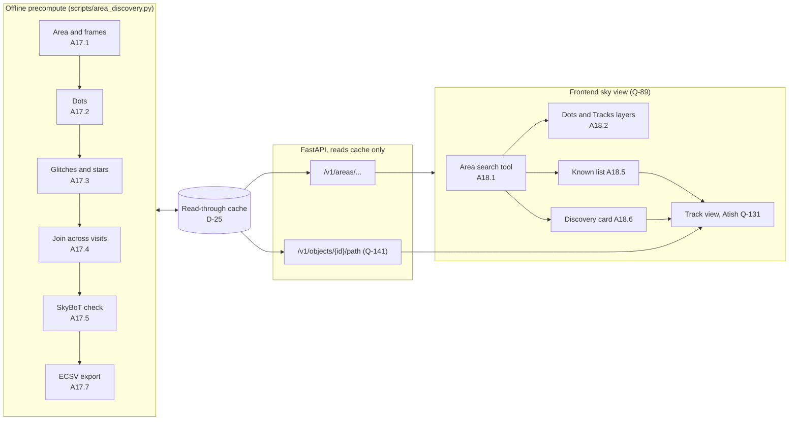

# Area search: Known objects (Track) and Discovery

> **Part of:** Architecture spec ([index](README.md)) · **Sections:** A16–A16.7 · **Backend:** [linker-backend.md](linker-backend.md) (A17) · **Sky UI:** [linker-ui.md](linker-ui.md) (A18) · **Diagrams:** [uml/21-linker.md](../uml/21-linker.md)

Status: **agreed plan, not built** ([Q-146](../decisions.md), 9 Nov 2026). It replaces the first proposal of this fragment (the blind Band-Hop Linker with an injection atlas, Q-113), re-scoped after Atish's review (Q-131). The file keeps its name so links stay valid. Labels follow the architecture spec: **Tested**, **Documented**, **To build / Not confirmed**.

Clickable mock-ups: `mockup/spherex-ui.html` (Area search tool, key 5) and `mockup/chase-the-rock.html` (Track). Mock-ups are visual input only, never a spec (D-01).

## A16 Area search

The user draws a square on the sky. A card then offers two ways to search it:

1. **Known objects.** Asteroids and comets already on file that crossed the square while SPHEREx looked (SkyBoT). Picking one opens **Track** (Atish, Q-131): its Horizons path from SPHEREx, the SPHEREx frames that caught it, a north-up zoom with stars masked and a spectrum built exposure by exposure.
2. **Discovery.** Find the dots in the square's frames, drop one-exposure glitches, drop stars, join what moves between visits, then check the joined tracks against SkyBoT. A track that matches a known object reads "found blind = (designation)" and opens Track; one that matches nothing reads "unexplained track".

In one sentence for the public: draw a square, then either follow a rock we already know, or let the computer look for dots that move and see whether anyone has named them.

### A16.1 Why and who

| Item | Detail | Label |
|---|---|---|
| Gap | The SPHEREx Solar System Object Catalog tracks objects with **known** orbits and leaves unknown-object mining to "community researchers" (Lisse, Bauer and Kim 2024, [arXiv:2402.08705](https://arxiv.org/abs/2402.08705)). The pipeline does forced photometry at known positions (Akeson et al. 2025, [arXiv:2511.15823](https://arxiv.org/abs/2511.15823)). | Documented |
| Public users | Follow a famous rock on real SPHEREx frames (Known), and watch the computer find one blind (Discovery). | To build |
| Demo moment | Draw the square around 433 Eros on its 20 to 21 Mar 2026 frames (Q-137), run Discovery: it finds Eros without being told where it is, SkyBoT confirms it, and one click opens Track on the same rock. | To build |
| Researchers (after the event) | The same tool with the full linker: a rate-grid linker over many visits, an injection-recovery completeness curve and ADES export (A16.7, phase 2). | Not in the event build |
| Why "band-hop" | One SPHEREx frame covers a range of wavelengths across its field ([A3.1](data-sources.md#a31-spherex-irsa)), so each detection of a mover lands at a different wavelength. Track builds the spectrum from that; Discovery shows each dot in its wavelength colour. | Documented (instrument) |

### A16.2 Scope

**Event build (by 14 Nov 2026):**

- The **Area search** tool on the sky view: draw a square, the two-option card, the Known list, the Discovery card with its five steps, the Dots and Tracks layers, the blink between visits, the track card (A18).
- **Track** for known objects, as Atish specifies it (Q-131, Q-134 to Q-145). This fragment does not respecify Track; it only hands off to it.
- **Discovery backend** for precomputed areas (A17): frames, dot detection, glitch and star removal, joining across visits, SkyBoT check, an ECSV export of the tracks.
- 1 to 3 **precomputed areas**, one of them the Eros area. Desktop browser only, on the A15 (Q-132).

**Phase 2 (after the event), kept here so the idea is not lost:** the rate-grid linker across many visits (THOR style), the SED smoothness score, injection-recovery completeness and the shuffled-time control, ADES export, live areas anywhere on the sky.

**Never:**

- **No discovery claim.** An unmatched track is "unexplained", never "an asteroid", "new" or "a discovery" (A16.5).
- No computing in a web request. Discovery runs offline in a script; the API serves cached results (A17.8).
- No change to the object pipeline (stages 1 to 7, [A4](pipeline.md#a4-pipeline)). Discovery is a separate **area** pipeline that reuses its adapters and helpers.

### A16.3 Architecture

| Part | Code (proposed) | Owner (D-17) |
|---|---|---|
| Discovery pipeline | `backend/app/core/area/` (`frames.py`, `dots.py`, `clean.py`, `join.py`, `match.py`, `export.py`, `service.py`) | Kevin |
| Precompute script | `backend/scripts/area_discovery.py` | Kevin |
| API | `backend/app/api/areas.py`, models in `backend/app/api/models.py` | Kevin |
| Star list for movers (shared with Track's masks, Q-143) | `core/find/overlays.py` extension | Kevin, Moon |
| Schemas and fixtures | `shared/schemas/area-*.schema.json`, `shared/fixtures/area/` | Moon |
| Area tool, cards, layers, state | `frontend/src/app/sky/area/`, `frontend/src/app/shell/`, `frontend/src/state/store.ts` | Moon |
| Track (path, frames, zoom, spectrum, sound) | per Q-131 to Q-145 | Atish |

Reused, not rewritten: `adapters/irsa_sia.py`, `adapters/irsa_cutout.py`, `adapters/gaia.py`, `adapters/wise.py`, `adapters/skybot.py`, the cache, `core/find/wcs.py` (pixel to sky, `wavelength_at`), the Stage 2 flag reject list and background method ([A4.2](pipeline.md#a42-stage-2-measure-brightness-and-spectrum)), PR #53's moving-object frame search, `viewer/sky/skyMath.ts` (`raDecToScreen`), `app/flipbook/wavelengthColor.ts`, `app/shell/PanelCard.tsx`, Track's sky layer and export (Q-131, Q-145).

### A16.4 Data flow

1. **Choose areas** (centre, size, data release QR2, the visits) in `backend/scripts/targets.toml`, group `areas`. One is the Eros area of 20 to 21 Mar 2026.
2. **Precompute** with `python -m scripts.area_discovery --area <id>` while the internet is good. Every external call goes through the read-through cache. The script writes derived JSON for the area (A17.10).
3. **Serve.** `/v1/areas/...` reads that JSON. Under `SX_OFFLINE=1` nothing reaches the network.
4. **Draw a square.** The frontend finds the precomputed area that contains the square. A square outside every precomputed area is refused (`area:not_prepared`) and the card lists the prepared areas with a button to fly there.
5. **Show.** Known reads the area's SkyBoT list; Discovery reads its dots and tracks and plays the five steps.

### A16.5 Honesty rules

| Output | Tag (A5.2) | Badge (D-02) | Notes |
|---|---|---|---|
| Dot pixel centroid, flux, error | `measured` | Measured | Same flux method as Stage 2. |
| Dot RA/Dec, wavelength | `derived` | Estimated | Through the frame WCS and `WCS-WAVE`. |
| "Glitch" and "star" labels on a dot | `derived` | Estimated | Rule shown (A17.3). |
| A track (which dots belong together) | `derived` | Estimated | Rule and thresholds in `provenance`. |
| SkyBoT match | `derived` | Estimated | Designation and separation shown. |
| Wavelength colours on the sky | `artistic` | Default | A display choice. |

- **Wording.** "T1 · found blind = 433 Eros"; "T2 · unexplained track"; "T3 · possible · 1 visit". Never "asteroid", "new" or "discovery" for an unmatched track. The track card says what an unexplained track is: "a lead for follow-up, not a discovery".
- **Refuse rather than invent.** An area with fewer than 2 visits: no tracks, `area:visits` in `missing`. A stamp whose cutout is not cached: `stamp:<dot_id>`.
- **Precomputed, said so.** The Discovery card shows when the search ran (`computed_at`). Its button reads "Look for movers"; the steps replay the precomputed result.
- **Flagged frames stay visible** (Q-139): a frame kept with OUTLIER on the core is drawn hollow and flagged in the export.
- **Fixtures.** Synthetic fixtures carry the dev-only Fixture badge and never reach a production build (Q-32).

### A16.6 Open items

| Item | Why it matters | Status |
|---|---|---|
| Visits per area and the gap between them | Joining needs at least 2 visits; the gap sets the search radius. A3.1 says about 0.8 days for one spot; a cache check reported 0.7 to 88 days. | **[verify]**, Q-114, Day 0 |
| Per-exposure depth (5σ point source per band) | Sets how faint a dot can be and how many dots a frame has. Survey depths of 19.5 to 19.9 AB (Bock et al. 2025, [arXiv:2511.02985](https://arxiv.org/abs/2511.02985)) are not per-exposure. | **[verify]**, Day 0 |
| Motion inside one visit | Eros's 4 exposures span about 7 minutes; at 0.5 deg/day that is about 1.5 px. It decides whether a visit alone shows the direction. | **[verify]** on the Eros frames |
| Trailing | Smear starts near 0.53 deg/day and is significant near 1.2 deg/day (Lisse et al. 2024, appendix). | Documented |
| IRSA MOST for the Known list | Faster than SkyBoT per epoch if its positions are SPHEREx-centred. | Kevin, Q-140 |

### A16.7 Tickets and plan

Three tickets (D-29 "as few tickets as possible"), milestone **M4 Extras**, priority P2. Track has its own tickets (Atish, Q-131).

| Ticket | Owner | Checklist |
|---|---|---|
| **D1 Discovery backend** | Kevin | Day 0 count on the Eros frames: visits, gap, exposures per visit, motion inside a visit, per-exposure S/N (recorded in A16.6 and Q-114) · area frames (A17.1) · dots (A17.2) · glitches and stars (A17.3, star list shared with Q-143) · join (A17.4) · SkyBoT (A17.5) · ECSV (A17.7) · API (A17.8) · determinism test (A17.10) |
| **D2 Area tool UI** | Moon | Schemas and fixtures (A17.9) · Area tool and drawing (A18.1) · layers (A18.2) · blink (A18.3) · cards (A18.4 to A18.7) · hand-off to Track · minimise to the island (A18.4) · copy and badges · tests (A18.10) |
| **D3 Integration** | Shared, M5 | Precompute the demo areas under `SX_OFFLINE=1` · e2e on the real cache (Eros found blind, then Track) · this spec and [uml/21](../uml/21-linker.md) updated to "as built" |

- **Order:** agree the JSON shapes (A17.8, A17.9) first, so D1 and D2 build in parallel against fixtures (D-29).
- **Gate:** if Day 0 shows Eros is not found blind on its own frames, keep Known and Track, and show Discovery only as the five steps on the Eros area with its real counts, without claiming tracks. Never drop the "unexplained, not a discovery" wording.
