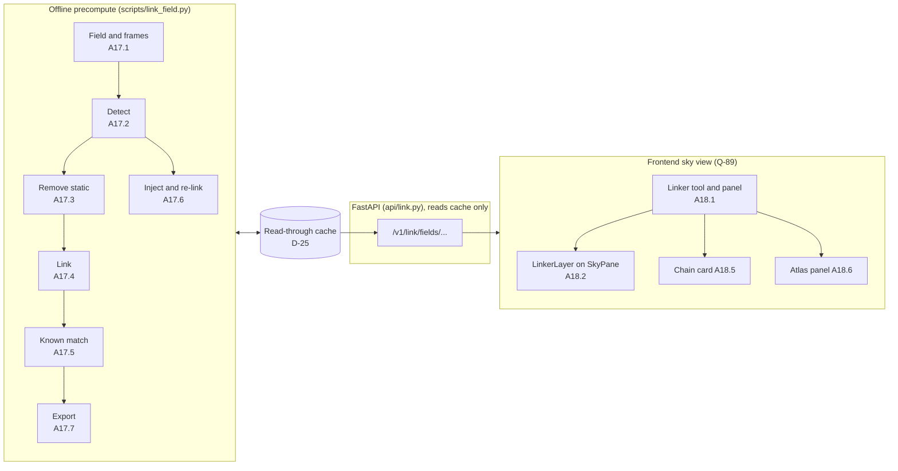

# Band-Hop Linker

> **Part of:** Architecture spec ([index](README.md)) · **Sections:** A16–A16.7 · **Backend:** [linker-backend.md](linker-backend.md) (A17) · **Sky UI:** [linker-ui.md](linker-ui.md) (A18) · **Diagrams:** [uml/21-linker.md](../uml/21-linker.md)

Status of this fragment: **proposal, not built.** It becomes a decision when [Q-113](../decisions.md) is answered. Labels follow the architecture spec: **Tested**, **Documented**, **To build / Not confirmed**.

## A16 Band-Hop Linker

A blind moving-object linker for SPHEREx frames, plus a **completeness atlas** that says how many movers it catches. It is folded into the existing sky view (Q-89) as two layers and a tool, not built as a separate page.

In one sentence for the public: the computer joins dots that are not stars into the paths of space rocks, then hides fake rocks to test how many it finds.

### A16.1 Why and who

| Item | Detail | Label |
|---|---|---|
| Gap | The SPHEREx Solar System Object Catalog tracks objects with **known** orbits and leaves unknown-object mining to "community researchers" (Lisse, Bauer and Kim 2024, [arXiv:2402.08705](https://arxiv.org/abs/2402.08705)). The pipeline does forced photometry at catalogue positions and lists known solar system objects per frame (Akeson et al. 2025, [arXiv:2511.15823](https://arxiv.org/abs/2511.15823)). IRSA's MOST needs a known orbit. | Documented |
| Scientist users | SSOC external collaborators, NEO and small-body observers, anyone planning a THOR or HelioLinC run on SPHEREx. | To build |
| What they get | A published **injection-recovery completeness curve** for blind linking on SPHEREx frames, a shuffled-time false-link rate, and a candidate list in ECSV with an ADES file ready for the SPHEREx team. | To build |
| Public users | See detections join into tracks on the real sky, click a track, see its colours built hop by hop. | To build |
| Why "band-hop" | One SPHEREx frame covers a range of wavelengths across its field ([A3.1](data-sources.md#a31-spherex-irsa)), so each detection of a mover lands at a different wavelength. The linker uses that: brightness must change smoothly with wavelength along a real chain. | Documented (instrument), To build (use) |

### A16.2 Scope and non-goals

**In scope (event build):** 1 to 2 precomputed fields; detection, star removal, linking, known-object match, injection harness, shuffled-time control, exports; the sky layers, linker panel, chain card and atlas panel; synthetic fixtures for every endpoint.

**Not in scope:**

- **No discovery claim.** A chain that matches nothing known is an "unmatched chain", a candidate, never "an asteroid" and never "a discovery" (A16.5).
- No live linking in a web request. Linking runs offline in a script; the API serves cached results only (A17.10).
- No MPC submission. No SPHEREx observatory code was found, so the ADES file is written and marked not submittable (A17.7).
- No all-sky run, no formal orbit determination, no GPU code.
- No change to the object pipeline (stages 1 to 7, [A4](pipeline.md#a4-pipeline)). The linker is a separate **field** pipeline that reuses its adapters and helpers.

### A16.3 Architecture

Three parts, joined only by JSON in the read-through cache (D-25) and by the shared schemas (D-18):

| Part | Code (proposed) | Owner (proposal, D-17) |
|---|---|---|
| Field pipeline | `backend/app/core/link/` (`field.py`, `extract.py`, `static.py`, `link.py`, `match.py`, `inject.py`, `export.py`, `service.py`) | Kevin |
| Precompute script | `backend/scripts/link_field.py` | Kevin |
| API | `backend/app/api/link.py`, models in `backend/app/api/models.py` | Kevin |
| Schemas and fixtures | `shared/schemas/link-*.schema.json`, `shared/fixtures/link/` | Moon |
| Sky layers, panels, state | `frontend/src/app/sky/linker/`, `frontend/src/app/shell/`, `frontend/src/state/store.ts` | Moon |
| Haptics for chains (optional) | `frontend/src/haptics/` | Atish (M3) |

Reused, not rewritten: `adapters/irsa_sia.py`, `adapters/irsa_cutout.py`, `adapters/gaia.py`, `adapters/wise.py`, `adapters/skybot.py`, `adapters/horizons.py`, the cache, `core/find/wcs.py` (pixel to sky, `wavelength_at`), the Stage 2 flag reject list and background method ([A4.2](pipeline.md#a42-stage-2-measure-brightness-and-spectrum)), the overlay catalogue cones ([A4.9](pipeline.md#a49-overlays-flag-mask-and-combine)), `viewer/sky/skyMath.ts` (`raDecToScreen`), `app/flipbook/wavelengthColor.ts`, `app/shell/PanelCard.tsx`, `app/shell/Transport.tsx`.

### A16.4 Data flow

1. **Choose a field** (centre, radius, data release, one pass) in `backend/scripts/targets.toml`, group `linker` (proposal).
2. **Precompute** with `python -m scripts.link_field --field <id> --seed <n>` while the internet is good. Every external call goes through the read-through cache. The script writes derived JSON for the field under the cache (A17.10).
3. **Serve.** `/v1/link/...` reads that JSON. Under `SX_OFFLINE=1` nothing reaches the network, and a field that was not precomputed answers 404 `field_not_found`; nothing is computed in the request.
4. **Show.** The frontend loads the field list, then detections, chains and completeness for the chosen field, and draws them on the sky.

### A16.5 Honesty rules

| Output | Tag (A5.2) | Badge (D-02) | Notes |
|---|---|---|---|
| Detection pixel centroid, flux, error | `measured` | Measured | Same flux method as Stage 2. |
| Detection RA/Dec, wavelength | `derived` | Estimated | Through the frame WCS and `WCS-WAVE`; formula shown. |
| "Static" label on a detection | `derived` | Estimated | Catalogue match or repeat test; rule shown. |
| A chain (which detections belong together) | `derived` | Estimated | Algorithm and thresholds in `provenance`. |
| Known-object match | `derived` | Estimated | SkyBoT designation and separation shown. |
| SED smoothness score, fit residual | `derived` | Estimated | Formula shown. |
| Completeness curve, recall, 50 % magnitude | `model_dependent` | Estimated | Depends on the injection model; its assumptions are listed. |
| Wavelength colours on the sky and stamps | `artistic` | Default | A display choice. |

- **Wording.** Matched chains: "T01 · found blind = (designation)". Others: "T03 · unmatched chain". Never "asteroid", "new" or "discovery" for an unmatched chain. A low SED score reads "low confidence".
- **Synthetic movers never reach the sky.** Injected movers exist only inside the injection run (A17.6); they are never drawn on the sky, never served as images and never written to the cutout cache.
- **Refuse rather than invent.** No per-exposure limit measured: the atlas draws no limit band and lists `link:limit` in `missing`. A field with too few frames in its pass: no chains, `link:frames` in `missing`. A stamp whose cutout is not cached: `stamp:<det_id>`.
- **Precomputed, said so.** The UI says when the linking ran (`computed_at`). The panel's reveal button reads "Show the linked chains", not "Run".
- **Fixtures.** Synthetic fixtures carry the dev-only Fixture badge and never reach a production build (Q-32).

### A16.6 Open items

| Item | Why it matters | Status |
|---|---|---|
| Per-exposure depth (5σ point source per band) | Sets the magnitude axis, the recall limit and how many orphans a frame has. The 19.5 to 19.9 AB figures often quoted are survey depths (Bock et al. 2025, [arXiv:2511.02985](https://arxiv.org/abs/2511.02985)). | **[verify]**, measured first (Day 0, A16.7) |
| Band revisit inside a pass | [A3.1](data-sources.md#a31-spherex-irsa) says the bands for one spot are captured within about 0.8 days; a check of cached frame lists on 8 Nov 2026 reported passes of 0.7 to 88 days (not re-checked). Field size and the hypothesis grid depend on it. | **[verify]**, Q-114 |
| Same-channel revisit interval | Whether two hops can share a channel inside one pass. | **[verify]** |
| PSF per band for injections | The cutout `PSF` extension is not cached (Q-20). Injections use a Gaussian per band until it is. | **[verify]** FWHM per band |
| Trailing | Smear starts near 0.53 deg/day and is significant near 1.2 deg/day (Lisse et al. 2024, appendix). The linker's top rate is 1.2 deg/day. | Documented |
| SPHEREx MPC observatory code | Needed for a submittable ADES file. | Not found |
| Pipeline known-object list (kete Parquet) public? | Free truth for which frames hold known objects. | **[verify]** |
| Moving-object frames (Q-21) | The object pipeline refuses them. The linker does not use object frame lists; it searches frames by field (A17.1). | Not blocking |

### A16.7 Tickets and plan

Three tickets (folded, D-29 "as few tickets as possible"), milestone **M4 Extras** unless Q-113 says otherwise. Reviewer for the spec: Atish.

| Ticket | Owner | Checklist |
|---|---|---|
| **L1 Data and precompute** | Kevin | Day 0 measurement (exposures per day and per-exposure S/N for 5 known asteroids; result recorded in A16.6) · field frames (A17.1) · detection (A17.2) · static removal (A17.3) · linker (A17.4) · known match (A17.5) · injection and shuffled control (A17.6) · exports (A17.7) · API (A17.8) · determinism test (A17.10) |
| **L2 Sky UI** | Moon | Schemas and fixtures (A17.9) · contract and validation · Linker tool and panel (A18.1) · LinkerLayer (A18.2) · transport (A18.3) · camera (A18.4) · chain card (A18.5) · atlas (A18.6) · copy and badges · tests (A18.10) |
| **L3 Integration and docs** | Shared, M5 | Precompute the demo fields under `SX_OFFLINE=1` · e2e on the real cache · this spec and [uml/21](../uml/21-linker.md) updated to "as built" · answer Q-113 and Q-114 |

- **Order:** agree the JSON shapes (A17.8, A17.9) first, so L1 and L2 build in parallel against fixtures (D-29).
- **Gate:** if the Day 0 depth is too shallow for useful chains, keep the injection harness and the completeness curve ("here is the limit") and cut live chains from the demo. Never cut the shuffled-time control or the candidate wording.
- **Optional:** chain haptics (A18.9) as a separate M3 ticket for Atish.
