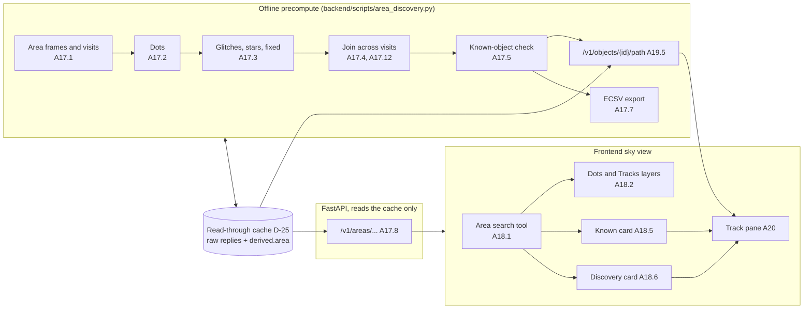

# Area search: Known objects and Discovery

> **Part of:** Architecture spec ([index](../README.md)) · **Sections:** A16 to A16.6 (A16.7 to A16.8 in [area-plan.md](area-plan.md)) · **Implements:** [Q-146](../../decisions/moving-objects.md), [Q-131](../../decisions/moving-objects.md), [Q-137](../../decisions/scope-process.md), [Q-132](../../decisions/platform-hosting.md) · **Read with:** [area-plan.md](area-plan.md) (A16.7, A16.8), [area-backend.md](area-backend.md) (A17), [area-contract.md](area-contract.md) (A17.6 to A17.13), [area-ui.md](area-ui.md) (A18), [track.md](track.md) (A19), [track-ui.md](track-ui.md) (A20), [uml/22](../../uml/22-area-search.md)

Status: **agreed plan, not built** ([Q-146](../../decisions/moving-objects.md), 9 Nov 2026). It replaces the blind Band-Hop Linker with an injection atlas (Q-147), re-scoped after Atish's review (Q-131). [Q-203](../../decisions/moving-objects.md) (10 Nov 2026) adds four gated research checks (A16.2, A16.7, A16.8). Labels follow the architecture spec: **Tested**, **Documented**, **To build / Not confirmed**. Placeholders written as **Proposed (Q-178 to Q-187)** wait for a decision row; until then the rest of this fragment does not depend on them unless it says so.

Clickable mock-ups: `mockup/spherex-ui.html` (Area search is mock-up tool 5; the app adds no number keys, Q-121) and `mockup/chase-the-rock.html` (Track). Mock-ups are visual input only, never a spec (D-01).

## A16 Area search

The user draws a square on the sky. A card then offers two ways to search it:

1. **Known objects.** Asteroids and comets already on file that crossed the square while SPHEREx looked. SkyBoT lists them; their positions come from Horizons seen from SPHEREx (Q-138). **Track it** opens **Track** ([A19](track.md), [A20](track-ui.md)): the object's path, the SPHEREx frames that caught it, a north-up zoom with stars masked and a spectrum built exposure by exposure.
2. **Discovery.** Find the dots in the square's frames, drop one-exposure glitches, drop stars and dots fixed in both visits, join what moves between visits, then check the joined tracks against known objects. A track that matches one reads "found blind = (designation)" and opens Track; one that matches nothing reads "unexplained track".

In one sentence for the public: draw a square, then either follow a rock we already know, or let the computer look for dots that move and see whether anyone has named them.

### A16.1 Why and who

| Item | Detail | Label |
|---|---|---|
| Gap | The SPHEREx Solar System Object Catalog tracks objects with **known** orbits and leaves unknown-object mining to "community researchers" (Lisse, Bauer and Kim 2024, [arXiv:2402.08705](https://arxiv.org/abs/2402.08705)). The pipeline does forced photometry at known positions (Akeson et al. 2025, [arXiv:2511.15823](https://arxiv.org/abs/2511.15823)). | Documented |
| Public users | Follow a famous rock on real SPHEREx frames (Known), and watch the computer pick out dots that move without being given any object's position (Discovery). | To build |
| Demo moment | The Eros area of 20 to 21 Mar 2026 (Q-137). **We chose this area because Eros crosses it** (A17.1). Discovery is not given Eros's position: it finds the dots that move, and the known-object check then names one of them 433 Eros. One click opens Track on the same rock. | To build |
| Researchers | Four checks that make a lead usable: how often the search finds planted movers, how many false tracks it makes on scrambled data, whether a track's spectrum looks like one body, and a linker that uses 3 or more visits (A16.8, Q-203). After the event: ADES export and live areas anywhere (phase 2). | Checks: gated extras (A16.7); the rest not in the event build |
| Why "band-hop" | One SPHEREx frame covers a range of wavelengths across its field ([A3.1](../data-sources.md#a31-spherex-irsa)), so each detection of a mover lands at a different wavelength. Track builds the spectrum from that; Discovery shows each dot in its wavelength colour. | Documented (instrument) |

### A16.2 Scope

**Event build (by 14 Nov 2026):**

- The **Area search** tool on the sky view: draw a square, the Options card, the Known list, the Discovery card with its five steps, the Dots and Tracks layers, the blink between visits, the Result card (A18).
- **Track** for known objects ([A19](track.md) data and backend, [A20](track-ui.md) screen). Track is the MVP (Q-131, Q-137); Area search hands off to it and does not respecify it.
- **Discovery backend** for precomputed areas (A17): frames, dots, glitch and star removal, joining across visits, the known-object check, an ECSV export.
- 1 to 3 **precomputed areas**, one of them the Eros area. Desktop browser only, on the A15 (Q-132). The demo data is frozen on QR2 (Q-137).

**Event build, gated extras ([Q-203](../../decisions/moving-objects.md), A16.7, A16.8):** four research checks, each its own ticket, built only after the core demo works and cut if not finished and tested by 13 Nov:

- **Completeness and a planted test mover** (A17.6, A18.11): how often the search finds movers we plant in this square's real frames, shown as a grid per brightness and speed.
- **Shuffled-time control** (A17.6): the same search on frames with permuted times, to count the tracks it makes from chance alignment.
- **Spectrum smoothness score** (A17.13): a label per track saying whether its flux against wavelength looks like one body.
- **Rate-grid linker** (A17.12): for an area with 3 or more visits, links all visits at once.

**Phase 2 (after the event), kept so the idea is not lost:** ADES export, live areas anywhere on the sky, a larger completeness grid over many areas, and the full THOR or HelioLinC run on many visits.

**Never:**

- **No discovery claim.** An unmatched track is "unexplained", never "an asteroid", "new" or "a discovery" (A16.5). No single catch-rate number: completeness is shown only as the grid for the squares tested (A18.11), never as one figure for the sky.
- No computing in a web request. Discovery runs offline in a script; the API serves cached results (A17.8).
- No change to the object pipeline (stages 1 to 7, [A4](../pipeline.md#a4-pipeline)). Discovery is a separate **area** pipeline that reuses its adapters and helpers.

### A16.3 Architecture

| Part | Code (proposed, **To build**) | Owner |
|---|---|---|
| Discovery pipeline | `backend/app/core/area/` (`frames.py`, `dots.py`, `clean.py`, `join.py`, `match.py`, `service.py`) | Kevin (D-17) |
| Checks: planted movers and completeness, shuffled-time control, spectrum score, rate-grid linker (gated extras, Q-203) | `backend/app/core/area/` (`inject.py`, `control.py`, `sed.py`, `rategrid.py`) | Kevin |
| Precompute script | `backend/scripts/area_discovery.py` | Kevin |
| API | `backend/app/api/areas.py`, models generated from the schemas (D-18) | Kevin |
| Star list for movers (shared by Track's masks and Discovery, Q-143) | `backend/app/core/find/stars.py` (library), `catalogs.py`, `overlays.py` ([A19.6](track.md#a196-star-list-for-movers)); built in #95 | Atish (proposed, Q-404) |
| Shared ECSV writer | `backend/app/core/export/ecsv.py` ([A19.9](track-contract.md#a199-export)) | Kevin |
| Schemas and fixtures | `shared/schemas/area-*.schema.json`, `shared/fixtures/area/` | Moon (D-17) |
| Area tool, cards, layers, state | `frontend/src/app/sky/area/`, `frontend/src/app/shell/`, `frontend/src/state/store.ts` | Moon (D-17) |
| Track backend | [A19](track.md) | Kevin, **Proposed (Q-183)** |
| Track screen and sound | [A20](track-ui.md), `frontend/src/app/track/` | Atish (Q-131), **Proposed (Q-183)** as a D-17 amendment, since `app/` is Moon's |

Reused, not rewritten: `adapters/irsa_sia.py`, `adapters/irsa_cutout.py`, `adapters/gaia.py`, `adapters/wise.py`, `adapters/skybot.py`, `adapters/horizons.py`, the cache, `core/find/wcs.py` (pixel to sky, `wavelength_at`), the Stage 2 aperture photometry and flag reject list ([A4.2](../pipeline.md#a42-stage-2-measure-brightness-and-spectrum)), Stage 1's fixed-position SIA cone ([A4.1](../pipeline.md#a41-stage-1-find-the-object)) with PR #53's `s_region` test, `viewer/sky/skyMath.ts` (`raDecToScreen`), `app/flipbook/wavelengthColor.ts`, `app/shell/PanelCard.tsx`, the shared ECSV writer and the star list (A19).

### A16.4 Data flow

1. **Choose areas** in `backend/targets.toml` ([A3.12](../targets.md)) as `[[area]]` tables: `id`, `ra`, `dec`, `width_deg`, `height_deg`, `data_release` (`spherex_qr2`), `windows` (UTC time spans to search). Visits are computed, not configured (A17.1). The Eros area is set from Eros's known path of 20 to 21 Mar 2026, sized to hold both visits' positions (A17.1). Built (issue #97): `eros-2026-03`, loaded by `app/core/area/config.load_areas` ([Q-400](../../decisions/moving-objects.md)).
2. **Precompute** with `python -m scripts.area_discovery --area <id>` while the internet is good. Every external call goes through the read-through cache (D-25); results are stored as `derived.area` entries (A17.10). The same run pre-fetches Track for every Known object of the area, or lists the ones it skipped ([A19.12](track-contract.md#a1912-cache-offline-and-pre-fetch)). **As built (issue #129, [Q-461](../../decisions/moving-objects.md)):** after the known step, the run calls `scripts.prefetch.prefetch_target` (frames with their cutouts, path, star cones and, for a mover, the spectrum) for each Known object with an `object_id`, and logs each as `fetched` or `skipped` with its reason. A skip never fails the run. The step is skipped as a whole under `SX_OFFLINE=1` (so `--recorded`) and with `--record`. `track_available` is then read from the cache (A17.5).
3. **Serve.** `/v1/areas/...` reads those entries. Under `SX_OFFLINE=1` nothing reaches the network.
4. **Draw a square.** The frontend checks the `GET /v1/areas` index and picks the precomputed area that holds the square. None: refused in the frontend as `area:not_prepared`; the card lists the prepared areas with **Fly there** (A18.1).
5. **Show.** Known reads the area's known list; Discovery reads its dots and tracks and replays the five steps.

### A16.5 Honesty rules

| Output | Tag (A5.2) | Badge (D-02) | Notes |
|---|---|---|---|
| Dot pixel centroid, flux, error, flags | `measured` | Measured | Stage 2 aperture method at the centroid (A17.2). |
| Dot wavelength and bandwidth | `measured` | Measured | `WCS-WAVE` lookup at a measured centroid, as Stage 1 tags frame wavelengths ([A4.1](../pipeline.md#a41-stage-1-find-the-object), [Q-125](../../decisions/moving-frames.md)). |
| Dot RA/Dec | `derived` | Estimated | Measured centroid through the frame WCS. The dots are still drawn in "Measured only" (A18.2), because the WCS placement adds no model, as the flipbook places frames; not yet decided, listed for Moon in Q-202. |
| "Glitch", "star", "fixed" labels; tracklets; tracks | `derived` | Estimated | Rule and thresholds in `method` (A17.3, A17.4). |
| Known-object positions and the match | `model_dependent` | Estimated | Assumption: "orbit solutions from SkyBoT (candidates) and JPL Horizons (positions) as of `fetched_at`, seen from SPHEREx (`500@-163182`)" (A17.5, Q-138). |
| Planted test mover and the completeness grid | `model_dependent` | Estimated | Assumption in `provenance`: "synthetic point sources added in memory to this area's recorded cutouts; PSF and distance model in `method.checks`". Every planted source carries the **Injected** badge (A17.6). |
| Shuffled-time control counts | `derived` | Estimated | Tracks the search made on frames with permuted times; seeds in `method.checks` (A17.6). |
| Spectrum smoothness label | `derived` | Estimated | Rule and thresholds in `method` (A17.13). A flag, never a statement about composition. |
| Wavelength colour on the sky | `derived` | Estimated | Hue = wavelength, as Rainbow Trails is built; the tag follows Q-27 (open). In "Measured only" dots are drawn in one colour. |

- **Wording.** "T1 · found blind = 433 Eros"; "T2 · unexplained track"; "T3 · possible · 1 visit". Never "asteroid", "new" or "discovery" for an unmatched track. The Result card says what an unexplained track is: "a lead for follow-up, not a discovery", and dates it: "matches nothing known to SkyBoT as of <date>".
- **Checked, or not.** "Unexplained" needs a completed check. When the SkyBoT or Horizons call failed, the verdict is `unchecked` ("not checked against known objects"), with the reason in `missing` (A17.5).
- **Planted means planted.** A planted mover is shown only in the Checks section and on the sky with the **Injected** badge, and the sentence "We planted this mover. The search was not told where." It never enters `known`, `tracks`, the step counts or the real ECSV (A17.6), and it never shares a list with real verdicts without a divider and the badge. Planting is never presented as a discovery.
- **Completeness is a grid, not a number.** It is shown per brightness and speed for the square tested, with the caption "How often the search found movers we planted in this square. It is not a catch rate for the real sky." No single figure goes into a card, an announcement or the export.
- **Honest demo line.** The area was chosen because Eros crossed it. The Result card for Eros says: "The search was not given Eros's position. We chose this area because Eros crossed it; the known-object check then named it." Never "found without being told where to look".
- **Refuse rather than invent.** Fewer than 2 visits: no tracks, `area:visits` in `missing`. A stamp whose cutout is not cached: `stamp:<dot_id>`. Full code list in A17.8.
- **Precomputed, said so.** The Discovery card shows when the search ran (`computed_at`). Its button reads "Look for movers"; the steps replay the precomputed result.
- **Flags stay visible.** A dot whose pixels carry `OUTLIER` is kept and its flag is shown in the Result card and the export (A17.2, **Proposed (Q-178)**). Dots on the sky are not drawn hollow for it, because Discovery cannot know a dot is a mover's core. Track's spectrum shows kept OUTLIER points hollow (Q-139, [A20.7](track-ui.md#a207-spectrum-hop-by-hop)).
- **Fixtures.** Synthetic fixtures carry the dev-only Fixture badge and never reach a production build (Q-32).

### A16.6 Open items and measured facts

Facts measured on PR #53's recorded Eros fixtures (16 cutouts, `mockup/chase-the-rock.html` data):

| Item | Value | Status |
|---|---|---|
| Visits, exposures, frames | 2 visits; 4 exposures per visit; each exposure on 2 detectors at once (D1 0.79 to 1.06 µm, D4 2.6 to 3.6 µm): 16 frames | Tested (Eros only) |
| Visit length and gap | One visit spans 6.4 min (08:33:43 to 08:40:10 UTC); the two visits are 1.017 d (24.4 h) apart | Tested (Eros only); other areas **[verify]**, Q-148 |
| Motion inside a visit | 16″ (2.6 px) from exposure 1 to 4: 0.99 deg/day at PA 80.6° | Tested (Eros) |
| Motion between visits | 0.970° in 1.017 d: 0.954 deg/day at PA 105.7°. The two directions differ by 25° because of SPHEREx's orbital parallax (Q-134); A17.4 handles it | Tested (Eros) |
| Sky position | Galactic l = 195.6°, b = −4.0°: a crowded field, so star masking is tested hard (A17.3) | Tested |
| Per-exposure depth (5σ point source per band) | Survey depths of 19.5 to 19.9 AB (Bock et al. 2025, [arXiv:2511.02985](https://arxiv.org/abs/2511.02985)) are not per exposure | **[verify]**, Day 0 |
| Eros gate (A16.7, A17.4), recorded-fixture area (issue #108) | 456 dots: 12 glitch, 392 star, 0 fixed, 52 mover; 1 `track` holding Eros's 14 dots, `found_blind = 433 Eros` (median 0.037 px from Horizons seen from SPHEREx); 8 possibles (ambiguous or no partner), 0 unexplained, 0 static one-visit; `u` = 1.705 /au. Passed with the A17 rules as written; served from the committed pack | Tested offline (recorded 0.1° cutouts, Q-402 (3)); the live area run (D3) is still to do |
| Dot density and run times (offline, recorded Eros cutouts) | About 6 400 kept dots per deg² per frame (about 76 000 for the Eros area, an estimate extrapolated from 0.1° cutouts); mesh std 1.8 × sqrt(VARIANCE); Eros found in 14 of 16 frames; Stage 2 13 to 21 ms a dot | Measured offline ([Q-401](../../decisions/moving-objects.md)); live **[verify]** |
| Visits and gap for the other demo areas | Joining needs 2 visits; the gap sets `rate_min` (A17.4). A3.1 says about 0.8 days for one spot; a cache check reported 0.7 to 88 days | **[verify]**, Q-148, Day 0 |
| Trailing | Smear starts near 0.53 deg/day and is significant near 1.2 deg/day (Lisse et al. 2024, appendix) | Documented |
| IRSA MOST for frame lists | One question, Q-126 (PR #53's entry); Q-140 asks the same | Open (Kevin), [A19.3](track.md#a193-frame-list) |
| Areas with 3 or more visits (for the rate-grid linker, D7) | Eros has 2. A cache check reported passes of 0.7 to 88 days, so another spot may have more. If none is found, D7 is tested on a synthetic multi-visit area with the Fixture badge and never shown as real | **[verify]**, Day 0 |
| PSF model for planted movers (D4) | The SPHEREx PSF changes with wavelength. Use the PSF cube if D1 can read it, else a Gaussian whose width is measured on isolated stars in the area | **[verify]**, D4 |
| Spectrum smoothness thresholds (D6) | Set so Eros is `smooth` and most chance chains of the shuffled control are `rough`; Eros's rotation changes its brightness between exposures, so an error floor is needed (A17.13) | **[verify]** on Eros and the control |
