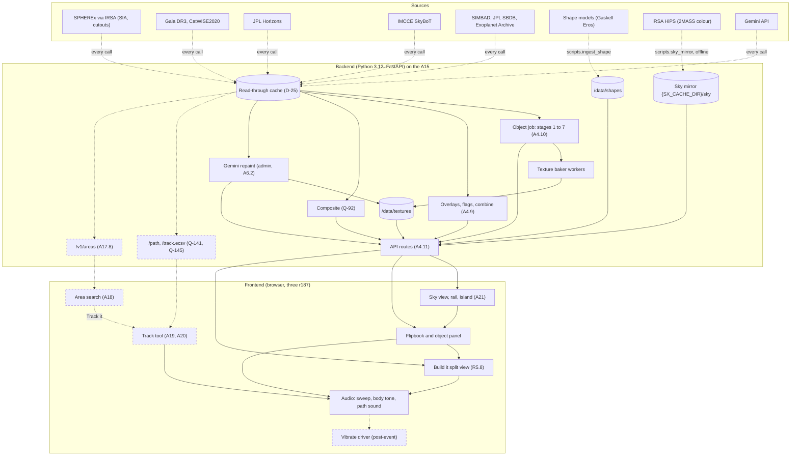

# Overview

> **Part of:** Architecture spec ([index](README.md)) · **Sections:** A1–A2.1 · **Implements:** [D-02](../decisions/contract-tags.md), [D-05, Q-132](../decisions/platform-hosting.md), [D-06, Q-137](../decisions/scope-process.md), [D-12](../decisions/haptics-design.md), [D-16](../decisions/contract.md), [D-25, D-31](../decisions/data-sources.md), [D-28, Q-131, Q-146](../decisions/moving-objects.md), [Q-89](../decisions/sky-shell.md) · **Read with:** [plan.md](plan.md) (A13 status), [../rendering/principles-stack.md](../rendering/principles-stack.md)

## A1 What we are building

A public web tool, shown at the event in a desktop browser on Atish's Asus TUF A15 laptop ([Q-132](../decisions/platform-hosting.md)). Phones and vibration come after the event.

- **Sky first.** The main view is an all-sky picture with clickable markers (Q-89, A21 in [sky-shell.md](sky-shell.md)). A user types a name or RA/Dec, or clicks a marker, and sees real SPHEREx images of that patch as a short video-like series: the **flipbook**, the base requirement of the challenge.
- **What it is made of.** The object panel shows the spectrum measured on the fly, the light curve and the ObjectCard. **Build it** opens a split view where the 3D body is moulded beside the live sky (R5.8 in [../rendering/build-mould.md](../rendering/build-mould.md)); its look, sound and (after the event) touch are generated from the data.
- **Known moving objects.** The **Track** tool follows a known asteroid or comet: its JPL Horizons path, the SPHEREx frames that caught it, a north-up zoom with stars masked, and a spectrum built exposure by exposure (A19, [moving-objects/track.md](moving-objects/track.md); Q-131). It is the MVP demo, on 433 Eros (Q-137). No blind discovery claims are made.
- **Area search.** The user draws a square on the sky; a feature card ([A21.5](sky-shell-surfaces.md#a215-overlay-surfaces-island-object-panel-object-card)) offers Known objects (opens Track) or Discovery, a replay of five steps from a precomputed result (A16, [moving-objects/area-search.md](moving-objects/area-search.md); Q-146).

### A1.1 Priority tiers

The base tool must exist before any extra. If time runs short, cut from the bottom. Status as of 9 Nov 2026; the milestone board is [A13](plan.md#a13-plan-to-14-nov).

| Tier | Feature | Status | Why |
|---|---|---|---|
| **P0** | Flipbook: coordinates or name in, SPHEREx frames out, played as a series. Must work on Barnard's Star, Epsilon Indi B, WISE 0855, RW Aurigae, R Draconis. | Built (#1, #3) | Required by the challenge. |
| **P0** | Spectrum on the fly for a clicked object (flux per frame against wavelength, with error bars and flags). Three test targets saturate (counts: [A4.2](pipeline.md#a42-stage-2-measure-brightness-and-spectrum)); the demo objects of [A3.12](targets.md#a312-test-and-demo-targets) have measured spectra (D-31). | Built (#2, #24) | The twist, and an optional challenge item. |
| **P1** | **Track tool (MVP demo, Q-137):** Eros on 20 to 21 Mar 2026; path, frames, masked zoom, spectrum hop by hop, path sound (Q-134). P1 and milestone M4: **Proposed (Q-187)**. | To build (T1 backend Kevin, T2 screen and T3 sound Atish, T4 OUTLIER rule Moon; A19.14); needs PR #53 (open) | The demo the team chose. |
| **P1** | Sky view: all-sky background, markers, rail and island (Q-89, Q-120, Q-121, Q-124). | Built (#47, #64, #66) | Context and the way in. |
| **P1** | Gaia and WISE overlays, URL coordinates, contamination flags, field of view, add and subtract images ([A4.9](overlays.md#a49-overlays-flag-mask-and-combine)). | Built (#12); endpoints await Q-50 | Optional items in the challenge. |
| **P1** | Rainbow Trails: a view mode of the flipbook, one dot per band along a moving object's path (D-28). Dot colour is a false colour, hue = wavelength, tagged `derived` (Estimated badge); in "Measured only" the dots are drawn in one colour (D-21, Q-27). | UI built (#3); real movers wait for PR #53 (Q-21) | The team's early concept ([handover](../handover.md) §5). |
| **P1** | Classify the object, then Sky Sculptor (3D body from the ObjectCard and RenderParams), shown in the Build it split view. | Built (M2, #60) | Headline wow. |
| **P1** | Spectrum sound with audio pairing, for every object (R8.6, R8.9); vibration after the event (Q-132). | Built against fixtures (PR #36; issue #10 still open); wired into the app in M5 | Access for blind and low-vision users. Works on every object, even a `candidate`. |
| **P2** | Physics layer, all body types, sliders ([A7](physics.md#a7-physics-layer)). | Built in the browser (#13) | Depth. |
| **P2** | Body sound: a continuous tone that follows the height under the pointer (Q-133); per-type texture vibration after the event. | Tone to build (Atish) | Depth and access. |
| **P2** | Sound (data sweep, imagined drive) ([A8](sound-voice.md#a8-sound-and-voice)). | Data sweep built (#11); imagined drive in the mock-up only | Access and wow. |
| **P2** | Area search: Known objects and Discovery (A16 to A18, Q-146), tickets D1 to D3, Day 0 gate (A16.7). | To build (Kevin, Moon; M4) | Shows SPHEREx finding a mover. |
| **P3** | Gemini artistic layer (admin only, [A6.2](generators.md#a62-optional-gemini-artistic-layer)), fluid solver for gas giant storms. | Gemini built (PR #48); solver not built | Stretch only. |
| **Backlog** | Gemini Live voice control (B-02), AI sound clips (B-03), image-to-3D (B-04), Tauri Android app (B-01), phone vibration (Q-132). | Not built for the event | Post-event (D-06). |

---

## A2 System overview

As built on 9 Nov 2026, from the routers in `backend/app/main.py`. Dashed nodes are planned or post-event. Every route: [A4.11](endpoints.md#a411-endpoint-register).

The event build runs locally on the A15 with `SX_OFFLINE=1` ([A10.2](frontend-platform.md#a102-running-the-event-build)). SkyBoT is reached only by the pre-fetch script today ([A3.5](data-sources.md#a35-imcce-skybot)). Post-event backlog items (B-01 to B-04) are not drawn. Full UML set: [uml/](../uml/README.md) (component view: UML 02, deployment: UML 03).

### A2.1 Design principles

1. **Code first.** Every body is built by code from its ObjectCard and RenderParams. Generative AI is optional and never required.
2. **Data, not generated code.** Data produces an ObjectCard. Deterministic rules turn it into RenderParams. A fixed set of tested generators turns those into a body. No model writes code or produces a number at runtime.
3. **Honest labels.** Every value carries one of 5 provenance tags (`measured`, `derived`, `model_dependent`, `inferred_from_analog`, `artistic`). The UI shows them as 3 badges: Measured, Estimated, Default (D-02, [A5.2](data-contract.md#a52-provenance-tags-and-badges)). Every picture is labelled an artist's impression.
4. **Repeatable.** The same ObjectCard and seed always give the same body, with byte-identical textures.
5. **Never blank.** The code version loads first. Optional layers swap in only if they succeed.
6. **One height field drives look, touch and sound.** The same field feeds the normals, the displacement, the haptics and the surface sound, so they never disagree (rendering doc §1, principle 6). Shader-drawn bodies use a shared CPU field for this (D-12).
7. **Runs on modest hardware.** Targets and budgets: [A10.1](frontend-platform.md#a101-performance-budget-d-05). Heavy jobs run offline.
