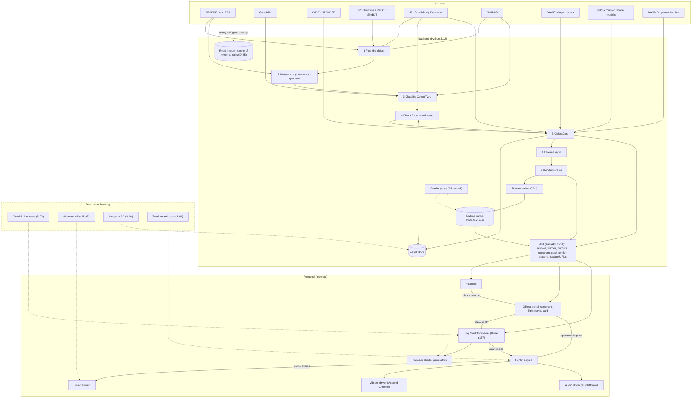

# Overview

> **Part of:** Architecture spec ([index](README.md)) · **Sections:** A1–A2.1 · **Implements:** D-02, D-05, D-06, D-12, D-16, D-25, D-28

## A1 What we are building

A public web tool. A user enters RA/Dec or a name and sees real SPHEREx images of that patch as a short video-like series (the base requirement). On top of that, every moving or interesting object also tells you what it is made of: its spectrum, its class, and a 3D model, sound and touch (haptics) generated from that data.

### A1.1 Priority tiers

The base tool must exist before any extra. If time runs short, cut from the bottom.

| Tier | Feature | Why |
|---|---|---|
| **P0** | Flipbook: coordinates or name in, SPHEREx frames out, played as a series. Must work on Barnard's Star, Epsilon Indi B, WISE 0855, RW Aurigae, R Draconis. | Required by the challenge. |
| **P0** | Spectrum on the fly for a clicked object (flux per frame against wavelength, with error bars and flags). | The twist, and an optional challenge item. |
| **P1** | Gaia and WISE overlays, URL coordinates, contamination flags, field of view, add and subtract images. | Optional items in the challenge. |
| **P1** | Rainbow Trails: a view mode of the flipbook, one dot per band along a moving object's path. Uses the frames and mover positions the flipbook already loads. Built after basic playback works (D-28). | The team's early concept ([handover](../handover.md) §5). |
| **P1** | Classify the object, then Sky Sculptor (3D body from the ObjectCard and RenderParams). | Headline wow. |
| **P1** | Spectrum haptics with audio pairing, for every object (rendering doc §8.6, §8.9). | Access for blind and low-vision users. Works on every object, even a `candidate`. |
| **P2** | Physics layer, all body types, sliders. | Depth. |
| **P2** | Per-type texture and data haptics (rendering doc §8.5; D-12 for shader-drawn bodies). | Depth and access. |
| **P2** | Sound (data sweep, imagined drive). | Access and wow. |
| **P3** | Gemini artistic layer, fluid solver for gas giant storms. | Stretch only. |
| **Backlog** | Gemini Live voice control (B-02), AI sound clips (B-03), image-to-3D (B-04), Tauri Android app (B-01). | Post-event (D-06). Not built for the event. |

---

## A2 System overview

Every arrow from a source passes through the backend's read-through cache (D-25); the diagram draws it once. The event build runs locally on the team's Asus A15 (D-24).

Full UML set: [uml/](../uml/README.md)

### A2.1 Design principles

1. **Code first.** Every body is built by code from its ObjectCard and RenderParams. Generative AI is optional and never required.
2. **Data, not generated code.** Data produces an ObjectCard. Deterministic rules turn it into RenderParams. A fixed set of tested generators turns those into a body. No model writes code or produces a number at runtime.
3. **Honest labels.** Every value carries one of 5 provenance tags (`measured`, `derived`, `model_dependent`, `inferred_from_analog`, `artistic`). The UI shows them as 3 badges: Measured, Estimated, Default (D-02, [section 5.2](data-contract.md#a52-provenance-tags-and-badges)). Every picture is labelled an artist's impression.
4. **Repeatable.** The same ObjectCard and seed always give the same body, with byte-identical textures.
5. **Never blank.** The code version loads first. Optional layers swap in only if they succeed.
6. **One height field drives look, touch and sound.** The same field feeds the normals, the displacement, the haptics and the surface sound, so they never disagree (rendering doc §1, principle 6). Shader-drawn bodies use a shared CPU field for this (D-12).
7. **Runs on modest hardware.** Targets are an Intel Iris Xe laptop (Zenbook 14X) and two Android phones (D-05). Heavy jobs run offline.
