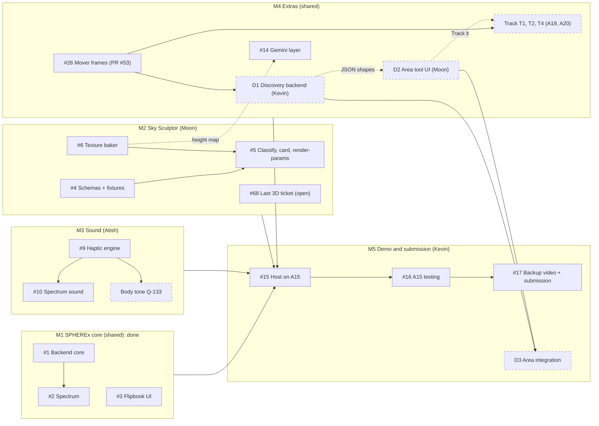

# Plan to 14 Nov

> **Part of:** Architecture spec ([index](README.md)) · **Sections:** A13 · **Implements:** [D-14, D-17, D-29, D-30, Q-137](../decisions/scope-process.md), [Q-132](../decisions/platform-hosting.md), [Q-131, Q-146](../decisions/moving-objects.md) · **Read with:** [risks.md](risks.md) (A14), [overview.md](overview.md) (A1.1 tiers), [moving-objects/area-search.md](moving-objects/area-search.md) (A16.7 tickets)

## A13 Plan to 14 Nov

Status board as of **9 Nov 2026**, from GitHub (issues and merged PRs). Dates are targets, not promises. The team builds from 5 Nov and has set aside the event rule against building before 14 Nov (D-14). Work is tracked in the GitHub project "SphereX and PlanetX - NASA COMPETITION 2026" as milestones M1 to M5 (D-29, owners D-30). M1 to M4 build against their own fixtures; only M5 joins them. Numbers like #26 are issues; "PR #n" are pull requests.

**What changed since the plan of 5 Nov:** the event build is desktop browser only on the Asus A15 (Q-132), so M3 becomes **"Sound"** (D-29 and D-30 carry the amendment; the rename on GitHub is pending) and phone testing moves after the event. The MVP demo is 433 Eros in the **Track** tool (Q-137, A19, Atish). **Area search** (Q-146, A16 to A18) joins M4 as tickets D1 to D3.

| Milestone (due, owner) | Done | Open | Next |
|---|---|---|---|
| **M1** SPHEREx core (8 Nov, shared) | #1 backend core (PR #19), #2 spectrum (PR #20), #3 flipbook (PR #21), #24 refusals (PR #27), #47 sky view (PR #49) | #25 demo targets: answered by D-31 (PR #28), Moon's sign-off pending | Close #25 once Moon confirms D-31 |
| **M2** Sky Sculptor (10 Nov, Moon) | #4 contract (PR #23), #5 card and params (PR #34), #6 baker (PR #30), #7 baked viewer (PR #29), #8 shader kinds (PR #31), #38 tiers (PR #44), #39 render core (PR #46), #40 shapes and sources (PR #45), #41 fan-out (PR #58), #42 sphere bodies (PR #52), #43 shapes and volumes (PR #51), #60 Build it (PR #61), #62 body fixes (PR #63), #64 sky marker click (PR #65), #66 rail and island (PR #67), #68 Part 0.1 exoplanet rule on (PR #69; Q-63 signed off by Moon) | the rest of #68: exoplanet looks, demo search list, Bennu shape, accuracy | Finish #68 |
| **M3** Sound (11 Nov, Atish) | #9 engine (PR #35), #11 texture haptics and sound (PR #37), spectrum haptics and calibration merged (PR #36) | #10 still open on GitHub; body tone (Q-133) and Track sound T3 (Q-134) to build | Close or re-scope #10; build the body tone (Q-133, details Q-188 to Q-192) |
| **M4** Extras (12 Nov, shared) | #12 overlays (PR #32), #13 physics (PR #33), Gemini layer merged (PR #48) | #14 still open on GitHub; #26 moving-object frames (PR #53, changes requested); Area search D1 (Kevin), D2 (Moon) not opened as issues yet; Track tickets T1, T2, T4 not opened yet (A19.14) | Land PR #53 (Q-138, Q-139 follow-ups); Day 0 count (D1, gate A16.7); open the Track and D1 to D3 issues |
| **M5** Demo and submission (15 Nov, Kevin) | | #15 integrate and host on the A15; #16 device testing (still says Zenbook and phones: re-scope to the A15, Q-132); #17 backup video and submission; D3 Area integration | Hosting (A10, #15) and the event run ([A10.2](frontend-platform.md#a102-running-the-event-build)) |
| No milestone | #56 (PR #57) | #50 bloom skip, #54 and #55 haptics follow-ups (Atish, post-event under Q-132) | |

**Track (A19, A20; Q-131 to Q-145).** The MVP demo. Tickets (A19.14, A20.15; not opened as issues yet): T1 Track backend (Kevin), T2 Track screen (Atish), T3 Track sound (Atish, M3), T4 OUTLIER-core rule (Moon); owners **Proposed (Q-183)**. It depends on PR #53 (frames for movers, open with changes requested) and on the open proposals Q-140 (frame list from MOST or path cones), Q-141 (`/path`) and Q-145 (export). Decided rules it must follow: Q-138 (SPHEREx-centred positions), Q-139 (OUTLIER on a mover's core is a flag), Q-142 (marker follows the time slider), Q-143 (per-visit star cones), Q-144 (comet caption), Q-134 (path sound), Q-135 (spin slider), Q-136 (high-resolution imagery only in the detail view; CDS permission open). P1 in milestone M4: **Proposed (Q-187)** ([A1.1](overview.md#a11-priority-tiers)).

**Area search (A16 to A18, Q-146).** Tickets D1 Discovery backend (Kevin), D2 Area tool UI (Moon), D3 integration (shared, M5), defined in [A16.7](moving-objects/area-search.md). D1 starts with the **Day 0 count** on the Eros frames (visits, gap, exposures per visit, motion inside a visit, per-exposure S/N; also settles Q-148). **Gate:** if Day 0 shows Eros is not found blind, keep Known objects and Track, and show Discovery's five steps with real counts but no tracks. It also depends on PR #53 (frames) and Q-143 (star list).

**Remaining days.**

| Date | Work |
|---|---|
| 9 to 10 Nov | M2 closes (the rest of #68; PR #69 merged). PR #53 review fixes and merge. Day 0 count (D1). Track build starts on the PR #53 fixtures. Agree the Area JSON shapes (A17.8, A17.9) so D1 and D2 run in parallel. |
| 11 Nov | M3 Sound: body tone (Q-133), path sound (Q-134). Track zoom, masks and spectrum. D1 and D2 against fixtures. |
| 12 Nov | M4: Track complete on Eros; Area search D1, D2. DR1 may appear this day **[verify]**: do not switch (Q-137). Pre-fetch and back up the cache. |
| 13 Nov | M5: host on the A15 (#15), run [A10.2](frontend-platform.md#a102-running-the-event-build) end to end offline, measure frame times on the A15 (#16), D3 integration, record the backup video (#17). |
| 14 to 15 Nov | Event. Morning checklist: [A10.2](frontend-platform.md#a102-running-the-event-build) steps 2 to 5. |

**Milestone dependencies (D-29, D-30).** Solid arrows are hard dependencies; dashed arrows are soft links that can be built against fixtures first. Node labels are GitHub issue numbers or ticket names; dashed boxes are not opened as issues yet.

