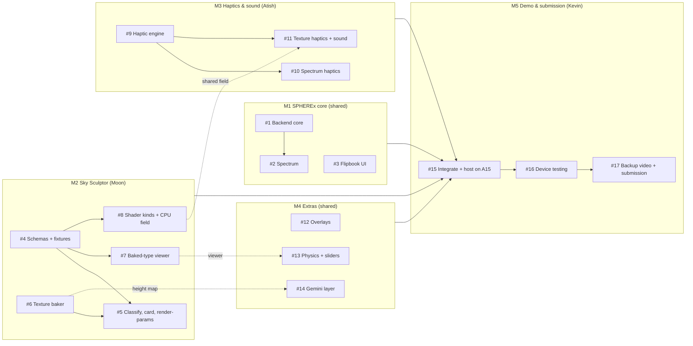

# Plan to 14 Nov

> **Part of:** Architecture spec ([index](README.md)) · **Sections:** A13 · **Implements:** D-14, D-29, D-30

## A13 Plan to 14 Nov

About 10 days. Dates are targets, not promises.

The team builds from 5 Nov and has set aside the event rule against building before 14 Nov (decisions D-14). Work is tracked as milestones M1–M5 with their due dates in D-29. M1–M4 build against their own fixtures and do not depend on each other; only M5 joins them.

| Dates | Work |
|---|---|
| 5 to 6 Nov | Data adapters and cache. Find the object, measure flux, build the flipbook for the five test targets (P0). |
| 7 to 8 Nov | Spectrum on the fly. Classify and pick the `ObjectType`. Asset lookup, ObjectCard and RenderParams. |
| 9 to 10 Nov | Texture baker for the baked types. Port the browser shader generators from the mock-up into the app. Physics layer v1 (planets and gas giants first). Haptic engine with the vibrate and audio drivers (10 Nov). |
| 11 Nov | Spectrum haptics with audio pairing, and calibration. Optional overlays (Gaia, WISE, contamination flags): built on 6 Nov in PR #32 (issue #12, [A4.9](pipeline.md#a49-overlays-flag-mask-and-combine)). Sound. |
| 12 Nov | Gemini artistic layer behind a server proxy, if time. Pre-bake demo assets and textures. |
| 13 Nov | Test on the Zenbook. Test haptics, audio sync and calibration on both Android phones. Fix performance. Record backup demo. |
| 14 to 15 Nov | Event. |

**Milestone dependencies (D-29, D-30).** Solid arrows are hard dependencies; dashed arrows are soft links that can be built against fixtures first. Owners in parentheses. Node labels are GitHub issue numbers.

