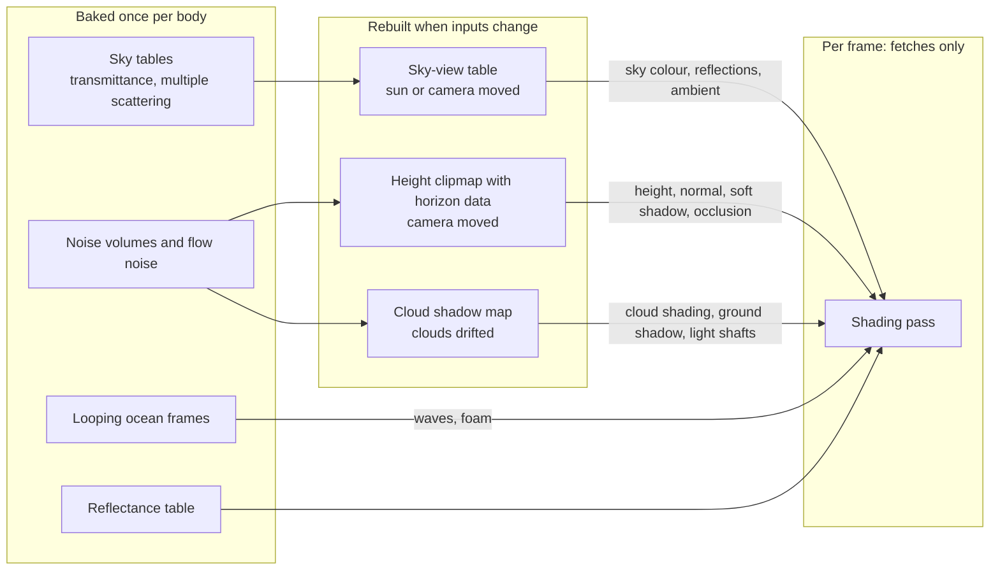

# Photorealism of celestial bodies

Research, not a spec. Recorded 12 Nov 2026 against `origin/main` at `a6337fa`. Where this file and a spec or decision differ, the spec or decision wins. Paths are under `frontend/src/`.

**Scope.** The four world types drawn by the D-37 world engine: rocky worlds, water worlds, gas giants and lava worlds. Stars, rocks and comets were not studied for realism and are not covered here.

**How this was produced.** A read of the globe and fly shaders (`engine/worlds/shaders.js:44-391`), checked against each idea. Nothing was built or measured. Every gain is an estimate. The reflectance laws, wave relations and other physics named here were written from general knowledge and must go through `/sx-verify` before any reach code.

**Read first.** [render-performance.md](render-performance.md). Most of what follows depends on the bake cache, the pass split and the height clipmap described there. Doing it earlier would add lag.

## Summary

The worlds can look far more real without costing frame time, because most of these upgrades replace a per-pixel loop that exists today with a few texture fetches. Several should make the frame cheaper.

Each upgrade is paid for in one of three ways:

- **Bake it once.** Anything fixed for a body can be as expensive as needed, because it is computed once and then looked up.
- **Spread it over frames.** When the camera is still, samples accumulate and the image keeps improving at no per-frame cost.
- **Swap in better maths at the same cost.** A more physical formula often costs the same as the current one.

Recommended order:

1. Atmosphere tables, tone curve and dithering.
2. Clouds with shadows.
3. Ocean wave spectrum and glint.
4. Sub-kilometre terrain with baked horizon shadows.
5. Accumulation when the camera is still.

The first three change how every world looks from orbit, which is where most viewers start.

## What the engine draws today

| Feature | Globe view | Fly view |
|---|---|---|
| Atmosphere | Single scattering, 10 steps per pixel, fixed Rayleigh colour (`scatter()`) | Single scattering, 16 steps per pixel (`atmo()`), with aerial perspective |
| Terrain lighting | Bump shading only, no terrain shadows | Soft shadow by a 36-step march; no sky occlusion |
| Terrain detail | Height map plus two noise layers | Nothing finer than about 0.6 km, so the ground is smooth up close |
| Clouds | The flat tracer texture, white, with an offset shadow on the ground | One flat deck lit by its own slope, cover evaluated up to 5 times per pixel |
| Ocean | Glint as a Gaussian in slope with a slope variance (`uSig`), water colour by depth, sea ice | Ripples from 9 noise lookups, Blinn-Phong highlight, Schlick Fresnel against a constant sky colour |
| Gas giants | Relief shading from the tracer gradient, limb darkening, night-side thermal glow above 850 K, ring shadows both ways | A 10-step backward advection loop with curl noise |
| Lava | Planck-coloured glow, cracks, lava channels from the hydrology image | The same rule, shared through `lavaGround()` |
| Output | `1 - exp(-1.5 c)` per channel, then gamma 2.2. No bloom, no dithering. | The same |

Two gaps run through the whole table. Nothing carries over smoothly from orbit to surface, and nothing is shared between effects: clouds, shadows and sky are each computed alone.

## Upgrades by world type

### All worlds

| Upgrade | What you see |
|---|---|
| Multiple-scattering atmosphere | Correct twilight colours, a thin bright limb from orbit, a reddened terminator |
| Soft shadows sized by the star | Penumbra width from the host star's real angular size. A close-in red dwarf gives very soft shadows. |
| Sky-lit ambient and occlusion | Valleys darker than ridges, shadows tinted by the sky |
| Tone curve, exposure and dithering | No banding in skies, highlights that roll off like a camera |
| Accumulation when still | Supersampled edges, cleaner shadows and clouds |
| Filtered baked textures | No shimmer on distant detail |

### By type

| World | Upgrade |
|---|---|
| Rocky | Terrain detail below 0.6 km: metre-scale octaves, scree on slopes, strata |
| Rocky, airless | A regolith reflectance law (Hapke or Lommel-Seeliger) in place of plain diffuse, so a full-phase disc looks flat-lit like the Moon |
| Water | A real wave spectrum from wind and gravity in the fly view, replacing the noise ripple |
| Water | Sky reflected from the sky table, whitecaps and shore foam |
| Rocky and water | Clouds with thickness at the model's cloud-base height, lit and shadowed, with shadows visible from orbit |
| Gas giant | Fine filaments that shear with the jets, cloud decks that shadow each other at the terminator, a ring phase function |
| Lava | Bloom on the blackbody emission, glow lighting haze and cloud from below, crust plates drifting along the lava channels, heat shimmer near flows |

## How each one stays cheap

| Feature | Technique | Why it costs little | Loop it replaces today |
|---|---|---|---|
| Atmosphere | Hillaire's sky tables (2020): transmittance and multiple scattering once per body, a small sky-view table when the sun or camera moves | A few fetches per pixel; table updates spread over frames | 10-step loop (globe), 16-step loop (fly) |
| Terrain shadows and ambient | Horizon mapping (Max 1988): store the skyline angle in 8 to 16 directions per terrain texel, baked with the clipmap | Two fetches give a soft shadow with the star's true penumbra, plus sky occlusion. Nothing to redo when the sun moves. | 36-step shadow march |
| Sub-kilometre terrain | Residual synthesis (Losasso and Hoppe 2004): each finer clipmap level is the coarser one upsampled plus one or two new octaves | Constant bake cost per texel, however deep the detail goes | None (new detail) |
| Clouds | A two-surface height field (cloud base and top) marched like relief, with one sun-side shadow map shared by cloud shading, ground shadows and light shafts | Quarter resolution, a sixteenth of pixels per frame with reprojection, empty sky skipped through a coverage pyramid | Up to 5 calls of 17 noise lookups (`cov2`) |
| Ocean | Tessendorf wave spectrum from wind and gravity, with wave frequencies snapped so the animation loops, baked as a 3D texture | Three fetches; the hardware interpolates in time | 9 noise lookups for ripples |
| Gas giant detail | Flow maps: two phase-shifted noise layers carried by the existing velocity texture | Two fetches of a baked texture | 10-step advection loop (about 80 lookups) and a static 9-lookup mottle |
| Lava glow | Dual-filter bloom at half resolution, run only when emissive pixels exist; its blurred mips also light haze and cloud from below | About one extra full-screen pass, zero on non-lava worlds | None (new) |
| Airless reflectance | The reflectance law stored in a small lookup table | One fetch | Plain diffuse term |
| Exposure, tone, dither | Average brightness from the top mip of a small buffer; blue-noise dither | One or two fetches | None |

The new terrain octaves must continue the existing amplitude fall-off, so they are smaller than the smallest current octave. That keeps the silhouette, and the globe and fly views, in agreement.

## Shared data

Realism gets cheap when one baked result feeds several effects.

## Keeping orbit and surface consistent

The largest quality risk is detail that shimmers or vanishes as the camera zooms out. The fix is moment-preserving filtering (LEAN mapping, Olano and Baker 2010; Bruneton's ocean method, 2010). When waves or bumps shrink below a pixel, their slope spread is kept in the texture mips and becomes surface roughness. Sharp glitter up close then widens smoothly into the broad glint the globe already draws with `uSig`.

## Techniques doing the work

- **Precompute and look up:** sky, reflectance and ocean frames.
- **Looping bakes:** snap frequencies so an animation repeats exactly. This is the same idea as the ambience loop in [weather-and-ambience.md](weather-and-ambience.md).
- **Hierarchical synthesis:** coarse data plus a small residual per level.
- **One intermediate, many users:** the cloud shadow map and the sky table each feed three or four effects.
- **Dirty flags:** rebuild a table only when its inputs change.
- **Temporal amortisation:** update a fraction per frame, reproject the rest, accumulate when still.
- **Skip what cannot show:** run bloom only when something emits, the same lesson as the wasted passes in the performance note.

## Limits and decisions

- **Memory.** Roughly 150 to 200 MB of GPU memory at full sizes (clipmap with horizon data, ocean loops, noise volumes). That needs trimming for integrated GPUs.
- **WebGL2.** The engines are raw WebGL2, so there are no compute shaders. Every bake is a fragment pass or a worker job, and float render targets depend on an extension that is common but not universal.
- **Prerequisites.** Horizon maps and sub-kilometre detail need the clipmap. Clouds and accumulation need the pass split.
- **Verbatim engines.** The engines are copied prototype code under a parity gate (Q-303, Q-335). These upgrades go beyond the prototype, so either they are made in the prototype and re-extracted, or the engine is declared forked. That is a decision for a `Q-` entry.
- **Tone curve.** Q-67 chose a highlight clip over a tone curve on the three.js path to keep derived colours true. A new curve should stay inside the "+ Artistic" engines unless that decision changes.
- **Honesty.** More convincing pictures imply more knowledge than we have. Physics-derived parts (penumbra from the star's size, glint from wind, cloud height) can be `model_dependent`. Added detail stays `artistic`.
- **Value noise.** The engine's value noise shows grid-aligned artefacts, but changing it changes every world's terrain. Left alone here.

## To verify before use

- The reflectance laws for airless bodies and their parameters.
- The wave spectrum and the relation between wind speed and sea-surface slope (Cox and Munk).
- The power-law fall-off assumed for terrain below 0.6 km.
- Any colour assigned to gas-giant cloud decks by condensation temperature.
- The host star's angular size as seen from each planet, from the card's radius and orbit values.
