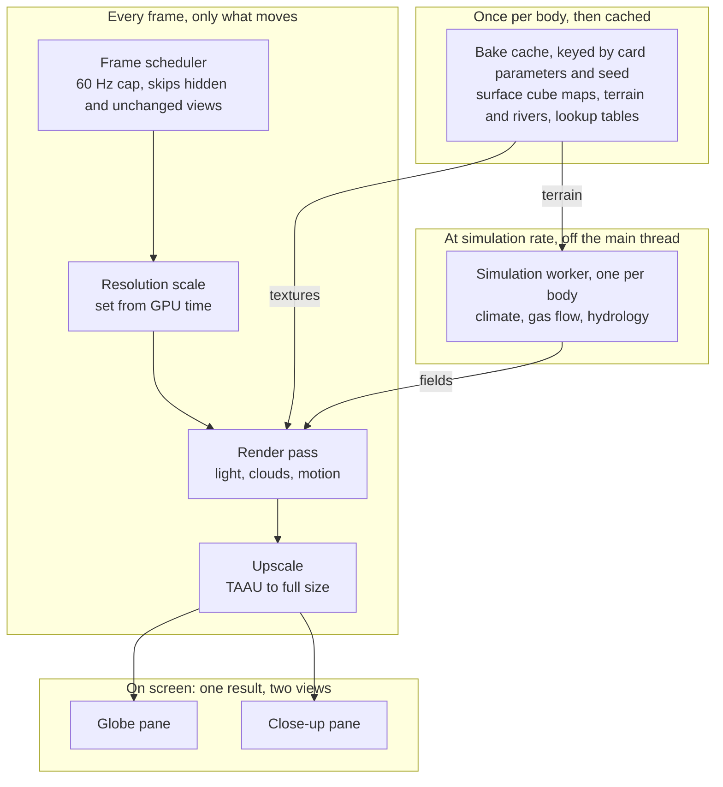

# Render performance: findings and improvement architecture

Research, not a spec. Recorded 12 Nov 2026 against `origin/main` at `a6337fa`. Where this file and a spec or decision differ, the spec or decision wins. Paths are under `frontend/src/`.

**How this was produced.** Four read-only code audits (stars, worlds, small bodies with orbit and sky, the viewer host), with the main claims re-checked against the source. Nothing was profiled. Every gain below is an estimate from counting operations in the code, not a measurement.

## Summary

The lag is not caused by polygons. It is caused by procedural maths that is redone for every pixel on every frame, by simulation running on the main thread, and by the same body being drawn two or three times in separate GPU contexts.

- **Planets and stars at "+ Artistic" are drawn with one triangle.** The D-37 engines cover the canvas with a single full-screen triangle and compute the whole body in the pixel shader.
- **The only heavy mesh is the rock**, at 312,000 triangles, and even there the pixel shader costs more than the triangles do.
- **The three.js path** (the default, at "Measured only" and "+ Estimated") uses spheres of 4,000 to 24,000 triangles, which is trivial.

The fix is the standard game-engine answer: compute each thing once, at the rate it actually changes, and only for pixels someone can see. Most of a planet's or rock's surface detail never changes, so it can be baked into a texture once and looked up afterwards.

Rough size of the win, as estimates:

| View | After Phase 0 | After all phases |
|---|---|---|
| Rock, "+ Artistic" | About 50% less with both panes open, plus 20 to 40% from back-face culling | About 90% less shader work |
| Planet fly view | Little change per frame; the stall on opening the close-up goes away | 50 to 75% less with the two-level march, 80 to 90% with the clipmap |
| Planet globe | Little change | 65 to 85% less, and 7 to 14 ms per frame of simulation leaves the main thread |
| Star, "+ Artistic" | Several wasted passes and a 2.9 MB per-frame upload removed | Star close-up 60 to 85% less |
| Default three.js path | Only the frame cap helps | About 45% less scene cost at 75% render scale |

On a 144 Hz display the 60 Hz cap alone cuts about 58% of all work. On a 60 Hz display it cuts nothing.

## How rendering works today

There are two render paths, and which one runs depends on the honesty level.

| Path | When it draws | Technology | Where the cost is |
|---|---|---|---|
| three.js path | "Measured only" and "+ Estimated" (the default) | three.js r187 WebGPU with a post-processing chain (bloom, TAAU) | Noise in the body shaders, at full resolution, at the display's refresh rate |
| Prototype engines (D-37) | "+ Artistic" only (Q-287) | Raw WebGL2, verbatim prototype code, one engine per pane | Ray marching and noise per pixel, plus climate and gas simulation on the main thread |

Three things are true of both paths:

- **Static detail is recomputed every frame.** Crater fields, terrain height, mottling and granulation are fixed for a given body and seed, yet the shader rebuilds them from noise for every pixel.
- **There is no frame cap on desktop.** On a 120 or 144 Hz panel everything runs 120 or 144 times a second.
- **Each pane owns its own GPU context.** Opening the close-up starts a second full engine (and a second simulation) for the same body. In the worst case a star at "+ Artistic" with the close-up open holds 2 WebGPU devices, 4 WebGL2 contexts and 2 canvas overlays.

What is already done well: the three.js viewer renders on demand and pauses when hidden, the pixel ratio is capped at 1.5, field generation for the three.js path runs in workers, and nothing recompiles shaders when a slider moves.

## Findings

Ranked by estimated cost. The counts are read from the code; the ranking is a judgement.

| # | What is slow | The numbers | Where | Type |
|---|---|---|---|---|
| 1 | Planet fly view ray march | Up to 360 steps per pixel, about 19 noise evaluations per step, plus up to 36 shadow steps. Roughly 100 times the cost of the globe view. | `engine/worlds/shaders.js:293` | GPU |
| 2 | Rock surface shader | About 386 hash evaluations per pixel for detail that never changes, plus a shadow march of up to 26 steps | `engine/rocks/source.ts:97-128` | GPU |
| 3 | Same body drawn twice | Globe and close-up are two engines in two contexts. For planets each one also runs the full climate simulation. | `app/worldStore.ts`, `engine/rocks/RockView.ts:311` | GPU and CPU |
| 4 | Simulation on the main thread | Climate sim takes up to 7 ms per frame per engine (14 ms while spinning up). A frame at 60 fps has 16.7 ms in total. | `engine/worlds/core.js:434` | CPU |
| 5 | Hidden globe in the fly view | The fly canvas is 167% of its pane width and the off-screen 40% draws a full globe nobody sees | `app/WorldEngineStage.tsx:111`, `engine/worlds/core.js:396` | GPU, pure waste |
| 6 | No frame cap | Engines and the three.js clock run at the display rate, so up to 2.4 times the work on a 144 Hz panel | `app/StarEngineStage.tsx:94`, `viewer/ViewerApp.ts:1113` | GPU and CPU |
| 7 | three.js scene at full resolution | The TAAU pass can upscale from a smaller image, but the scene is rendered at full size | `viewer/render/pipeline.ts:157` | GPU |
| 8 | Star shader | About 18 Perlin and 5 Worley noises per pixel. The sunspot detail runs for every pixel, inside a spot or not. | `viewer/shaders/star.ts:170-341` | GPU |
| 9 | Close-up pane readback | Every frame: render, copy the image from GPU to CPU, loop over every byte in JavaScript, paint to a 2D canvas (about 2.5 MB per frame) | `viewer/ViewerApp.ts:1526-1582` | CPU |
| 10 | Whole-buffer uploads and garbage | Star streak buffers upload 2.9 MB per frame when about 0.15 MB is in use. Comet jets create about 12,000 short-lived objects per frame per view. | `viewer/renderers/StarPlasma.ts:73`, `engine/rocks/source.ts:163-174` | CPU |
| 11 | Work that only produces black | The star plasma pass runs 6 passes per frame in true colour and in the surface close-up, where it can only output black. Bloom runs 12 passes per frame even when nothing is bright enough to bloom. | `engine/stars/protoStar3.js:421`, `viewer/render/pipeline.ts:160` | GPU, pure waste |
| 12 | Stalls on open and on sliders | Opening the planet close-up rebuilds terrain (an estimated 250 to 400 ms), recompiles 4 shaders and re-runs a 900-step spin-up. Each step of the rock age slider rebuilds the height map (13.6 million sine calls). | `app/CloseUpPane.tsx:256`, `engine/rocks/RockView.ts:174` | CPU spikes |

Two smaller things make the picture worse than it needs to be:

- **The resolution scaler reacts to the wrong signal.** The planet engine lowers its resolution when frames are slow, but it measures total frame time. When the simulation is the slow part, it blurs the image and the lag stays (`engine/worlds/core.js:392`).
- **The rock engine never pauses.** `setVisible` exists but nothing calls it, so the rock keeps drawing when scrolled off-screen (`engine/rocks/RockView.ts:281`).

Not a problem: the sky view, the island loader, the build mould and the comet volumes are either cheap or already render on demand.

## Techniques

| Technique | Plain meaning | Applied here | Expected gain (estimate) |
|---|---|---|---|
| Baking | Compute static detail once into a texture, then look it up | Rock detail and normals into a cube map. Planet globe static layers into a cube map. The still star in the close-up into one image. | 5 to 10 times on the rock shader, 3 to 6 times on the planet globe, 60 to 85% of the star close-up |
| Acceleration structures for ray marching | Big safe steps far from the surface, careful steps near it | Max-height pyramid and two-level march in the fly view, then a height clipmap centred on the camera | 2 to 4 times, then 5 to 10 times, on the fly pass |
| Deferred caching | Keep the expensive result that did not change and redo only the lighting | Fly view and orbit pane: keep hit distance and normal while the camera is still. Atmosphere scattering into a lookup texture. | 2 to 10 times while the camera is still |
| Temporal upscaling and dynamic resolution | Render fewer pixels, rebuild the full image from previous frames | Render the three.js scene at 75% and let the existing TAAU pass upscale. Drive the scale from GPU time. | Scene cost falls to 56% at a 0.75 scale |
| Frame scheduling | One loop decides who draws, how often, and skips anything hidden or unchanged | 60 Hz cap, visibility pausing for every engine, skip passes that output nothing | Up to 2.4 times on 120 to 144 Hz panels, 100% for hidden views |
| Moving work off the main thread | Run simulation in a worker so drawing is never blocked | Climate, gas and hydrology simulation, and the rock height build | Removes up to 14 ms per frame of blocking and the slider stalls |
| Sharing instead of duplicating | One simulation and one render feeding several views | One planet simulation for globe and fly view. One rock render copied to the second canvas. | About 2 times whenever two panes show the same body |

Looked at and rejected for this codebase:

- **Level-of-detail meshes and tessellation (CDLOD, quadtrees).** There is almost no geometry to reduce.
- **GPU compute for particles.** It exists in r187, but the live particles are in the raw WebGL2 engines, where a vertex-shader animation does the same job.
- **Moving the renderer to a worker (OffscreenCanvas).** The viewer and engines are tied to the DOM, and it would not reduce GPU cost.
- **Impostors and billboards.** Each view shows one body filling the frame.

## Target architecture

The target design sorts all work by how often it really changes, and runs each kind at that rate and no faster. Today almost everything sits in the "every frame" row.

| Layer | Runs | Holds | Replaces today's |
|---|---|---|---|
| Bake cache | Once per body and seed, in a worker or a one-off GPU pass | Rock and planet surface cube maps, terrain and river routing, scattering lookup tables, generated fields | Noise recomputed per pixel per frame, terrain rebuilt on every close-up open |
| Simulation worker | At its own step rate, off the main thread | Climate, gas flow, hydrology. One instance per body, shared by all views. | Two copies of the simulation on the main thread, taking up to 14 ms per frame |
| Frame scheduler | Every frame, capped at 60 Hz | One loop for all views. Skips hidden and unchanged views, sets the resolution from GPU time, then renders and upscales. | A separate loop per engine and pane with no cap, and a scaler that reacts to CPU time |
| Views | On screen | Globe and close-up as two cameras on one result | Two or three engines and contexts per body |

The engines stay as raw WebGL2 and the three.js path stays as it is. This is a change to where work happens, not a rewrite. Both paths adopt the four layers through their existing wrappers (`WorldEngineStage`, `StarEngineStage`, `RockView`, `ViewerApp`).

## Roadmap

Three phases, ordered by how much they risk the parity gate. Effort is S (hours), M (about a day) or L (several days).

### Phase 0: wrapper and host changes only

Output is pixel-identical unless noted. No engine code is edited.

| # | Change | Fixes finding | Effort | Note |
|---|---|---|---|---|
| 0.1 | Add GPU timing (`trackTimestamp`) and the r187 Inspector behind a dev flag | Measures everything else | S | Do this first, on the Asus TUF A15 |
| 0.2 | Cap animated frames at 60 Hz in the engine host loops and the three.js clock | 6 | S | Motion steps double on 144 Hz panels. Conflicts with Q-66, see guardrails. Do not cap the star engine below about 53 fps or its own scaler gets stuck low. |
| 0.3 | Pause the rock engine and the star close-up when off-screen or hidden | Rock never pauses | S | Calls the existing `setVisible` |
| 0.4 | Turn on back-face culling for the rock from the wrapper | 2 | S | Check the winding once with a capture. Wrong winding shows an empty body. |
| 0.5 | Make the plasma and overlay canvases inert in the star surface close-up | 11 | S | Removes a context, 3 render targets and about 5 passes per frame |
| 0.6 | Upload only the used part of the star streak buffers | 10 | S | 2.9 MB down to about 0.15 MB per frame |
| 0.7 | Keep the planet fly view mounted and paused when the close-up closes | 12 | S | Removes the rebuild on every open |
| 0.8 | Draw the rock once and copy it to the second canvas | 3 | S to M | About 2 times when both panes are open |
| 0.9 | Cache generated fields and worlds by their parameters and seed | Regeneration on toggles | S | Deterministic by construction |
| 0.10 | Stop the timer-driven React re-renders in the engine stages | Main-thread churn | S | Memoise, update readouts only on change |

### Phase 1: declared deviations

These edit verbatim engine code or the post chain. Pixels stay the same or are pinned during parity runs, but each engine edit needs a recorded `@deviation` or `@rename`.

| # | Change | Fixes finding | Effort | Risk |
|---|---|---|---|---|
| 1.1 | Skip the hidden globe pass in the fly engine | 5 | S | Low |
| 1.2 | Skip the star plasma pass while it has nothing to draw | 11 | S | Low. Must clear once when leaving observatory view. |
| 1.3 | Skip bloom when the scene has no emitter bright enough. Half-resolution bloom on High. | 11 | S | Low. Goldens change only where bloom was active. |
| 1.4 | Drive the planet resolution scaler from GPU time | Scaler reacts to the wrong signal | S | Low |
| 1.5 | Compile shaders lazily and pre-warm late ones | 12 | S to M | Low |
| 1.6 | Cache terrain and routing by preset and seed | 12 | S to M | Low. About 2 MB per terrain. |
| 1.7 | Animate comet jets in the vertex shader | 10 | M | Low. Float32 rounding only. |
| 1.8 | Build the rock height map in a worker and debounce the age slider | 12 | M | Low |
| 1.9 | One planet simulation feeding both views | 3, 4 | M | Medium. Couples two lifecycles. |
| 1.10 | Move climate, gas and hydrology simulation into a worker | 4 | M | Medium. Keep a synchronous mode for parity spin-up. |
| 1.11 | Paint the close-up pane directly with a `CanvasTarget` on WebGPU | 9 | M | Medium. Readback stays on the WebGL2 fallback. |
| 1.12 | Cache the still star in the close-up as one image | 8 | M | Low to medium |
| 1.13 | Branch the sunspot detail so it runs only inside spots | 8 | S to M | Low. Mathematically identical. |
| 1.14 | Render the three.js scene at 75% and let TAAU upscale | 7 | S to wire, M to tune | Medium. Slightly softer in motion. Goldens need re-baselining. |

### Phase 2: the big wins, parity re-baselined

These change pixels slightly, so the parity references and goldens must be regenerated and compared side by side.

| # | Change | Fixes finding | Estimated gain | Effort |
|---|---|---|---|---|
| 2.1 | Bake rock detail, normals and albedo terms into a cube map | 2 | 5 to 10 times on the rock shader | M to L |
| 2.2 | Fly view work, see the next section | 1 | 2 to 4 times, then more | M to L |
| 2.3 | Bake the planet globe's static layers into a cube map, keeping the top octaves procedural when zoomed in | Globe shader | 3 to 6 times on the globe | M |
| 2.4 | Cache the orbit pane's terrain hit and re-shade only | Orbit march | 2 to 5 times while the clock runs | L |
| 2.5 | Dynamic resolution on the three.js path from GPU time | 7 | Holds the frame rate without a tier drop | M |
| 2.6 | One shared WebGPU device for sky, viewer and star close-up | 3 | Fewer devices and duplicate compiles | L |

If only three things get done, do 0.2, 2.1 and the first fly-view ticket below.

## Fly view deep dive: zooming all the way to the surface

A line-by-line read of the fly shader (`engine/worlds/shaders.js:255-391`). Close to the surface, most of the cost goes on work that cannot change the picture.

### What the shader does today

- **No distance awareness in the march.** Every step evaluates the full terrain function (about 19 noise lookups, roughly 150 hashes), whether the point is 300 m or 2,000 km away. The level-of-detail fade (`lod()`) exists, but only for colouring.
- **The terrain has no detail finer than about 0.6 km** on an Earth-sized world. Its top octave is about 10,750 cells per radian (`efbm(p*.8)` at `d*420`, 6 octaves). At 0.3 km altitude the shader recomputes a smooth surface from scratch at every step.
- **Sky and horizon rays are the most expensive pixels.** They crawl through the whole 14 km terrain shell, hit the 360-step cap, and are then drawn as sky. Distant terrain can be missed this way, so this is also a quality bug.
- **Shadows cost more than the march for many pixels:** up to 36 more full terrain evaluations per sunlit pixel, including over flat ocean.
- **Normals cost three more full evaluations,** and the atmosphere runs a 16-step loop on every pixel.
- **Cloud cover is evaluated up to 5 times per pixel** at 17 noise lookups each (`cov2`).

### Fixes that keep the image the same

| # | Technique | What it does | Est. gain on fly pass |
|---|---|---|---|
| 1 | Max-height pyramid | A mip chain of the 720 by 360 height map, plus the known maximum detail amplitude, gives a guaranteed ceiling. Rays jump over empty air in big safe steps. Also fixes the missed horizon. | 2 to 4 times; most on sky and horizon |
| 2 | Octave LOD inside the march | Drop octaves whose amplitude is below the hit tolerance the marcher already accepts at that distance (`t*6e-5`), faded so nothing pops | 1.5 to 2 times |
| 3 | Cheaper shadows | Use the pyramid to skip pixels nothing can shadow (open sea, plains), and apply the same octave LOD | Up to 2 times on sunlit land |
| 4 | Static G-buffer | The terrain never changes. With a still camera, keep hit distance, normal and ground colour, and redo only light, clouds and air. | 5 to 10 times while still |
| 5 | Depth reprojection | While moving, start each ray near last frame's hit, checked against the pyramid so no nearer ridge is skipped | 2 to 3 times while flying |
| 6 | Low-resolution cone pre-pass | March at quarter resolution with a widened ray, then start full-resolution rays from there | 1.5 to 3 times |
| 7 | Atmosphere lookup tables | Precompute scattering into small textures (Hillaire 2020) | Removes 16 steps per pixel |
| 8 | Cloud deck texture | Bake cloud cover into a camera-centred texture refreshed at the drift rate | Removes up to 85 lookups per pixel |

### The structural fix

A camera-centred height clipmap: nested textures around the camera, each twice as wide as the last, storing height and slope. A march step becomes one texture fetch, normals come for free, and shadows get cheap. Because the terrain has nothing finer than 0.6 km, texels of about 40 m with smooth (cubic or Hermite) interpolation reproduce it. Only newly exposed rows and columns are redrawn as the camera flies. Height needs 32-bit float storage, or a residual per level, because half floats are too coarse near the ground. Estimated at another 5 to 10 times, for several days of work.

### What improves for the viewer

- **Correct horizon:** distant mountains stop dropping out.
- **Sharper stills:** with the G-buffer, a still camera can accumulate jittered frames into a supersampled image at no extra cost.

### What not to do

- **Texture-based noise:** it changes the terrain itself.
- **Plain half-resolution rendering:** it softens the image.
- **Lowering the step cap:** it makes the horizon bug worse.

### Tickets

Four tickets, grouped by what shares code and what can share one parity re-baseline.

| # | Ticket | Contains | Depends on | Size |
|---|---|---|---|---|
| 1 | Smarter march | GPU timing for the fly view, max-height pyramid, octave LOD in the march, cheaper shadows | Nothing | Medium |
| 2 | Lookup bakes | Atmosphere lookup tables, cloud deck texture | Nothing | Medium |
| 3 | Pass split | Static G-buffer, depth reprojection, cone pre-pass, jittered accumulation when still | Ticket 1 | Large |
| 4 | Height clipmap | Camera-centred height and slope textures, march and shadows read from them | Tickets 1 and 3 | Large |

Tickets 1 and 2 can run in parallel. Ticket 4 is only worth doing if measurements after ticket 3 still show the fly view over budget. Each ticket edits the verbatim fly shader, so each carries one recorded deviation and one parity re-baseline.

## Guardrails

**Decisions needed**

- **The 60 Hz cap contradicts Q-66 and R5.7**, which say Medium and High draw at the display rate. It needs a new `Q-` entry before it ships. Q-64 (whether 60 fps replaces D-05's 30 fps floor) is still open and is the same conversation.
- **Engine edits need recorded deviations.** The engines are verbatim prototype code (Q-303, Q-335). Phase 1 and 2 items that touch `engine/*` need an `@deviation` or `@rename` each.
- **Phase 2 re-baselines parity.** Baking and march changes alter pixels slightly at crater rims, silhouettes and shadow edges. The parity threshold is not recorded on `main`; confirm it before starting.
- **GPU bakes are not byte-identical across GPUs.** That is no worse than today, since the engines are exempt from byte-identical output under D-37. On the three.js path, where determinism applies to baked textures, a bake must run on the CPU.

**How each rule is kept**

| Rule | How the plan keeps it |
|---|---|
| Determinism | Caches are keyed by card parameters and seed, and generation is unchanged. Dynamic resolution snaps to a fixed scale for settled frames, so goldens stay stable. |
| Never blank | Bakes and pre-warmed shaders swap in only when ready. The current procedural path keeps drawing until then. |
| Provenance | Baking changes how a layer is computed, not what it is. Each baked layer keeps the tag of the layer it replaces. |
| Pinned versions | Every three.js API named here was confirmed present in the installed r187 (0.187.0). |
| Budget rule R5.5 | It already says "never compute noise per frame for baked kinds". Phase 2 extends that rule to the engines. |

**Measure before and after.** Nothing has been measured on the demo laptop (R12 item 43), so step 0.1 comes first. Record GPU milliseconds per frame, main-thread milliseconds per frame and frame rate for one star, one rocky planet, one gas giant, one rock and one comet, at "+ Estimated" and at "+ Artistic", with the close-up open and closed. Re-run after each phase. For anything that changes pixels, compare side-by-side screenshots against the reference.

**Open questions**

- What is the refresh rate of the Asus TUF A15 panel? If it is 60 Hz, the frame cap gains nothing there.
- Are the build stage and the close-up visible at the same time in the final layout? The "drawn twice" findings assume they can be.
- Is the 167% fly canvas width intentional for the layout? The fix differs if it is.
