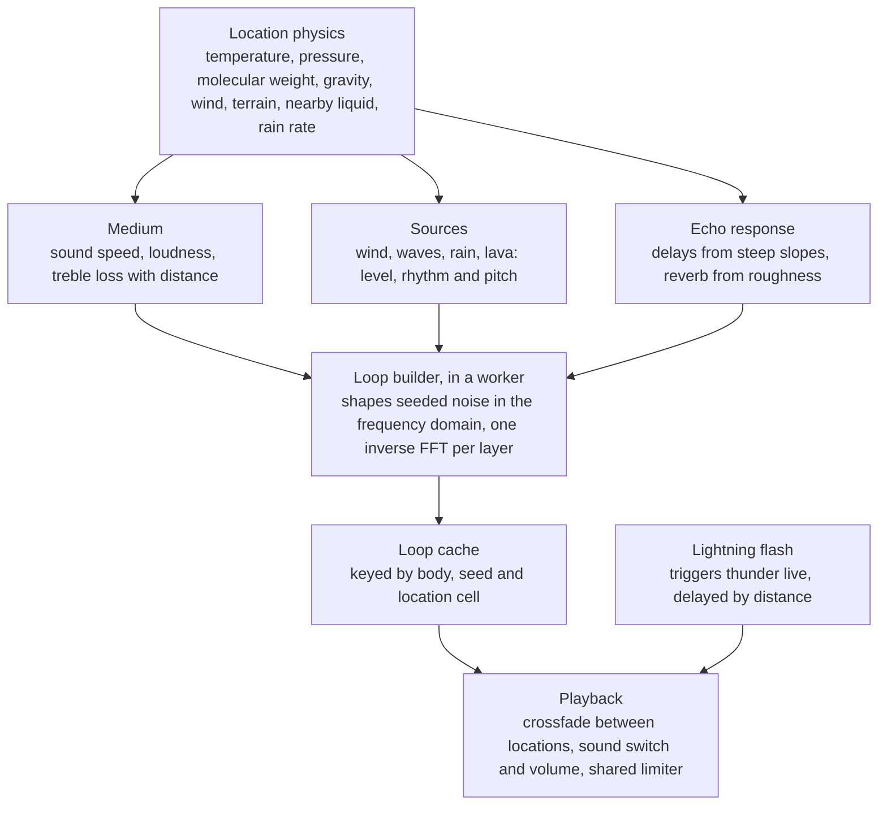

# Weather and ambience: physics-based rain, lightning and location sound

Research, not a spec. Recorded 12 Nov 2026 against `origin/main` at `a6337fa`. Where this file and a spec or decision differ, the spec or decision wins. Paths are under `frontend/src/`.

**How this was produced.** Two read-only code surveys (the world engine's physical inputs, the existing audio code), plus a browser proof of concept for the sound method. The physics formulas and solar-system facts here were written from general knowledge, not from cited sources. Every constant must go through `/sx-verify` before it reaches code.

## Summary

Rain, lightning and generated ambience are all feasible and cheap to run, but only part of the idea can be driven by real data today. The world model has pressure, temperature, gravity, rain rate and terrain per location. It has no atmospheric composition.

- **Rain: buildable now.** The engine already knows which liquid can condense on each world and how much rain falls where. Two formulas turn gravity and air density into drop size and fall speed.
- **Lightning: mostly buildable.** Where and how often it strikes can follow published scalings from rain rate and convection. Its colour cannot follow the gas mix until composition is added to the ObjectCard.
- **Ambience sound: buildable now, and fast.** Building the loop in the frequency domain gives a seamless 32.8 second loop from one worker pass. Thunder stays live so it can follow each flash at the right delay.
- **Lava worlds are the exception.** The model treats them as airless, so by the physics they get no rain and no airborne sound. That needs a decision.
- **Echo is partly a guess.** The terrain is too coarse to contain real echo surfaces, so echo combines resolved slopes with a statistical reverb, and the second part is tagged artistic.

Recommended order is sound, then rain, then lightning.

## What the code already knows

| Input | Available? | Where | Note |
|---|---|---|---|
| Surface pressure, temperature, gravity, scale height | Yes | `worldModel()` in `engine/worlds/core.js` | Pressure is assumed to be 1 bar when the card has none (`model_dependent`) |
| Lapse rate and cloud base height | Yes | `gamK`, `zc` in the same model | Enough for a convection test |
| The one liquid that can condense | Yes | `FLUIDS` in `engine/worlds/presets.js`: water, ammonia-water, methane, ammonia, nitrogen, carbon dioxide | Each has triple point, boiling point and latent heat |
| Rain rate, humidity, temperature, snow, sea ice per location | Yes | Climate grid `EB`, 180 by 90 cells | Rain is normalised so 1 is about 1 m per year. Humidity and snow are in the grid but not exposed by the sampler. |
| Terrain height per location | Yes | 720 by 360 grid, read with `WorldFieldSampler.sampleLonLat` in `engine/worlds/fieldSampler.ts` | Slope is not stored but can be computed from neighbours |
| Rivers, lakes, lava channels | Yes | Hydrology image, 2048 by 1024 | Gives "is there liquid nearby" |
| Current location in the fly view | Yes | `engine.fly.lon`, `lat`, `alt`, `head` | No event fires on change, so a consumer must poll each frame |
| Wind at a location | Partly | Global wind speed `U` and a formula for zonal wind, plus up to 12 cyclones | The per-pixel wind lives only on the GPU. It can be recomputed on the CPU from the same formula. |
| Mean molecular weight | Assumed | 29 by default, 18 for a water world, 28 for methane, 44 for lava | Always `model_dependent` |
| Atmospheric composition | **No** | Not in the ObjectCard, not in the engine | The card has only `surface_pressure_bar`, `surface_temperature_K` and `surface_fluid` |
| Convective energy (CAPE), ash or dust sources | **No** | Not modelled | Needed for flash rate and for volcanic lightning |

Three consequences follow.

- **"Match the atmospheric composition" cannot be done from data today.** The honest version uses what exists: the condensable fluid and the assumed molecular weight.
- **Lava worlds are airless in the model.** A lava world is given 0.005 bar of rock vapour (`engine/worlds/cardToWorld.ts:59`), which the engine treats as no atmosphere (below 0.02 bar).
- **Everything here appears only at "+ Artistic".** The world engine mounts only at that honesty level (Q-287).

Existing sound code gives a head start: a shared audio context that starts on a click, a master limiter, and a sound switch with volume. All of it sits in `haptics/`, which is being removed, so `audioContext.ts`, `audioGraph.ts` and the sound half of `settings.ts` must move out first. There is no offline rendering, no convolution and no noise library yet.

## Rain

Rain is decided by four physical checks, in order. If any check fails or its input is missing, no rain is drawn and the layer is listed as missing.

1. **Is there something that can condense?** A gas rains only if its partial pressure reaches its saturation vapour pressure somewhere in the air column (the Clausius-Clapeyron relation).
2. **Is it liquid at the surface?** The surface temperature and pressure must sit between the substance's triple point and critical point. Below the triple point it falls as snow.
3. **Does it reach the ground?** In hot, dry air below the cloud the drops evaporate on the way down (virga). Venus is the known case.
4. **How hard does it rain?** The energy budget sets a ceiling. Rain can remove no more heat than the surface absorbs, so the rate is at most absorbed flux divided by latent heat.

| World | Likely condensate | Analogue | What the viewer sees |
|---|---|---|---|
| Temperate rocky or ocean world | Water | Earth | Grey streaks, wet ground, snow where it is below freezing |
| Cold world with a thick nitrogen and methane atmosphere | Methane and ethane | Titan | Large, slow drops, because gravity is low and the air is dense |
| Hot world with a thick carbon dioxide atmosphere | Sulphuric acid | Venus | Virga only: streaks that fade out before the ground |
| Cold, thin carbon dioxide atmosphere | Carbon dioxide or water ice | Mars | Light snow or frost, no liquid |
| Lava world | Vaporised rock condensing on the cooler side | Models of 55 Cancri e and K2-141 b | Not drawable today: the model gives lava worlds almost no air |

The look of the rain comes from two formulas:

```math
r_{max} \approx k\sqrt{\frac{\sigma}{g\,\rho_{liquid}}} \qquad v_t = \sqrt{\frac{8\,r\,\rho_{liquid}\,g}{3\,C_d\,\rho_{air}}}
```

The first gives the largest drop that holds together (surface tension against gravity). The second gives its fall speed. Streak length on screen is fall speed times exposure time, and the slant is wind speed divided by fall speed.

**How to draw it.** In the fly view, rain is one extra full-screen pass in the wrapper, drawn over the engine's image: three depth layers of hashed streaks, plus surface darkening where it is wet. From orbit, rain shows only as darker shafts under convective cloud.

**To verify.** The constant k, the drag coefficient, and the vapour pressure, triple point, critical point, surface tension and density of each condensate. Loftus and Wordsworth (2021) is the reference for raindrop physics across planets.

## Lightning

Lightning needs three things at once. A world missing any of them gets no lightning.

| Ingredient | Physical test | Input it needs |
|---|---|---|
| Rising air (convection) | The air cools with height faster than the adiabatic rate | Surface temperature, lapse rate, gravity, heat capacity of the gas |
| Charge carriers | Ice and liquid droplets colliding in a cloud, or dust and ash rubbing together | The rain checks above, or an eruption or dust source |
| Enough voltage | The field between charge layers must exceed the breakdown field of the gas, which rises with density | Pressure, temperature, gas mix |

That gives three lightning types:

- **Rocky and ocean worlds with rain:** ordinary thunderstorms, placed only inside convective cloud cells where it is raining.
- **Lava worlds:** volcanic lightning in ash plumes. This needs no rain, but it needs an eruption or ash model that does not exist yet.
- **Dry, dusty worlds:** small dust discharges. Faint, and optional.

**How often.** Romps and others (2014) scale flash rate with rain rate times convective energy, and both inputs come out of the rain model. Price and Rind (1992) is the alternative, using cloud-top height.

```math
F = \frac{\eta}{E}\; P \times \mathrm{CAPE}
```

**What colour.** A bolt is gas heated to tens of thousands of kelvin, so its colour is the emission-line spectrum of the atmosphere. Code could compute it from the NIST atomic spectra database, weighted by the gas mix. The data has no gas mix today, so this part must wait or be refused.

**How to draw it.**

- **Inside the cloud:** a short-lived light term added to the cloud layer, with 2 to 4 return strokes about 50 ms apart.
- **Visible bolts:** a seeded branching path from cloud base to ground, generated once per flash and drawn as a few glowing segments in the wrapper's overlay pass.
- **From orbit:** small flickers on the night side over convective cells.

**Thunder ties sound to picture.** Each flash schedules its thunder at distance divided by the local speed of sound.

**Safety rule.** WCAG 2.3.1 forbids more than three flashes in any one second. The flash rate must be clamped below that whatever the physics says, and reduced-motion mode should swap flashes for a slow glow.

**To verify.** The flash-rate constants, and the observational record: lightning is confirmed on Earth, Jupiter and Saturn, disputed on Venus, not detected on Titan by Cassini, and small dust discharges on Mars were reported recently.

## Ambience sound

A 30 second loop can be generated in well under a second, with no seam, by building the sound in the frequency domain.



- **Why the frequency domain.** Wind, surf and rain are all shaped noise. Write the wanted spectrum directly, give every frequency a seeded random phase, and run one inverse FFT. The output is periodic by construction, so the last sample flows into the first with no click and no crossfade.
- **Loop length.** At a 32 kHz sample rate, 2^20 samples is 32.8 seconds.
- **Events inside the loop.** Waves, gusts and raindrops are placed at seeded times and wrapped around the loop end.
- **Switching location.** The old loop keeps playing until the new one is ready, then the two crossfade over about one second. Loops are cached by location cell.
- **Same seed, same sound.** Random phases and event times come from `mulberry32` in `viewer/fields/noise.ts`. No `Math.random`.

### The atmosphere as a filter

| Quantity | Formula | What you hear |
|---|---|---|
| Speed of sound | c = sqrt(gamma R T / M) | Echo and thunder delays. Slower in cold, heavy gas. |
| Loudness coupling | impedance Z = density times c | Thin air carries sound badly |
| Absorption with distance | rises with frequency squared and falls with pressure, plus a gas-specific term | Distant sounds lose their treble. Carbon dioxide strips high frequencies strongly. |

In code this is one delay, one gain and one low-pass filter per source, set from the distance to that source.

### The sources

| Source | When it plays | Physics that shapes it | Synthesis |
|---|---|---|---|
| Wind | Always, if there is air | Level follows dynamic pressure (density times speed squared). Gusts are slow random swells. | Shaped noise with a slow gain curve |
| Wind whistle | Rough or rocky terrain | Tone at 0.2 times wind speed divided by obstacle size (the Strouhal relation) | A few narrow noise bands |
| Waves on a shore | Liquid within earshot | Wave height grows with wind speed squared over gravity, and the period with wind speed over gravity | A noise burst per wave |
| Bubbles and foam | With breaking waves and with lava | Bubble pitch is the Minnaert frequency, set by bubble size, pressure and liquid density | Many short decaying tones |
| Rain | Where the rain model says it lands | Impact energy is drop mass times fall speed squared, times the drop rate | Dense noise, plus individual drops |
| Thunder | On each visible flash | Delay is distance over c. Distance removes treble and stretches the rumble. | Triggered live, not part of the loop |
| Lava | Lava worlds near active flows | Large slow bubbles in dense liquid, crackle from cooling crust | Low tones, random clicks and noise |

### Echo from the terrain

An audible echo comes from surfaces roughly 20 m to 2 km away. The terrain grid is about 55 km per cell on an Earth-sized planet, and its finest procedural detail is about half a kilometre. So the model has no real cliffs at echo distance. The honest design has two tiers:

- **Resolved echoes:** sample the terrain height around the listener in about 32 directions. Any steep slope facing the listener within range becomes one echo, with delay equal to twice its distance over c.
- **Unresolved roughness:** below the terrain's resolution, use the local slope and roughness statistics to set a short reverb tail. A flat plain gets none.

Both tiers become one impulse response. In the frequency domain, applying it is one multiplication per frequency, and it wraps around the loop correctly.

### Accuracy upgrades at no extra build time

Each of these only changes a layer's spectrum or its event list, and both are small tables prepared before the expensive transform.

| Upgrade | What changes | Applies to |
|---|---|---|
| Real absorption curves | Replace the simple treble roll-off with the published curve for the gas, including molecular relaxation | Every distant source, and thunder |
| Local air, not global air | Use temperature and pressure at the listener's altitude, from the lapse rate and scale height the engine already has | Everything |
| Ground effect | Sound reflected off rock, sand, snow or liquid reinforces some frequencies and cancels others | Surf, rain, thunder |
| Turbulence spectrum | The standard von Karman shape for wind, with its knee set by wind speed and height above ground | Wind |
| Size distributions | A spread of raindrop sizes and bubble sizes in place of one size each | Rain, surf, lava |
| Wave sets | Wave heights follow their known statistical spread, so large waves arrive in groups | Surf |
| Direction | Surf ahead and cliff behind, by small level and timing differences between left and right. Never the only cue (R8.9.2). | Surf, echo, thunder |

For lightning, four of these shape the thunder: the absorption curve sets how dull a distant strike sounds, local air sets its delay, the ground effect colours the rumble, and direction places it.

Two limits apply. The absorption curve for a gas mix needs the gas mix, which the data does not have. Every coefficient must come from a cited source.

### Upgrades that cost a little, and how to stay fast

- **Spectra that change over time.** Building the loop from many short overlapping transforms lets a gust rise in pitch and a wave move from thump to hiss, for about the same arithmetic.
- **Split sources from place.** Build each dry layer once per world and apply echo and distance at playback with the browser's native convolution. Moving along a shore then rebuilds only a small echo response.
- **Play a quick version first,** then crossfade to the full mix.
- **A faster transform.** A 32-bit, real-input or WebAssembly FFT in place of plain JavaScript in 64-bit floats.

### Proof of concept

A single-page prototype built four scenes with this method: a mountain ridge, a shore, open water and rain, each switchable between four illustrative worlds. Measured once in Node on the development machine, each 32.8 second loop took 0.3 to 0.9 seconds with a plain JavaScript FFT; the shore was slowest because of its echo pass. The prototype's planet values were round illustrative numbers and must not be copied into the app. It refuses rain and sea scenes on a world with no liquid.

## Cost

Estimates from operation counts, apart from the prototype timing above.

| Feature | Cost when it happens | Cost per frame |
|---|---|---|
| Ambience loop | One worker job per new location | None. The browser plays the buffer on its audio thread. |
| Echo | Folded into the loop build | None |
| Thunder | A short buffer built once per world, then triggered per flash | None |
| Rain overlay | None | One full-screen pass of a few hash lookups per pixel |
| Lightning | One seeded bolt path per flash | A light term in the cloud layer and a few line segments |

- **Memory.** One stereo loop is about 8 MB. Cap the cache at about six locations.
- **Regeneration rate.** Rebuild only when the listener crosses into a new climate cell, and wait about 300 ms after movement stops.
- **The fly view is already the heaviest thing in the app.** See [render-performance.md](render-performance.md). Draw the rain pass in the wrapper so the verbatim engine code is not touched.

## Honesty rules

Weather and ambience are model output, not measurement. Architecture section A8 already defines an "Imagined drive" sound: procedural noise shaped by gravity and surface type, always labelled "Imagined". Ambience should follow that precedent.

| Part | Proposed tag | Why |
|---|---|---|
| Whether it rains, and what liquid | `model_dependent` | Comes from the climate model, often on an assumed 1 bar pressure |
| Drop size, fall speed, slant | `model_dependent` | Physics formulas applied to model inputs |
| Where each streak or bolt is drawn | `artistic` | Seeded placement |
| Whether lightning occurs, and how often | `model_dependent` | Published scaling applied to model rain and convection |
| Lightning colour | Refused for now | Needs gas composition |
| Sound speed, loudness, treble loss | `model_dependent` | Uses the assumed molecular weight |
| Wind, surf, rain and lava sound | `artistic`, labelled "Imagined" | Synthesised, physics-shaped, never recorded |
| Echo from resolved slopes | `model_dependent` | From the terrain model |
| Reverb from unresolved roughness | `artistic` | A statistical guess |

Rules that already apply:

- **Nothing only by sound (R9).** Show a text line for what is playing: wind speed, sound speed, and how much quieter the place is than Earth.
- **Sound switch and volume (D-10).** Ambience obeys the existing switch, starts only after a click (R8.9, Q-73), and goes through the shared limiter.
- **True loudness.** Thin air would make most worlds nearly silent. The mix must be raised to be audible, so state the real level in text.
- **Refuse rather than invent.** An airless world plays silence and says "No air to carry sound".

Decisions needed, each as a new `Q-` entry:

1. **Lava worlds.** Either accept that they get no rain and no airborne sound (ground rumble labelled "Imagined" only), or revise the lava atmosphere assumption with a cited source.
2. **Composition in the ObjectCard.** A gas-mix field in the shared schema unlocks lightning colour and gas-specific absorption.
3. **Audio code location.** Move the shared audio context, limiter and sound settings out of `haptics/` before that folder is removed.
4. **Flash safety.** Clamp lightning to fewer than three flashes per second and replace flashes with a slow glow under reduced motion. The specs have no rule for this today.
5. **Determinism for sound.** Same body, seed and location should give the same loop. Byte-identical output across browsers cannot be promised, because sine and cosine differ in their last bits between engines.

## Tickets

| # | Ticket | Contains | Depends on | Size |
|---|---|---|---|---|
| 1 | Location physics | One module that answers "what is it like here": wind recomputed on the CPU, rain rate, humidity, nearby liquid, slope, sound speed, air density. Verified constants. The `Q-` decisions above. | Nothing | Medium |
| 2 | Ambience sound | Move the audio code out of `haptics/`, loop builder in a worker, wind, surf and rain layers, the no-cost accuracy upgrades, terrain echo, cache, crossfade, text readout | Ticket 1 | Large |
| 3 | Rain visuals | Condensation and virga checks, drop size and fall speed, the fly-view rain overlay, wet ground | Ticket 1 | Medium |
| 4 | Lightning and thunder | Convection test, flash rate, cloud glow, bolts, live thunder delayed by distance, the flash clamp | Tickets 2 and 3 | Medium to large |
| 5 (optional) | Composition in the ObjectCard | Schema field for gas mix, then lightning colour and gas-specific absorption | Ticket 4, plus a data source | Large |

Tickets 2 and 3 can run in parallel. If the haptics removal is imminent, split the audio move out of ticket 2 into its own small ticket.

## Open questions

- **What counts as "switching location"?** A click on the globe sets a target in the store, but flying around fires no event. Should ambience follow the camera continuously, or change only on a click?
- **How close is the listener to the ground?** The fly camera ranges from 0.3 km to 3,000 km altitude. Either fade ambience out with altitude or always place the listener on the ground below the camera.
- **Which lava-world answer?** See decision 1.
