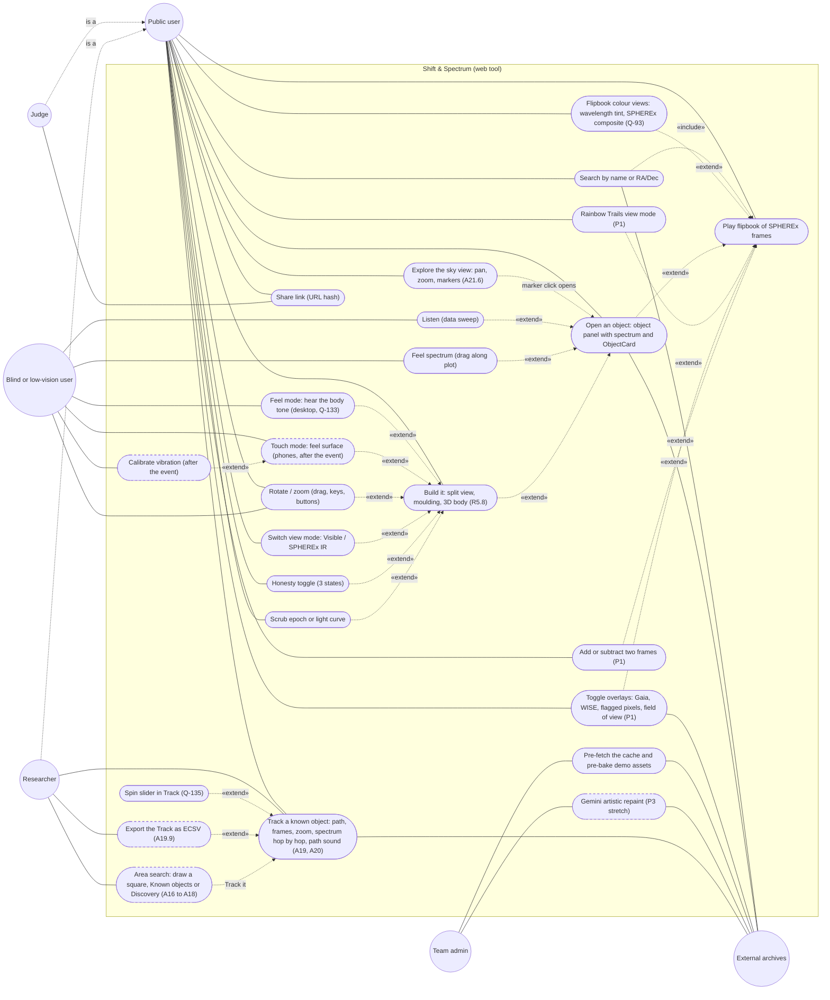

# 01 Use cases

Who uses Shift & Spectrum and for what. Drawn from architecture spec §1.1 (tiers), §10 (hash routing), rendering doc §4 (display levels), §5.2–5.6 (view modes, honesty, interaction), §8.6–8.7 (spectrum haptics, calibration) and decisions D-06, D-07, D-08, D-25 and D-28, the sky view and shell (Q-89, Q-120, A21), Build it (Q-113, R5.8), the colour views (Q-93), Track (Q-131, Q-135, A19, A20), Area search (Q-146, A16 to A18) and Q-132 (the event is a desktop browser on the A15 laptop, sound only).

Mermaid has no native use-case diagram, so this is a `flowchart LR`: actors are circles, use cases are rounded boxes inside the system boundary. Dashed boxes are stretch goals, to-build features or post-event (Q-132).

## Notes

- "External archives" stands for IRSA (SPHEREx), Gaia, CatWISE2020 (IRSA), Horizons, SkyBoT, SBDB, DAMIT, SIMBAD, the Exoplanet Archive and the Gemini API. See [03-deployment.md](03-deployment.md).
- Build it is not offered for `candidate`; the panel says "Not enough data for a 3D model" (rendering doc R4, R7.6). It opens from the object card, the object panel (*Build it in 3D*) or the rail's 3D viewer (Q-120 item 4).
- At the event (Q-132) the A15 laptop runs desktop Feel mode with sound only. Touch mode and vibration calibration are after the event, on Android Chrome; iPhone, iPad and desktop get the paired audio only (D-08, D-10).
- Track is the MVP (Q-131, Q-137: 433 Eros), built for researchers looking at known objects only; Area search (Q-146) is dashed because Discovery may be cut first (A14). The spin slider and export follow Q-135 and Q-145.
- Gemini repaint is server-side and behind the admin token (rendering doc §10, D-07).
- Post-event, not drawn: Gemini Live voice control (B-02), AI sound clips (B-03), image-to-3D (B-04).
- Rainbow Trails is a view mode of the flipbook (D-28), so it extends "Play flipbook". It is P1, built after basic playback works.
- Overlays and combine frames extend the flipbook (A4.9, issue #12). The overlays load on the first switch-on and query Gaia DR3 and CatWISE2020 through the cache.
- Pre-fetch fills the backend's read-through cache for the test targets and demo objects, so the demo runs offline (D-25).
