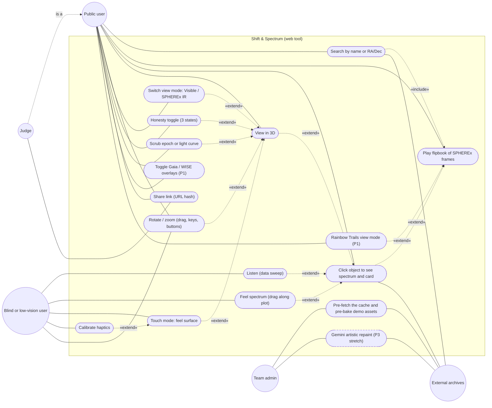

# 01 Use cases

Who uses Shift & Spectrum and for what. Drawn from architecture spec §1.1 (tiers), §10 (hash routing), rendering doc §4 (display levels), §5.2–5.6 (view modes, honesty, interaction), §8.6–8.7 (spectrum haptics, calibration) and decisions D-06, D-07, D-08, D-25 and D-28.

Mermaid has no native use-case diagram, so this is a `flowchart LR`: actors are circles, use cases are rounded boxes inside the system boundary. Dashed boxes are stretch goals.

## Notes

- "External archives" stands for IRSA (SPHEREx), Gaia, Horizons, SkyBoT, SBDB, DAMIT, SIMBAD, the Exoplanet Archive and the Gemini API. See [03-deployment.md](03-deployment.md).
- View in 3D is not offered for `candidate`; the panel says "Not enough data for a 3D model" (rendering doc §4, §7.6).
- Touch mode feels the surface only on Android Chrome. iPhone, iPad and desktop get the paired audio only (D-08, D-10).
- Gemini repaint is server-side and behind the admin token (rendering doc §10, D-07).
- Post-event, not drawn: Gemini Live voice control (B-02), AI sound clips (B-03), image-to-3D (B-04).
- Rainbow Trails is a view mode of the flipbook (D-28), so it extends "Play flipbook". It is P1, built after basic playback works.
- Pre-fetch fills the backend's read-through cache for the test targets and demo objects, so the demo runs offline (D-25).
