# 02 Components

The main components and the interfaces between them. Diagram 1 is the system and backend view; diagram 2 opens up the frontend. Every route is listed once in the endpoint register [A4.11](../architecture/endpoints.md#a411-endpoint-register); the object job is [A4.10](../architecture/jobs.md#a410-object-job-and-fan-out); the shell is [A21](../architecture/sky-shell.md#a21-app-shell-and-sky-view); Track is A19 and A20, Area search A16 to A18 (their own diagrams: [23](23-track.md), [22](22-area-search.md)). Dashed nodes and edges are post-event, stretch or **to build** (Track, Area search, `/path`, `/v1/areas`). Drawn from architecture spec §2, §3, §4, §9, rendering doc §3, §6, §7.7, §8, §10 and decisions D-01, D-02, D-07, D-08, D-10, D-12, D-15, D-16, D-18, D-19, D-20, D-22, D-25, D-28 and D-35 (sky-view prototype: Q-87 to Q-91; colour composite, colour views, progressive frames and cached markers: Q-92 to Q-95, Q-97 and Q-98), and A4.9 (overlays; on the frame grid: Q-102). Object jobs, the shared pools, the background bake and the warm cache follow Q-111 and Q-112 (issue #41), and A6.2 (Gemini layer, Q-122).

## Diagram 1: system and backend

```mermaid
flowchart LR
  subgraph FE["Frontend (Vite + TS + React, see diagram 2)"]
    FEFlip["Flipbook"]
    FEPanel["Object panel"]
    FEViewer["Sky Sculptor viewer"]
    FESky["Shell + SkyPane / SkyView (A21, Q-89)"]
    FEBuild["Build pane in the split pane (R5.8, A21.8)"]
    FETrack["Track pane (A20, to build)"]
    FEArea["Area search tool (A18, to build)"]
  end

  subgraph BE["Backend (FastAPI on Python 3.12, D-15)"]
    API["API (D-16): resolve, frames, cutouts, spectrum, card, render-params; overlays, flags PNG, combine PNG (A4.9, Q-50); job, job/events (beyond D-16, Q-111); admin gemini-repaint, albedo-ai, albedo-ai.webp (A6.2, Q-122)"]
    SkyAPI["/v1/sky router, api/sky.py (beyond D-16, Q-87; /v1/sky/cached, Q-98)"]
    CompAPI["api/composite.py: /v1/objects/{id}/composite, /composite.png (beyond D-16, Q-92)"]
    subgraph CompPkg["core/composite (prototype, no D-17 owner yet)"]
      CompSvc["service.py: CompositeService, derived.composite"]
      CompSel["select.py: one frame per channel, one pass (config.py constants, Q-94)"]
      CompGrid["grid.py: flag mask, TAN grid, resample, asinh stretch, RGB PNG"]
    end
    SkyTools["scripts.sky_mirror, scripts.sky_bake; core/sky: surveys, healpix, bake"]
    SkyStore[("Sky mirror store {SX_CACHE_DIR}/sky/: HiPS tiles, mirror.json, equirect JPEGs (D-35); outside the D-25 cache")]
    Adapters["Data adapters (proxy)"]
    DataCache[("Read-through disk cache (D-25): raw responses, spectra, cards, render params; SX_OFFLINE=1 never calls out")]
    Jobs["core/jobs.py: JobRegistry, one background Job per object id, reused for SX_JOB_TTL_S (Q-111)"]
    Warm["WarmCache, core/warm.py: SX_PREFETCH_ON_START=1 runs the object job for each SX_PREFETCH_GROUPS target, one at a time (Q-112)"]
    subgraph Pipe["Pipeline"]
      S1["1 Find object (core/find)"]
      CutPool["Shared cutout pool (frames.py): SX_CUTOUT_CONCURRENCY at a time across all objects, fair per frame list (Q-112)"]
      S2["2 Measure flux and spectrum (core/measure)"]
      MeasPool["MeasurePool, measure/pool.py: SX_MEASURE_WORKERS spawn processes, photometry per landed cutout (Q-112)"]
      subgraph Classify["core/classify"]
        S3["3 Classify: rules.py (catalogue label, Q-55)"]
        TypeSel["Type selection (rendering doc §3.3; exoplanet thresholds Q-56)"]
      end
      subgraph CardPkg["core/card"]
        Svc["service.py: ObjectPipeline, stages 3-5 and 7 for one id"]
        Catalogue["catalogue.py: re-reads the cached SIMBAD / SBDB answer"]
        S4["4 Asset lookup, assets.py: saved / generated / sketch"]
        CardB["5 Card builder, build.py: ObjectCard with tags"]
        Validate["validate.py: jsonschema check of every reply (Q-40)"]
      end
      Physics["6 Physics layer (derived values)"]
      Ovl["Overlays, flag mask, combine (A4.9): markers, contamination, footprint, cutout box"]
    end
    subgraph Render["core/render"]
      C2P["7 card_to_params.py"]
      SpxRGB["spherex_rgb.py"]
      Blackbody["blackbody.py: Teff to display colour"]
      Baker["Texture baker: noise, craters, height, normals, palette, bake"]
      TexBaker["TextureBaker, render/background.py: SX_BAKE_WORKERS spawn process, both R5 sizes, off the request path (Q-112)"]
      GemPaint["gemini_paint.py (P3, admin token)"]
    end
    PathAPI["/v1/objects/{id}/path, /track.ecsv (A19.5, A19.9, to build, on PR #53's path search)"]
    AreaAPI["/v1/areas, core/area (A17.8, to build)"]
    TexCache[("/data/textures/{id}/{generator_version}/{seed}/")]
    AiStore[("SX_TEXTURES_AI_DIR: albedo_ai.webp, gemini.json, pointers; not served as static files (Q-122)")]
    Prebaked[("backend/assets/{type}/{id}.json (SX_ASSETS_DIR), pre-baked assets")]
  end

  subgraph Shared["shared/ (single source of the contract, D-18)"]
    CardSchema["schemas/object-card.schema.json"]
    RPSchema["schemas/render-params.schema.json"]
    Fixtures["fixtures/ (D-17)"]
  end

  subgraph Ext["External services"]
    IRSA["IRSA SIA + S3 (SPHEREx QR2)"]
    HiPS["IRSA HiPS: 2MASS colour, AllWISE colour (A3.11)"]
    Resolver["SBDB / SIMBAD name resolve (D-19: SBDB first for small-body names, SIMBAD first otherwise)"]
    Horizons["JPL Horizons"]
    SkyBoT["IMCCE SkyBoT"]
    Gaia["Gaia DR3 TAP (IRSA first, then ESA)"]
    CatWISE["CatWISE2020 (IRSA TAP)"]
    SBDB["JPL SBDB phys-par"]
    DAMIT["DAMIT (not called live: OBJ converter only, site was down)"]
    Exo["NASA Exoplanet Archive (PSCompPars, tested)"]
    Gemini["Gemini image API"]
  end

  subgraph ShapesB["Shape models"]
    Shapes["Static route /data/shapes"]
    ShapeDir["backend/assets/shapes: registry.toml + GLBs (Q-61)"]
  end

  FEFlip -->|"GET /v1/resolve, /v1/objects/{id}/frames (again while cutouts are deferred, Q-97), /cutouts/{frame_id}.png"| API
  FEFlip -->|"GET /v1/objects/{id}/overlays, /flags/{frame_id}.png, /combine.png"| API
  FEFlip -->|"GET /v1/objects/{id}/composite, /composite.png (colour view, Q-93)"| CompAPI
  FEPanel -->|"GET /v1/objects/{id}/spectrum, /card"| API
  FEViewer -->|"GET /v1/objects/{id}/render-params"| API
  FEBuild -->|"GET /card, /render-params when the card is asked for or the pane opens (Q-120)"| API
  FEBuild --> FEViewer
  FETrack -.->|"GET frames, path (poll while path:deferred), track.ecsv"| PathAPI
  FEArea -.->|"GET /v1/areas index and results"| AreaAPI
  FEArea -.->|"Track it: open the Track pane"| FETrack
  PathAPI -.->|"SPHEREx-centred ephemeris, through the cache"| Adapters
  PathAPI -.-> Jobs
  AreaAPI -.->|"derived.area, read only"| DataCache
  FEViewer -->|"texture URLs: albedo.webp, height.png, height.bin, normal.png"| TexCache
  FESky -->|"GET /v1/sky/index.json, equirect_{W}x{H}.jpg, /v1/sky/cached"| SkyAPI
  FESky -->|"GET /v1/resolve for the five test-target markers"| API
  FESky -->|"pick: search ra,dec, origin sky"| FEFlip
  SkyAPI -->|"read only, never upstream"| SkyStore
  SkyAPI -->|"/v1/sky/cached: derived.frames metas, derived.object (read only)"| DataCache
  CompAPI --> CompSvc
  CompSvc -->|"frame list (downloads nothing in the request: on_request, Q-111)"| S1
  CompSvc -->|"Stage 2 verdict per frame"| S2
  CompSvc --> CompSel
  CompSvc --> CompGrid
  CompSvc <-->|"cached cutouts, derived.composite (D-25)"| DataCache
  SkyTools -->|"write tiles, bake equirect"| SkyStore
  SkyTools -->|"mirror tiles (refused with SX_OFFLINE=1)"| HiPS

  API --> S1
  API --> Ovl
  S1 -->|"frames, cached cutouts"| Ovl
  API -->|"/card, /render-params: final within SX_FIRST_ANSWER_WAIT_S, else newest intermediate (Q-111)"| Svc
  API -->|"/job, /job/events: read only, never starts a job"| Jobs
  Svc -->|"start or join the object's job"| Jobs
  S1 -->|"on_request: cutouts still to download"| Svc
  S1 -->|"live cutouts"| CutPool
  CutPool --> Adapters
  Svc -->|"each landed cutout"| MeasPool
  Svc -->|"queue bake for every reply with textures"| TexBaker
  TexBaker -->|"bake in a worker process"| Baker
  Warm -->|"ensure_job per demo target"| Svc
  API -->|"mounts /data/textures (404 until the bake lands)"| TexCache
  Svc --> S4
  S1 --> S2 --> S3 --> TypeSel --> S4 --> CardB
  Catalogue -->|"catalogue facts"| S3
  Catalogue -->|"SBDB phys-par, SIMBAD values"| CardB
  S4 -->|"read"| Prebaked
  S4 <-->|"derived.asset (Q-57)"| DataCache
  Physics -->|"derived TVs with formula"| CardB
  SpxRGB -->|"spherex_rgb TV"| CardB
  Blackbody -->|"star colour from Teff"| C2P
  CardB --> C2P
  C2P -->|"RenderParams"| API
  C2P -->|"baked types only (D-01)"| Baker
  Baker -->|"write maps"| TexCache
  GemPaint -->|"reads height.bin, bake.json"| TexCache
  GemPaint -->|"AI albedo if corr >= 0.3, stamped with the bake"| AiStore

  S1 & S2 & Catalogue & Ovl --> Adapters
  Adapters <--> DataCache
  Adapters -->|"SIA?COLLECTION=spherex_qr2, cutouts"| IRSA
  Adapters -->|"name to RA/Dec"| Resolver
  Adapters -->|"path ephemeris and position per frame (seen from SPHEREx), phase angle (quantity 24, observer SPHEREx), heliocentric vectors for sun_vector"| Horizons
  Adapters -->|"conesearch.php, -ep in JD"| SkyBoT
  Adapters -->|"sso_reflectance_spectrum; gaia_dr3_source cone, G #lt; 20"| Gaia
  Adapters -->|"catwise_2020 cone"| CatWISE
  Adapters -->|"sbdb.api?sstr=...&phys-par=1"| SBDB
  Adapters -.->|"OBJ converter, no live call"| DAMIT
  Adapters -->|"pscomppars by name, TAP sync"| Exo
  API -->|"GET /data/shapes/{name}.glb"| Shapes
  Shapes --> ShapeDir
  API -->|"X-SX-Admin-Token (Q-122)"| GemPaint
  GemPaint <--> DataCache
  GemPaint -->|"hillshade + prompt (server-side key, through the cache)"| Gemini

  Validate -.->|"validates cards against"| CardSchema
  Validate -.->|"validates render params against"| RPSchema
  FE -.->|"src/contract generated from (D-18)"| Shared

  classDef stretch stroke-dasharray: 5 5
  class GemPaint,Exo,FETrack,FEArea,PathAPI,AreaAPI stretch
```

## Diagram 2: frontend

```mermaid
flowchart TB
  BackendAPI["Backend API (diagram 1)"]

  subgraph UI["UI shell (React, Tailwind, animate-ui)"]
    Router["Hash routing: share link"]
    Flipbook["Flipbook, with the Rainbow Trails view mode (P1, D-28)"]
    Overlays["Overlays (P1, issue #12): toggles, markers, flag mask, field of view, combine panel"]
    Panel["Object panel: spectrum, card, 3 badges"]
    Listen["Audio / Listen: data sweep, imagined drive"]
    Store["Store (Zustand): card, RenderParams, honesty state, overrides"]
    PulseInd["On-screen pulse indicator (D-20)"]
    Settings["Haptics + audio settings"]
    Shell["Shell (A21, Q-89): ToolRail + railIcons, shellStore, PanelCard, Readout, shortcuts, bezel insets (Q-124)"]
    Island["Island, app/island (Q-121, Q-123): orb, Thinking pill, grid loader"]
    SkyPane["SkyPane: sky image, markers, click to pick"]
    Transport["Transport bar"]
    Session["Flipbook session (session.tsx): cutout preload, playback timer, can play"]
    FrameGrid["frameGrid.ts: one fixed grid and scale per object; noData.ts hatching text"]
    FrameSwap["frameSwap.ts + useFrameSwap: next frame shown once decoded"]
    ColourViews["ColourViews + colourMode (prototype, Q-93, Q-95): Raw | Colour, wavelength tint, SPHEREx composite"]
    Progressive["progressive.ts + FramesProgress (Q-97): ask again while cutouts are deferred, merge, Stop / Continue"]
    CachedMarkers["useCachedMarkers + cachedMarkers (Q-98): lilac cached, loads instantly markers"]
  end

  subgraph Build["app/build (issue #60, R5.8)"]
    SelectedCard["SelectedCard: the object card"]
    BodyLoader["selectedBody.ts: useSelectedBodyLoader"]
    BuildPane["BuildPane: split pane, Feel, Replay, New seed, Close"]
    Mould["useMould + MouldStrip"]
  end

  TrackPane["Track pane (A20, to build): time slider, zoom, spectrum hop by hop"]
  AreaTool["Area search tool and sky layer (A18, to build)"]

  subgraph Viewer["Sky Sculptor viewer (three r187, three/webgpu)"]
    ViewerApp["ViewerApp"]
    Support["lighting, modes, honesty, scaleBar, altText"]
    subgraph Renderers["renderers/"]
      RBaked["AsteroidMesh, AsteroidProcedural, Comet, BrownDwarf, Star (baked or mesh)"]
      RShader["ShaderBody (planet_rocky, planet_water, gas_giant, nebula, nova)"]
    end
    ShaderGen["Shader generators: terra-planet, banded-giant, gas-cloud, shell-remnant (triplanar)"]
    FieldWorker["Field worker (Web Worker): 512x256 field"]
    SkyView["SkyView + skyMath (viewer/sky): inside-out sky sphere, render on demand, camera ray to RA/Dec"]
    MouldRig["viewer/mould: MouldRig, mouldSteps"]
    BodiesEtc["viewer/bodies, volume, shape, motion"]
  end

  subgraph Haptics["haptics/"]
    Engine["HapticEngine: rate limit, fan-out"]
    ListenSweep["sound/listenSweep.ts"]
    Calib["Calibration"]
    subgraph Sources["sources/"]
      SrcSurface["heightMap, meshNormal, terrain, flow"]
      SrcData["field, dataPulse, spectrum, lightcurve"]
    end
    subgraph Drivers["drivers/"]
      DVib["WebVibrateDriver (after the event, Q-132)"]
      DAud["AudioDriver (audio.ts)"]
      DTauri["TauriDriver stub (B-01, post-event)"]
    end
  end

  IDB[("IndexedDB: session assets, overrides (D-22)")]
  LS[("localStorage: calibration, settings")]
  Vibrate["navigator.vibrate"]
  WebAudio["Web Audio AudioContext"]

  Router --> Store
  Shell --> SkyPane
  Shell --> Transport
  Shell -->|"panel card"| Flipbook
  Shell -->|"panel card"| Panel
  Shell --> Island
  Shell -->|"rail 3D viewer: built at once"| BuildPane
  Shell -.->|"Area search tool"| AreaTool
  AreaTool -.->|"sky layer slot"| SkyPane
  AreaTool -.->|"Track it: openPane track"| TrackPane
  TrackPane -.->|"Track layer, marker"| SkyPane
  TrackPane -.->|"GET path, frames"| BackendAPI
  SkyPane -->|"right-click: card asked for"| SelectedCard
  SelectedCard -->|"Build it"| BuildPane
  Store -->|"card asked for or pane open"| BodyLoader
  BodyLoader -->|"GET card, render-params"| BackendAPI
  BuildPane --> Mould
  Mould -->|"showPlan, whenLoaded, setMould"| ViewerApp
  ViewerApp --> MouldRig
  ViewerApp --> BodiesEtc
  SkyPane --> SkyView
  SkyPane --> CachedMarkers
  CachedMarkers -->|"GET /v1/sky/cached"| BackendAPI
  CachedMarkers -->|"search query or id coordinates, origin sky"| Store
  Flipbook --> FrameGrid
  Flipbook --> FrameSwap
  Flipbook --> ColourViews
  ColourViews -->|"colour choice, composite reply"| Store
  Store -->|"GET composite (not in Measured only)"| BackendAPI
  Store -->|"pollFrames, mergeFrames"| Progressive
  Progressive -->|"GET frames again, one at a time"| BackendAPI
  Flipbook -->|"FramesProgress: progress, Stop / Continue"| Progressive
  SkyPane -->|"GET /v1/sky/index.json, /v1/resolve (markers)"| BackendAPI
  SkyView -->|"equirect JPEG"| BackendAPI
  SkyPane -->|"search ra,dec, origin sky"| Store
  Transport -->|"reads"| Session
  Flipbook -->|"reads"| Session
  Session <--> Store
  Flipbook -->|"resolve, frames, cutouts"| BackendAPI
  Flipbook --> Overlays
  Overlays -->|"overlays (lazy, first toggle), flags PNG, combine PNG"| BackendAPI
  Store <--> Overlays
  Panel -->|"GET spectrum, card"| BackendAPI
  ViewerApp -->|"GET render-params, textures"| BackendAPI
  Flipbook -->|"click ring: object id"| Panel
  Panel -->|"Build it in 3D"| BuildPane
  Panel --> Listen
  Store <--> Panel
  Store <--> ViewerApp
  Store <--> IDB
  ViewerApp --> Support
  ViewerApp -->|"choose by type"| Renderers
  RShader --> ShaderGen
  RShader -->|"request field (seed)"| FieldWorker
  FieldWorker -->|"DataTexture"| ShaderGen
  ViewerApp -->|"pointer UV, honesty state"| Sources
  SrcSurface -->|"sample height.bin or field"| FieldWorker
  Panel -->|"drag on plot, scrub"| SrcData
  Listen -->|"same events as spectrum haptics"| SrcData
  Sources -->|"HapticEvent"| Engine
  Engine -->|"emit"| DVib
  Engine -->|"emit"| DAud
  Engine -.->|"emit"| DTauri
  Engine -.->|"spherex:haptic debug event"| PulseInd
  DVib --> Vibrate
  DAud --> WebAudio
  Listen --> ListenSweep
  ListenSweep --> WebAudio
  Calib <--> LS
  Settings <--> LS
  Calib --> DVib
  Calib --> DAud

  classDef post stroke-dasharray: 5 5
  class DTauri,DVib,TrackPane,AreaTool post
```

## Notes

- Baked types (rendering doc types) fetch textures from the backend; shader kinds generate a field in the browser instead (D-01, D-12).
- Endpoints follow D-16. Every endpoint is keyed by the object id that `resolve` returns; there is no separate flipbook endpoint. Responses served from the cache carry `cached_at` (D-25); for `/card` and `/render-params` it is the `X-SX-Cached-At` header, next to `X-SX-Asset-Status`, because the R3 shapes forbid extra fields (Q-39).
- Sky-view prototype (Q-87 to Q-91): the `/v1/sky` endpoints are not keyed by an object id and are outside D-16 until Q-87 is settled. They serve only the local copy written by `scripts.sky_mirror` and `scripts.sky_bake` (D-35), never the network. A click on the sky becomes an `ra,dec` search with origin `sky` and then follows the usual resolve and frames path ([08](08-sequence-search-flipbook.md)). The flipbook panel and the transport bar read one playback session, so closing the panel does not stop playback.
- Colour composite (prototype, Q-92, Q-94): `GET /v1/objects/{id}/composite` and `/composite.png` are keyed by object id but are not in D-16 yet. `core/composite` runs Stage 1 once per request, takes Stage 2's verdict per frame, picks one frame per channel from one pass, resamples the three onto one north-up TAN grid and stretches each band; the result is stored as `derived.composite` (D-25). Sequence: [20](20-sequence-composite.md). `GET /v1/sky/cached` (Q-98) reads only `derived.frames` metas and the `derived.object` registry, never cutouts or upstream.
- Flipbook additions (prototype): the colour views are false colour, tagged `derived` and hidden in Measured only (Q-93); the hash gains `colour=` (Q-95); progressive frames ask again while `cutouts:deferred:<n>` is listed, one request at a time (Q-97), and the spectrum, composite and overlays wait for the complete list. `frameGrid.ts` draws every frame of an object on one fixed grid. `frameSwap.ts` decodes the next frame in a hidden `` slot and shows it only once decoded; captions and the transport readout follow the shown frame. Overlay markers and the flag mask use the shown frame's grid placement and follow the shown frame; they are not drawn on the composite (Q-102). The no-data caption of a clipped frame shows only while paused; one steady line covers the object (`noData.ts`, R9).
- The overlays (A4.9) are drawn as their own backend component, because they are not a numbered pipeline stage: they read Stage 1's frames and cached cutouts and the Gaia and CatWISE2020 cones. Their endpoints are not yet in D-16 (Q-50).
- Every external call goes through the read-through cache (D-25) (the prototype's sky mirror script writes its own store instead; open as Q-87): cache, then a live call with a timeout and retries, then an older cached entry, then refuse.
- `core/classify`, `core/card` and the `card_to_params`, `blackbody` and `spherex_rgb` modules of `core/render` were built in issue #5. The `/card` and `/render-params` replies are plain dicts checked with `jsonschema`; the generated Pydantic models (D-18) only describe them in the OpenAPI docs (Q-40). The render-params endpoint names the texture URLs; since issue #41 every reply whose render params have textures queues both sizes on `TextureBaker` in a worker process off the request path, and the API serves them at `/data/textures`, so a texture URL answers 404 until its bake lands (Q-112).
- Issue #41 (Q-111, Q-112): `/card` and `/render-params` start or join one background job per object (`core/jobs.py`, `ObjectPipeline._job`). The catalogue, the Horizons geometry and the frame list start together; cutouts download in one shared pool and each is measured in a `MeasurePool` worker as it lands. A job publishes up to three answers (first stage `measuring:`, partial `measuring:frames`, final); only the final can be saved. `/frames`, `/spectrum`, the overlays and the composite download nothing in the request: `FrameService.on_request` starts or joins the job and the rest are listed as `cutouts:deferred:<n>`. `SX_MAX_JOBS` caps only the full download after the first batch (stage `queued`). `GET /v1/objects/{id}/job` and `/job/events` are beyond D-16 (Q-111 (4)).
- The physics layer is drawn on the backend, feeding derived values into the card. The browser reruns the same functions on slider changes (architecture spec §4.6). As of issue #13 only the browser half exists (`frontend/src/physics/`); whether the backend ports it is Q-60. Baked types allow only colour, lighting and spin sliders; relief sliders exist only on the shader kinds (D-26).
- The `spherex:haptic` DOM event is a debug hook that also drives the on-screen pulse indicator (D-20). Which module fires it is not stated; it is drawn from the engine.
- `ShaderBody` (`viewer/renderers/ShaderBody.ts`) and the `fields/` folder (`viewer/fields/fieldWorker.ts`) follow from D-01 and D-12; the file layout is [R10](../rendering/layout.md#r10-file-layout-and-ownership).
- The `terrain` and `flow` sources come from D-12. The data haptics live in `sources/dataPulse.ts` and `sources/lightcurve.ts`; the brown dwarf `bands` source is refused (Q-82) and `detections` is refused (Q-86).
- Build split view (issue #60, R5.8): the rail's 3D viewer, *Build it* on the object card and *Build it in 3D* in the object panel all open the one build pane (Q-120 item 4); the body loads in `useSelectedBodyLoader` when the card is asked for or the pane opens (Q-120 item 5). The shell's states: [24-state-shell.md](24-state-shell.md).
- The `Shell` node places every surface inside the bezel insets of Q-124 (A21.2). At the event the A15 laptop plays sound only, so `WebVibrateDriver` is drawn dashed (Q-132).
