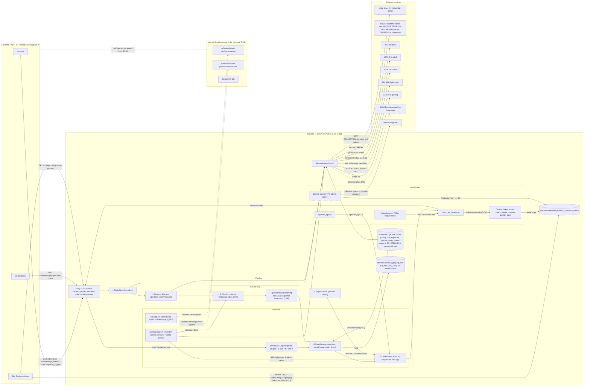
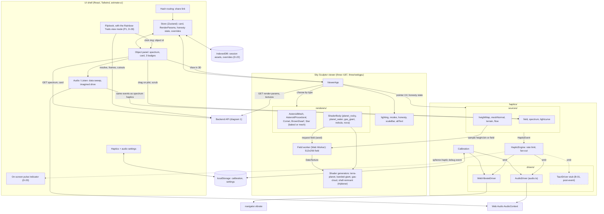

# 02 Components

The main components and the interfaces between them. Diagram 1 is the system and backend view; diagram 2 opens up the frontend. Drawn from architecture spec §2, §3, §4, §9, rendering doc §3, §6, §7.7, §8, §10 and decisions D-01, D-02, D-07, D-08, D-10, D-12, D-15, D-16, D-18, D-19, D-20, D-22, D-25 and D-28.

## Diagram 1: system and backend

## Diagram 2: frontend

## Notes

- Baked types (rendering doc types) fetch textures from the backend; shader kinds generate a field in the browser instead (D-01, D-12).
- Endpoints follow D-16. Every endpoint is keyed by the object id that `resolve` returns; there is no separate flipbook endpoint. Responses served from the cache carry `cached_at` (D-25); for `/card` and `/render-params` it is the `X-SX-Cached-At` header, next to `X-SX-Asset-Status`, because the R3 shapes forbid extra fields (Q-39).
- Every external call goes through the read-through cache (D-25): cache, then a live call with a timeout and retries, then an older cached entry, then refuse.
- `core/classify`, `core/card` and the `card_to_params`, `blackbody` and `spherex_rgb` modules of `core/render` were built in issue #5. The `/card` and `/render-params` replies are plain dicts checked with `jsonschema`; the generated Pydantic models (D-18) only describe them in the OpenAPI docs (Q-40). The render-params endpoint names the texture URLs but does not call the baker yet.
- The physics layer is drawn on the backend, feeding derived values into the card. The browser reruns the same functions on slider changes (architecture spec §4.6). Baked types allow only colour, lighting and spin sliders; relief sliders exist only on the shader kinds (D-26).
- The `spherex:haptic` DOM event is a debug hook that also drives the on-screen pulse indicator (D-20). Which module fires it is not stated; it is drawn from the engine.
- `ShaderBody` and the `fields/` folder follow from D-01 and D-12 and are now listed in rendering doc §10. Their file names are **[verify]**.
- The `terrain` and `flow` sources come from D-12. The brown dwarf `bands` source and the `flux_pulse`, `teq_pulse`, `motion` and `detections` data haptics have no source file named in §10 **[verify]**.
