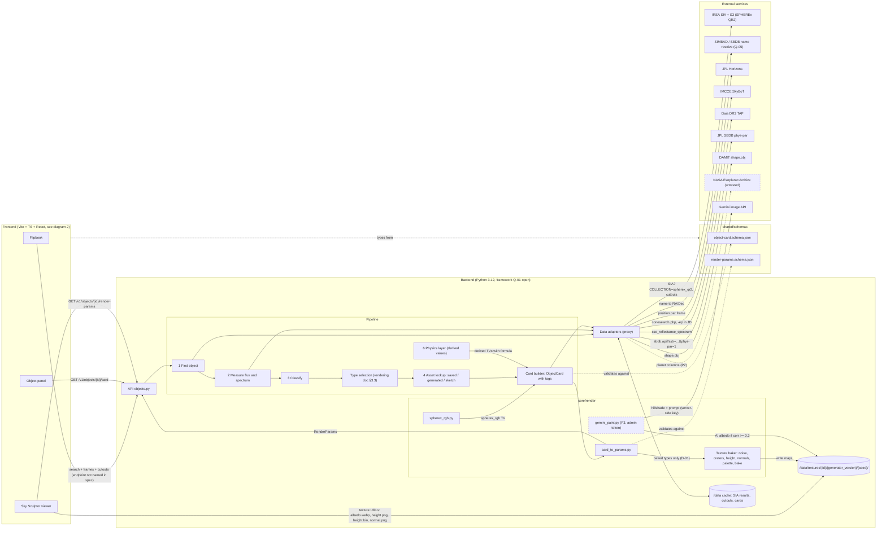
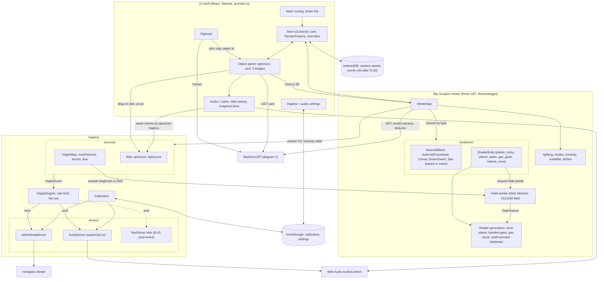

# 02 Components

The main components and the interfaces between them. Diagram 1 is the system and backend view; diagram 2 opens up the frontend. Drawn from architecture spec §2, §3, §4, §9, rendering doc §3, §6, §7.7, §8, §10 and decisions D-01, D-02, D-07, D-08, D-10, D-12.

## Diagram 1: system and backend

## Diagram 2: frontend

## Notes

- Baked types (rendering doc types) fetch textures from the backend; shader kinds generate a field in the browser instead (D-01, D-12).
- The flipbook and search endpoints are not named in either spec. Only `/v1/objects/{id}/card` and `/render-params` are.
- The physics layer is drawn on the backend, feeding derived values into the card. Whether sliders re-run it on the client is part of Q-03.
- `ShaderBody` and the `fields/` folder are not in rendering doc §10 yet; they follow from D-01 and D-12. Their file names are **[verify]**.
- The `terrain` and `flow` sources come from D-12. The brown dwarf `bands` source and the `flux_pulse`, `teq_pulse`, `motion` and `detections` data haptics have no source file named in §10 **[verify]**.
