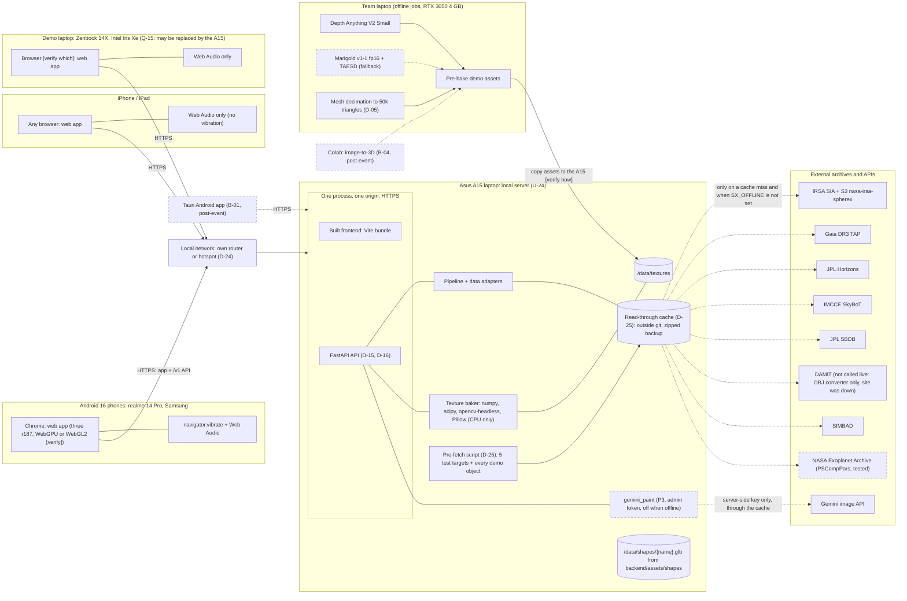

# 03 Deployment

Where each part runs at the event, and what talks to what. Drawn from architecture spec §3, §6.3, §9, §10 and §12, rendering doc §2, §5.5, §8.1, and decisions D-05, D-06, D-08, D-15, D-24 and D-25. Dashed nodes are post-event or optional.

## Notes

- Haptics can only be shown on the two Android phones (D-05, D-08). Every device gets the paired audio (D-10).
- Budgets (D-05): ≥ 30 fps while rotating, pixel ratio ≤ 1.5, textures 2048×1024 desktop and 1024×512 mobile, displacement on desktop only.
- HTTPS is needed because WebGPU needs a secure context. A local root certificate (e.g. `mkcert`) is installed on both Android phones; whether a clicked-through self-signed certificate is enough is **[verify]** (D-24).
- Venue Wi-Fi may block device-to-device traffic, so the team brings a router or hotspot (D-24).
- The demo runs with `SX_OFFLINE=1`: nothing touches the network, and the Gemini layer stays off so the code path shows (D-24, D-25). The pre-fetch script fills the cache while the internet is good. Cutouts only, never whole frames. Where the script runs is not stated; it is drawn on the A15 because the cache lives there.
- The baker is CPU-only (rendering doc §2).
- There is no public URL after the event. A static hosted copy is a later, separate decision (D-24).
- Whether the A15 also replaces the Zenbook as the demo screen is Q-15. Whether the team laptop for offline jobs is the A15 is not stated.
