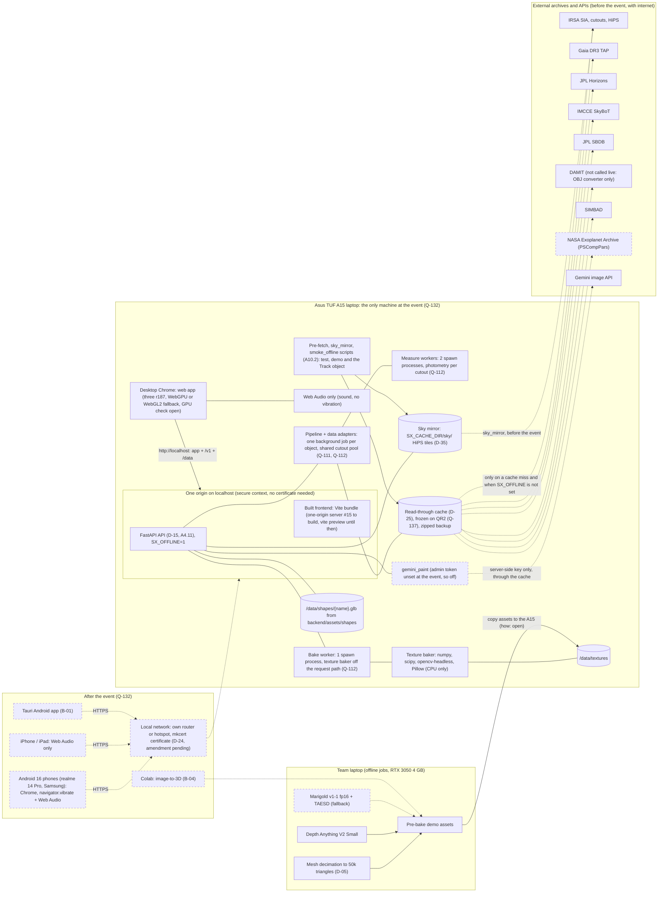

# 03 Deployment

Where each part runs at the event, and what talks to what. Drawn from [A10–A10.2](../architecture/frontend-platform.md) (the event build), A3, A6.3, A9, A12, rendering doc R2, R5.5, R8.1, and decisions D-05, D-06, D-08, D-15, D-24, D-25, D-35, Q-111 and Q-112 (object jobs and worker processes), **Q-132** (the event is a desktop browser on the Asus A15 laptop, sound only; answers Q-15) and Q-137 (data frozen on QR2). Dashed nodes and edges are post-event, optional or proposed.

## Notes

- **At the event (Q-132):** one machine, the Asus A15 laptop, runs the browser and the server. Sound is the only output; there is no vibration and no phone. The run steps are [A10.2](../architecture/frontend-platform.md#a102-running-the-event-build).
- `http://localhost` is a secure context, so WebGPU needs no certificate when the browser runs on the A15 itself. HTTPS, `mkcert` and the router of D-24 matter only once phones join, after the event.
- Budgets: owned by R5.5 and R5.7; the A15's GPU and browser version are still to measure (A10.1, A14.1).
- The demo runs with `SX_OFFLINE=1`: nothing touches the network, and the Gemini route does not exist because `SX_ADMIN_TOKEN` is unset (A10.2, D-24, D-25). The pre-fetch script fills the cache while the internet is good; the sky mirror holds the HiPS tiles (D-35). Cutouts only, never whole frames.
- The baker is CPU-only (rendering doc R2). It runs in a `spawn` worker process (`SX_BAKE_WORKERS=1`) queued by the API, and photometry runs in 2 more (`SX_MEASURE_WORKERS=2`), which leaves cores for the API (Q-112). With `SX_PREFETCH_ON_START=1` the API warms the cache for the demo targets at start-up (warm start, A4.10); overlays and composites still need the pre-fetch script.
- How pre-baked assets reach the A15 is open. Whether the team laptop for offline jobs is the A15 is not stated.
- There is no public URL after the event. A static hosted copy is a later, separate decision (D-24).
