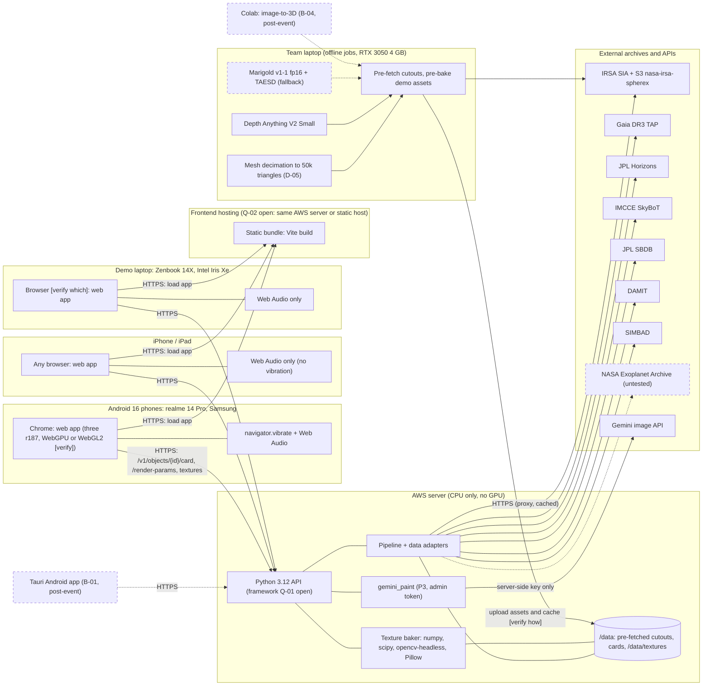

# 03 Deployment

Where each part runs at the event, and what talks to what. Drawn from architecture spec §3, §6.3, §9 and §12, rendering doc §2, §5.5, §8.1, and decisions D-05, D-06, D-08, Q-01, Q-02. Dashed nodes are post-event or optional.

## Notes

- Haptics can only be shown on the two Android phones (D-05, D-08). Every device gets the paired audio (D-10).
- Budgets (D-05): ≥ 30 fps while rotating, pixel ratio ≤ 1.5, textures 2048×1024 desktop and 1024×512 mobile, displacement on desktop only.
- IRSA is slow and sometimes returns 504, so every demo target is pre-fetched into `/data` before the event (architecture spec §3.1, §13).
- The AWS server has no GPU and needs none; the baker is CPU-only (rendering doc §2).
- Q-02: if the frontend is hosted on the same AWS server, the "Frontend hosting" node merges into it.
