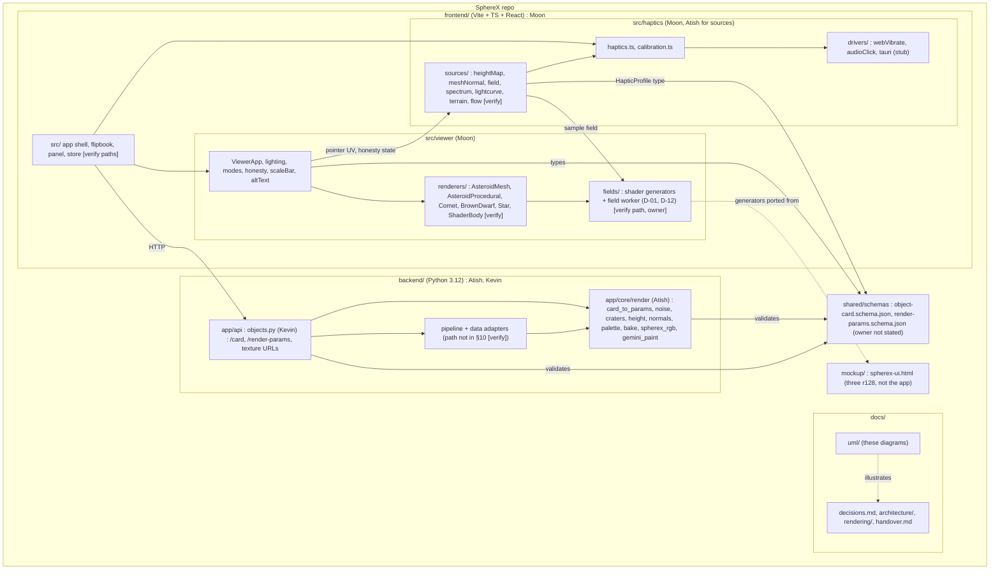

# 04 Packages

The repo and code layout as packages, with their dependencies and owners. Drawn from `CLAUDE.md` (layout), rendering doc §10 (file layout and owners) and decisions D-01, D-11, D-12. Arrows mean "depends on" or "uses".

## Notes

| Package | Owner (rendering doc §10) |
|---|---|
| `backend/app/core/render` | Atish |
| `backend/app/api` | Kevin |
| `frontend/src/viewer`, `viewer/renderers` | Moon |
| `frontend/src/haptics`, `haptics/drivers` | Moon |
| `haptics/sources` | Moon, with Atish |
| `viewer/fields`, `shared/schemas`, backend pipeline and adapters | Not stated **[verify]** |

- `viewer/fields`, `ShaderBody`, `sources/terrain` and `sources/flow` are not yet in rendering doc §10. They follow from D-01 and D-12 (Proposed).
- The shader generators move from the mock-up into ES modules; the mock-up is not ported in place (D-03).
