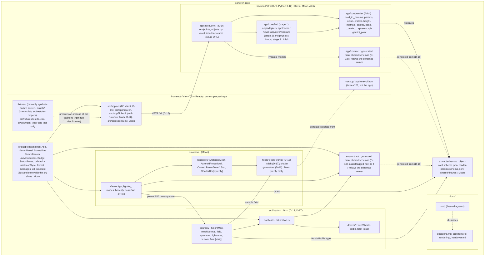

# 04 Packages

The repo and code layout as packages, with their dependencies and owners. Drawn from `CLAUDE.md` (layout), rendering doc §10 (file layout and owners) and decisions D-01, D-11, D-12, D-13, D-15, D-17 and D-18. Arrows mean "depends on" or "uses".

## Notes

| Package | Owner (rendering doc §10, D-17) |
|---|---|
| `backend/app/core/render` (baker, `card_to_params`, Gemini layer) | Atish |
| `backend/app/api`, `backend/app/adapters`, `backend/app/cache`, `backend/app/core/find` (stage 1), backend scaffold, pipeline stages 4, 5 | Kevin |
| `backend/app/core/measure` (stage 2), physics layer, `shared/schemas`, `shared/fixtures` | Moon (Munazir) |
| Pipeline stage 3 | Atish |
| `frontend/src/viewer`, `viewer/renderers`, shader kinds, `src/app`, `src/state` | Moon |
| `src/app/api`, `src/app/search`, `src/app/flipbook`, `src/app/spectrum` (flipbook UI) | Moon |
| `frontend/fixtures`, `frontend/scripts`, `src/test`, `src/fixtures.test.ts`, `frontend/e2e` | Not named in D-17; dev and test tooling for the flipbook UI |
| `frontend/src/viewer/fields` | Atish |
| `frontend/src/haptics` (engine, `drivers`, `sources`) | Atish (D-13, D-17) |
| `src/contract`, `backend/app/contract` | Generated (D-18); follows the owner of `shared/schemas` |

- `viewer/fields`, `ShaderBody`, `sources/terrain` and `sources/flow` follow from D-01 and D-12. They are listed in rendering doc §10, but the `ShaderBody` and `fields/fieldWorker` file names stay **[verify]**.
- `src/contract`, `src/state` and `src/app` were added by the frontend scaffold (4 Nov 2026) and are listed in rendering doc §10. `src/contract/generated.ts` is generated from `shared/schemas` (D-18), as is `backend/app/contract/`; the hand-written scaffold types were replaced in issue #4.
- The flipbook and spectrum view (M1, issue #3, 5 Nov 2026) added `src/app/api`, `src/app/search`, `src/app/flipbook`, `src/app/spectrum`, the `sky` slice in `src/state/store.ts`, `src/test`, `fixtures/` and `scripts/` (rendering doc §10). `fixtures/` is a Vite dev-server plugin used only by `npm run dev:fixtures` and the Playwright tests; `scripts/check-dist.js` fails the build if a fixture marker reaches `dist/`.
- D-13: Atish owns the creative direction of haptics (what each body feels like, patterns, sound pairing). Engineering choices (drivers, timing, rate limits) stay with the implementer.
- The shader generators move from the mock-up into ES modules; the mock-up is not ported in place (D-03).
