# 04 Packages

The repo and code layout as packages, with their dependencies and owners. Drawn from `CLAUDE.md` (layout), rendering doc §10 (file layout and owners) and decisions D-01, D-11, D-12, D-13, D-15, D-17 and D-18. Arrows mean "depends on" or "uses".

```mermaid
flowchart TB
  subgraph Repo["SphereX repo"]
    subgraph Docs["docs/"]
      DocSpecs["decisions.md, architecture/, rendering/, handover.md"]
      DocUML["uml/ (these diagrams)"]
    end

    Mockup["mockup/ : spherex-ui.html (three r128, not the app)"]

    subgraph Backend["backend/ (FastAPI, Python 3.12) : Kevin, Moon, Atish"]
      BApi["app/api (Kevin) : D-16 endpoints; objects.py : /card, /render-params, texture URLs; overlays.py : /overlays, /flags, /combine.png (Q-50)"]
      BPipe["app/core/find (stage 1; overlays, flagmask, combine, A4.9), app/adapters (gaia, wise = CatWISE2020, tap), app/cache, app/core/card (stages 4, 5) : Kevin; app/core/measure (stage 2) and physics : Moon; app/core/classify (stage 3) : Atish"]
      BRender["app/core/render (Atish) : card_to_params, blackbody, params, noise, craters, height, normals, palette, bake, __main__, spherex_rgb, gemini_paint"]
      BContract["app/contract : generated from shared/schemas (D-18) : follows the schemas owner"]
    end

    subgraph Frontend["frontend/ (Vite + TS + React) : owners per package"]
      FApp["src/app (React shell: App, ViewerPanel, StatusLine, FixtureBanner, LiveAnnouncer, Badge, StatusBoxes, urlHash + useHashSync, format, messages, refusals, RefusalList, ui), src/state (Zustand store with the sky slice) : Moon"]
      FFlip["src/app/api (M1 client, D-16), src/app/search, src/app/flipbook (with Rainbow Trails, D-28; overlays/, issue #12), src/app/spectrum : Moon"]
      FDev["fixtures/ (dev-only synthetic fixture server), scripts/ (check-dist), src/test (test helpers), src/fixtures.test.ts, e2e/ (Playwright) : dev and test only"]
      FPhysics["src/physics : A7 physics layer, derivePhysics, slider registry (D-26, D-27) : Moon"]
      FContract["src/contract : generated from shared/schemas (D-18), assertTagged next to it : follows the schemas owner"]
      subgraph FViewer["src/viewer (Moon)"]
        VCore["ViewerApp, lighting, modes, honesty, scaleBar, altText"]
        VRend["renderers/ : AsteroidMesh, AsteroidProcedural, Comet, BrownDwarf, Star, ShaderBody [verify], bodyRenderer, shaderPlan, shaderSpec, shaderPalette, pointClouds; sliders.ts"]
        VRender["render/ : pipeline (RenderChain), quality (quality tiers, FrameGovernor), clock (SimClock), workerPool (WorkerPool), fanout (loadBody, asset prefetch)"]
        VShaders["shaders/ : TSL noise (fbm, ridged, domainWarp, animatedCells, OCTAVES) and sphere helpers (latLon, tangentFrame, differentialRotate)"]
        VFields["fields/ : fieldGenerator, noise, fieldWorker, fieldClient (D-12) : Atish (D-17); shader generators (D-01) : Moon [verify path]"]
      end
      subgraph FHaptics["src/haptics : Atish (D-13, D-17)"]
        HCore["haptics.ts (engine), audioContext, audioGraph, settings, calibration, platform, pitch, spectrumMapping, tuning"]
        HDrivers["drivers/ : webVibrate, audio, tauri (stub)"]
        HProfiles["profiles.ts (buildHaptics, TouchHaptics), probe.ts (TouchProbe)"]
        HSources["sources/ : types, relief, heightMap, meshNormal, field, dataPulse, spectrum, lightcurve, terrain, flow"]
        HSound["sound/ : listenSweep (A8)"]
        HUi["ui/ : PulseIndicator, UnlockButton, SpectrumHapticsPad, CalibrationWizard, HapticsSettings"]
      end
      FShaderlab["src/shaderlab + shaderlab.html : dev-only shader harness, not a build input, not in dist/ : no owner named in D-17"]
      FHapticsTest["src/hapticsTestPage + haptics-test.html : dev-only test page, not a build input : Atish"]
    end

    Schemas["shared/schemas : object-card.schema.json, render-params.schema.json; shared/fixtures : Moon"]
  end

  DocUML -.->|"illustrates"| DocSpecs
  BApi --> BPipe
  BApi --> BRender
  BPipe --> BRender
  BRender -->|"validates"| Schemas
  BApi -->|"Pydantic models"| BContract
  BContract -.->|"generated from (D-18)"| Schemas

  FApp --> VCore
  FApp --> FPhysics
  FPhysics -->|"SliderKey, Overrides (viewer/sliders.ts)"| VRend
  VRend -->|"LAVA_START_K"| FPhysics
  FPhysics --> FContract
  FApp --> FContract
  VCore --> FContract
  HCore --> FContract
  FContract -.->|"generated from (D-18)"| Schemas
  FApp --> HCore
  FApp --> FFlip
  FFlip -->|"HTTP /v1 (D-16)"| BApi
  FDev -.->|"answers /v1 instead of the backend (npm run dev:fixtures)"| FFlip
  VCore --> VRend
  VCore -->|"RenderChain, SimClock, FrameGovernor"| VRender
  VRender -->|"OCTAVES"| VShaders
  VRender -->|"fanout: AssetCache, isLoadableMeshUrl"| VRend
  FShaderlab -.->|"dev server only"| VShaders
  VRend --> VFields
  VCore -->|"pointer ray, honesty state (M5)"| HProfiles
  HProfiles --> HSources
  HProfiles -->|"Comet, BrownDwarf, shaderSpec, planCommon, planTypes, sliders, pointClouds"| VRend
  HProfiles -->|"directionToUV"| VFields
  HSources --> HCore
  HSources -->|"field, zonalWind, storms, rings"| VFields
  HSources -->|"Comet, Star, pointClouds"| VRend
  HSources -->|"spectrum/scale, api/types"| FApp
  HSound --> HCore
  HSound -->|"Comet gasQForEpoch"| VRend
  HCore --> HDrivers
  HUi --> HCore
  HUi --> HSources
  HUi -->|"app/ui, api/types"| FApp
  FHapticsTest -.->|"dev server only"| HUi
  FHapticsTest -.->|"dev server only"| HProfiles
  HCore -->|"honesty filter"| VCore
  VCore -->|"types"| Schemas
  HSources -->|"HapticProfile type"| Schemas
  VFields -.->|"generators ported from"| Mockup
```

## Notes

| Package | Owner (rendering doc §10, D-17) |
|---|---|
| `backend/app/core/render` (baker, `card_to_params`, Gemini layer), `backend/app/core/classify` (stage 3) | Atish |
| `backend/app/api`, `backend/app/adapters`, `backend/app/cache`, `backend/app/core/find` (stage 1), `backend/app/core/card` (stages 4, 5), backend scaffold | Kevin |
| `backend/app/core/measure` (stage 2), physics layer, `shared/schemas`, `shared/fixtures` | Moon (Munazir) |
| Pipeline stage 3 | Atish |
| `frontend/src/viewer`, `viewer/renderers`, `viewer/render`, `viewer/shaders`, shader kinds, `src/app`, `src/state`, `src/physics` | Moon |
| `src/shaderlab`, `shaderlab.html` | Not named in D-17; dev-only harness for `viewer/shaders` |
| `src/app/api`, `src/app/search`, `src/app/flipbook`, `src/app/spectrum` (flipbook UI) | Moon |
| `frontend/fixtures`, `frontend/scripts`, `src/test`, `src/fixtures.test.ts`, `frontend/e2e` | Not named in D-17; dev and test tooling for the flipbook UI |
| `frontend/src/viewer/fields` | Atish |
| `frontend/src/haptics` (engine, `drivers`, `sources`, `ui`), `src/hapticsTestPage`, `haptics-test.html` | Atish (D-13, D-17) |
| `src/contract`, `backend/app/contract` | Generated (D-18); follows the owner of `shared/schemas` |

- `viewer/fields`, `ShaderBody`, `sources/terrain` and `sources/flow` follow from D-01 and D-12. They are listed in rendering doc §10, but the `ShaderBody` and `fields/fieldWorker` file names stay **[verify]**.
- Issue #9 (6 Nov 2026) built the haptics core: the engine, both web drivers, the shared AudioContext, the settings store, calibration types, platform defaults, the λ→pitch and spectrum mappings, `tuning.ts` (every tuning value, D-13), the `ui/` pulse indicator and unlock button, and the dev-only test page. Issues #10 and #11 added the spectrum pad, calibration wizard and settings UI, `profiles.ts`, `probe.ts`, the texture and data sources and `sound/listenSweep.ts`. Imports from outside `src/haptics` are type-only or pure functions: `viewer/honesty.ts` (honesty filter), `viewer/fields/fieldGenerator.ts` (the shared field and its functions), `viewer/renderers/` (`Comet`, `Star`, `BrownDwarf`, `shaderSpec`, `pointClouds` plan helpers), `viewer/planCommon.ts`, `viewer/planTypes.ts`, `viewer/sliders.ts` (the `Overrides` type), `app/spectrum/scale.ts`, `app/api/types.ts` and `app/ui.ts` (button class). None of them creates GPU or browser state at import.
- `src/contract`, `src/state` and `src/app` were added by the frontend scaffold (4 Nov 2026) and are listed in rendering doc §10. `src/contract/generated.ts` is generated from `shared/schemas` (D-18), as is `backend/app/contract/`; the hand-written scaffold types were replaced in issue #4.
- The flipbook and spectrum view (M1, issue #3, 5 Nov 2026) added `src/app/api`, `src/app/search`, `src/app/flipbook`, `src/app/spectrum`, the `sky` slice in `src/state/store.ts`, `src/test`, `fixtures/` and `scripts/` (rendering doc §10). `fixtures/` is a Vite dev-server plugin used only by `npm run dev:fixtures` and the Playwright tests; `scripts/check-dist.js` fails the build if a fixture marker reaches `dist/`.
- The physics layer and slider registry (issue #13) added `src/physics` (rendering doc §10, architecture spec §7). There is one slider registry, `src/viewer/sliders.ts` (drawn in the `VRend` box): `src/state/store.ts`, the shader kinds and `src/physics` all take `SliderKey` and `Overrides` from it (D-27). `shaderPalette` takes the lava threshold `LAVA_START_K` from `src/physics/constants.ts`, so the two agree. The backend half of stage 6 is not built (Q-60).
- The overlays (M4, issue #12) added `backend/app/api/overlays.py`, `backend/app/core/find/overlays.py`, `flagmask.py` and `combine.py`, the `gaia`, `wise` and `tap` adapters, `src/app/flipbook/overlays/` and the `overlays` and `combine` parts of the `sky` slice (A4.9). D-17 gives the Gaia and WISE adapters to Kevin and the overlay UI to Moon.
- The viewer render core (issue #39) added `viewer/render/` (the frame pipeline, quality tiers, the sim clock, a worker pool and the fan-out loader) and `viewer/shaders/` (shared TSL helpers). `quality.ts` takes its octave counts from `shaders/noise.ts`; `fanout.ts` uses the asset cache from `renderers/build.ts` and the mesh-URL rule from `renderers/AsteroidMesh.ts`. `src/shaderlab` with `shaderlab.html` is a dev-only harness: Vite builds `index.html` only, so it never reaches `dist/`.
- D-13: Atish owns the creative direction of haptics (what each body feels like, patterns, sound pairing). Engineering choices (drivers, timing, rate limits) stay with the implementer.
- The shader generators move from the mock-up into ES modules; the mock-up is not ported in place (D-03).
