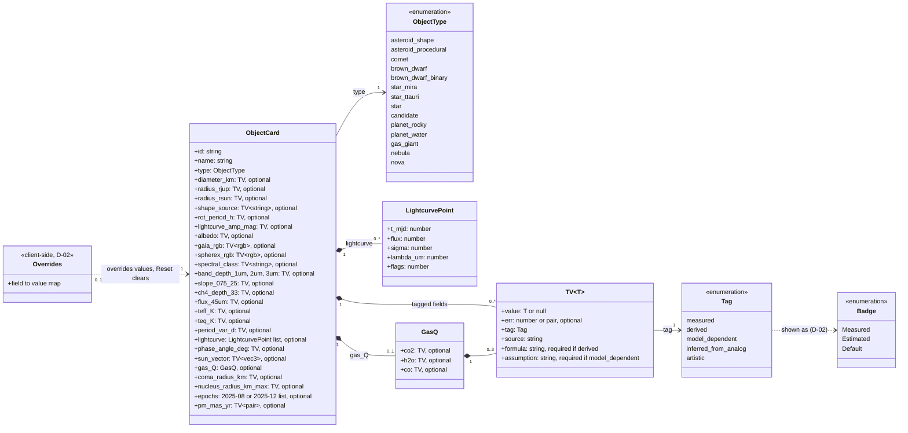
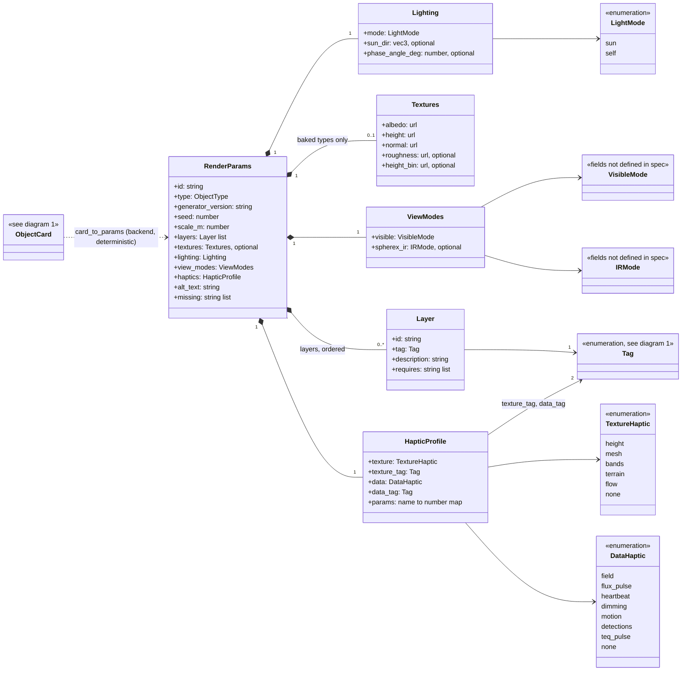

# 05 Data contract (classes)

The data contract between backend and frontend: `ObjectCard` (what we know) and `RenderParams` (how to draw and feel it). Drawn from rendering doc §3.1–3.4, §5.1–5.3, §8.8 and decisions D-02 (replaces the settings file), D-04 (type union) and D-12 (extended `HapticProfile`, new `teq_K` field).

## Diagram 1: tagged values and the ObjectCard

## Diagram 2: RenderParams

## Notes

- `rgb` and `vec3` stand for `[number, number, number]`; `pair` stands for `[number, number]`. They are written in words because Mermaid class members cannot hold brackets reliably.
- `textures` is present only for the baked types (D-01). Shader kinds (`planet_rocky`, `planet_water`, `gas_giant`, `nebula`, `nova`) get their field from the browser worker, so it is absent **[verify]**.
- `terrain`, `flow`, `teq_pulse` and the ObjectCard field `teq_K` are added by D-12, which is still Proposed. `teq_K` is in D-12 and in `frontend/src/contract/objectCard.ts`, but not yet in the rendering doc R3.2 listing. `teq_pulse` is refused and listed in `missing` when `teq_K` is null.
- `lighting.mode` is `sun` for solar-system bodies (`phase_angle_deg` from Horizons quantity 24) and `self` for stars and brown dwarfs (rendering doc §5.1).
- `Overrides` holds user slider edits on the client, separate from the card, so Reset restores the data values. Which sliders apply to baked bodies is Q-03 open.
