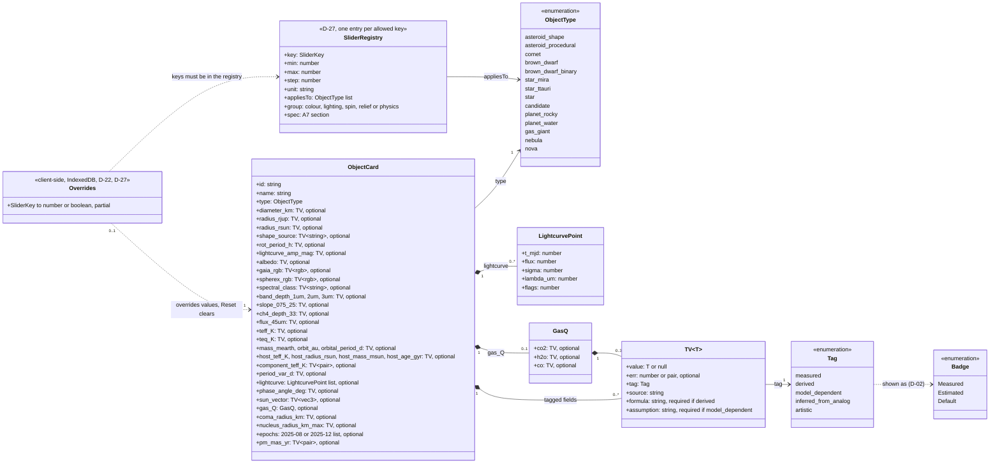
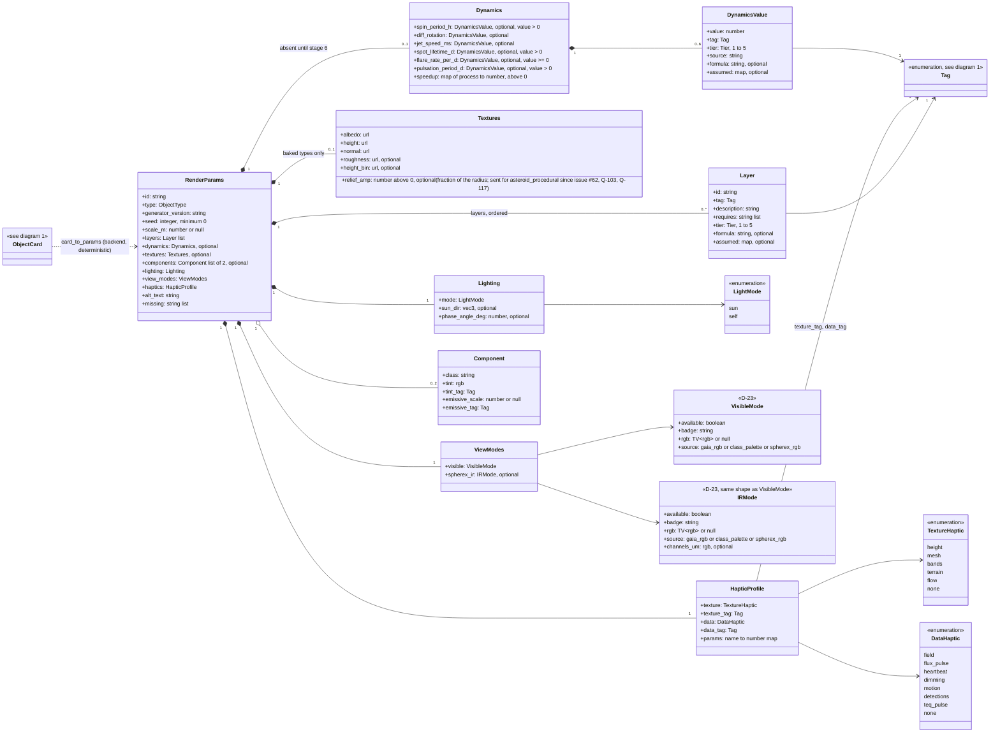

# 05 Data contract (classes)

The data contract between backend and frontend: `ObjectCard` (what we know) and `RenderParams` (how to draw and feel it). Drawn from `shared/schemas/`, rendering doc §3.1–3.4, §5.1–5.3, §8.8 and decisions D-02 (replaces the settings file), D-04 (type union), D-12 (extended `HapticProfile`, new `teq_K` field), D-23 (view-mode fields) and D-27 (`overrides` type).

## Diagram 1: tagged values and the ObjectCard

## Diagram 2: RenderParams

## Notes

- The demo fixtures `planet_trappist1f` and `planet_kepler186f` hold real archive values, each `source` starting "synthetic fixture: real <planet> value, " (Q-165).
- `TV~T~` is one schema definition per payload in code (`TVNumber`, `TVString`, `TVRgb`, `TVVec3`, `TVPair`), because JSON Schema has no generics; `TV<T>` is a hand-written view of them in `frontend/src/contract/tags.ts`. Generated code: `backend/app/contract/`, `frontend/src/contract/generated.ts` (D-18).
- `Layer.tier` and `DynamicsValue.tier` are fixed by the tag (1 measured, 2 derived, 3 model_dependent, 4 inferred_from_analog, 5 artistic). `formula` is required from tier 2 and `assumed` at tier 3 (D-32). A rate no rung answers is omitted and listed in `missing` as `dynamics:<key>`. `speedup` keys are `spin`, `spots`, `flares`, `winds`, `clouds`, `pulsation`.
- `scale_m` is null when the size is unknown, for example on a `candidate` (Q-33).
- `Textures` and `Lighting` are named `RenderTextures` and `RenderLighting` in the schema and the generated code. The schema has no `IRMode` definition: `spherex_ir` refers to `VisibleMode`, and `IRMode` is a type alias in `frontend/src/contract/index.ts` (D-23).
- `rgb` and `vec3` stand for `[number, number, number]`; `pair` stands for `[number, number]`. They are written in words because Mermaid class members cannot hold brackets reliably.
- Issue #68: the card gains the exoplanet orbit, mass and host-star fields and `component_teff_K` (Q-150, Q-154); `components` holds the two bodies' class tint and relative brightness of a `brown_dwarf_binary` (Q-154) and is absent when the class does not name two components.
- `textures` is present only for the baked types (D-01). Shader kinds (`planet_rocky`, `planet_water`, `gas_giant`, `nebula`, `nova`) get their field from the browser worker, so it is absent **[verify]**.
- `terrain`, `flow`, `teq_pulse` and the ObjectCard field `teq_K` are added by D-12 (Accepted). `teq_K` is in the rendering doc R3.2 listing: `measured` from Exoplanet Archive `pl_eqt`, otherwise `derived`. `teq_pulse` is refused and listed in `missing` when `teq_K` is null.
- `VisibleMode` and `IRMode` share one shape (D-23); `channels_um` is set on `IRMode` only. Their `rgb` field, drawn as `TV~rgb~ or null`, is `TV<[number, number, number]> | null`, the same type as `gaia_rgb` and `spherex_rgb` (D-23, Q-18). When a mode is not available, the reason goes in `missing`.
- `lighting.mode` is `sun` for solar-system bodies (`phase_angle_deg` from Horizons quantity 24) and `self` for stars and brown dwarfs (rendering doc §5.1).
- `Overrides` holds user slider edits on the client, separate from the card, so Reset restores the data values. It is `Partial<Record<SliderKey, number | boolean>>`, and an unknown key fails the type check (D-27). It stays in IndexedDB and is never sent to the server (D-22).
- Baked types allow only colour, lighting and spin sliders for the event; relief sliders exist only on the shader kinds (D-26).
- The one registry lives in `frontend/src/viewer/sliders.ts` and serves the viewer and the physics layer. Each entry adds `group` (so D-26 can be checked) and `spec` (the section it feeds) to the D-27 fields (see the note under D-27); `SliderKey` is the registry's keys. A value outside the range is ignored, never clamped. Bulk density for the asteroid spin barrier is filed under `spin` (Q-58).
