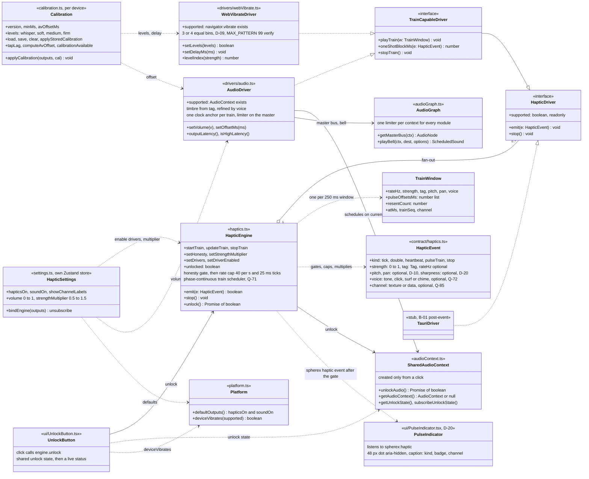
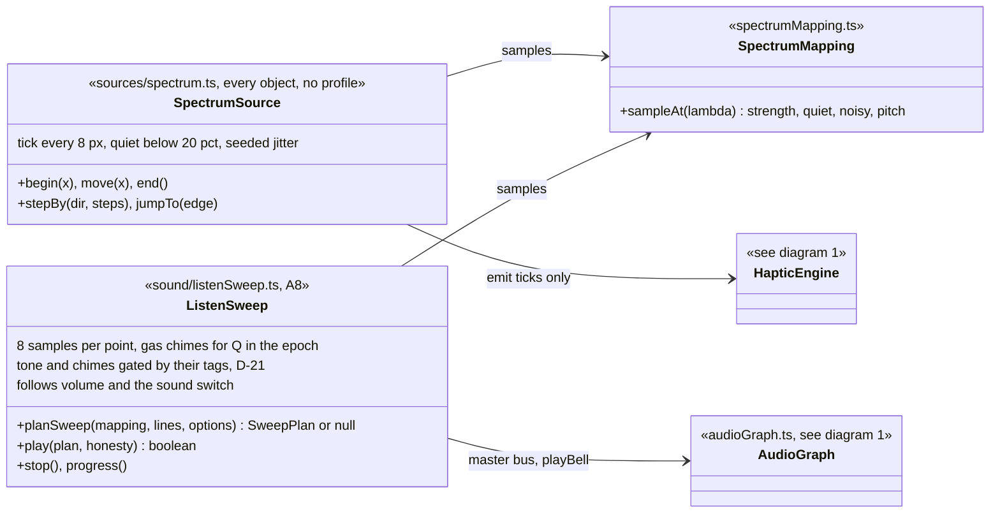

# 06 Haptics and audio (classes)

The haptics engine, its drivers, the calibration store and the event sources. Drawn from rendering doc §8.3–8.8 and §10, and decisions D-08 (web only), D-09 (quantised strength), D-10 (audio on every platform, `pitch` and `pan`), D-12 (`terrain` and `flow` sources, shared field), D-20 (`sharpness`, `spherex:haptic` debug hook) and B-01 (Tauri, post-event). The engine fans out every event to all active drivers.

## Diagram 1: engine, drivers, settings and calibration

As built in issue #9 (`frontend/src/haptics/`). Every tuning value lives in `tuning.ts` (D-13).

## Diagram 2: profiles, probe and touch sources

As built in issue #11 (`profiles.ts`, `probe.ts`, `sources/`). Every texture event carries `texture_tag` and `channel: texture`; every data event carries `data_tag` (or `teq_K`'s, or `spectral_class`'s tag, Q-81) and `channel: data`.

```mermaid
classDiagram
  direction TB
  class BuildHaptics {
    <<profiles.ts>>
    +buildHaptics(engine, params, card, body, options) HapticsBuild
    options: overrides required, planBodies, meshNormals, heightGrid, epoch, gas
    +shaderProbeOptions(body, build)
    +planProbeBodies(bodies)
  }
  class HapticsBuild {
    +texture: HapticSource or null
    +data: HapticSource or null
    +rings: boolean
    +missing: refused ids
  }
  class TouchHaptics {
    <<profiles.ts>>
    +move(sample), poll(now)
    +scrub(index), endScrub(), release()
    moving gives texture, holding still gives the data pulse
  }
  class TouchProbe {
    <<probe.ts>>
    +fromPointer(x, y, rect, camera, t, out)
    +fromWorldRay(origin, dir, ...)
    analytic sphere or ellipsoid, ring plane, pan
  }
  class TouchSample {
    <<sources/types.ts, one reused object>>
    +bodyId, dir, u, v, normal
    +rayOrigin, rayDir, centreDistance, ringRadius, pan
  }
  class HapticSource {
    <<interface, sources/types.ts>>
    +id, channel, trigger: move, hold or scrub, tag
    +move(s), hold(s), scrub(i), release()
  }
  class TrainSlot {
    <<sources/types.ts>>
    start or update only on a change, stop
  }
  class OneShot {
    <<sources/types.ts>>
    one reused event per source
  }
  class HeightMapSource {
    <<sources/heightMap.ts>>
    float16 height.bin decoded by hand, bilinear
    R8.4 peak rule, hydrated x0.6
    crater rims refused, Q-78
  }
  class MeshNormalSource {
    <<sources/meshNormal.ts>>
    normal turn over 12 deg ticks, limb edge tick
    refused as mesh_normals until a mesh raycast, Q-78
  }
  class TerrainSource {
    <<sources/terrain.ts, D-12>>
    land relief, coastline with hysteresis
    ocean swell, ice over land and sea, lava double
  }
  class FlowSource {
    <<sources/flow.ts, D-12>>
    band ticks from the field, jets, storm swirl, ring gaps
  }
  class FieldSources {
    <<sources/field.ts>>
    CometFieldSource: k Q over r, nucleus tick
    PointDensitySource: nebula and nova
  }
  class DataPulseSources {
    <<sources/dataPulse.ts>>
    HoldPulseSource: teq_pulse, flux_pulse
    BinaryPulseSource: rate by class
  }
  class LightcurveSources {
    <<sources/lightcurve.ts>>
    MiraHeartbeatSource: a beat per scrub step
    TTauriDimmingSource: thinning by depth, Q-80
  }
  class SharedField {
    <<BodyRenderer.field, D-12>>
  }
  class HapticEngine {
    <<see diagram 1>>
  }

  BuildHaptics --> HapticsBuild : returns
  TouchHaptics --> HapticsBuild : drives
  TouchProbe --> TouchSample : fills
  TouchHaptics --> HapticSource : move, hold, scrub
  HapticSource --> TrainSlot : trains
  HapticSource --> OneShot : ticks
  TrainSlot --> HapticEngine : startTrain, updateTrain, stopTrain
  OneShot --> HapticEngine : emit
  HeightMapSource ..|> HapticSource
  MeshNormalSource ..|> HapticSource
  TerrainSource ..|> HapticSource
  FlowSource ..|> HapticSource
  FieldSources ..|> HapticSource
  DataPulseSources ..|> HapticSource
  LightcurveSources ..|> HapticSource
  TerrainSource --> SharedField : samples
  FlowSource --> SharedField : samples
```

## Diagram 3: spectrum source and Listen sweep

## Notes

- `SpectrumSource` is not profile-driven: every object with a spectrum gets it (R8.6). It reads the spectrum's points and `SpectrumResponse.tag` and calls only `emit`, so the honesty gate and the rate cap apply. Its UI is `ui/SpectrumHapticsPad.tsx` (a `role="slider"` over λ).
- The Listen sweep is a sound, not a `HapticEvent`: it does not go through the engine, so it applies the honesty filter itself (tone by the spectrum's tag, each chime by its Q's tag) and uses the shared master bus and its limiter.
- The engine applies, in order: the honesty gate (D-21; `stop` is exempt), the R8.3 rate cap (≥ 25 ms between `tick`, `double` and `heartbeat`; at most 40 events in any 1 s window, a train window counting as one; `stop` exempt; extra events dropped, never queued), then the strength multiplier (R8.7). Only then does it fan out and fire `spherex:haptic` (D-20), even when no driver is active.
- Pulse trains belong to the engine (Q-71): sources call `startTrain` / `updateTrain` / `stopTrain` and own no timers. The engine keeps each train's phase and sends explicit pulse times per 250 ms window (`TrainWindow` also carries `atMs`, `trainSeq` and `channel`), so 1–2 Hz swells play at their rate; a late timer never moves the grid. One train at a time. A one-shot cancels the vibration pattern; the engine re-sends the cancelled pulses to vibration only (`resentCount`) once it ends. Stopping a train calls each driver's `stopTrain()`, which cancels train output only, never a playing one-shot. The vibration delay of the R8.9 offset is a timer per pattern (Q-73).
- `WebVibrateDriver` maps `strength` to 3–4 equal bins (D-09). Its `supported` is false on iPhone, iPad and desktop, so it is a silent no-op there.
- `AudioDriver` timbre (R8.9, Q-72): clean tone for `measured`, softer tone for the Estimated tags, a 4 ms noise grain for `artistic`. `voice` refines it: `surf` low-passed noise and `tone` a band-passed grain for `artistic`; `chime` a bell for the other tags. `artistic` never becomes a tone and the other tags never become noise.
- Settings and calibration each persist under one `localStorage` key. `Calibration` types and `applyCalibration` were pinned in #9; #10 built the maths, the persistence (validated on load) and the wizard, `ui/CalibrationWizard.tsx` (diagram 13). Offset rule (R8.9): a positive `avOffsetMs` delays the audio, a negative one the vibration.
- Drivers never know about objects; only `buildHaptics` reads `HapticProfile`. `sharpness` is ignored by the web driver (D-20).
- Refused, never invented (`HapticsBuild.missing`): crater rims and mesh normals (Q-78), brown dwarf band ticks (Q-82), `flux_pulse` while `flux45Reference` is null (R12 #15), `motion` while the SPHEREx baseline is null (R12 #16), `detections` (no detection field, Q-86). The `teq_pulse`, `flux_pulse` and binary pulses live in `sources/dataPulse.ts`.
