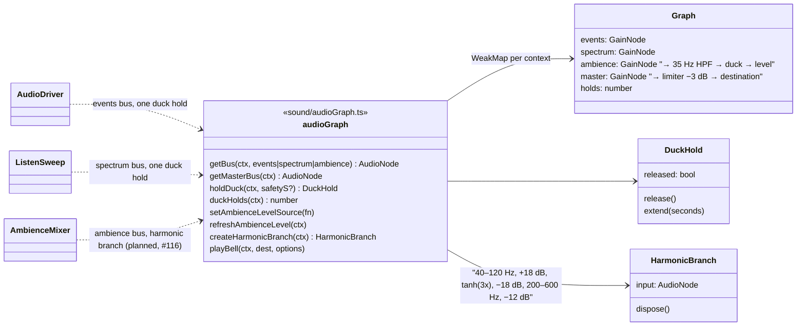

# 06 Sound engine, voices and buses (classes)

> **D-39 (12 Nov 2026):** haptics are cut. This diagram used to show the haptic engine, the vibrate and Tauri drivers, calibration, the touch profiles, the probe and the touch sources. All of those are deleted; the old diagrams are in git history (before issue #111). The file name is kept so links stay valid.

The sound code in `frontend/src/sound/` as built in issue #111. It is drawn from rendering doc R8.8, R8.9, R13.9 and R13.12 and decisions D-10 (timbre by tag), D-20 (event API), D-21 (honesty), D-39, Q-71 (engine-owned trains), Q-73 (unlock on a click), Q-430 (long wavelength = low pitch) and Q-441 (buses and ducking). Every tuning value lives in `sound/tuning.ts` (D-13). The contract types keep their `Haptic*` names until after the event (D-39).

## Diagram 1: engine, voices, sweep, settings and the shell control

```mermaid
classDiagram
  direction LR
  class HapticEvent {
    <<contract/haptics.ts>>
    kind: tick | double | heartbeat | pulseTrain | stop
    strength: number
    tag: Tag
    pitch?: number
    pan?: number
    voice?: HapticVoice
    rateHz?: number
  }
  class SoundEngine {
    <<sound/engine.ts>>
    emit(e) bool
    startTrain(id, params) bool
    updateTrain(id, changes) bool
    stopTrain(id?)
    setHonesty(state)
    setDriverEnabled(driver, on)
    unlock() Promise~bool~
    stop()
  }
  class AudioDriver {
    <<sound/voices.ts>>
    emit(e)
    playTrain(window)
    setVolume(v)
    stop()
    stopTrain()
    ducking: bool
  }
  class ListenSweep {
    <<sound/listenSweep.ts>>
    play(plan, honesty) bool
    setHonesty(state)
    stop()
    progress() number
    ducking: bool
  }
  class AppSound {
    <<sound/appSound.ts>>
    unlock()
    setMuted(m)
    setVolume(v)
    listen(reply) ListenOutcome
    stopListen()
    chordPlan(reply) ChordPlan
    chord(reply, {owner, mode}) ChordOutcome
    setChordMode(mode) bool
    stopChord(owner)
    bind(honesty) unbind
  }
  class SpectrumChord {
    <<sound/spectrumChord.ts>>
    start(plan, mode, honesty) bool
    setMode(mode) bool
    setHonesty(state)
    stop()
    ducking: bool
  }
  class ChordPlan {
    <<planChord(mapping), pure>>
    bins: ChordBin[12]
    data: ChordPartial[]
    smooth: ChordPartial[]
    missing: string[]
  }
  class spectrumExclusive {
    <<sound/spectrumExclusive.ts>>
    claimSpectrumSound(stop) SpectrumClaim
  }
  class SoundSettingsStore {
    <<sound/settings.ts, key sx.haptics.settings>>
    soundOn
    volume
    ambienceOn
    ambienceVolume
    flashesOn
    readCaptions
    update(changes)
  }
  class SoundSettings {
    <<sound/ui/SoundSettings.tsx, top bar>>
    click: unlock, open popover
  }
  class pitch {
    <<sound/pitch.ts>>
    wavelengthToPitch(λ) "long λ = low (Q-430)"
    pitchToHz(p)
  }
  SoundEngine --> AudioDriver : fans out events and trains
  AudioDriver ..> HapticEvent
  AudioDriver ..> pitch
  ListenSweep ..> pitch
  AppSound *-- SoundEngine
  AppSound *-- ListenSweep
  AppSound *-- SpectrumChord
  SpectrumChord ..> ChordPlan
  SpectrumChord ..> pitch
  SpectrumChord ..> spectrumExclusive : one spectrum sound
  ListenSweep ..> spectrumExclusive : one spectrum sound
  class hearAudio {
    <<app/build/hearAudio.ts>>
    startSpectrum(values, from) SpectrumHandle
  }
  hearAudio ..> spectrumExclusive : one spectrum sound (Hear it sweep)
  AppSound ..> SoundSettingsStore : bindEngine, ambience level
  SoundSettings ..> AppSound : useSound().unlock()
  SoundSettings ..> SoundSettingsStore : update
```

## Diagram 2: the audio graph (one per AudioContext)


