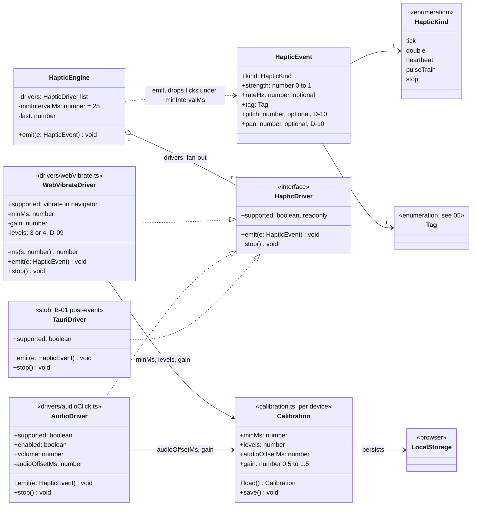
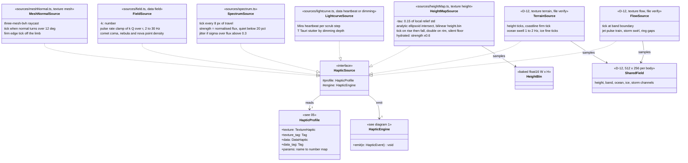

# 06 Haptics and audio (classes)

The haptics engine, its drivers, the calibration store and the event sources. Drawn from rendering doc §8.3–8.8 and §10, and decisions D-08 (web only), D-09 (quantised strength), D-10 (audio on every platform, `pitch` and `pan`), D-12 (`terrain` and `flow` sources) and B-01 (Tauri, post-event). The engine fans out every event to all active drivers.

## Diagram 1: engine, drivers and calibration

## Diagram 2: event sources

## Notes

- `HapticEngine` replaces the single `driver` in rendering doc §8.8 with a `drivers` list. Every event goes to every active driver (D-10); the rate limit (≥ 25 ms between ticks, ≤ 40 events/s) is applied once, before the fan-out, and extra ticks are dropped, not queued.
- `WebVibrateDriver` maps `strength` to 3–4 discrete levels (D-09). Its `supported` is false on iPhone, iPad and desktop, so it is a silent no-op there.
- `AudioDriver` timbre follows the tag: clean tone for `measured`, grainy click for `artistic` (D-10). Its on/off switch and volume are separate from the haptics switch.
- `Calibration.gain` is the strength multiplier from rendering doc §8.7. `levels` and `audioOffsetMs` come from D-09 and D-10; their exact measurement is in rendering doc §8.9 **[verify once written]**.
- The brown dwarf `bands` texture and the `flux_pulse`, `teq_pulse`, `motion` and `detections` data haptics have no source file in rendering doc §10 **[verify]**.
- Drivers never know about objects; only sources read `HapticProfile`.
