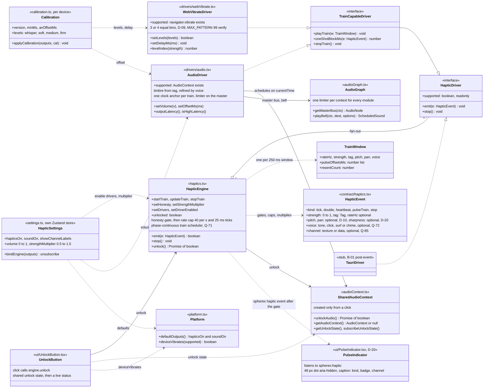

# 06 Haptics and audio (classes)

The haptics engine, its drivers, the calibration store and the event sources. Drawn from rendering doc §8.3–8.8 and §10, and decisions D-08 (web only), D-09 (quantised strength), D-10 (audio on every platform, `pitch` and `pan`), D-12 (`terrain` and `flow` sources, shared field), D-20 (`sharpness`, `spherex:haptic` debug hook) and B-01 (Tauri, post-event). The engine fans out every event to all active drivers.

## Diagram 1: engine, drivers, settings and calibration

As built in issue #9 (`frontend/src/haptics/`). Every tuning value lives in `tuning.ts` (D-13).

## Diagram 2: event sources

```mermaid
classDiagram
  direction TB
  class HapticSource {
    <<interface>>
    #profile: HapticProfile
    #engine: HapticEngine
  }
  class HapticProfile {
    <<see 05>>
    +texture: TextureHaptic
    +texture_tag: Tag
    +data: DataHaptic
    +data_tag: Tag
    +params: name to number map
  }
  class HapticEngine {
    <<see diagram 1>>
    +emit(e: HapticEvent) boolean
    +startTrain, updateTrain, stopTrain
  }
  class SpectrumMapping {
    <<spectrumMapping.ts>>
    +sampleAt(lambda) strength, quiet, noisy, pitch
    shared with the Listen sweep
  }
  class HeightMapSource {
    <<sources/heightMap.ts, texture height>>
    -tau: 0.15 of local relief std
    analytic ellipsoid intersect, bilinear height.bin
    tick on rise then fall, double on rim, silent floor
    hydrated: strength x0.6
  }
  class MeshNormalSource {
    <<sources/meshNormal.ts, texture mesh>>
    three-mesh-bvh raycast
    tick when normal turns over 12 deg
    firm edge tick off the limb
  }
  class FieldSource {
    <<sources/field.ts, data field>>
    -k: number
    pulse rate clamp of k Q over r, 2 to 30 Hz
    comet coma, nebula and nova point density
  }
  class SpectrumSource {
    <<sources/spectrum.ts>>
    tick every 8 px of travel
    strength = normalised flux, quiet below 20 pct
    jitter if sigma over flux above 0.3
  }
  class LightcurveSource {
    <<sources/lightcurve.ts, data heartbeat or dimming>>
    Mira heartbeat per scrub step
    T Tauri stutter by dimming depth
  }
  class TerrainSource {
    <<sources/terrain.ts, D-12, texture terrain>>
    height ticks, coastline firm tick
    ocean swell 1 to 2 Hz, ice fine ticks
    lava-crack mask gives a double tick
  }
  class FlowSource {
    <<sources/flow.ts, D-12, texture flow>>
    tick at band boundary
    jet pulse train 2 to 20 Hz, verify on phones
    storm swirl, ring gaps
  }
  class SharedField {
    <<D-12, 512 x 256 per body>>
    texture A: height, band index, storm id
    texture B: ocean mask, ice mask, lava-crack mask
    two RGBA Float32 DataTextures, same Float32Arrays
  }
  class HeightBin {
    <<baked float16 W x H>>
  }

  HapticSource --> "1" HapticProfile : reads
  HapticSource --> "1" HapticEngine : emit, trains
  SpectrumSource --> SpectrumMapping : samples
  HeightMapSource ..|> HapticSource
  MeshNormalSource ..|> HapticSource
  FieldSource ..|> HapticSource
  SpectrumSource ..|> HapticSource
  LightcurveSource ..|> HapticSource
  TerrainSource ..|> HapticSource
  FlowSource ..|> HapticSource
  HeightMapSource --> HeightBin : samples
  TerrainSource --> SharedField : samples
  FlowSource --> SharedField : samples
```

## Notes

- The engine applies, in order: the honesty gate (D-21; `stop` is exempt), the R8.3 rate cap (≥ 25 ms between `tick`, `double` and `heartbeat`; at most 40 events in any 1 s window, a train window counting as one; `stop` exempt; extra events dropped, never queued), then the strength multiplier (R8.7). Only then does it fan out and fire `spherex:haptic` (D-20), even when no driver is active.
- Pulse trains belong to the engine (Q-71): sources call `startTrain` / `updateTrain` / `stopTrain` and own no timers. The engine keeps each train's phase and sends explicit pulse times per 250 ms window, so 1–2 Hz swells play at their rate; a late timer never moves the grid. One train at a time. A one-shot cancels the vibration pattern; the engine re-sends the cancelled pulses to vibration only (`resentCount`) once it ends. Stopping a train calls each driver's `stopTrain()`, which cancels train output only, never a playing one-shot. The vibration delay of the R8.9 offset is a timer per pattern (Q-73).
- `WebVibrateDriver` maps `strength` to 3–4 equal bins (D-09). Its `supported` is false on iPhone, iPad and desktop, so it is a silent no-op there.
- `AudioDriver` timbre (R8.9, Q-72): clean tone for `measured`, softer tone for the Estimated tags, a 4 ms noise grain for `artistic`. `voice` refines it: `surf` low-passed noise and `tone` a band-passed grain for `artistic`; `chime` a bell for the other tags. `artistic` never becomes a tone and the other tags never become noise.
- Settings and calibration each persist under one `localStorage` key. `Calibration` types and `applyCalibration` are pinned in #9; the wizard, the maths and persistence come with #10 (diagram 13). Offset rule (R8.9): a positive `avOffsetMs` delays the audio, a negative one the vibration.
- Drivers never know about objects; only sources read `HapticProfile`. `sharpness` is ignored by the web driver (D-20).
- The brown dwarf `bands` texture and the `flux_pulse`, `teq_pulse`, `motion` and `detections` data haptics have no source file in rendering doc §10 **[verify]** (issue #11).
