# 07 Sky Sculptor viewer (classes)

The 3D viewer: the app class, the renderer chosen by `type`, and the helpers for lighting, view modes, honesty, scale and alt text. Drawn from rendering doc §4, §5, §7, §9, §10 and decisions D-01 (baked types vs shader kinds), D-03 (three r187), D-05 (budgets), D-12 (shared field worker) and D-21 (honesty states). Diagram 2 adds the D-37 engines, which draw generated bodies at + Artistic only (Q-287) on their own WebGL2 canvases, with this viewer as the fallback ([R5.9](../rendering/engines.md#r59-prototype-engines-d-37)). Method names are illustrative where the spec gives only file names **[verify]**.

```mermaid
classDiagram
  direction TB
  class ViewerApp {
    <<ViewerApp.ts>>
    -renderer: WebGPURenderer, three r187
    -params: RenderParams
    -body: BodyRenderer
    -plan: RenderPlan
    -touchMode: boolean
    -chain: RenderChain or null, null on the plain renderer.render fallback
    -clock: SimClock
    -governor: FrameGovernor
    +setObject(card: ObjectCard, params: RenderParams, ctx: PlanContext) void
    +showPlan(plan: RenderPlan) void
    +setSpinPaused(paused: boolean) void
    +setQualityTier(name: TierName) void
    +setMeshMeasuredHandler(handler) void, called with radiusM (half the longest box extent) when a shape model loads; ignored once the scene is no longer the current plan
    +setOverrides(overrides) void, D-27 slider values (remnant age) for the body and the next build
    +renderStats() RenderStats
    +freezeClock(simSeconds: number) Promise~void~
    +whenSettled() Promise~void~
    +whenLoaded(timeoutMs) Promise~void~, issue #60: textures, meshes, generated field, compile
    +setMould(pose: MouldPose or null) void, issue #60 build animation, null restores the normal render
    +setTurn(x, y) void and setDragTurnsBody(on) void, issue #60: the body turns under a fixed light
    +timeLapses() id, label, speedup list via timeLapsesOf(plan), active processes only, Q-108
    one Pause motion / Play motion button in the panel whenever timeLapses is not empty, reduced motion starts in Play
    +setTouchMode(on: boolean) void
    +setEngineOwned(owned: boolean) void, D-37: builds and draws nothing while an engine draws the body
    +render() void
    frames the camera to plan.extent, rebuilds only when sceneKey changes
  }
  class RenderChain {
    <<render/pipeline.ts>>
    scene pass to half-float HDR target, bloom, clipHighlights, TAAU or SMAA
    +config: ChainConfig
    +setTier(tier: TierName) void
    +setReducedMotion(reduced: boolean) void
    +compileAsync(object: Object3D) Promise~void~
    +restartTemporal() void
    +render() void
    +dispose() void
    SMAA replaces TAAU under reduced motion (R9)
  }
  class FrameGovernor {
    <<render/quality.ts>>
    +tier: TierName, quality level low, medium or high
    +setTier(t: TierName) void
    +reset() void
    +feed(frameMs, nowMs) TierDrop or null
    lowers one quality level after 2 s of slow frames, never raises
  }
  class SimClock {
    <<render/clock.ts>>
    one sim time per process, real time x speedup
    +setProcess(p: ClockProcess) void
    +removeProcess(id) void
    +simTime(id) number
    +setAllSimTimes(simS) void
    +pause(reason: PauseReason) void
    +resume(reason: PauseReason) void
    +running: boolean
    +tick() number
  }
  class WorkerPool~Req, Res~ {
    <<render/workerPool.ts>>
    stateless workers, cores - 1, at most 4
    inline fallback when no Worker
    +run(payload: Req, opts) Promise~Res~
    +dispose() void
  }
  class BodyRenderer {
    <<interface>>
    +build(params: RenderParams) void
    +applyHonesty(state: HonestyState) void
    +dispose() void
  }
  class RenderPlan {
    <<planTypes.ts>>
    pure data, no GPU
    volumes: VolumePlan list (kind coma, dust, ion_tail, dust_tail, remnant, nebula)
    shape: ShapePlan or null (lommelSeeliger, shadows, ao, regolith)
    layers drawn, notes, missing
    all honesty, mode and epoch decisions
  }
  class PlanRender {
    <<renderPlan.ts, planCommon.ts>>
    +planRender(card, params, ctx: PlanContext) RenderPlan
    PlanContext: honesty, view mode, comet epoch, light-curve scrub, failed loads
    per-type plan functions in renderers/
    exoplanetSentences(facts) the starlight and climate-scenario words shared by the notes and the alt text (Q-166)
    PlanBuilder.draw gains the exoplanet layers starlight, climate, look and look_preset (issue #68, Q-156 to Q-160): starlight and climate come from exoplanetSentences and the physics layer, look and look_preset are artistic and + Artistic only
    physics/tides.ts (t_lock, Q-155) and physics/climate.ts (climateScenario, deriveClimate, Q-156): the field params gain substellar and iceAngleRad for a locked planet's eyeball or snowball pattern
    looks/scenarioLooks.ts and looks/presets.ts (Q-160): shaderSpec merges the scenario look, then the per-planet preset (empty until Moon supplies reviewed entries), under the sliders
    SearchBar (app/search, Q-161) is an ARIA combobox over demoTargets: opens on focus, / or typing, filters on name and aliases, a pick calls skySearch with kind name and origin input; see diagram 08
    PlanBuilder.drawLocal(id, tag, description) adds a layer the plan decides itself (reflectance, self_shadow, baked_ao, regolith, ion_tail, dust_tail), honesty-filtered, else listed in missing
  }
  class PlanBuild {
    <<renderers/build.ts>>
    +build(plan: RenderPlan, hooks, cache: AssetCache) three.js objects
    AssetCache keeps textures and meshes by URL across rebuilds
    plan.volumes (VolumePlan) become VolumeBody meshes, ray-marched emission-only (issue #43), tier listeners call setTier
    shape-model asteroids get the ShapeMaterial from plan.shape; onMeshMeasured reports half the longest box extent of the model in metres
  }
  class VolumeBody {
    <<volume/VolumeBody.ts>>
    emission-only ray-march in a box, interleavedGradientNoise jitter
    steps by quality level 96, 64, 40
    density from baked 48 cubed noise cube (noiseVolume.ts, deterministic)
    sliced noise bake (no long task), empty until it arrives
    depthTest on, depthWrite off, additive
    +setTier(t: TierName) void
    +setJitterFrame(taauIndex: number) void
    +dispose() void
  }
  class AsteroidMesh {
    <<asteroid_shape>>
    requires shape_source, diameter_km
    GLB or OBJ, max 50k triangles, D-05
    spin sped up, factor shown
    three-mesh-bvh for raycast and baked AO (BVH built in a worker on a copy, then sliced rays)
    ShapeMaterial: Lommel-Seeliger reflectance, Sun shadow map, baked_ao, regolith (tier 5)
    lod0 and lod1 GLB by quality level and on-screen size (160 px, hysteresis)
    real size in metres to the scale bar
  }
  class AsteroidProcedural {
    <<asteroid_procedural>>
    requires diameter_km
    SphereGeometry 1, 256, 128 scaled by ellipsoid_axes
    baked albedo (visible mode only), normal, roughness maps
    displacement by baked height map, scale textures.relief_amp (artistic layer displacement, issue #62)
    refused (reason backend) when relief_amp is not sent
    displacement on the high and medium quality levels only (refused with reason quality on low, PlanContext.qualityTier)
    albedo lift 0.42 over mean luma, clamped 1 to 6, from + Estimated, legend line display_lift (asteroidLift.ts, Q-117)
  }
  class Comet {
    <<comet>>
    requires gas_Q per epoch (Q-42), coma_radius_km
    one-epoch gas_Q only when epochs has one entry
    nucleus at upper size limit, sizeQualifier upper_limit
    coma volume with one emitter per gas, density 1 over r squared (shells stay in the plan as haptic data)
    dust volume December only
    ion_tail (straight) and dust_tail (curved) volumes need the Sun direction
    67P nucleus from a shape model
    epoch toggle Aug or Dec 2025
  }
  class BrownDwarf {
    <<brown_dwarf, brown_dwarf_binary>>
    requires spectral_class, flux_45um
    sphere about 1 Jupiter radius
    baked bands, contrast from ch4_depth_33, in the IR view brightness only on the average colour (albedoLuma, Q-116)
    limb_darkening layer, linear u 0.6 analogue, tier 4 (Q-116, Q-119)
    emissive from flux_45um, refused (reason unverified) while flux45Reference is null
    binary orbit is artistic
    binary bodies take components (own class tint, brightness from Teff, Q-154)
  }
  class Star {
    <<star, star_mira, star_ttauri>>
    requires teff_K, radius_rsun optional (no radius: unit sphere, no scale bar)
    blackbody colour, linear limb darkening
    Mira brightness follows light curve
    T Tauri disc (flared, lit, depth-tested, two fixed passes: back faces then front faces; ttauriDisc.ts, issue #62) and dust screen
    motion trail from pm_mas_yr
    issue #42: StarBody draws spots, faculae, flares, loops, granulation, glow
    from the CPU model bodies/starModel.ts (pure in seed, rates, t)
  }
  class MotionPlan {
    <<issue #42, motion/motion.ts>>
    resolveMotion: measured card field, dynamics, class value, else dynamics:key in missing
    a process runs only with a stated speed-up and every rate it needs
    SimClock processes carry their tag and tier
    activeProcesses are the processes that drive a drawn layer, filled by finishMotion in planMotion.ts, the only ones registered (Q-108)
    cappedFlareSpeedup keeps flare onsets at or below 0.5 per real second (Q-108)
  }
  class ShaderBody {
    <<planet_rocky, planet_water, gas_giant, nebula, nova>>
    made by buildScene from plan.shader (ShaderBody.start), kept across plans that only change honesty or light
    visibleTags from allowedTags(plan.honesty), light from planLighting, onChange from BuildHooks
    plain sphere at once (never blank), surface swaps in when the field is ready
    plain sphere follows Q-45: only while the size on the card is shown
    gas_giant (issue #62): five layers bands, flattening, colour, storms, turbulence, each its own switch
    (plan.shader.gas, setGasLayers, JetLayers uniforms), bands, flattening, colour from + Estimated, storms and turbulence (artistic) from + Artistic (Q-115)
    TSL node materials on three r187
    reads field as 2 Float32 DataTextures via textureLoad
    finer noise is seen, not felt
    nebula and nova are emission volumes (remnant: core glow, filaments, dust lanes), no point sets and no haptics (Q-103)
    refused layers go in missing
    issue #42: setTime(time) poses spin, jets, storms, clouds; jetSurface.ts shared with brown dwarfs
    storms from fields/flowModel.ts go to the shader and to FieldSampler.setStorms (same t)
  }
  class FieldWorker {
    <<Web Worker, D-12>>
    fieldWorker.ts wraps generateField
    fieldGenerator.ts is pure and seeded
    512 x 256 equirectangular, R6.1 mapping
    texture A height, band, storm
    texture B ocean, ice, lava crack
    runs once per body, not per frame
  }
  class FieldSampler {
    <<fieldGenerator.ts>>
    bilinear height and masks, nearest ids
    +setStorms(storms: Storm list or null) void, issue #42: the storm channel at the same t as the shader
    +currentStorms: Storm list or null, read by FlowSource haptics (Q-105)
    sampleDirection and sampleUV
  }
  class Lighting {
    <<lighting.ts>>
    +mode: sun or self
    +colour: linear-sRGB light colour or null, +colourTag: Tag or null, +colourTeffK: number or null (issue #68, Q-157)
    the colour is the blackbody of host_teff_K at unit luminance (physics/starlight.ts, twin of backend blackbody.py, Q-157); solar-system bodies stay white
    DirectionalLight at phase_angle_deg
    ambient intensity max 0.03
  }
  class Modes {
    <<modes.ts>>
    +current: visible or spherex_ir
    IR disabled if under 2 points per channel
  }
  class Honesty {
    <<honesty.ts>>
    +state: HonestyState, starts at PlusEstimated
    +visible(layer: Layer) boolean
  }
  class HonestyState {
    <<enumeration, D-21>>
    MeasuredOnly
    PlusEstimated
    PlusArtistic
  }
  class ScaleBar {
    <<scaleBar.ts>>
    +scale_m: number or null
    +sizeQualifier: upper_limit or null
    one familiar comparison, "at most" for an upper limit
  }
  class AltText {
    <<altText.ts>>
    +buildAltText(plan: RenderPlan) string
    planets with host-star fields add the starlight and scenario sentences (planCommon.exoplanetSentences, Q-166)
    built from the plan, not from RenderParams.alt_text
    updates canvas aria-label
    aria-live polite announcements
  }
  class HapticSource {
    <<interface, see 06>>
  }

  ViewerApp "1" *-- "0..1" RenderChain : draws through it, compiles new content with it
  ViewerApp "1" *-- "1" SimClock : spin process, pause reasons
  ViewerApp "1" *-- "1" FrameGovernor : fed during continuous frames
  note for WorkerPool "issue #39: built and tested, no caller in ViewerApp yet"
  ViewerApp "1" *-- "1" Lighting
  ViewerApp "1" *-- "1" Modes
  ViewerApp "1" *-- "1" Honesty
  ViewerApp "1" *-- "1" ScaleBar
  ViewerApp "1" *-- "1" AltText
  ViewerApp ..> PlanRender : setObject calls planRender
  PlanRender ..> RenderPlan : returns
  ViewerApp ..> PlanBuild : showPlan builds the plan
  PlanBuild ..> RenderPlan : reads
  ViewerApp "1" --> "0..1" BodyRenderer : the generated body of a shader kind (ViewerApp.body), none for the baked kinds and candidate
  PlanBuild ..> ShaderBody : creates it from plan.shader
  PlanBuild ..> VolumeBody : creates one per plan.volumes entry
  ShaderBody ..> VolumeBody : nebula and nova draw as volumes
  ViewerApp "1" --> "0..*" HapticSource : touch mode pointer UV
  Honesty --> HonestyState
  AsteroidMesh ..|> BodyRenderer
  AsteroidProcedural ..|> BodyRenderer
  Comet ..|> BodyRenderer
  BrownDwarf ..|> BodyRenderer
  Star ..|> BodyRenderer
  ShaderBody ..|> BodyRenderer
  ShaderBody --> "1" FieldWorker : requests field
  HapticSource ..> FieldSampler : samples same array
  FieldSampler --> FieldWorker : reads its arrays
```

## Diagram 2: the D-37 engines and their hosts

```mermaid
classDiagram
  direction LR
  class ViewerPanel {
    <<app/ViewerPanel.tsx>>
    +honesty: HonestyState
    enginesShown = honesty is artistic, Q-287
    engineStar, engineWorld: the adapter result when shown and not failed for this object
  }
  class EngineStage {
    <<WorldGlobeStage, WorldFlyStage, StarEngineStage, RockStage, RockCloseUp>>
    own canvas, raw WebGL2
    +onFail() falls back to three.js, keyed per object
    context lost falls back, no black canvas
  }
  class WorldEngine {
    <<engine/worlds/WorldEngine.ts>>
    createCore(canvas, role), role globe or fly or both (Q-339)
    the prototype's code with declared deviations
    +whenReady() Promise, shaders compiled in the background (issue #93)
    +setOverrides(o) void
    +setFly(on) void
    +spinUp() void, wall-clock budget, not byte-identical
    +cpuFields() terrain, climate, rain, land mask
  }
  class StarEngine {
    <<engine/stars/StarEngine.ts>>
    four prototype slices run through new Function, needs unsafe-eval
    mode: globe or flare or surface close-up
  }
  class RockView {
    <<engine/rocks/RockView.ts>>
    wraps source.ts: rebuild, drag, loop, jets
    releases its WebGL contexts on detach
  }
  class CardToWorld {
    <<cardToWorld.ts>>
    +cardToWorld(card, overrides) preset, tags, assumptions, missing, mismatches
    preset value keeps the card tag within 0.5 percent
    card seed = 32-bit hash of the id, seed3 = seedVec(seed) (Q-347)
  }
  class CardToStar {
    <<cardToStar.ts>>
    +cardToStar(card) preset, teff, rotation, assumed
    only ref-sun maps to a prototype preset
    card star gets seed and so (Q-349), FLAME mass and luminosity (Q-363)
  }
  class CardToRock {
    <<cardToRock.ts>>
    +cardToRock(card) preset, seed hashed into 0 to 97
    card body gets seed3 and seedHash (Q-353)
  }
  class Seed {
    <<engine/seed.ts>>
    +hashString32(s) number
    +hashInt32(n) number
    +seedVec(hash) three integers in 0 to 255
  }
  class TerrainCache {
    <<engine/worlds/terrainCache.js>>
    +terrainCached(p, oceanFrac, gv, opt) one build per input set, read-only
    +routeCached(t) river routing once per terrain
  }
  class ViewerApp {
    <<see diagram 1>>
  }
  ViewerPanel --> EngineStage : mounts only at + Artistic
  ViewerPanel ..> ViewerApp : setEngineOwned while an engine draws
  EngineStage --> WorldEngine : planets, gas giants, two instances
  EngineStage --> StarEngine : stars with a Teff
  EngineStage --> RockView : asteroids, comet nuclei
  WorldEngine ..> CardToWorld : preset from the card
  StarEngine ..> CardToStar : preset from the card
  RockView ..> CardToRock : preset from the card
  CardToWorld ..> Seed : card seeds
  CardToStar ..> Seed : card seeds
  CardToRock ..> Seed : card seeds
  WorldEngine ..> TerrainCache : globe and fly engines share one build (Q-341)
  EngineStage ..> ViewerApp : fallback when refused, failed, context lost or no WebGL2
```

## Notes

- D-37 engines (diagram 2): at + Artistic, a card the adapter accepts is drawn by the prototype's own engine on its own WebGL2 canvas, and `ViewerApp.setEngineOwned(true)` makes the three.js viewer build and draw nothing under it. At + Estimated and Measured only (Q-287), and when the adapter refuses the card, the engine fails or loses its context, or WebGL2 is missing, the three.js renderers of diagram 1 draw (`GasWorld`, `RockyWorld`, the orbit view, `ShaderBody`, `Star`, the asteroid and comet renderers). Engine frames are exempt from the byte-identical rule (R5.9). Review fixes: Q-329 to Q-331, Q-334, Q-335.
- Issue #93 (D-38, diagram 2): a `WorldEngine` is created with a role (`globe`, `fly` or `both`), compiles its shaders in the background and is used after `whenReady()` resolves (Q-338, Q-339); the globe and fly engines of one world share one terrain build (`terrainCache.js`, Q-341); card worlds, stars and rocks take their noise offsets from `engine/seed.ts` (Q-347 to Q-353), the prototype's presets keep their scalar seeds.
- Render core (issue #39): `ViewerApp` draws through a `RenderChain` (`render/pipeline.ts`); if the chain cannot be built it falls back to plain `renderer.render`. New content is compiled with `RenderChain.compileAsync` before it is swapped in (diagram [10](10-sequence-view-3d.md)). The quality level (low, medium or high, `render/quality.ts`) sets bloom resolution, anti-aliasing (TAAU or SMAA), noise octaves and volume steps. `FrameGovernor` only lowers the quality level; `setQualityTier` picks one by hand. `SimClock` (`render/clock.ts`) holds one sim time per moving process (the spin, and since issue #42 the processes `motion/planMotion.ts` states for stars, gas giants, brown dwarfs and worlds, Q-104) and the pause reasons shown in diagram [15](15-state-interaction.md). `renderStats`, `whenSettled` and `freezeClock` are test and tuning hooks; `timeLapses` lists each process with its shown speed-up. Motion and quality levels follow R5.7 and D-34; the implementation is Q-66 in [decisions](../decisions/README.md).
- Tier labels (issue #42): the viewer panel (`app/ViewerPanel.tsx`, `tierText`) writes every process speed-up and layer tier as "tier N of 5, <meaning>" (for example "tier 3 of 5, worked out with a typical value"), so the D-32 tier is said in words next to it.
- Shapes and volumes (issue #43): `RenderPlan.volumes` and `RenderPlan.shape` are new plan fields. `build.ts` makes a `VolumeBody` per volume and forwards `setTier` (via `BuiltScene.setTier`, called by `ViewerApp.setQualityTier`) so the ray-march step count follows the quality level. `buildLights` takes shadow settings (`shape/shapeModel.shadowSettings`) when `plan.shape.shadows` is set, and the renderer shadow map is enabled for it; `ViewerApp.setLights` disposes the shadow map of a light it replaces. The loaded model reports half of its longest box extent through `onMeshMeasured` (ignored if the scene is no longer current) so the scale bar and the screen-reader label (`canvasLabel(plan, shownSize)`) show the same real size. Volumes replace point sprites; the nebula and the nova make no point sets and have no haptics (Q-103). `ShaderBody` disposes each `VolumeHandle` (and its `Data3DTexture`) when it releases a surface. The remnant age slider in `ViewerPanel` writes the store's D-02 `overrides.age_yr` (log-mapped input) and the panel passes the overrides to `ViewerApp.setOverrides`. `ViewerApp.draw` hands the TAAU frame index to `BuiltScene.setJitterFrame` and the body's on-screen size to `BuiltScene.setScreenPx` (160 px level of detail). `ViewerPanel` calls `showPlan` only when the plan changes; the canvas label follows the measured size in its own effect.
- `WorkerPool` (`render/workerPool.ts`) and the fan-out loader (`render/fanout.ts`, `loadBody`) exist and are tested, but nothing in the viewer calls them yet.

- Plan layer (issue #7): `ViewerApp.setObject` calls `planRender` to get a pure `RenderPlan`, and `showPlan` passes it to `renderers/build.ts`, which makes the three.js objects. The per-type renderer files hold the plan functions. `BodyRenderer` above is the conceptual contract; in code it is the plan function plus `build.ts`.

- `candidate` has no renderer. The panel shows "Not enough data for a 3D model: distance and albedo unknown" (rendering doc §7.6).
- The five baked renderers use backend textures (rendering doc §6); `ShaderBody` uses the shader generators from the mock-up, ported to ES modules (D-01, D-03). `ShaderBody` is `viewer/renderers/ShaderBody.ts` (R10). The shader kinds use the same entry point as the baked kinds: `renderers/shaderPlan.ts` (pure) plans them with `PlanBuilder` (legend, missing, notes, Q-45 plain sphere), `renderers/build.ts` creates the `ShaderBody` from `plan.shader`, and `BuiltScene.update(plan)` applies a new honesty state or light to it in place, so a toggle never regenerates the field (Q-49). `bodyRenderer.ts` holds the `BodyRenderer` contract. There is no per-type registry and no `ViewerApp.setBody`.
- Mesh budget: D-05 sets ≤ 50k triangles, tighter than the 300k in older text; D-05 wins.
- Pixel ratio is `min(devicePixelRatio, 1.5)`, and the scene renders only when the view changes (D-05).
- If a required card field is missing, the renderer does not draw that layer and it is listed in `RenderParams.missing`.
- Honesty states follow the badges (D-21): Measured only shows `measured`; + Estimated adds `derived`, `model_dependent` and `inferred_from_analog`; + Artistic adds `artistic` and is the only state at which the D-37 engines draw (Q-287). As built: `HONESTY_STATES = ['measured', 'derived', 'artistic']` in `viewer/honesty.ts`, starting at `'derived'` (+ Estimated).
