# 07 Sky Sculptor viewer (classes)

The 3D viewer: the app class, the renderer chosen by `type`, and the helpers for lighting, view modes, honesty, scale and alt text. Drawn from rendering doc §4, §5, §7, §9, §10 and decisions D-01 (baked types vs shader kinds), D-03 (three r187), D-05 (budgets) and D-12 (shared field worker). Method names are illustrative where the spec gives only file names **[verify]**.

```mermaid
classDiagram
  direction TB
  class ViewerApp {
    <<ViewerApp.ts>>
    -renderer: WebGPURenderer, three r187
    -params: RenderParams
    -body: BodyRenderer
    -touchMode: boolean
    +open(params: RenderParams) void
    +setTouchMode(on: boolean) void
    +render() void
  }
  class BodyRenderer {
    <<interface>>
    +build(params: RenderParams) void
    +applyHonesty(state: HonestyState) void
    +dispose() void
  }
  class AsteroidMesh {
    <<asteroid_shape>>
    requires shape_source, diameter_km
    GLB or OBJ, max 50k triangles, D-05
    spin sped up, factor shown
    three-mesh-bvh for raycast
  }
  class AsteroidProcedural {
    <<asteroid_procedural>>
    requires diameter_km
    SphereGeometry 1, 256, 128 scaled by ellipsoid_axes
    baked albedo, normal, roughness maps
    displacement on desktop only
  }
  class Comet {
    <<comet>>
    requires gas_Q per epoch, coma_radius_km
    nucleus at upper size limit
    one point cloud per gas, density 1 over r squared
    dust cloud December only
    epoch toggle Aug or Dec 2025
  }
  class BrownDwarf {
    <<brown_dwarf, brown_dwarf_binary>>
    requires spectral_class, flux_45um
    sphere about 1 Jupiter radius
    baked bands, contrast from ch4_depth_33
    emissive from flux_45um
    binary orbit is artistic
  }
  class Star {
    <<star, star_mira, star_ttauri>>
    requires teff_K
    blackbody colour, linear limb darkening
    Mira brightness follows light curve
    T Tauri disc and dust screen
    motion trail from pm_mas_yr
  }
  class ShaderBody {
    <<planet_rocky, planet_water, gas_giant, nebula, nova>>
    browser shader generator, triplanar
    samples field as DataTexture
    finer noise is seen, not felt
  }
  class FieldWorker {
    <<Web Worker, D-12>>
    +seed: number
    512 x 256 equirectangular
    channels height, band, ocean, ice, storm
    runs once per body, not per frame
  }
  class Lighting {
    <<lighting.ts>>
    +mode: sun or self
    DirectionalLight at phase_angle_deg
    ambient intensity max 0.03
  }
  class Modes {
    <<modes.ts>>
    +current: visible or spherex_ir
    IR disabled if under 2 points per channel
  }
  class Honesty {
    <<honesty.ts>>
    +state: HonestyState
    +visible(layer: Layer) boolean
  }
  class HonestyState {
    <<enumeration>>
    MeasuredOnly
    PlusDerived
    PlusArtistic
  }
  class ScaleBar {
    <<scaleBar.ts>>
    +scale_m: number
    one familiar comparison
  }
  class AltText {
    <<altText.ts>>
    +alt_text: string
    updates canvas aria-label
    aria-live polite announcements
  }
  class HapticSource {
    <<interface, see 06>>
  }

  ViewerApp "1" *-- "1" Lighting
  ViewerApp "1" *-- "1" Modes
  ViewerApp "1" *-- "1" Honesty
  ViewerApp "1" *-- "1" ScaleBar
  ViewerApp "1" *-- "1" AltText
  ViewerApp "1" --> "0..1" BodyRenderer : chosen by type, none for candidate
  ViewerApp "1" --> "0..*" HapticSource : touch mode pointer UV
  Honesty --> HonestyState
  AsteroidMesh ..|> BodyRenderer
  AsteroidProcedural ..|> BodyRenderer
  Comet ..|> BodyRenderer
  BrownDwarf ..|> BodyRenderer
  Star ..|> BodyRenderer
  ShaderBody ..|> BodyRenderer
  ShaderBody --> "1" FieldWorker : requests field
  HapticSource ..> FieldWorker : samples same array
```

## Notes

- `candidate` has no renderer. The panel shows "Not enough data for a 3D model: distance and albedo unknown" (rendering doc §7.6).
- The five baked renderers use backend textures (rendering doc §6); `ShaderBody` uses the shader generators from the mock-up, ported to ES modules (D-01, D-03). `ShaderBody` is not in rendering doc §10 yet.
- Mesh budget: D-05 sets ≤ 50k triangles, tighter than the 300k in older text; D-05 wins.
- Pixel ratio is `min(devicePixelRatio, 1.5)`, and the scene renders only when the view changes (D-05).
- If a required card field is missing, the renderer does not draw that layer and it is listed in `RenderParams.missing`.
