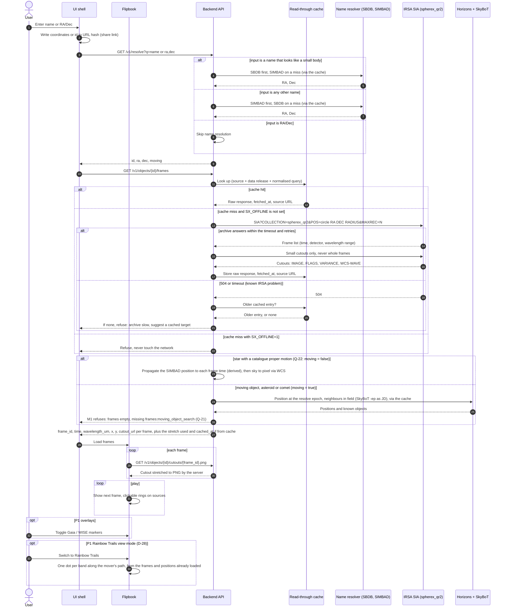

# 08 Sequence: search and flipbook

A user searches by name or RA/Dec and the flipbook plays the SPHEREx frames of that patch (the P0 base requirement). Drawn from architecture spec §1.1, §3.1, §3.4–3.5, §4.1 and §9, rendering doc §4 (display level 1) and decisions D-16 (endpoints), D-19 (resolver order), D-25 (cache) and D-28 (Rainbow Trails).

## Notes

- Endpoints follow D-16. Every endpoint is keyed by the object id that `resolve` returns. There is no separate flipbook endpoint: the flipbook plays the frame list in order.
- Small-body names are numbered asteroids (`433 Eros`), provisional designations (`2024 AB`), comets (`C/…`) and interstellar objects (`3I/ATLAS`) (D-19).
- Cache order (D-25): cache, then a live call with a timeout and retries with backoff, then an older cached entry, then refuse. There is no expiry for the event. A refused layer goes in `missing`.
- All five test targets (Barnard's Star, Epsilon Indi B, WISE 0855, RW Aurigae, R Draconis) and the demo objects are pre-fetched, so the demo runs with `SX_OFFLINE=1` and always hits the cache (D-25).
- A `candidate` source gets one haptic tick per frame where it is detected (rendering doc §8.5). That path is not drawn here.
- Rainbow Trails is built after basic playback works (D-28).
- `moving` means a solar-system body (Q-22). High proper-motion stars are not `moving`; their positions come from the SIMBAD proper motion, propagated to each frame time. The ephemeris-driven frame search for moving objects is not built in M1 (Q-21).
- The SIA search and every cutout go through the cache. A cut-off SIA answer (`QUERY_STATUS=OVERFLOW`) adds `frames:truncated` to `missing`.
