# 08 Sequence: search and flipbook

A user searches by name or RA/Dec and the flipbook plays the SPHEREx frames of that patch (the P0 base requirement). Drawn from architecture spec §1.1, §3.1, §3.4–3.5, §4.1, §10 (hash routing) and §11 (badges), rendering doc §4 (display level 1) and decisions D-16 (endpoints), D-19 (resolver order), D-25 (cache), D-28 (Rainbow Trails) and D-35 (sky tiles), and A4.9 (overlays, flag mask, combine). The sky-view prototype paths (sky pick, shared flipbook session, transport bar) follow Q-87 to Q-91; its cached markers, progressive frames and colour views follow Q-92, Q-93 and Q-95 to Q-99; overlays on the frame grid follow Q-102; downloads in the object's background job follow Q-111 and Q-112 (issue #41). How the backend builds the composite: [20](20-sequence-composite.md).

```mermaid
sequenceDiagram
  autonumber
  actor U as User
  participant SP as Sky pane (SkyPane + skyMath, prototype)
  participant UI as UI shell
  participant TB as Transport bar
  participant S as Flipbook session (session.tsx)
  participant FB as Flipbook
  participant API as Backend API
  participant J as Object job (core/jobs.py, background)
  participant C as Read-through cache
  participant R as Name resolver (SBDB, SIMBAD)
  participant SIA as IRSA SIA (spherex_qr2)
  participant HZ as Horizons + SkyBoT
  participant TAP as Gaia + CatWISE TAP (IRSA, ESA)
  participant FX as Fixture server (dev only)

  opt dev only: npm run dev:fixtures
    Note over UI,FX: A Vite dev-server plugin answers every /v1 call below instead of the backend. Never part of a build.
    UI->>FX: The same /v1 requests
    FX-->>UI: Synthetic replies with header X-SX-Fixture: synthetic
    UI->>UI: Page-wide "Fixture data" banner, Fixture badges instead of Measured, SYNTHETIC image label
  end
  opt sky view opens (prototype, Q-87)
    SP->>API: GET /v1/sky/index.json
    API-->>SP: Surveys on disk in {SX_CACHE_DIR}/sky/, or an empty list (never fetched upstream)
    SP->>API: GET /v1/sky/{survey}/equirect_{W}x{H}.jpg, smallest first, a larger one if the GPU and device allow (Q-90)
    API-->>SP: Equirect JPEG, shown with the Estimated badge and the survey credit (Q-88, D-35)
    SP->>API: GET /v1/resolve for each quick-pick target
    API-->>SP: Marker positions (a name that does not resolve gets no marker)
    SP->>API: GET /v1/sky/cached (Q-98, not in D-16)
    API->>C: derived.frames meta files of this release + derived.object registry (never the cutouts)
    API-->>SP: Positions whose frame list is complete: id, name, query, ra, dec, frames
    SP->>SP: Small "cached, loads instantly" markers, except where a target marker already is
  end
  alt user types a name or RA/Dec
    U->>UI: Enter name or RA/Dec
  else user clicks the sky (prototype, pointer moved under 5 px)
    U->>SP: Click
    SP->>SP: RA/Dec from the camera ray (screenToRaDec), 6 decimals, tagged derived (Q-91)
    SP->>UI: Search ra,dec with origin sky (the search field shows the query)
  else user clicks a target marker on the sky
    U->>SP: Click marker
    SP->>UI: Search the target name with origin sky
  else user clicks a cached marker (prototype)
    U->>SP: Click cached marker
    SP->>UI: Search its query (a name) or its id coordinates (5 decimals), origin sky
  else user opens a shared link or presses Back
    U->>UI: URL hash #35;ra=…&dec=…[&name=…][&frame=…][&colour=…]
    UI->>UI: Parse the hash. Unusable parts are ignored, never guessed, shown under the search field and announced (live region)
    alt hash has a name or valid coordinates
      UI->>UI: Search the name if present, else the coordinates (frame= reopens that frame)
    else hash is empty (Back to the page without a hash) or has neither
      UI->>UI: Reset the search to the empty start state, no request
    end
  end
  UI->>API: GET /v1/resolve?q=name or ra,dec
  alt input is a name that looks like a small body
    API->>R: SBDB first, SIMBAD on a miss (via the cache)
    R-->>API: RA, Dec
  else input is any other name
    API->>R: SIMBAD first, SBDB on a miss (via the cache)
    R-->>API: RA, Dec
  else input is RA/Dec
    API->>API: Skip name resolution
  end
  API-->>UI: id, ra, dec, moving
  UI->>UI: Write #35;ra=…&dec=…[&name=…] to the URL hash (share link). A typed search or a sky pick adds a history entry, a link replaces it
  UI->>UI: Island shows Thinking: Searching the archive for SPHEREx frames at RA, Dec (Q-121)
  UI->>API: GET /v1/objects/{id}/frames
  API->>C: Look up (source + data release + normalised query)
  alt cache hit
    C-->>API: Raw response, fetched_at, source URL
  else cache miss and SX_OFFLINE is not set
    API->>SIA: SIA?COLLECTION=spherex_qr2&POS=circle RA DEC RADIUS&MAXREC=N
    alt archive answers within the timeout and retries
      SIA-->>API: Frame list (time, detector, wavelength range)
      API->>C: Store raw response, fetched_at, source URL
    else 504 or timeout (known IRSA problem)
      SIA-->>API: 504
      API->>C: Older cached entry?
      C-->>API: Older entry, or none
      API-->>UI: If none, refuse: archive slow, suggest a cached target
    end
  else cache miss with SX_OFFLINE=1
    API-->>UI: Refuse, never touch the network
  end
  alt star with a catalogue proper motion (Q-22: moving = false)
    API->>API: Propagate the SIMBAD position to each frame time (derived), then sky to pixel via WCS
  else moving object, asteroid or comet (moving = true)
    API->>HZ: Position at the resolve epoch, neighbours in field (SkyBoT -ep as JD), via the cache
    HZ-->>API: Positions and known objects
    API-->>UI: M1 refuses: frames empty, missing frames:moving_object_search (Q-21)
  end
  opt cutouts not yet in the cache and SX_OFFLINE is not set (Q-111 (5))
    API->>J: on_request: start or join the object's job. The request downloads no cutout itself
    API->>API: List the cutouts still to come as cutouts:deferred:n
    Note over J,SIA: After this reply, in the background: small cutouts only, never whole frames, in one fair pool shared by every object, SX_CUTOUT_CONCURRENCY at a time (Q-112)
    J->>SIA: Cutout requests
    SIA-->>J: Cutouts: IMAGE, FLAGS, VARIANCE, WCS-WAVE
    J->>C: Store raw response, fetched_at, source URL
  end
  Note over API,C: The frame list is stored (derived.frames) only when complete
  API-->>UI: frame_id, time, wavelength_um, x, y, cutout_url per frame, plus the stretch used and cached_at if from cache
  UI->>UI: Badges: wavelength and time Measured, display stretch Estimated (derived, tooltip gives its parameters)
  UI->>S: Frames in the store
  opt reply lists cutouts:deferred:n (progressive loading, flipbook/progressive.ts)
    UI->>UI: Show and play the frames so far, a progress box "Fetching SPHEREx frames … ready of found ready" and a Stop button
    loop until no cutouts:deferred, Stop, or a new search (one request at a time)
      UI->>API: GET /v1/objects/{id}/frames again (0.5 s after the last reply)
      API->>J: on_request again: join the running job (a finished one is started again)
      API-->>UI: A fast reply: the frames the job has cached by now, the rest still cutouts:deferred:n
      UI->>UI: Merge by frame_id in time order, the current frame and playback stay
      UI->>UI: Client timeout: still working, ask again. Server or network error: back off 2 s to 30 s, give up after 5 (error box, Try again)
    end
    UI->>UI: Complete: polite announcement, a spectrum asked for meanwhile is measured now, the composite is built when it shows
    UI->>SP: Load /v1/sky/cached again, so the spot gets its cached marker
  end
  Note over TB,FB: One session above the panel and the transport bar: closing the panel does not stop playback or restart the preload
  loop each frame
    S->>API: GET /v1/objects/{id}/cutouts/{frame_id}.png
    API-->>S: Cutout stretched to PNG by the server
  end
  U->>TB: Play (or Space or K in the flipbook)
  TB->>S: Read can play (current frame and the next 3 cutouts loaded or failed)
  loop play
    S->>UI: Timer at the chosen fps advances the frame index in the store
    UI-->>TB: Frame index, play state
    UI-->>FB: Frame index (requested)
    FB->>FB: Decode the requested cutout in the hidden img slot (frameSwap.ts)
    FB->>FB: Once decoded, swap slots: picture, ring, hatching and caption change together
    FB-->>TB: Shown frame (the readout's frame number and wavelength)
  end
  opt user pauses or steps (transport bar or flipbook keys)
    TB->>UI: Current frame
    UI->>UI: Replace the hash in place with frame=… (no new history entry)
  end
  opt P1 overlays (issue #12, A4.9, Q-50)
    U->>UI: Switch on a layer: Gaia stars, WISE sources, Flagged pixels or Field of view
    opt frame list still loading (cutouts:deferred, Q-102)
      UI->>UI: Overlays wait, and are asked for once when the list is complete
    end
    alt first switch-on, after an error, or a catalogue was pending
      UI->>API: GET /v1/objects/{id}/overlays (lazy). The previous reply stays drawn meanwhile, and if the reload fails
      API->>C: Gaia cone (G #lt; 20) and CatWISE2020 cone, in parallel
      alt cache miss and no live failure in the last catalog_failure_ttl_s
        API->>TAP: Gaia: IRSA gaia_dr3_source, then ESA gaiadr3.gaia_source. CatWISE: IRSA catwise_2020
        TAP-->>API: CSV, parsed row by row before it is cached
      end
      alt both cones answered within overlay_wait_s = 75 s
        API-->>UI: catalogs, per-frame markers, contamination, footprint, cutout box, flag groups, missing, provenance
      else a cone is still running
        API-->>UI: The reply without it, missing has overlay:{cat}:pending. The fetch keeps filling the cache
        UI->>UI: The toggle stays enabled, with a "Try again" button
        U->>UI: Try again (or switch the layer off and on)
        UI->>API: GET /v1/objects/{id}/overlays again
      end
    end
    UI->>FB: Markers in cutout pixels, contamination note, field-of-view map
    FB->>FB: Place markers and mask with the shown frame's grid offset (frameGrid.ts, Q-102), not on the composite
    opt Flagged pixels
      FB->>API: GET /v1/objects/{id}/flags/{frame_id}.png
      API-->>FB: RGBA mask from FLAGS, or 404 flags_unavailable
    end
  end
  opt P1 combine frames (issue #12, Q-54)
    U->>UI: Choose frame A, frame B and add or subtract
    UI->>API: GET /v1/objects/{id}/combine.png?op=add|sub&a=…&b=…
    API-->>UI: PNG on A's grid, X-SX-Combine header (both wavelengths, unit, stretch, tag derived, formula)
  end
  opt P1 Rainbow Trails view mode (D-28)
    U->>FB: Switch to Rainbow Trails
    FB->>FB: One dot per band along the mover's path, from the frames and positions already loaded
    FB->>FB: Dot colour = false colour, hue = wavelength (derived, Estimated badge). Monochrome in Measured only
  end
  opt Colour view (prototype): Raw | Colour, then Wavelength tint | SPHEREx composite
    U->>FB: Pick Colour and a colour view
    UI->>UI: Replace the hash in place with colour=tint or colour=composite (absent: raw)
    alt honesty state Measured only (D-21)
      FB->>FB: Grey frames, with a note that the false colour is hidden
    else Wavelength tint
      FB->>FB: Each grey frame multiplied by the colour of its own wavelength (derived, Estimated badge), playback unchanged, no extra requests
    else SPHEREx composite
      FB->>UI: Load the composite (once per object, cached in the store)
      UI->>API: GET /v1/objects/{id}/composite (Q-92, built as in diagram 20)
      API-->>UI: image_url, width, height, x, y, bands (blue, green, red), tag derived + formula, missing
      alt image_url set
        UI->>API: GET image_url (/v1/objects/{id}/composite.png?v=…)
        FB->>FB: One RGB picture, pixel-sharp, ring at (x, y), band legend, "North up, east left", Estimated badge with the formula
        UI-->>TB: Playback controls disabled, with a note (the composite is one picture)
      else image_url null
        FB->>FB: Refusal in plain words from missing (never a blank box)
      end
    end
  end
  opt "Build it" on a demo-pack row (Q-164, issue #68)
    UI->>API: GET /v1/objects/{id}/card and /render-params
    API->>API: AssetStore reads backend/assets/TYPE/ID.json first (no catalogue call, no frames job)
    API-->>UI: Saved asset, header X-SX-Asset-Status: saved, texture URLs under /data/demo-textures
    UI->>API: GET /data/demo-textures/ID/VERSION/SEED/1024x512/FILE (read-only static files, also under SX_OFFLINE=1)
    UI->>UI: Build pane shows "Built ahead of time from the same data"
  end
```

## Notes

- Endpoints follow D-16. Every endpoint is keyed by the object id that `resolve` returns. There is no separate flipbook endpoint: the flipbook plays the frame list in order.
- Small-body names are numbered asteroids (`433 Eros`), provisional designations (`2024 AB`), comets (`C/…`) and interstellar objects (`3I/ATLAS`) (D-19).
- Cache order (D-25): cache, then a live call with a timeout and retries with backoff, then an older cached entry, then refuse. There is no expiry for the event. A refused layer goes in `missing`.
- All five test targets (Barnard's Star, Epsilon Indi B, WISE 0855, RW Aurigae, R Draconis) and the demo objects are pre-fetched, so the demo runs with `SX_OFFLINE=1` and always hits the cache (D-25).
- The demo pack (Q-164): the 16 rows of the search list are built ahead of time by `backend/scripts/bake_demo_pack.py` from the same pipeline and committed (cards, render params and 1024x512 maps; no frames, no spectrum). The class labels in the list come from those cards. A row's frames still come from the D-25 cache, so the flipbook needs `scripts.prefetch` (or the cache backup) for a stage demo; "Build it" does not.
- A `candidate` source gets one haptic tick per frame where it is detected (rendering doc §8.5). That path is not drawn here.
- Rainbow Trails is built after basic playback works (D-28). As built in M1 (issue #3), the dot colour is a false colour, hue = wavelength, tagged `derived` with that formula, so it wears the Estimated badge. In "Measured only" (D-21) the dots are drawn in one colour. The mode is offered only for a `moving` object whose frames share a north-up grid, so with real data it waits for Q-21. The M1 UI has no honesty toggle yet, so the monochrome state is not reachable from the page. Tagging question: Q-27.
- Sky pick (prototype, Q-89, Q-91): a click that moved under 5 px is a pick. The position under the pointer is computed analytically from the camera ray (`viewer/sky/skyMath.ts`), written as `ra,dec` with 6 decimals and searched with origin `sky`; from there it is an ordinary RA/Dec search. The picked position is user input, tagged `derived` (Estimated badge). The `/v1/sky` endpoints are open as Q-87 and serve only the local copy of the survey tiles (D-35).
- Cached markers (prototype, Q-98): `GET /v1/sky/cached` reads only the derived cache and lists the positions whose frame list is complete. `app/sky/useCachedMarkers.ts` loads it and loads it again when a frame list has just become complete; `cachedMarkers.ts` skips a position already marked as a quick-pick target (same id, or within 2″) and turns a click into a search of its query or its id coordinates.
- Flipbook session (`app/flipbook/session.tsx`): the cutout preload, the playback timer and "can play" live above the flipbook panel and the transport bar, which both read it. The viewer shows the requested frame only once its picture has decoded in a hidden `` slot (`frameSwap.ts`, `useFrameSwap.ts`); until then it keeps the previous picture and caption. The timer never waits for a decode; a decode over 1 s stops holding the old picture, and only a real load error shows "Cutout unavailable". During playback the no-data caption of a clipped frame stays hidden; one steady line for the object says how many frames are hatched (`noData.ts`, R9). The flipbook's First and Last buttons are gone in the prototype; Home and End still work (Q-89).
- Colour views (prototype, 7 Nov 2026): the flipbook's "Picture" switch (Raw | Colour) and "Colour view" switch (Wavelength tint | SPHEREx composite), radio groups in `app/flipbook/ColourViews.tsx`, rules in `colourMode.ts`. Both colour views are false colour, tagged `derived` (Estimated badge): the tint with "false colour: hue = wavelength" plus the stretch, the composite with the reply's `formula`. In "Measured only" both fall back to the grey frames with a note. The composite endpoint (`GET /v1/objects/{id}/composite`, `/composite.png`) is not in D-16 (Q-92); how the backend builds it is in [20](20-sequence-composite.md). Its codes (`composite:too_few_bands`, `composite:<channel>:<reason>`, `composite:moving_object` …) are worded in `app/messages.ts`. The `colour=` link parameter and the disabled transport bar: Q-95. Tagging questions: Q-27, Q-93.
- URL hash (architecture spec §10, hash routing): `#ra=<deg>&dec=<deg>[&name=<search text>][&frame=<frame_id>][&colour=tint|composite]`; without `colour` the flipbook shows the raw frames, so older links keep working. `name` is kept for a name search, so a link to a moving object reopens the same object id. A link with a name searches the name, otherwise the coordinates. Going back to the page without a hash resets the search. Unusable parts (bad coordinates, or no name and no coordinates) are ignored, never guessed: they are shown under the search field and announced in the polite live region.
- Dev-only fixture path: `npm run dev:fixtures` (`vite --mode fixtures`) mounts a Vite dev-server plugin from `frontend/fixtures/` that answers `/v1` with synthetic data, and `npm run test:e2e` always uses it. Every reply carries `X-SX-Fixture: synthetic`. The UI then shows a page-wide "Fixture data" banner, "Fixture" badges instead of "Measured" (and instead of the stretch's Estimated badge) and a SYNTHETIC label on the image. `vite build` never runs the plugin, and `scripts/check-dist.js` fails the build if a fixture marker reaches `dist/` ([fixtures README](../../frontend/fixtures/README.md)). The Fixture badge is a fourth badge beside the 3 of D-02; it is a proposed dev-only exception, open as Q-32 in the decisions log.
- `moving` means a solar-system body (Q-22). High proper-motion stars are not `moving`; their positions come from the SIMBAD proper motion, propagated to each frame time. The ephemeris-driven frame search for moving objects is not built in M1 (Q-21).
- The SIA search and every cutout go through the cache. A cut-off SIA answer (`QUERY_STATUS=OVERFLOW`) adds `frames:truncated` to `missing`.
- Progressive frames (sky-view prototype, 7 Nov 2026, Q-97; live budget Q-99): since issue #41 a `/frames` request downloads no cutout itself. It answers from the cache, lists the cutouts still to come as `cutouts:deferred:<n>` and calls `FrameService.on_request`, which starts or joins the object's background job; the job downloads them in one pool shared by every object, `SX_CUTOUT_CONCURRENCY` at a time and fair per frame list (Q-111 (5), Q-112). The flipbook shows the frames it has and asks again until none is deferred; each reply is fast and shows the job's progress. Progress numbers: ready = frames listed; found = ready + `cutouts:deferred` + per-frame refusals. The spectrum and composite wait for the complete list, because each of those requests runs Stage 1 again and would measure a partial list; after Stop they can be made from what is there, with the deferred count in their `missing`. `GET /v1/objects/{id}/job` and `/job/events` report the job's stage and frames done of total (Q-111 (4)); the flipbook does not read them yet.
- Overlays (A4.9) load lazily on the first switch-on of any layer, not on every search, and never block the flipbook. A catalogue still being fetched after `overlay_wait_s` (75 s, below the frontend's 90 s timeout) is reported as `overlay:<cat>:pending`; its toggle stays enabled and "Try again" reloads the overlays, by which time the cone is usually cached. A cone that failed live is not retried for `catalog_failure_ttl_s`. Moving objects get `overlay:gaia` and `overlay:wise` (Q-21). The endpoints are not yet in D-16 (Q-50).
- Overlays on the fixed frame grid (Q-102): a layer switched on while the frame list is still loading progressively waits ("Overlays load once all the frames are in") and the overlays are asked for once, when the list is complete; a reply made from a partial list (after Stop) is asked for again then. Markers (cutout pixels) and the flag mask get the shown frame's whole-pixel placement (`frameGrid.ts` `markersOnGrid`), so they stay on their sources and change with the picture, never with the requested frame; markers off the frame's own pixels (hatched no-data) are not drawn. They are not drawn on the colour composite, which has its own north-up grid; a note says so.
- The flipbook shows the frames reply's `missing` grouped by reason, one plain line with a count each and the frame IDs behind a disclosure; unknown codes are shown as is (A11, issue #24).
