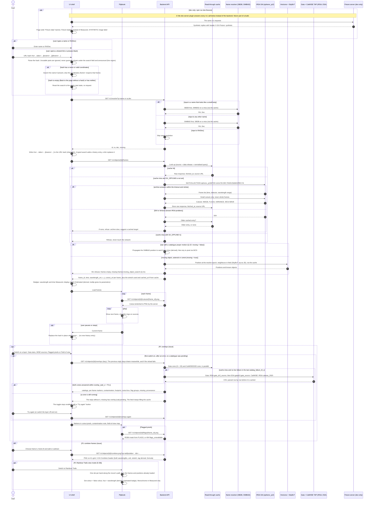

# 08 Sequence: search and flipbook

A user searches by name or RA/Dec and the flipbook plays the SPHEREx frames of that patch (the P0 base requirement). Drawn from architecture spec §1.1, §3.1, §3.4–3.5, §4.1, §10 (hash routing) and §11 (badges), rendering doc §4 (display level 1) and decisions D-16 (endpoints), D-19 (resolver order), D-25 (cache) and D-28 (Rainbow Trails), and A4.9 (overlays, flag mask, combine).

## Notes

- Endpoints follow D-16. Every endpoint is keyed by the object id that `resolve` returns. There is no separate flipbook endpoint: the flipbook plays the frame list in order.
- Small-body names are numbered asteroids (`433 Eros`), provisional designations (`2024 AB`), comets (`C/…`) and interstellar objects (`3I/ATLAS`) (D-19).
- Cache order (D-25): cache, then a live call with a timeout and retries with backoff, then an older cached entry, then refuse. There is no expiry for the event. A refused layer goes in `missing`.
- All five test targets (Barnard's Star, Epsilon Indi B, WISE 0855, RW Aurigae, R Draconis) and the demo objects are pre-fetched, so the demo runs with `SX_OFFLINE=1` and always hits the cache (D-25).
- A `candidate` source gets one haptic tick per frame where it is detected (rendering doc §8.5). That path is not drawn here.
- Rainbow Trails is built after basic playback works (D-28). As built in M1 (issue #3), the dot colour is a false colour, hue = wavelength, tagged `derived` with that formula, so it wears the Estimated badge. In "Measured only" (D-21) the dots are drawn in one colour. The mode is offered only for a `moving` object whose frames share a north-up grid, so with real data it waits for Q-21. The M1 UI has no honesty toggle yet, so the monochrome state is not reachable from the page. Tagging question: Q-27.
- URL hash (architecture spec §10, hash routing): `#ra=<deg>&dec=<deg>[&name=<search text>][&frame=<frame_id>]`. `name` is kept for a name search, so a link to a moving object reopens the same object id. A link with a name searches the name, otherwise the coordinates. Going back to the page without a hash resets the search. Unusable parts (bad coordinates, or no name and no coordinates) are ignored, never guessed: they are shown under the search field and announced in the polite live region.
- Dev-only fixture path: `npm run dev:fixtures` (`vite --mode fixtures`) mounts a Vite dev-server plugin from `frontend/fixtures/` that answers `/v1` with synthetic data, and `npm run test:e2e` always uses it. Every reply carries `X-SX-Fixture: synthetic`. The UI then shows a page-wide "Fixture data" banner, "Fixture" badges instead of "Measured" (and instead of the stretch's Estimated badge) and a SYNTHETIC label on the image. `vite build` never runs the plugin, and `scripts/check-dist.js` fails the build if a fixture marker reaches `dist/` ([fixtures README](../../frontend/fixtures/README.md)). The Fixture badge is a fourth badge beside the 3 of D-02; it is a proposed dev-only exception, open as Q-32 in the decisions log.
- `moving` means a solar-system body (Q-22). High proper-motion stars are not `moving`; their positions come from the SIMBAD proper motion, propagated to each frame time. The ephemeris-driven frame search for moving objects is not built in M1 (Q-21).
- The SIA search and every cutout go through the cache. A cut-off SIA answer (`QUERY_STATUS=OVERFLOW`) adds `frames:truncated` to `missing`.
- Overlays (A4.9) load lazily on the first switch-on of any layer, not on every search, and never block the flipbook. A catalogue still being fetched after `overlay_wait_s` (75 s, below the frontend's 90 s timeout) is reported as `overlay:<cat>:pending`; its toggle stays enabled and "Try again" reloads the overlays, by which time the cone is usually cached. A cone that failed live is not retried for `catalog_failure_ttl_s`. Moving objects get `overlay:gaia` and `overlay:wise` (Q-21). The endpoints are not yet in D-16 (Q-50).
- The flipbook shows the frames reply's `missing` grouped by reason, one plain line with a count each and the frame IDs behind a disclosure; unknown codes are shown as is (A11, issue #24).
