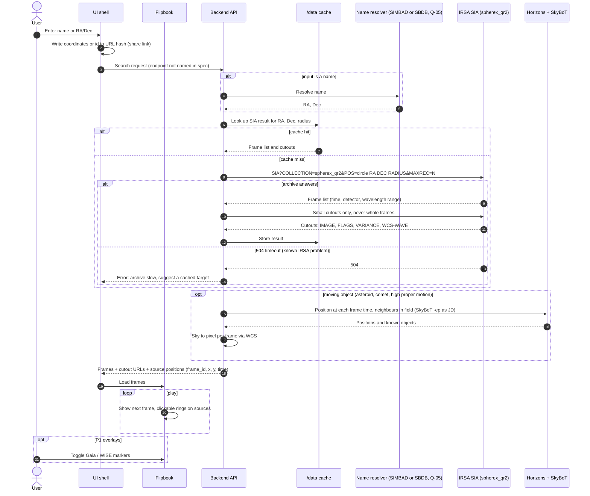

# 08 Sequence: search and flipbook

A user searches by name or RA/Dec and the flipbook plays the SPHEREx frames of that patch (the P0 base requirement). Drawn from architecture spec §1.1, §3.1, §3.4–3.5, §4.1 and §9, rendering doc §4 (display level 1) and Q-05 (resolver order).

## Notes

- Neither spec names the search or frames endpoint; only `/v1/objects/{id}/card` and `/render-params` are named. **[verify]** with Kevin.
- All five test targets (Barnard's Star, Epsilon Indi B, WISE 0855, RW Aurigae, R Draconis) and the demo objects are pre-fetched, so the live demo should always hit the cache.
- A `candidate` source gets one haptic tick per frame where it is detected (rendering doc §8.5). That path is not drawn here.
- Whether Rainbow Trails is a view mode of this flipbook is Q-04 open.
