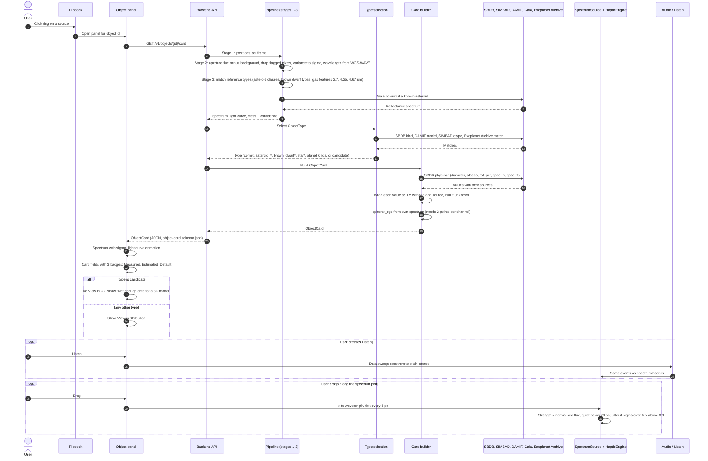

# 09 Sequence: click an object, get its spectrum and card

Clicking a source in the flipbook runs pipeline stages 1–3 and type selection, builds the `ObjectCard`, and the object panel shows the spectrum, the badges and Listen. Drawn from architecture spec §4.1–4.3 and §8, rendering doc §3.2–3.3, §4 (display level 2), §5.2, §8.6, and decisions D-02 and D-04.

## Notes

- Type selection order follows rendering doc §3.3; see [18-activity-type-selection.md](18-activity-type-selection.md). Resolver order (SIMBAD or SBDB first) is Q-05 open.
- The Estimated badge covers `derived`, `model_dependent` and `inferred_from_analog`; its tooltip shows the formula, assumption or analog (D-02).
- Where the card is cached between requests is not stated in the specs **[verify]**.
- Spectrum haptic events go through the same `HapticEngine` and drivers as touch mode ([11-sequence-touch-haptics.md](11-sequence-touch-haptics.md)).
