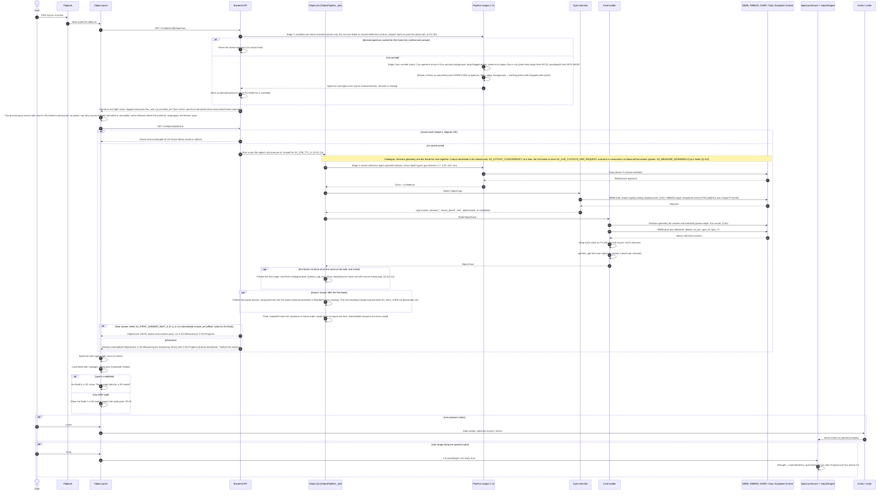

# 09 Sequence: click an object, get its spectrum and card

Opening an object (a marker click opens the object panel, Q-120; or a click on a source in the flipbook) runs pipeline stages 1–3 and type selection, builds the `ObjectCard`, and the object panel shows the spectrum, the badges and Listen. Drawn from architecture spec §4.1–4.3 and §8, rendering doc §3.2–3.3, §4 (display level 2), §5.2, §8.6, and decisions D-02, D-04, D-16 (endpoints), D-25 (cache) and D-31 (saturated targets, demo objects), and Q-111 and Q-112 (the object job of [A4.10](../architecture/jobs.md#a410-object-job-and-fan-out), issue #41: the object job, its first, partial and final answers, the headers and the worker pools).

## Notes

- Type selection order follows rendering doc §3.3; see [18-activity-type-selection.md](18-activity-type-selection.md). Name resolution happens earlier, in `resolve` (D-19, [08-sequence-search-flipbook.md](08-sequence-search-flipbook.md)).
- The Estimated badge covers `derived`, `model_dependent` and `inferred_from_analog`; its tooltip shows the formula, assumption or analog (D-02).
- Spectra and cards are cached in the backend's read-through cache, like every external call (D-25). The spectrum entry (`derived.spectrum`) is keyed by the method, Stage 1's `missing`, every frame record and every cutout's SHA-256, and is stored only for a complete frame list. Stage 2 itself never downloads (A4.2): a `/spectrum` request measures cached cutouts only and lists the rest as `cutouts:deferred:<n>`, while `FrameService.on_request` starts or joins the object's job, which downloads them (Q-111 (5)). Inside the job each cutout is measured in a `spawn` worker process as it lands and reused only when its bytes' SHA-256 and pixel position match (Q-112). Saturated frames are refused, never measured (D-31); the demo objects SIMP 0136, TWA 27 and IRAS 04302+2247 have measured spectra. The panel groups `missing` by reason (A11, issue #24) and words the empty state from the grouped counts, not from `spectrum:saturated`, which is absent when any listed frame was refused for another reason (Barnard's Star and R Dra on the full cache, A4.2). Calls to SBDB, SIMBAD, DAMIT, Gaia and the Exoplanet Archive also go through it.
- Spectrum haptic events go through the same `HapticEngine` and drivers as touch mode ([11-sequence-touch-haptics.md](11-sequence-touch-haptics.md)).
- As built (issue #5, `backend/app/core/card/service.py`): `/card` first looks up a saved asset (stage 4, [16-state-asset-lookup.md](16-state-asset-lookup.md)) and returns its card unchanged. Otherwise stage 3 takes the class label from the catalogue only (SIMBAD `sp_type`, SBDB `spec_B` then `spec_T`) with confidence `catalogue` or `none`, which the card does not carry; spectrum matching and the Gaia call are not built (Q-55). Issue #40 added the shape registry lookup (Q-61), the Horizons phase angle and Sun vector for comet and asteroid cards (Q-62) and the Exoplanet Archive adapter for SIMBAD `Pl` (Q-63); DAMIT is not called live. The card is checked with `jsonschema` before it is sent (Q-40), and `cached_at` and the asset status travel as the `X-SX-Cached-At` and `X-SX-Asset-Status` headers (Q-39). Since issue #41 (Q-111) a card without a saved asset comes from the object's background job: the reply is the final card if it arrives within `SX_FIRST_ANSWER_WAIT_S`, else the newest intermediate one (first stage `measuring:` or partial `measuring:frames`) with `X-SX-Measuring` and `X-SX-Progress`; only the final can be saved. `GET /v1/objects/{id}/job` and `/job/events` report the job (Q-111 (4)); the panel does not read them yet.
