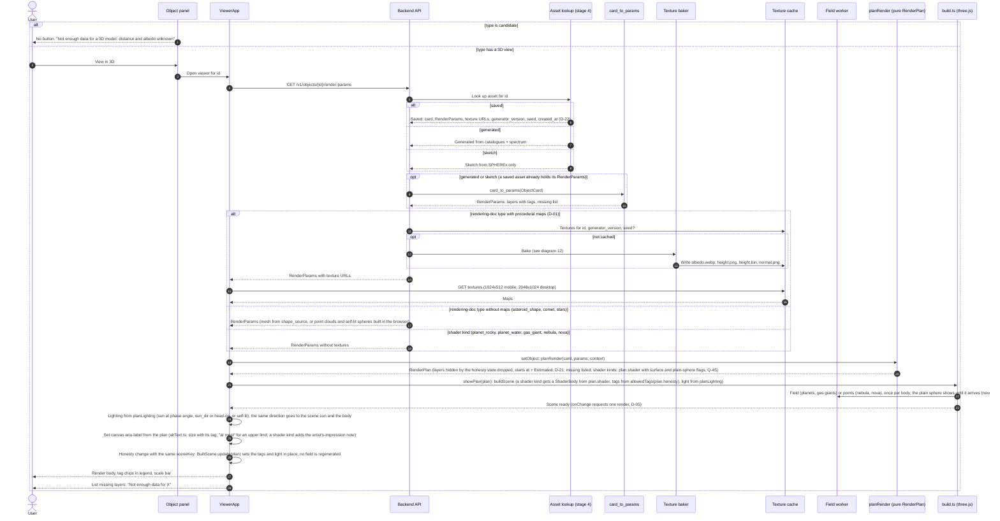

# 10 Sequence: View in 3D

Opening the Sky Sculptor view: the frontend asks for `RenderParams`, the backend looks up the asset, bakes textures if they are not cached, and the viewer picks a renderer by `type`. Drawn from architecture spec §4.4, rendering doc §3.4, §4, §5, §6.7, §7, §7.7, and decisions D-01, D-05, D-12, D-21 and D-22.

## Notes

- Asset status labels: new objects show "Sketch from SPHEREx only" (architecture spec §10). See [16-state-asset-lookup.md](16-state-asset-lookup.md).
- How the client picks the texture size (mobile vs desktop) is not stated **[verify]**.
- The field worker uses the same seed and functions as the shader, so the picture and the haptics agree (D-12).
- RenderParams responses served from the backend cache carry `cached_at` (D-25). As built (issue #5) it is the `X-SX-Cached-At` header, and the asset status is the `X-SX-Asset-Status` header (Q-39).
- If the view is unchanged, the viewer does not render a new frame (D-05).
- As built (issue #5): the render-params endpoint names the R6.7 texture URLs (in the `2048x1024` size directory, Q-47) but does not call the baker or serve the files yet, so the bake branch above is still to build. The reply is checked with `jsonschema` before it is sent (Q-40); `candidate` still gets a RenderParams with no layers (Q-33).
