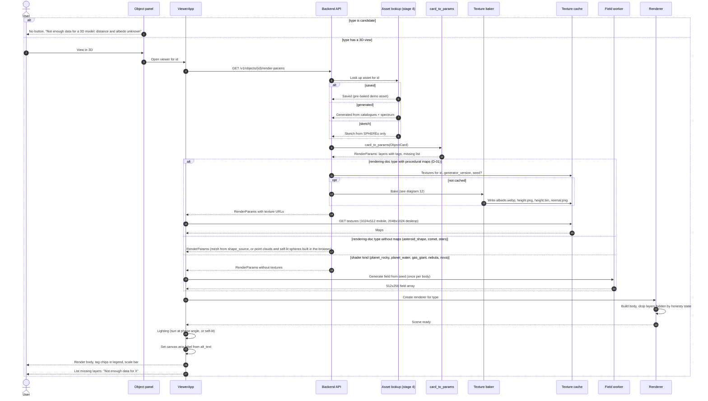

# 10 Sequence: View in 3D

Opening the Sky Sculptor view: the frontend asks for `RenderParams`, the backend looks up the asset, bakes textures if they are not cached, and the viewer picks a renderer by `type`. Drawn from architecture spec §4.4, rendering doc §3.4, §4, §5, §6.7, §7, §7.7, and decisions D-01, D-05 and D-12.

## Notes

- Asset status labels: new objects show "Sketch from SPHEREx only" (architecture spec §10). See [16-state-asset-lookup.md](16-state-asset-lookup.md).
- How the client picks the texture size (mobile vs desktop) is not stated **[verify]**.
- The field worker uses the same seed and functions as the shader, so the picture and the haptics agree (D-12, Proposed).
- If the view is unchanged, the viewer does not render a new frame (D-05).
