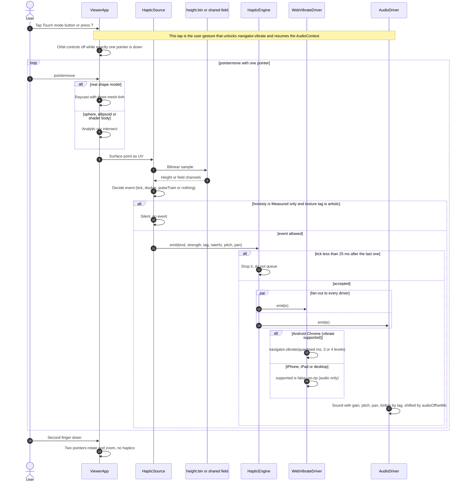

# 11 Sequence: Touch mode haptics

Feeling a surface with one finger in Touch mode, from the first tap to the vibration and the paired sound. Drawn from rendering doc §5.3, §5.6, §8.1–8.5, §8.8, and decisions D-08 (web only), D-09 (quantised strength), D-10 (audio on every platform) and D-12 (shared field).

## Notes

- Touch mode only exists on the 3D view. Spectrum haptics on the panel use the same engine ([09-sequence-object-spectrum.md](09-sequence-object-spectrum.md)).
- Rate limit: ≤ 40 events/s and ≥ 25 ms between ticks (rendering doc §8.3). Only `tick` events are throttled in the §8.8 code.
- Measured only: procedural relief and every texture haptic on shader kinds are silent; real meshes still tick, and data haptics remain (rendering doc §8.2, §7.7).
- How `audioOffsetMs` is applied is in rendering doc §8.9 **[verify once written]**.
