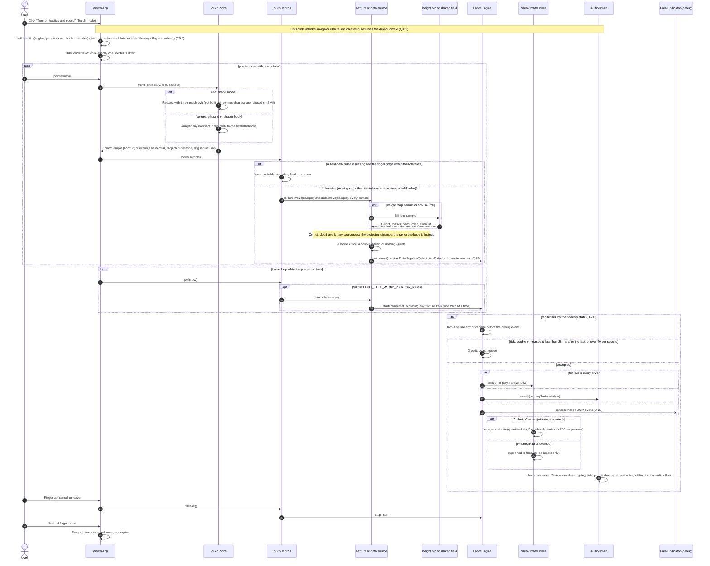

# 11 Sequence: Touch mode haptics

Feeling a surface with one finger in Touch mode, from the first tap to the vibration and the paired sound. Drawn from rendering doc §5.3, §5.6, §8.1–8.5, §8.8, and decisions D-08 (web only), D-09 (quantised strength), D-10 (audio on every platform), D-12 (shared field), D-20 (`sharpness`, debug hook) and D-21 (honesty filter). As built in issues #9 (engine) and #11 (probe, profiles, sources).

## Notes

- Touch mode only exists on the 3D view. Spectrum haptics on the panel use the same engine ([09-sequence-object-spectrum.md](09-sequence-object-spectrum.md)). The light-curve pulses (Mira heartbeat, T Tauri dimming) are driven by the scrubber through `TouchHaptics.scrub`, not by the finger on the body.
- Rate limit: ≤ 40 events/s and ≥ 25 ms between ticks, doubles and heartbeats (rendering doc §8.3); a 250 ms train window counts as one event.
- The honesty filter lives in the engine, not in the sources (D-21). Measured only plays only `measured` events: procedural relief and every texture haptic on shader kinds are silent; real meshes still tick; every data haptic not tagged `measured` is silent, so the `teq_pulse` plays only when `teq_K` is `measured` (rendering doc §8.2, §7.7). Texture events carry `texture_tag`; data events carry `data_tag`, except `teq_pulse` (`teq_K`'s tag) and the binary pulse (`spectral_class`'s tag, Q-69).
- Holding still: `pointermove` does not fire while a finger is still, so the viewer's frame loop calls `poll` (Q-71). The shader kinds' sources read `BodyRenderer.field` and `pointSets`, which include the D-27 slider overrides.
- `sharpness` is optional and ignored by the web driver (D-20).
- The `spherex:haptic` event drives an on-screen pulse indicator, so an audience watching the laptop can see what the phone feels (D-20). The engine fires it after the honesty gate.
- The audio offset follows rendering doc §8.9: a positive `avOffsetMs` (vibration felt later) delays the audio; otherwise the vibration is delayed.
