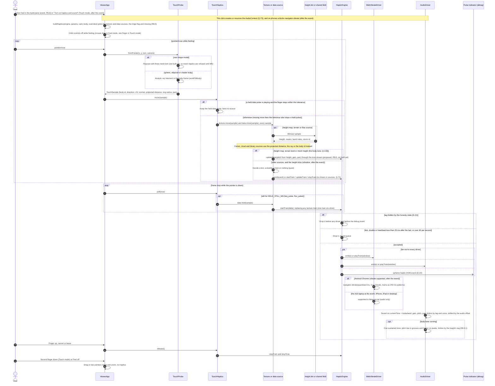

# 11 Sequence: feeling a body (Feel mode at the event, Touch mode after)

Feeling a surface, from the first click to the sound (and, after the event, the vibration). **At the event (Q-132)** the A15 laptop runs desktop Feel mode: a mouse drag in the build pane feels the body, and the only output is sound: the **body tone**, one continuous tone that follows the height (Q-133, [R8.9.1](../rendering/haptics/audio-pairing.md#r891-body-tone-from-the-height-map-q-133)). **After the event**, Touch mode on phones adds `navigator.vibrate` and the per-sample height ticks. Drawn from rendering doc R5.3, R5.6, R8.1–R8.5, R8.8, R8.9.1, and decisions D-08, D-09, D-10, D-12, D-20, D-21, Q-132 and Q-133. Engine and sources as built in issues #9 and #11; Feel mode, the tone stream and the body tone are not built yet (R5.6, R8.8, R8.8.1).

## Notes

- **Q-133 supersedes the height ticks for body interaction:** at the event the height map, terrain land and mesh height drive the body tone, not ticks. The tick, double and train decisions remain for the other sources and for vibration after the event ([R8.4](../rendering/haptics/sources.md#r84-event-sources)). As built, `haptics/sources/heightMap.ts` and `terrain.ts` still emit clicks.
- Feel mode (event) and Touch mode (after the event) exist only on the 3D view. Spectrum haptics on the panel use the same engine ([09-sequence-object-spectrum.md](09-sequence-object-spectrum.md)). The light-curve pulses (Mira heartbeat, T Tauri dimming) are driven by the scrubber through `TouchHaptics.scrub`, not by the finger on the body.
- Rate limit: ≤ 40 events/s and ≥ 25 ms between ticks, doubles and heartbeats (rendering doc §8.3); a 250 ms train window counts as one event.
- The honesty filter lives in the engine, not in the sources (D-21). Measured only plays only `measured` events: procedural relief and every texture haptic on shader kinds are silent; real meshes still tick; every data haptic not tagged `measured` is silent, so the `teq_pulse` plays only when `teq_K` is `measured` (rendering doc §8.2, §7.7). Texture events carry `texture_tag`; data events carry `data_tag`, except `teq_pulse` (`teq_K`'s tag) and the binary pulse (`spectral_class`'s tag, Q-81).
- Holding still: `pointermove` does not fire while a finger is still, so the viewer's frame loop calls `poll` (Q-83). The shader kinds' sources read `BodyRenderer.field` and `pointSets`, which include the D-27 slider overrides.
- `sharpness` is optional and ignored by the web driver (D-20).
- The `spherex:haptic` event drives an on-screen pulse indicator, so an audience can see what is felt or heard (D-20). The engine fires it after the honesty gate.
- The audio offset follows rendering doc §8.9: a positive `avOffsetMs` (vibration felt later) delays the audio; otherwise the vibration is delayed.
