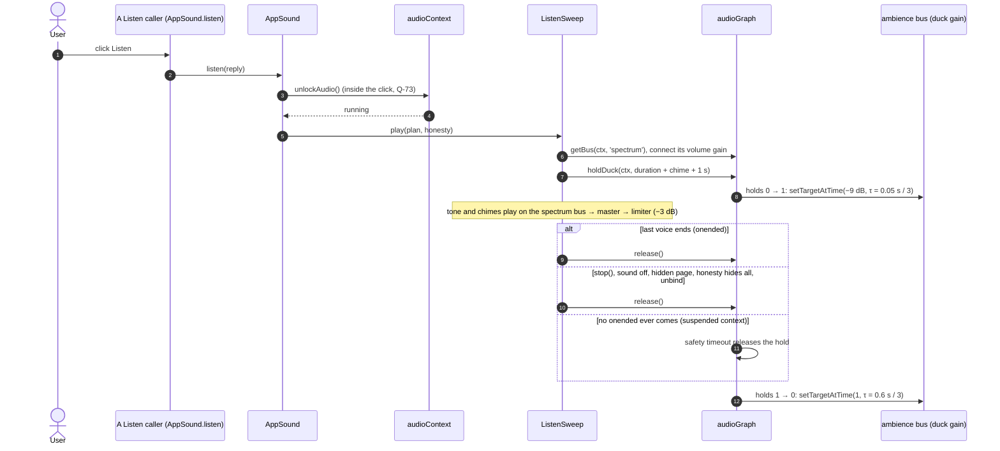

# 11 Sequence: a data sound ducks the ambience

> **D-39 (12 Nov 2026):** the touch sequence this file used to hold (Feel mode, TouchProbe, the touch sources, vibration after the event) is cut with the haptics. It is in git history before issue #111. The file name is kept so links stay valid. The ambience tick has its own diagram, [25](25-sequence-ambience.md).

What happens when a data sound plays while the flyover ambience plays (R13.9, Q-441), drawn for `AppSound.listen` and the Listen sweep. The build pane's Hear it (`hearAudio.ts`) holds the duck the same way. The same holds for the audio driver's voices (Track ticks, cues) on the events bus. Every end path releases the hold: the natural end, `stop()`, sound off, a hidden page, a honesty change, AppSound unbind, the voice cap, a new context and the safety timeout.

