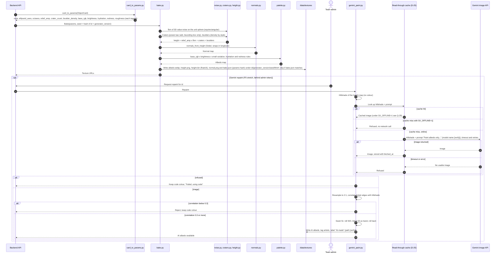

# 12 Sequence: texture bake and optional Gemini repaint

How the backend bakes the maps for a rendering-doc type, and the optional Gemini repaint with its alignment check. Drawn from rendering doc §1 (determinism), §6.1–6.7 and §10, and decisions D-01, D-06, D-07, D-24 (Gemini off in the offline demo) and D-25 (read-through cache, `SX_OFFLINE`).

## Notes

- Same card + seed must give byte-identical textures (SHA-256 test, rendering doc §11). Bump `generator_version` whenever a rule in §6.2–6.5 changes; it is part of the cache key. `bake.json` inside the directory also rebakes a changed card or size (Q-47).
- The code-colour albedo always loads first; the AI layer only swaps in on success ("never blank").
- The Gemini call is server-side only; the key never reaches the browser (D-07).
- The Gemini call goes through the backend's read-through cache like every external call (D-25). With `SX_OFFLINE=1` a miss is refused and the code colour stays (D-24). Whether a cached repaint is shown under `SX_OFFLINE=1` is Q-29.
- Shader kinds are not baked here (D-01); their field is built in the browser ([10-sequence-view-3d.md](10-sequence-view-3d.md)).
- Image-first (Depth Anything V2 Small) and Marigold paths are offline options, not drawn (rendering doc §6.6).
- As built (issue #5): the seed is the first 4 bytes of SHA-256(`id` + newline + `generator_version`), and `generator_version` is `p<card_to_params version>-b<BAKER_RULES_VERSION>` (Q-35, an assumption). The render-params endpoint does not call the baker yet; `python -m app.core.render` bakes from a card file.
