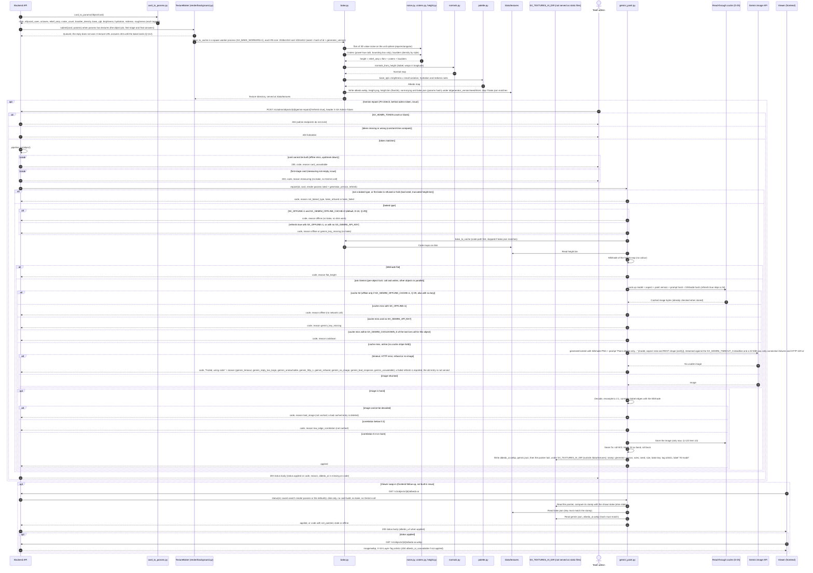

# 12 Sequence: texture bake and optional Gemini repaint

How the backend bakes the maps for a rendering-doc type, and the optional Gemini repaint with its alignment check. Drawn from rendering doc §1 (determinism), §6.1–6.7 and §10, and decisions D-01, D-06, D-07, D-24 (Gemini off in the offline demo) and D-25 (read-through cache, `SX_OFFLINE`), A6.2, Q-112 (issue #41: the bake runs in a worker process off the request path) and the open Q-122 (Gemini layer contract).

## Notes

- Same card + seed must give byte-identical textures (SHA-256 test, rendering doc §11). Bump `generator_version` whenever a rule in §6.2–6.5 changes; it is part of the cache key. `bake.json` inside the directory also rebakes a changed card or size (Q-47).
- The code-colour albedo always loads first; the AI layer only swaps in on success ("never blank").
- The Gemini call is server-side only; the key never reaches the browser (D-07).
- The Gemini call goes through the backend's read-through cache like every external call (D-25). With `SX_OFFLINE=1` a miss is refused and the code colour stays (D-24). Unlike other sources, an image is stored only after it passes the checks, and a failed refresh is reported rather than served from the older entry (Q-122 item 10). Whether a cached repaint is shown under `SX_OFFLINE=1` is Q-29 (open); issue #14 makes it the switch `SX_GEMINI_OFFLINE_CACHE`, default 0 (off offline, D-24).
- As built (issue #14, Q-122): routes in `backend/app/api/gemini.py`, admin gate `require_admin` in `backend/app/api/deps.py`, logic in `backend/app/core/render/gemini_paint.py`. The repaint always answers 200; every failure keeps the code colour and puts `albedo_ai` first in `missing`. `albedo_ai.webp`, `gemini.json` and the pointer live under `SX_TEXTURES_AI_DIR` (default `<SX_CACHE_DIR>/textures-ai`), outside the `/data/textures` static mount, so only the status-checked endpoint serves them; a version bump, a new seed or a rebake makes them `stale` (Q-122 items 4, 5). After a failed refresh the earlier verified repaint stays applied (Q-122 item 8). Only the 2048×1024 size is painted. RenderParams has no slot for the AI albedo, so the viewer swap-in (last block) is a frontend follow-up. Reason codes: [A6.2](../architecture/generators.md#a62-optional-gemini-artistic-layer).
- Shader kinds are not baked here (D-01); their field is built in the browser ([10-sequence-view-3d.md](10-sequence-view-3d.md)).
- Image-first (Depth Anything V2 Small) and Marigold paths are offline options, not drawn (rendering doc §6.6).
- As built (issue #5): the seed is the first 4 bytes of SHA-256(`id` + newline + `generator_version`), and `generator_version` is `p<card_to_params version>-b<BAKER_RULES_VERSION>` (Q-35, an assumption). Since issue #41 (Q-112) the object job queues both sizes on `TextureBaker` (`SX_BAKE_TEXTURES=1`, `SX_BAKE_WORKERS=1`) and the API serves them from `SX_TEXTURES_DIR` (default `<SX_CACHE_DIR>/textures`) at `/data/textures`; the same bake already in flight is not queued twice. `python -m app.core.render` still bakes from a card file.
