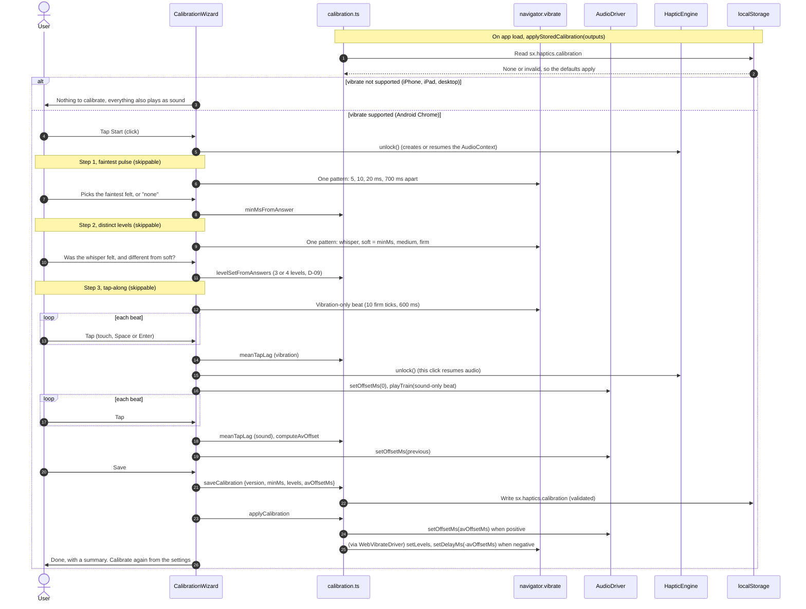

# 13 Sequence: first-use haptic calibration

The first-use calibration that sets the faintest pulse, the number of strength levels a person can tell apart, and the audio–vibration offset, stored per device. Drawn from rendering doc §8.7 and decisions D-09 and D-10, as built in issue #10 (`frontend/src/haptics/calibration.ts`, `haptics/ui/CalibrationWizard.tsx`). The tap-along method is Q-63 **[verify on phones]**.

## Notes

- The wizard runs only where `navigator.vibrate` exists (Q-62). On iPhone, iPad and desktop there is one output, so there is nothing to align and no level to calibrate.
- A skipped step keeps the R8.3 default: soft 8 ms, 3 levels, offset 0. "I felt none" keeps 8 ms and suggests checking vibration settings and battery saver (R12 #11).
- Tick lengths stay strictly increasing; medium and firm are raised when `minMs` is close to them (Q-62).
- The strength multiplier (0.5 to 1.5) is a setting, not part of the calibration. Settings also hold haptics on/off, sound on/off, volume and the texture-vs-data labels toggle (rendering doc §8.7, D-10), in their own key `sx.haptics.settings`.
- The 8 ms soft tick must be felt on both Android phones after calibration (acceptance test, rendering doc §11); the realme 14 Pro's minimum is still **[verify]**.
