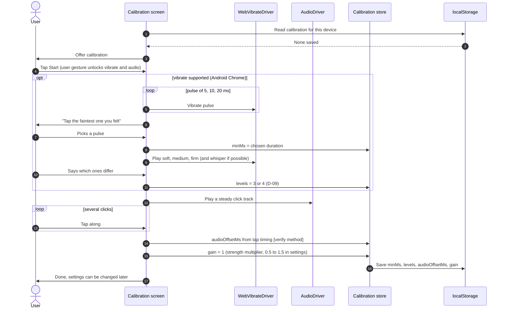

# 13 Sequence: first-use haptic calibration

The first-use calibration that sets the faintest pulse, the number of strength levels a person can tell apart, and the audio offset, stored per device. Drawn from rendering doc §8.7 and decisions D-09 and D-10. The level and tap-along steps follow D-09 and D-10; their exact procedure belongs in rendering doc §8.9 **[verify once written]**.

## Notes

- On iPhone, iPad and desktop the vibration steps are skipped; only the audio steps run (D-08).
- The 8 ms soft tick must be felt on both Android phones after calibration (acceptance test, rendering doc §11); the realme 14 Pro's minimum is still **[verify]**.
- Settings also hold haptics on/off and the separate audio on/off and volume (rendering doc §8.7, D-10).
