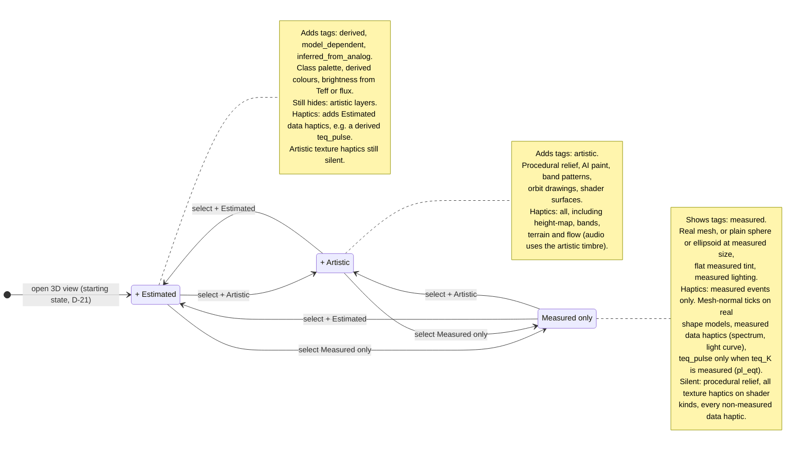

# 14 State: honesty toggle

The three-state honesty toggle in the 3D view, one state per badge: which tags each state shows and which haptics stay active. Drawn from rendering doc §5.3, §7.7, §8.2, §9, §11 (honesty test) and decisions D-02, D-12 and D-21.

## Notes

- One state per badge (D-02, D-21): Measured, Estimated, Default (artistic). The toggle starts at **+ Estimated**, so everything shown on load is backed by data or a stated formula.
- Every visible layer shows a tag chip in the legend. Each state change is announced through `aria-live="polite"` (rendering doc §9).
- Acceptance test: in Measured only no layer with a tag other than `measured` is drawn, and procedural texture haptics are silent (rendering doc §11).
- Haptics use the same filter as the layers (D-21). Whether the comet field pulse, tagged `measured` + `model_dependent` (rendering doc §8.4), plays in Measured only is Q-17.
